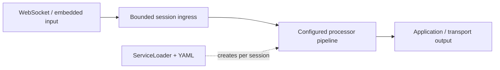

<p align="center">
  
</p>

<p align="center">
  <a href="https://github.com/g5n-dev/ominicat/actions/workflows/ci.yml"></a>
  
  <a href="LICENSE"></a>
</p>

<p align="center"><strong>High throughput. Measured latency. A small Java kernel.</strong><br>
<a href="README.zh-CN.md">简体中文</a> · <a href="#quick-start">Quick start</a> · <a href="docs/architecture.md">Architecture</a> · <a href="docs/plugins.md">Build a plugin</a> · <a href="#performance-on-java-17">Performance</a></p>

OminiCat is a **high-performance Java microkernel for multimodal conversation pipelines**. Embed it in an application or run it as a standalone WebSocket container. Typed frames connect transport, speech, language, vision, and conversation processors through a small plugin contract.

**Status:** early 0.1 development preview. APIs and configuration may evolve. The repository includes executable tests and reproducible profiling tools; the recorded kernel baseline is not a production capacity claim.

**Runtime:** Java 17 is the minimum for building and running every module. Java 21+ automatically uses virtual workers. See [Java compatibility and verification](docs/java-compatibility.md).

[Java 17 verification](reports/java17/README.md): **244 passing tests**, 512-seed lifecycle checks, real protocol faults, CPU/allocation profiles and a **120-second exact-artifact mixed-media run** with 138,388 validated frames, zero failures and complete resource drain. [Historical Java 21 evidence](reports/deep/README.md) retains its original source/artifact boundaries.

## Performance on Java 17

High throughput and low scheduling overhead, backed by [reproducible measurements](reports/java17/kernel/report.md):

| Measurement | Recorded result | Workload |
| --- | ---: | --- |
| Synchronous dispatch | **40.54M ops/s** | Four numeric-transform stages; one JMH thread |
| Session round trip | **7.104 µs/op** | Four stages; one outstanding frame; average including queue, worker and output handoff |
| Dispatch allocation | **328 B/op** | Four-stage synchronous numeric-frame workload |
| Bounded concurrent load | **2.706M frames/s** | 16 sessions × four stages; p99 **1.436 ms**; 25M measured frames, zero rejections |

Java 17.0.21, Apple M2 Pro / macOS arm64, 512 MiB heap, platform workers. JMH used two forks, three 1-second warmup iterations and five 1-second measurement iterations. The host was shared with development and validation work. These are in-memory numeric-frame measurements; network exchanges and model calls have separate timing scopes. [Raw JMH](reports/java17/kernel/jmh.json) · [Load data](reports/java17/kernel/load.json) · [CPU, allocation and GC profiles](reports/java17/kernel/profiles.md).

The design keeps the execution path small and overload explicit:

- **Direct typed-frame dispatch:** the JDK-only kernel passes frames through processor calls; synchronous embedding can use the path without session scheduling or JSON conversion.
- **One owner per session:** linear stages run serially on the session worker; explicit parallel branches use bounded branch workers. Asynchronous callbacks rejoin the session queue. Independent sessions progress concurrently.
- **Bounded work and backpressure:** ingress, active async work, branch parallelism/buffers and transport output have explicit limits. Saturation produces observable rejection or closure.
- **Workers for the selected JDK:** Java 17 uses platform threads; Java 21+ automatically uses virtual threads. The container runs blocking processor work outside Netty's transport event loops.

[Performance design and methodology](docs/performance.md) · [Resource timeline and fault verification](reports/java17/README.md).

## Quick start

Install **JDK 17 or newer**, then build and run the credential-free demo:

```sh
git clone https://github.com/g5n-dev/ominicat.git
cd ominicat
./mvnw -B verify
java -jar ominicat-server/target/ominicat-server.jar --config config/demo.yaml
```

Open **[localhost:8080](http://127.0.0.1:8080)**. The bundled playground sends text, a microphone recording, images, and speaker-attributed transcripts. The default `echo` pipeline returns your input, so the entire path can be checked without an external model.

```sh
curl http://127.0.0.1:8080/health
curl http://127.0.0.1:8080/metrics
```

Using an existing Maven installation also works: `mvn -B verify` requires Maven 3.9 or newer.

## A kernel, with replaceable capabilities

The core owns frame flow, session scheduling, bounded queues, cancellation fences, and processor lifecycle. Provider and transport code lives outside it. YAML selects plugins; Java `ServiceLoader` discovers them. Every WebSocket connection gets fresh processor instances and its own worker (platform thread on Java 17; virtual thread on Java 21+).



| Module | Responsibility | Production dependencies |
| --- | --- | --- |
| `ominicat-core` | Frames, envelopes, pipelines, session lifecycle, plugin SPI | JDK only |
| `ominicat-conversation` | Bounded transcript windows, policies, prompt composition | Core |
| `ominicat-providers` | Compatible model adapters, echo, energy-based VAD | Core, Jackson |
| `ominicat-server` | Embedded/standalone Netty container, YAML, browser playground | Runtime modules, Netty, Jackson YAML |
| `ominicat-benchmarks` | JMH, allocation measurements, queue-inclusive load driver | Core, JMH |

The open `Frame` interface supports application events alongside `Text`, PCM16 `Audio`, encoded `Image`, revision-aware `Transcript`, classified `Failure`, and explicit `Cancel` frames. Optional `FrameEnvelope` metadata preserves event, session, turn, correlation and causation identities through configured stages. See [architecture](docs/architecture.md) and the [wire protocol](docs/protocol.md).

## Configure a pipeline

```yaml
host: 127.0.0.1
port: 8080
queueCapacity: 256
maxSessions: 256
maxFrameBytes: 1048576
idleTimeoutSeconds: 60
stages:
  - type: echo
    options: {}
```

Swap stages without changing the kernel. For a model pipeline, select provider plugins and reference credentials through environment-variable names. Startup checks configured factories before binding; session state stays isolated. See [configuration](docs/configuration.md) for limits, authentication, and examples.

| Capability | Included behavior |
| --- | --- |
| Text and vision | OpenAI-compatible Chat Completions with streamed SSE text; encoded image input |
| Speech recognition | PCM utterance uploaded as WAV over HTTP, producing a final transcript |
| Speech synthesis | Text collected until a turn boundary, then returned as 24 kHz mono PCM |
| Voice activity | Deterministic RMS energy detector with configurable silence duration |
| Conversation state | Bounded final transcript windows, stable segment IDs, policy evidence, prompt templates |
| Transport | JSON over WebSocket, explicit overload handling, bearer authentication, Prometheus metrics |

Speech recognition and synthesis adapters use **utterance/turn requests**. They do not provide continuous provider-native streaming ASR/TTS, WebRTC, acoustic echo cancellation, or automatic speaker diarization. The browser supports manual interruption. The [scenario coverage matrix](docs/scenario-coverage.md) distinguishes implemented behavior from extension points.

Ready-to-edit configurations include [voice](config/voice.yaml), [vision](config/vision.yaml), [separate audio tracks](config/dual-stream.yaml), [transcript policies](config/conversation.yaml), and [a step sequence](config/steps.yaml).

## Embed the runtime

```java
import io.ominicat.core.*;

var pipeline = Pipeline.builder()
    .add((frame, next) -> next.accept(frame))
    .build();

try (var session = pipeline.openSession(SessionOptions.defaults(), System.out::println)) {
    if (!session.trySubmit(new Frame.Text("Hello, OminiCat."))) {
        throw new IllegalStateException("Session input is full or closed");
    }
    session.finish();
    session.completion().join();
}
```

Processors can emit zero, one, or many frames. Blocking provider I/O runs on session workers. `finish()` drains accepted work; `interrupt()` fences stale emissions and prepares a new generation; `close()` cancels cooperatively and `completion()` joins cleanup. Construct a fresh pipeline for each session.

## Add a plugin

Implement one factory and register its class in `META-INF/services/io.ominicat.core.spi.ProcessorFactory`:

```java
package example;

import io.ominicat.core.*;
import io.ominicat.core.spi.ProcessorFactory;
import java.util.Locale;
import java.util.Map;

public final class UppercaseFactory implements ProcessorFactory {
    public String type() { return "uppercase"; }

    public Processor create(Map<String, String> options) {
        if (!options.isEmpty()) throw new IllegalArgumentException("uppercase accepts no options");
        return (frame, next) -> {
            if (frame instanceof Frame.Text text) {
                next.accept(new Frame.Text(text.text().toUpperCase(Locale.ROOT)));
            } else {
                next.accept(frame);
            }
        };
    }
}
```

The service file contains `example.UppercaseFactory`; a YAML stage with `type: uppercase` selects it. Factories validate options, create isolated state, and return processors that honor interruption and clean up resources. [Plugin development](docs/plugins.md) covers lifecycle and richer compositions.

## Measure what runs

```sh
# Tests, per-module HTML coverage, and a dependency inventory
./mvnw -B -Pcoverage,sbom verify

# Forked JMH + allocation profiling, bounded-session load, JFR and GC logs
./scripts/profile.sh quick reports/latest
```

The [Java 17 kernel report](reports/java17/kernel/report.md) records throughput, latency and allocation together. Its [CPU/allocation profiles](reports/java17/kernel/profiles.md) expose worker scheduling, invocation guards and harness costs; the [resource timeline](reports/java17/soak-resources.svg) follows the separate mixed-media transport workload. The [performance guide](docs/performance.md) explains reproduction and sizing for the selected JDK.

[Earlier Java 21 measurements](reports/deep/kernel/comparison.md) retain their original source/artifact scope and disclose the allocation and throughput cost of invocation guards.

## Documentation

- [Architecture and lifecycle](docs/architecture.md)
- [Configuration and deployment](docs/configuration.md)
- [Frame protocol and metadata](docs/protocol.md)
- [Plugin development](docs/plugins.md)
- [Scenario coverage and current limits](docs/scenario-coverage.md)
- [Performance methodology](docs/performance.md) and [Java 17 measurements](reports/java17/kernel/report.md)
- [Conversation primitives](ominicat-conversation/README.md)

## License

[Apache License 2.0](LICENSE).
