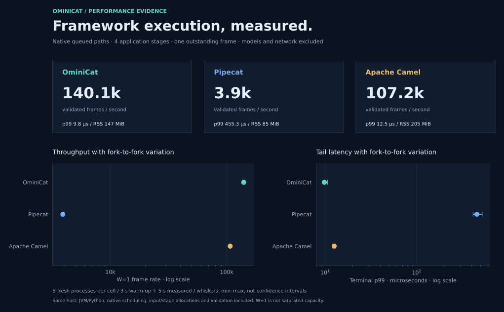
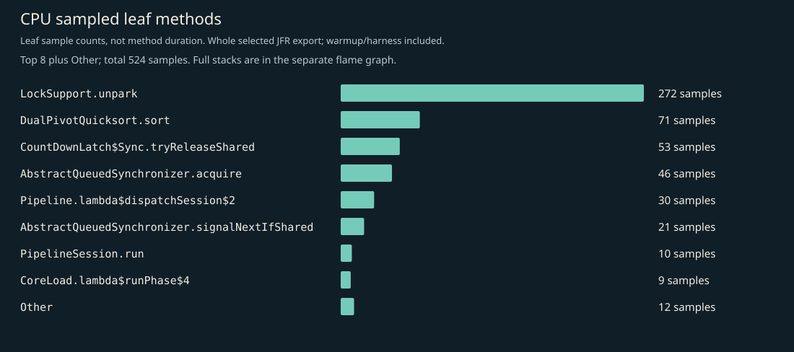
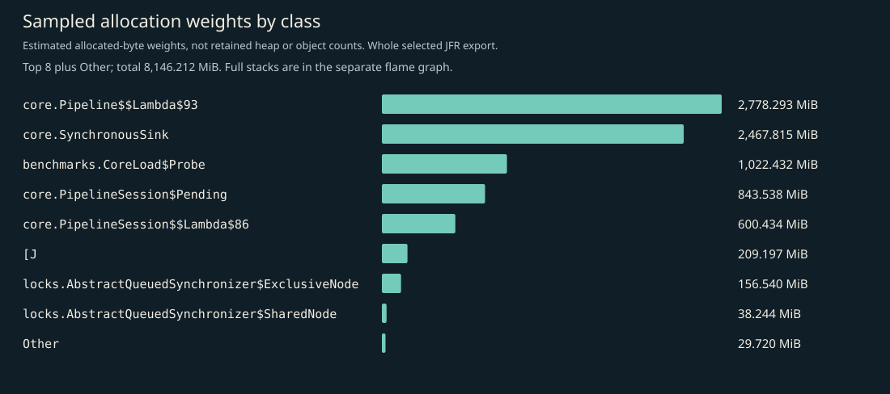
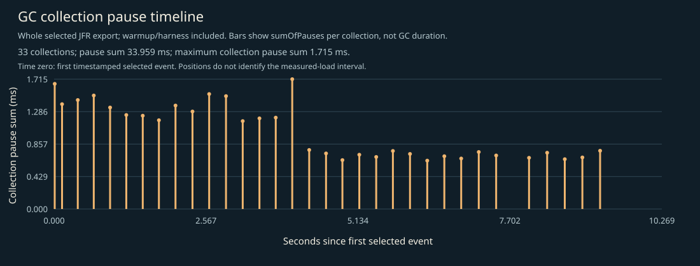
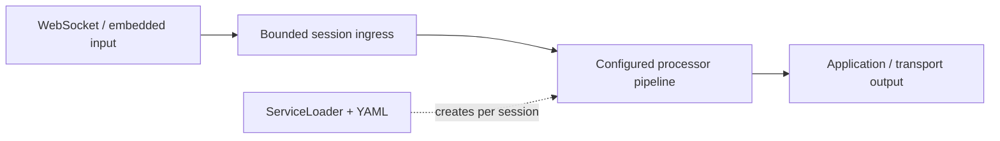

<p align="center">
  
</p>

<p align="center">
  <a href="https://github.com/g5n-dev/ominicat/actions/workflows/ci.yml"></a>
  
  <a href="LICENSE"></a>
</p>

<p align="center"><strong>High throughput. Measured latency. A small Java kernel.</strong><br>
<a href="README.zh-CN.md">简体中文</a> · <a href="#quick-start">Quick start</a> · <a href="docs/architecture.md">Architecture</a> · <a href="docs/plugins.md">Build a plugin</a> · <a href="#performance-on-java-17">Performance</a> · <a href="#profiles">Profiles</a></p>

OminiCat is a **high-performance Java microkernel for multimodal conversation pipelines**. Embed it in an application or run it as a standalone WebSocket container. Typed frames connect transport, speech, language, vision, and conversation processors through a small plugin contract.

**Status:** early 0.1 development preview. APIs and configuration may evolve. The repository includes executable tests and reproducible profiling tools; the recorded kernel baseline is not a production capacity claim.

**Runtime:** Java 17 is the minimum for building and running every module. Java 21+ automatically uses virtual workers. See [Java compatibility and verification](docs/java-compatibility.md).

[Java 17 verification](reports/verification.md): **297 passing tests**, 512-seed lifecycle checks and real protocol faults, including cancellation while HTTP response bodies remain open. [Recorded kernel/resource profiles](reports/java17/http-cancellation/README.md) and [historical Java 21 evidence](reports/deep/README.md) retain their source/artifact boundaries.

## Performance on Java 17

High throughput and low scheduling overhead, backed by [reproducible measurements](reports/java17/kernel/report.md):

| Measurement | Recorded result | Workload |
| --- | ---: | --- |
| Synchronous dispatch | **40.54M ops/s** | Four numeric-transform stages; one JMH thread |
| Session round trip | **7.104 µs/op** | Four stages; one outstanding frame; average including queue, worker and output handoff |
| Dispatch allocation | **328 B/op** | Four-stage synchronous numeric-frame workload |
| Bounded concurrent load | **2.706M frames/s** | 16 sessions × four stages; p99 **1.436 ms**; 25M measured frames, zero rejections |

Java 17.0.21, Apple M2 Pro / macOS arm64, 512 MiB heap, platform workers. JMH used two forks, three 1-second warmup iterations and five 1-second measurement iterations. The host was shared with development and validation work. These are in-memory numeric-frame measurements; network exchanges and model calls have separate timing scopes. [Raw JMH](reports/java17/kernel/jmh.json) · [Load data](reports/java17/kernel/load.json) · [CPU, allocation and GC profiles](reports/java17/kernel/profiles.md).

The design keeps the execution path small and overload explicit:

- **Direct typed-frame dispatch:** the JDK-only kernel passes frames through processor calls; synchronous embedding can use the path without session scheduling or JSON conversion.
- **One owner per session:** linear stages run serially on the session worker; explicit parallel branches use bounded branch workers. Asynchronous callbacks rejoin the session queue. Independent sessions progress concurrently.
- **Bounded work and backpressure:** ingress, active async work, branch parallelism/buffers and transport output have explicit limits. Saturation produces observable rejection or closure.
- **Workers for the selected JDK:** Java 17 uses platform threads; Java 21+ automatically uses virtual threads. The container runs blocking processor work outside Netty's transport event loops.

[Performance design and methodology](docs/performance.md) · [Resource timeline and fault verification](reports/java17/http-cancellation/README.md).

## Framework comparison

A separate **model-free queued-path comparison** runs OminiCat, Pipecat 1.15.0 and Apache Camel 4.22.2 LTS on the same Apple M2 Pro. Each uses immutable numeric frames, 1 / 4 / 16 application stages and one outstanding frame. Pipecat is the multimodal peer; Camel is the Java routing reference. All **45 fresh-process runs** passed exact output and cleanup checks, validating **18,659,525 measured frames**.



| Four-stage native queued path | Frames/s · W=1 | Terminal p99 | Sampled peak process RSS |
| --- | ---: | ---: | ---: |
| **OminiCat** | **140,089** | **9.79 µs** | 147.0 MiB |
| Pipecat 1.15.0 | 3,906 | 455.29 µs | **85.0 MiB** |
| Apache Camel 4.22.2 LTS | 107,210 | 12.54 µs | 205.4 MiB |

Medians of five independent processes per cell, each with 3 seconds of warmup and 5 seconds of measurement; the figures retain min–max ranges. Java 17 and CPython 3.12 use their native queued implementations. Runtime, frame-object and scheduler differences remain included; W=1 frame rate is not saturated capacity. Pipecat uses less process RSS in this profile. RSS includes each runtime, dependencies and the common 16 MiB harness buffer; it is not B/op.

[Complete comparison, stage scaling and resources](reports/comparison/java17-2026-10-31/README.md) · [Raw results and source/runtime manifest](reports/comparison/java17-2026-10-31/suite.json) · [Reproduce](comparison/README.md) · [CPU / allocation / GC diagnostics](reports/comparison/java17-2026-10-31/profiles/README.md).

### Linux CI evidence

Relevant pull requests and main pushes automatically run the full comparison on **Ubuntu 24.04** and **CentOS Stream 9 user space**, with manual dispatch available. Both Linux jobs passed: **90 fresh processes, 17,406,385 validated measured outputs**, plus separate CPU/allocation/GC and Python call diagnostics.

| Independent Linux job | OminiCat frames/s | Pipecat frames/s | Camel frames/s | Evidence |
| --- | ---: | ---: | ---: | --- |
| Ubuntu 24.04 native · EPYC 9V74 | **49,084** | 5,300 | 42,756 | [Figures and profiles](reports/comparison/linux-ubuntu24-java17-2026-10-31/README.md) |
| CentOS Stream 9 user space · EPYC 9V45 | **66,567** | 10,019 | 59,527 | [Figures and profiles](reports/comparison/linux-centos9-java17-2026-10-31/README.md) |

Four-stage W=1 medians of five processes per cell. Compare frameworks within each row: different hosts and JDK builds prevent an isolated OS ranking. CentOS uses a digest-pinned official container and shares its Ubuntu runner kernel. [Linux figures, every raw result and CI provenance](reports/comparison/README.md) · [Workflow and downloadable artifacts](https://github.com/g5n-dev/ominicat/actions/workflows/framework-comparison.yml).


## Profiles

### CPU, allocation and GC

The recorded **Java 17 kernel profile** contains 524 CPU stack samples and 2,814 allocation samples. It covers warmup, the bounded numeric-frame load and the measurement harness, including percentile sorting. These summaries show CPU leaf samples and allocation classes. Allocation weights estimate allocated bytes, rather than retained heap or object counts.





<details>
<summary>Explore the full CPU and allocation stacks</summary>

The original recording was re-exported with an explicit 64-frame limit, recovering stacks up to 46 frames deep. The earlier export showed only five frames. Event counts, timestamps and measurement results are unchanged. Open the SVGs to inspect individual frames.

[CPU flame graph](reports/java17/kernel/cpu-flamegraph.svg) · [Allocation flame graph](reports/java17/kernel/allocation-flamegraph.svg)


</details>



| Kernel JFR observation | Recorded value |
| --- | ---: |
| Garbage collections | **33** |
| Cumulative GC pause time | **33.959 ms** |
| Largest per-collection pause sum | **1.715 ms** |

GC values describe the whole kernel recording, including warmup and harness work. [Profile analysis](reports/java17/kernel/profiles.md) · [Selected JFR events](reports/java17/kernel/jfr-events.json.gz) · [GC log](reports/java17/kernel/gc.txt) · [Source/runtime context](reports/java17/kernel/measurement-context.json). The current distribution retains the same core bytecode, as recorded in the [artifact delta](reports/java17/http-cancellation/artifact-delta.json).

### Heap, direct memory and threads

This separate **120.127-second mixed-media WebSocket echo probe** used 64 persistent clients paced at approximately 20 frames/s each, plus four churn workers with a 100 ms pause between cycles, after ten seconds of warmup. It validated **138,239 frames** and **4,377 new connections**, with zero failures and complete session/worker/output drain. It used a 256 MiB heap and a 128 MiB direct-memory limit.


| Resource | After warmup | After drain |
| --- | ---: | ---: |
| Heap used after requested full GC | 12.687 MiB | 7.795 MiB |
| Netty pooled direct reservation | 16 MiB | 16 MiB |
| Open file descriptors | 96 | 32 |
| Platform threads | 80 | 16 |

The timeline shows periodic traffic samples; heap samples include objects awaiting collection. Post-drain NMT committed memory was **484.658 MiB**, including the fixed heap, native thread stacks, JVM internals and profiling; this differs from RSS. [Resource report](reports/java17/http-cancellation/README.md) · [Numeric samples](reports/java17/http-cancellation/soak-samples.jsonl) · [Post-GC comparison](reports/java17/http-cancellation/soak-summary.json) · [Native-memory diagnostics](reports/java17/http-cancellation/resource-diagnostics.json). The kernel profiles and this resource probe retain their separate workloads and artifacts.

### Generate profiles locally

With JDK 17+ and Python 3:

```sh
./scripts/profile.sh quick reports/local/profile
```

This produces `report.md`, `profiles.md`, CPU/allocation summaries and full-stack SVGs, a GC pause timeline, and local JFR/GC evidence. To regenerate the figures from a retained selected-event export, run `python3 scripts/summarize_profiles.py reports/local/profile`. Use `full` for longer JMH warmup and measurement. [Profiling methodology](docs/performance.md) · [Sustained-resource reproduction](validation/README.md).

## Quick start

Install **JDK 17 or newer**, then build and run the credential-free demo:

```sh
git clone https://github.com/g5n-dev/ominicat.git
cd ominicat
./mvnw -B verify
java -jar ominicat-server/target/ominicat-server.jar --config config/demo.yaml
```

Open **[localhost:8080](http://127.0.0.1:8080)**. **OminiCat Studio** starts with a task execution board: inspect content, actual processing stages, observed outputs and animated handoffs, then enter the separate pipeline debugger to send text, a microphone utterance, images or transcripts. The default `echo` pipeline returns your input without an external model.


[Studio guide and debugger](docs/studio.md) · [Three-stage offline example](config/studio.yaml) · [Browser and resource verification](reports/studio/README.md).

```sh
curl http://127.0.0.1:8080/health
curl http://127.0.0.1:8080/metrics
```

Using an existing Maven installation also works: `mvn -B verify` requires Maven 3.9 or newer.

## A kernel, with replaceable capabilities

The core owns frame flow, session scheduling, bounded queues, cancellation fences, and processor lifecycle. Provider and transport code lives outside it. YAML selects plugins; Java `ServiceLoader` discovers them. Every WebSocket connection gets fresh processor instances and its own worker (platform thread on Java 17; virtual thread on Java 21+).



| Module | Responsibility | Production dependencies |
| --- | --- | --- |
| `ominicat-core` | Frames, envelopes, pipelines, session lifecycle, plugin SPI | JDK only |
| `ominicat-conversation` | Bounded transcript windows, policies, prompt composition, optional media references | Core |
| `ominicat-providers` | Compatible model adapters, echo, energy-based VAD | Core, Jackson |
| `ominicat-server` | Embedded/standalone Netty container, YAML, browser playground | Runtime modules, Netty, Jackson YAML |
| `ominicat-benchmarks` | JMH, allocation measurements, queue-inclusive load driver | Core, JMH |

The open `Frame` interface supports application events alongside `Text`, PCM16 `Audio`, encoded `Image`, revision-aware `Transcript`, classified `Failure`, and explicit `Cancel` frames. Optional `FrameEnvelope` metadata preserves event, session, turn, correlation and causation identities through configured stages. See [architecture](docs/architecture.md) and the [wire protocol](docs/protocol.md).

## Configure a pipeline

```yaml
host: 127.0.0.1
port: 8080
queueCapacity: 256
maxSessions: 256
maxFrameBytes: 1048576
idleTimeoutSeconds: 60
stages:
  - type: echo
    options: {}
```

Swap stages without changing the kernel. For a model pipeline, select provider plugins and reference credentials through environment-variable names. Startup checks configured factories before binding; session state stays isolated. See [configuration](docs/configuration.md) for limits, authentication, and examples.

| Capability | Included behavior |
| --- | --- |
| Text and vision | OpenAI-compatible Chat Completions with streamed SSE text; encoded image input |
| Speech recognition | PCM utterance uploaded as WAV over HTTP, producing a final transcript |
| Speech synthesis | Text collected until a turn boundary, then returned as 24 kHz mono PCM |
| Voice activity | Deterministic RMS energy detector with configurable silence duration |
| Conversation state | Bounded final transcript windows, stable segment IDs, policy evidence, prompt templates |
| Media references | Optional source/producer-scoped range versions, explicit frame boundaries and bounded binary import/export; [Java API](docs/media-references.md) |
| Transport | JSON over WebSocket, explicit overload handling, bearer authentication, Prometheus metrics |

Speech recognition and synthesis adapters use **utterance/turn requests**. They do not provide continuous provider-native streaming ASR/TTS, WebRTC, acoustic echo cancellation, or automatic speaker diarization. The browser supports manual interruption. The [scenario coverage matrix](docs/scenario-coverage.md) distinguishes implemented behavior from extension points.

Ready-to-edit configurations include [voice](config/voice.yaml), [vision](config/vision.yaml), [separate audio tracks](config/dual-stream.yaml), [transcript policies](config/conversation.yaml), and [a step sequence](config/steps.yaml).

## Embed the runtime

```java
import io.ominicat.core.*;

var pipeline = Pipeline.builder()
    .add((frame, next) -> next.accept(frame))
    .build();

try (var session = pipeline.openSession(SessionOptions.defaults(), System.out::println)) {
    if (!session.trySubmit(new Frame.Text("Hello, OminiCat."))) {
        throw new IllegalStateException("Session input is full or closed");
    }
    session.finish();
    session.completion().join();
}
```

Processors can emit zero, one, or many frames. Blocking provider I/O runs on session workers. `finish()` drains accepted work; `interrupt()` fences stale emissions and prepares a new generation; `close()` cancels cooperatively and `completion()` joins cleanup. Construct a fresh pipeline for each session.

## Add a plugin

Implement one factory and register its class in `META-INF/services/io.ominicat.core.spi.ProcessorFactory`:

```java
package example;

import io.ominicat.core.*;
import io.ominicat.core.spi.ProcessorFactory;
import java.util.Locale;
import java.util.Map;

public final class UppercaseFactory implements ProcessorFactory {
    public String type() { return "uppercase"; }

    public Processor create(Map<String, String> options) {
        if (!options.isEmpty()) throw new IllegalArgumentException("uppercase accepts no options");
        return (frame, next) -> {
            if (frame instanceof Frame.Text text) {
                next.accept(new Frame.Text(text.text().toUpperCase(Locale.ROOT)));
            } else {
                next.accept(frame);
            }
        };
    }
}
```

The service file contains `example.UppercaseFactory`; a YAML stage with `type: uppercase` selects it. Factories validate options, create isolated state, and return processors that honor interruption and clean up resources. [Plugin development](docs/plugins.md) covers lifecycle and richer compositions.

## Measure what runs

```sh
# Tests, per-module HTML coverage, and a dependency inventory
./mvnw -B -Pcoverage,sbom verify

# Forked JMH + allocation profiling, bounded-session load, JFR and GC logs
./scripts/profile.sh quick reports/latest
```

The [inline profiles above](#profiles) show CPU, allocation, GC and resource evidence. The [Java 17 kernel report](reports/java17/kernel/report.md) records throughput, latency and allocation together. Its [CPU/allocation profiles](reports/java17/kernel/profiles.md) expose worker scheduling, invocation guards and harness costs; the [resource timeline](reports/java17/http-cancellation/soak-resources.svg) follows the separate mixed-media transport workload. The [performance guide](docs/performance.md) explains reproduction and sizing for the selected JDK.

[Earlier Java 21 measurements](reports/deep/kernel/comparison.md) retain their original source/artifact scope and disclose the allocation and throughput cost of invocation guards.

## Documentation

- [Architecture and lifecycle](docs/architecture.md)
- [Configuration and deployment](docs/configuration.md)
- [Frame protocol and metadata](docs/protocol.md)
- [Plugin development](docs/plugins.md)
- [Scenario coverage and current limits](docs/scenario-coverage.md)
- [Immutable media references and import/export](docs/media-references.md)
- [Studio operation overview and pipeline debugger](docs/studio.md)
- [Performance methodology](docs/performance.md) and [Java 17 measurements](reports/java17/kernel/report.md)
- [Iteration plan and acceptance criteria](docs/iteration-plan.md)
- [Cross-project integration contract proposal](docs/integration-contracts.md)
- [Temporal segment and annotation contract proposal](docs/temporal-annotations.md)
- [Conversation primitives](ominicat-conversation/README.md)

## License

[Apache License 2.0](LICENSE).
