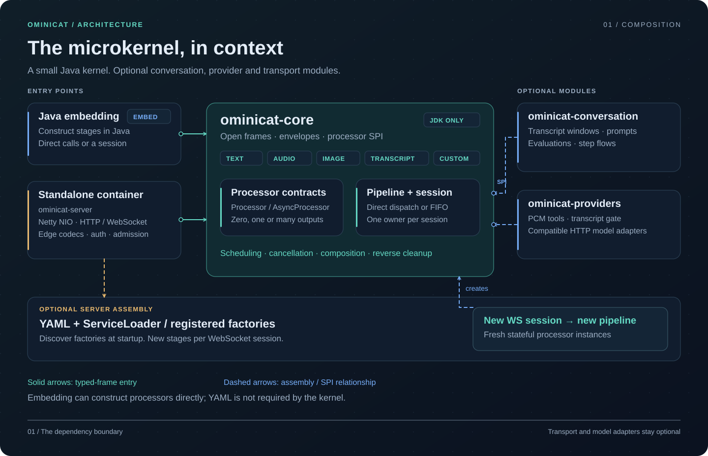
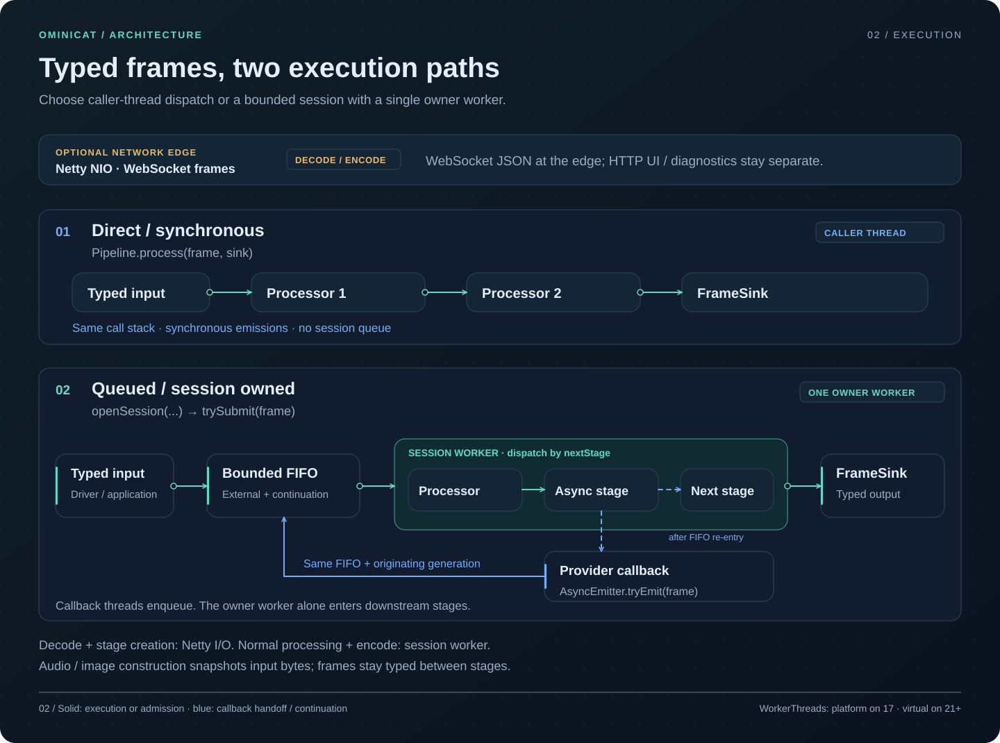
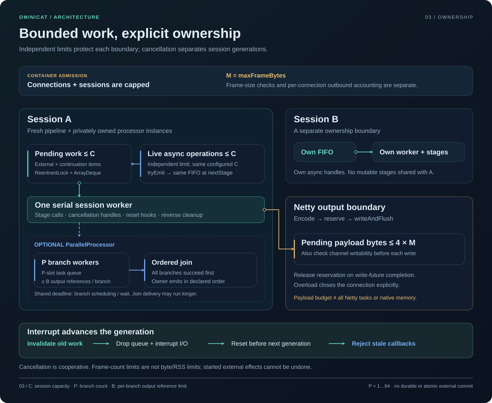

<p align="center">
  
</p>

<p align="center">
  <a href="https://github.com/g5n-dev/ominicat/actions/workflows/ci.yml"></a>
  
  <a href="LICENSE"></a>
</p>

<p align="center"><strong>High throughput. Measured latency. A small Java kernel.</strong><br>
<a href="README.zh-CN.md">简体中文</a> · <a href="#quick-start">Quick start</a> · <a href="docs/architecture.md">Architecture</a> · <a href="docs/plugins.md">Build a plugin</a> · <a href="#linux-performance-on-java-17">Performance</a> · <a href="#profiles">Profiles</a></p>

OminiCat is a **high-performance Java microkernel for multimodal conversation pipelines**. Embed it in an application or run it as a standalone WebSocket container. Typed frames connect transport, speech, language, vision, and conversation processors through a small plugin contract.

**Status:** early 0.1 development preview. APIs and configuration may evolve. The repository includes executable tests and reproducible profiling tools; the recorded kernel baseline is not a production capacity claim.

**Runtime:** Java 17 is the minimum for building and running every module. Java 21+ automatically uses virtual workers. See [Java compatibility and verification](docs/java-compatibility.md).

[Java 17 verification](reports/verification.md): **297 passing runtime tests** and 512-seed lifecycle checks. CI verifies Java 17, 21 and 25, the runnable distribution and container lifecycle.

## Linux performance on Java 17

The published comparison runs **OminiCat, Pipecat 1.15.0 and Apache Camel 4.22.2 LTS** on Linux. Both environments passed their complete matrices: **90 fresh processes and 17,406,385 validated measured outputs**. Models, network and codecs are outside this numeric-frame workload; native runtime, scheduling, frame allocation and output validation remain included.

### Ubuntu 24.04 / native x86_64

Four available logical processors, AMD EPYC 9V74, Temurin 17.0.21 and CPython 3.12.15. Four application stages, one outstanding frame (**W=1**):

| Framework | Frames/s · W=1 | Terminal p99 | Sampled peak process RSS |
| --- | ---: | ---: | ---: |
| **OminiCat** | **49,084** | **17.30 µs** | 144.1 MiB |
| Pipecat 1.15.0 | 5,300 | 220.35 µs | **93.5 MiB** |
| Apache Camel 4.22.2 LTS | 42,756 | 20.41 µs | 188.7 MiB |


Each cell contains five independent processes, each with three seconds warmup and five seconds measured. Tables show medians; plots retain observed min–max ranges. W=1 frame rate measures a closed client loop, not saturated throughput or production session capacity. RSS includes each runtime, dependencies and a common 16 MiB sample buffer; it is not framework-only allocation or B/op.

### CentOS Stream 9 / container user space

Four available logical processors, AMD EPYC 9V45, distribution OpenJDK 17.0.20.1 and CPython 3.12.15. The official image is digest-pinned and shares its Ubuntu runner kernel.

| Framework | Frames/s · W=1 | Terminal p99 | Sampled peak process RSS |
| --- | ---: | ---: | ---: |
| **OminiCat** | **66,567** | **12.44 µs** | 145.3 MiB |
| Pipecat 1.15.0 | 10,019 | 130.88 µs | **88.0 MiB** |
| Apache Camel 4.22.2 LTS | 59,527 | 13.78 µs | 188.9 MiB |

Compare frameworks within each environment. The jobs use different CPU models and JDK builds, so the two tables do not isolate operating-system effects. Pipecat has lower process RSS in both recorded profiles.

<details>
<summary>View the CentOS comparison figure</summary>


</details>

[All Linux figures, ranges and raw processes](reports/comparison/README.md) · [Recorded CI run](https://github.com/g5n-dev/ominicat/actions/runs/41222330745) · [Reproduce](comparison/README.md) · [Automatic Linux workflow](https://github.com/g5n-dev/ominicat/actions/workflows/framework-comparison.yml).

## Microkernel architecture

The kernel keeps execution mechanisms separate from capabilities. Applications can call a typed pipeline directly or open a bounded session; the standalone container adds Netty transport, wire codecs and YAML assembly. Conversation logic and provider adapters remain optional modules.



## Why the execution path stays small

| Mechanism | Cost it controls | Implementation and boundary |
| --- | --- | --- |
| **Direct typed-frame calls** | Synchronous stages call the next stage without an internal wire codec, stage queue or thread handoff. | [Pipeline](ominicat-core/src/main/java/io/ominicat/core/Pipeline.java) still allocates scoped sinks and continuations to enforce invocation lifetime. |
| **One owner for linear session work** | A session worker runs synchronous stages, reset hooks and cleanup serially; callbacks rejoin that worker at the next stage. | [PipelineSession](ominicat-core/src/main/java/io/ominicat/core/PipelineSession.java) uses a lock and FIFO. Pending entries and active async handles have separate count limits. |
| **Explicit parallelism and output pressure** | Branch worker/buffer limits and transport output checks make overload observable. | [ParallelProcessor](ominicat-core/src/main/java/io/ominicat/core/ParallelProcessor.java) buffers frame references; [server output](ominicat-server/src/main/java/io/ominicat/server/OminiCatServer.java) budgets pending payload bytes. These are separate limits, not a total-memory cap. |
| **Assembly outside frame dispatch** | Pipeline stages are selected and created before processing their frames. JDK worker capability discovery happens during factory initialization. | [PluginRegistry](ominicat-core/src/main/java/io/ominicat/core/spi/PluginRegistry.java) and [WorkerThreads](ominicat-core/src/main/java/io/ominicat/core/WorkerThreads.java); Java 17 uses platform workers, 21+ selects virtual workers. |
| **Immutable media ownership** | Existing frame instances can cross stages by reference without exposing mutable payload storage. | [Media constructors](ominicat-core/src/main/java/io/ominicat/core/Frame.java) defensively copy bytes; getters create read-only views. This has allocation costs and is not end-to-end zero-copy. |



In the container, processor work runs on session workers. JSON decoding and connection assembly still occur on Netty's I/O callbacks; the runtime does not move every operation off the event loop. The Linux numbers above use Java 17 platform workers and therefore do not demonstrate a virtual-thread speedup.

These mechanisms explain where the implementation controls work and overhead. The comparison measures the complete tested paths; it does not assign a measured speedup to each individual design choice.

### Bounded work and cancellation

Pending frames, active async invocations, branch workers/buffers and transport output each have their own limit. In an open session, an interrupt advances its generation, clears pending work and fences late callbacks. `finish()` waits for accepted work and outstanding async invocations; plugin cooperation determines how promptly cancellation completes.



[Source-backed architecture and lifecycle](docs/architecture.md) · [Performance mechanisms and measurement scope](docs/performance.md) · [Configuration and limits](docs/configuration.md).

## Linux profiles

The following **Ubuntu / Java 17** JFR diagnostics were collected in a separate instrumented run: **41 CPU stack samples, 445 allocation samples and three garbage collections**. Their scope includes JVM/framework startup, warmup, measurement, harness work and teardown. Sample counts are observations, not method-duration percentages; allocation weights estimate allocated bytes, not retained heap or exact B/op.


The recorded GC pause sum is **4.876 ms**, with a largest per-collection pause sum of **2.580 ms**. Sparse CPU samples and sampled allocations identify observations to investigate; they do not prove the causal contribution of an optimization. Instrumented timings are excluded from the 90-process comparison.

<details>
<summary>Full exported stacks and peer diagnostics</summary>

[Ubuntu CPU flame graph](reports/comparison/linux-ubuntu24-java17-2026-10-31/profiles/ominicat/cpu-flamegraph.svg) · [Ubuntu allocation flame graph](reports/comparison/linux-ubuntu24-java17-2026-10-31/profiles/ominicat/allocation-flamegraph.svg) · [Ubuntu OminiCat / Camel / Pipecat diagnostics](reports/comparison/linux-ubuntu24-java17-2026-10-31/profiles/README.md) · [CentOS diagnostics](reports/comparison/linux-centos9-java17-2026-10-31/profiles/README.md).

</details>

Relevant kernel, comparison, build and profiling changes trigger the Linux workflow for pull requests and main pushes. Each complete run publishes figures, raw numeric results, source/runtime manifests and checksums in a downloadable artifact retained for 30 days. The committed Linux baseline remains available independently of artifact expiry. [Collection and publication scope](comparison/README.md#linux-ci).

## Quick start

Install **JDK 17 or newer**, then build and run the credential-free demo:

```sh
git clone https://github.com/g5n-dev/ominicat.git
cd ominicat
./mvnw -B verify
java -jar ominicat-server/target/ominicat-server.jar --config config/demo.yaml
```

Open **[localhost:8080](http://127.0.0.1:8080)**. **OminiCat Studio** starts with a task execution board: inspect content, actual processing stages, observed outputs and animated handoffs, then enter the separate pipeline debugger to send text, a microphone utterance, images or transcripts. The default `echo` pipeline returns your input without an external model.


[Studio guide and debugger](docs/studio.md) · [Three-stage offline example](config/studio.yaml) · [Browser and resource verification](reports/studio/README.md).

```sh
curl http://127.0.0.1:8080/health
curl http://127.0.0.1:8080/metrics
```

Using an existing Maven installation also works: `mvn -B verify` requires Maven 3.9 or newer.

## A kernel, with replaceable capabilities

The core owns frame flow, session scheduling, cancellation generations and processor lifecycle. Provider and transport dependencies remain in separate modules. YAML selects configured stages; the Java SPI discovers factories at assembly time. Each session owns its pipeline and linear execution worker.

| Module | Responsibility | Production dependencies |
| --- | --- | --- |
| `ominicat-core` | Frames, envelopes, pipelines, session lifecycle, plugin SPI | JDK only |
| `ominicat-conversation` | Bounded transcript windows, policies, prompt composition, optional media references | Core |
| `ominicat-providers` | Compatible model adapters, echo, energy-based VAD | Core, Jackson |
| `ominicat-server` | Embedded/standalone Netty container, YAML, browser playground | Runtime modules, Netty, Jackson YAML |
| `ominicat-benchmarks` | JMH, allocation measurements, queue-inclusive load driver | Core, JMH |

The open `Frame` interface supports application events alongside `Text`, PCM16 `Audio`, encoded `Image`, revision-aware `Transcript`, classified `Failure`, and explicit `Cancel` frames. Optional `FrameEnvelope` metadata preserves event, session, turn, correlation and causation identities through configured stages. See [architecture](docs/architecture.md) and the [wire protocol](docs/protocol.md).

## Configure a pipeline

```yaml
host: 127.0.0.1
port: 8080
queueCapacity: 256
maxSessions: 256
maxFrameBytes: 1048576
idleTimeoutSeconds: 60
stages:
  - type: echo
    options: {}
```

Swap stages without changing the kernel. For a model pipeline, select provider plugins and reference credentials through environment-variable names. Startup checks configured factories before binding; session state stays isolated. See [configuration](docs/configuration.md) for limits, authentication, and examples.

| Capability | Included behavior |
| --- | --- |
| Text and vision | OpenAI-compatible Chat Completions with streamed SSE text; encoded image input |
| Speech recognition | PCM utterance uploaded as WAV over HTTP, producing a final transcript |
| Speech synthesis | Text collected until a turn boundary, then returned as 24 kHz mono PCM |
| Voice activity | Deterministic RMS energy detector with configurable silence duration |
| Conversation state | Bounded final transcript windows, stable segment IDs, policy evidence, prompt templates |
| Media references | Optional source/producer-scoped range versions, explicit frame boundaries and bounded binary import/export; [Java API](docs/media-references.md) |
| Transport | JSON over WebSocket, explicit overload handling, bearer authentication, Prometheus metrics |

Speech recognition and synthesis adapters use **utterance/turn requests**. They do not provide continuous provider-native streaming ASR/TTS, WebRTC, acoustic echo cancellation, or automatic speaker diarization. The browser supports manual interruption. The [scenario coverage matrix](docs/scenario-coverage.md) distinguishes implemented behavior from extension points.

Ready-to-edit configurations include [voice](config/voice.yaml), [vision](config/vision.yaml), [separate audio tracks](config/dual-stream.yaml), [transcript policies](config/conversation.yaml), and [a step sequence](config/steps.yaml).

## Embed the runtime

```java
import io.ominicat.core.*;

var pipeline = Pipeline.builder()
    .add((frame, next) -> next.accept(frame))
    .build();

try (var session = pipeline.openSession(SessionOptions.defaults(), System.out::println)) {
    if (!session.trySubmit(new Frame.Text("Hello, OminiCat."))) {
        throw new IllegalStateException("Session input is full or closed");
    }
    session.finish();
    session.completion().join();
}
```

Processors can emit zero, one, or many frames. Blocking provider I/O runs on session workers. `finish()` drains accepted work; `interrupt()` fences stale emissions and prepares a new generation; `close()` cancels cooperatively and `completion()` joins cleanup. Construct a fresh pipeline for each session.

## Add a plugin

Implement one factory and register its class in `META-INF/services/io.ominicat.core.spi.ProcessorFactory`:

```java
package example;

import io.ominicat.core.*;
import io.ominicat.core.spi.ProcessorFactory;
import java.util.Locale;
import java.util.Map;

public final class UppercaseFactory implements ProcessorFactory {
    public String type() { return "uppercase"; }

    public Processor create(Map<String, String> options) {
        if (!options.isEmpty()) throw new IllegalArgumentException("uppercase accepts no options");
        return (frame, next) -> {
            if (frame instanceof Frame.Text text) {
                next.accept(new Frame.Text(text.text().toUpperCase(Locale.ROOT)));
            } else {
                next.accept(frame);
            }
        };
    }
}
```

The service file contains `example.UppercaseFactory`; a YAML stage with `type: uppercase` selects it. Factories validate options, create isolated state, and return processors that honor interruption and clean up resources. [Plugin development](docs/plugins.md) covers lifecycle and richer compositions.

## Measure what runs

```sh
# Tests, per-module HTML coverage, and a dependency inventory
./mvnw -B -Pcoverage,sbom verify

# Forked JMH + allocation profiling, bounded-session load, JFR and GC logs
./scripts/profile.sh quick reports/local/profile
```

The [Linux profiles above](#linux-profiles) expose the recorded execution and allocation costs. Use the [Linux comparison guide](comparison/README.md#linux-ci) to run the same three-framework matrix on GitHub, or reproduce it on your own Linux host. The [performance guide](docs/performance.md) explains timing boundaries, worker selection and how to compare changes.

## Documentation

- [Architecture and lifecycle](docs/architecture.md)
- [Configuration and deployment](docs/configuration.md)
- [Frame protocol and metadata](docs/protocol.md)
- [Plugin development](docs/plugins.md)
- [Scenario coverage and current limits](docs/scenario-coverage.md)
- [Immutable media references and import/export](docs/media-references.md)
- [Studio operation overview and pipeline debugger](docs/studio.md)
- [Performance methodology](docs/performance.md) and [Linux measurements](reports/comparison/README.md)
- [Iteration plan and acceptance criteria](docs/iteration-plan.md)
- [Cross-project integration contract proposal](docs/integration-contracts.md)
- [Temporal segment and annotation contract proposal](docs/temporal-annotations.md)
- [Conversation primitives](ominicat-conversation/README.md)

## License

[Apache License 2.0](LICENSE).
