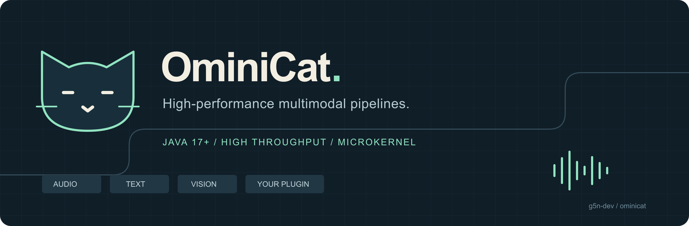
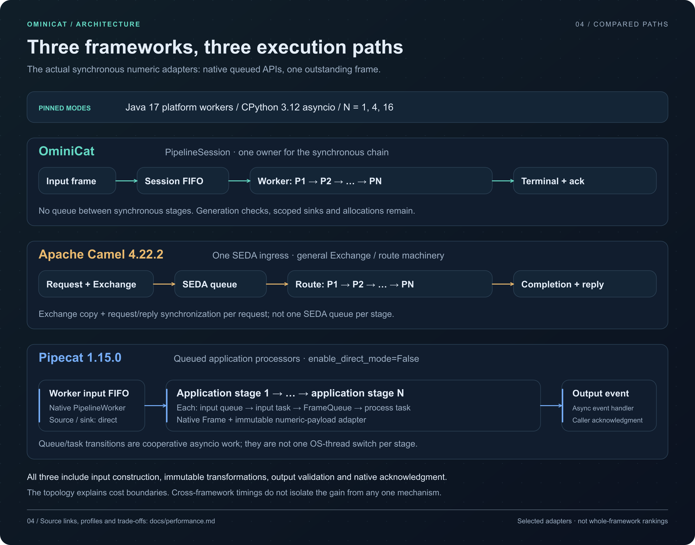
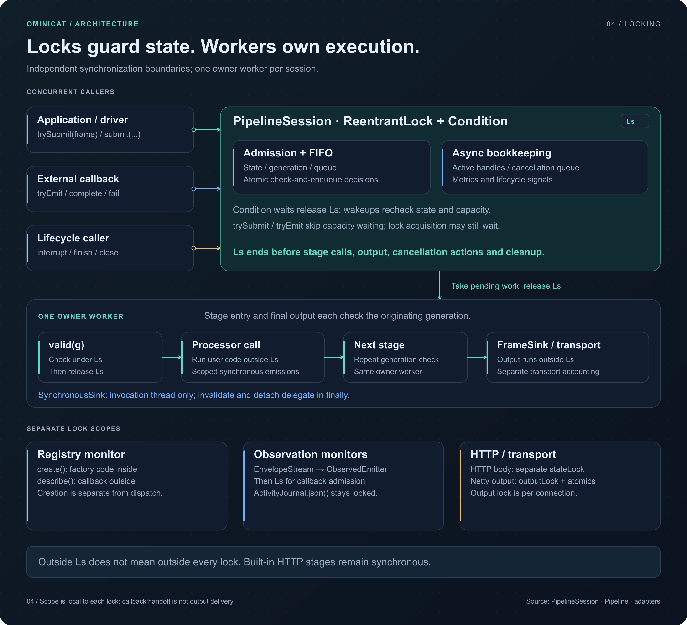
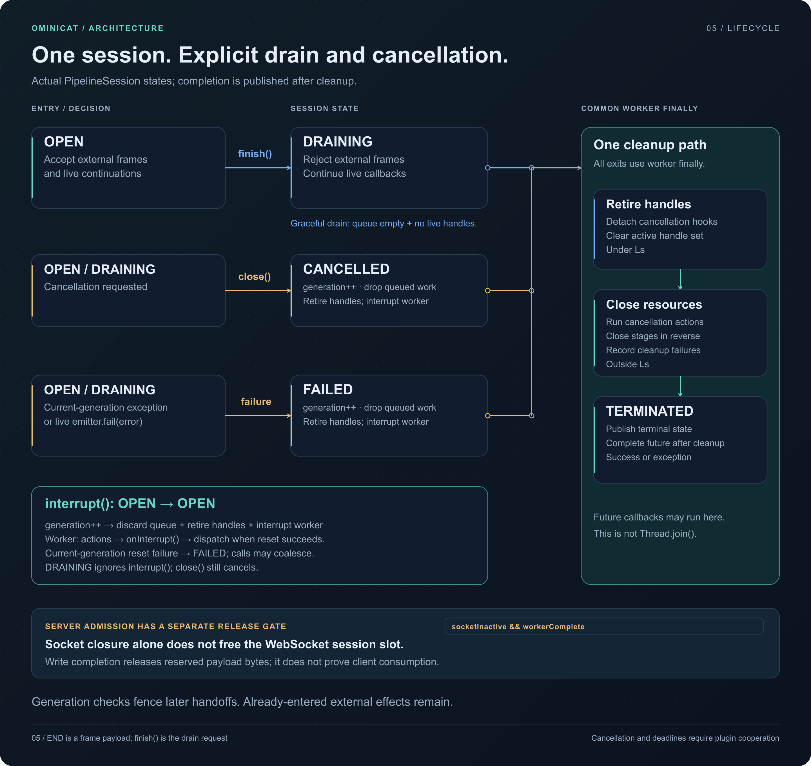

<!-- ominicat-language-nav -->
[简体中文](README.zh-CN.md) · **English**
<!-- /ominicat-language-nav -->

<p align="center">
  <a href="docs/assets/banner.svg"></a>
</p>

<p align="center">
  <a href="https://github.com/g5n-dev/ominicat/actions/workflows/ci.yml"></a>
  
  <a href="LICENSE"></a>
</p>

<p align="center"><strong>High throughput. Measured latency. A small Java kernel.</strong><br>
<a href="#quick-start">Quick start</a> · <a href="docs/architecture.md">Architecture</a> · <a href="docs/plugins.md">Build a plugin</a> · <a href="#linux-performance-on-java-17">Performance</a> · <a href="#linux-profiles">Profiles</a></p>

OminiCat is a **high-performance Java microkernel for multimodal conversation pipelines**. Embed it in an application or run it as a standalone WebSocket container. Typed frames connect transport, speech, language, vision, and conversation processors through a small plugin contract.

**Status:** early 0.1 development preview. APIs and configuration may evolve. The repository includes executable tests and reproducible profiling tools; the recorded kernel baseline is not a production capacity claim.

**Runtime:** Java 17 is the minimum for building and running every module. Java 21+ automatically uses virtual workers. See [Java compatibility and verification](docs/java-compatibility.md).

[Java 17 verification](reports/verification.md): **297 passing runtime tests** and 512-seed lifecycle checks. CI verifies Java 17, 21 and 25, the runnable distribution and container lifecycle.

## Linux performance on Java 17

The published comparison runs **OminiCat, Pipecat 1.15.0 and Apache Camel 4.22.2 LTS** on Linux. Both environments passed their complete matrices: **90 fresh processes and 17,406,385 validated measured outputs**. Models, network and codecs are outside this numeric-frame workload; native runtime, scheduling, frame allocation and output validation remain included.

### Ubuntu 24.04 / native x86_64

Four available logical processors, AMD EPYC 9V74, Temurin 17.0.21 and CPython 3.12.15. Four application stages, one outstanding frame (**W=1**):

| Framework | Frames/s · W=1 | Terminal p99 | Sampled peak process RSS |
| --- | ---: | ---: | ---: |
| **OminiCat** | **49,084** | **17.30 µs** | 144.1 MiB |
| Pipecat 1.15.0 | 5,300 | 220.35 µs | **93.5 MiB** |
| Apache Camel 4.22.2 LTS | 42,756 | 20.41 µs | 188.7 MiB |

[](reports/comparison/linux-ubuntu24-java17-2026-10-31/overview.svg)

Each cell contains five independent processes, each with three seconds warmup and five seconds measured. Tables show medians; plots retain observed min–max ranges. W=1 frame rate measures a closed client loop, not saturated throughput or production session capacity. RSS includes each runtime, dependencies and a common 16 MiB sample buffer; it is not framework-only allocation or B/op.

### CentOS Stream 9 / container user space

Four available logical processors, AMD EPYC 9V45, distribution OpenJDK 17.0.20.1 and CPython 3.12.15. The official image is digest-pinned and shares its Ubuntu runner kernel.

| Framework | Frames/s · W=1 | Terminal p99 | Sampled peak process RSS |
| --- | ---: | ---: | ---: |
| **OminiCat** | **66,567** | **12.44 µs** | 145.3 MiB |
| Pipecat 1.15.0 | 10,019 | 130.88 µs | **88.0 MiB** |
| Apache Camel 4.22.2 LTS | 59,527 | 13.78 µs | 188.9 MiB |

Compare frameworks within each environment. The jobs use different CPU models and JDK builds, so the two tables do not isolate operating-system effects. Pipecat has lower process RSS in both recorded profiles.

<details>
<summary>View the CentOS comparison figure</summary>

[](reports/comparison/linux-centos9-java17-2026-10-31/overview.svg)

</details>

[All Linux figures, ranges and raw processes](reports/comparison/README.md) · [Recorded CI run](https://github.com/g5n-dev/ominicat/actions/runs/41222330745) · [Reproduce](comparison/README.md) · [Automatic Linux workflow](https://github.com/g5n-dev/ominicat/actions/workflows/framework-comparison.yml).

## Microkernel architecture

The kernel keeps execution mechanisms separate from capabilities. Applications can call a typed pipeline directly or open a bounded session; the standalone container adds Netty transport, wire codecs and YAML assembly. Conversation logic and provider adapters remain optional modules.

[](docs/assets/architecture-overview.svg)

## Why the execution path stays small

For a linear synchronous chain, **OminiCat crosses the session queue once, then calls the stages on the same worker**. Typed frames travel through ordinary Java calls: adding a stage adds a processor invocation and its payload work, without adding another stage queue or coroutine task. External asynchronous results use a separate contract and re-enter the owner worker at the next stage.

The published comparison exercises these three concrete paths:

| Framework | Measured queued execution path | Costs retained |
| --- | --- | --- |
| **OminiCat** | One session FIFO → same-worker synchronous processor calls → terminal callback → bounded caller acknowledgment queue | Queue locking, per-stage generation checks, scoped sinks/continuations and newly transformed values |
| **Pipecat 1.15.0** | Worker input queue → each default queued application stage: input priority queue → input coroutine → processing queue → processing coroutine → next stage | Two persistent coroutine tasks per stage, native frame metadata, asyncio scheduling, output-event dispatch and the benchmark's immutable-payload guard; pipeline source/sink use direct mode |
| **Apache Camel 4.22.2 LTS** | One SEDA entrance → consumer → `route.process` chain → request/reply completion | Exchange copying/correlation and completion synchronization, plus route/lifecycle machinery; there is no SEDA queue per application stage |

[](docs/assets/framework-paths.svg)

This gives OminiCat a small synchronous stage-to-stage path while keeping session ownership and cancellation explicit. Camel also executes its route behind one queue, so its difference cannot be explained by counting stage queues. The benchmark retains each framework's native public API, metadata and runtime rather than replacing them with a common scheduler.

Pipecat also exposes direct mode and Camel has a `direct:` endpoint; those modes are outside this queued comparison. [Pinned source and mode boundaries](docs/performance.md#why-the-measured-paths-differ).

| Four-stage Linux profile | OminiCat / Pipecat frame rate | OminiCat / Camel frame rate | Memory tradeoff |
| --- | ---: | ---: | --- |
| Ubuntu 24.04 | **9.26×** | **1.15×** | Pipecat's sampled process RSS is **35.1% lower** than OminiCat's |
| CentOS Stream 9 user space | **6.64×** | **1.12×** | Pipecat's sampled process RSS is **39.4% lower** than OminiCat's |

Ratios divide the five-process median rates within each job. OminiCat leads the recorded rate/latency medians; individual CentOS forks overlap with Camel in some cases. These are measured tradeoffs for W=1, not a claim that one framework wins every workload.

[](docs/assets/framework-cost-scaling.svg)

Across 1→16 stages, OminiCat retains about **97.8%** of its one-stage frame rate in each Linux job; Pipecat retains **18.0% / 19.0%**, and Camel **92.0% / 95.7%** on Ubuntu / CentOS. This is consistent with different stage-to-stage work, but does not isolate its causal share: runtime, allocation, the output oracle and acknowledgment also cost time. [All stage counts, CPU costs, source paths and counterexamples](docs/performance.md).

<details>
<summary>OminiCat's direct and queued execution paths</summary>

[](docs/assets/execution-path.svg)

[Pipeline](ominicat-core/src/main/java/io/ominicat/core/Pipeline.java) still allocates scoped sinks and continuations; [PipelineSession](ominicat-core/src/main/java/io/ominicat/core/PipelineSession.java) uses a lock and FIFO. Direct embedding omits session scheduling and leaves serialization/cleanup to the caller. Media constructors make defensive copies; transport JSON/Base64 has separate costs.

In the container, processor work runs on session workers. JSON decoding and connection assembly remain on Netty's I/O callbacks. The published Java 17 runs use platform workers; they do not measure a virtual-thread speedup.

</details>

### Bounded work and cancellation

Pending frames, active async invocations, branch workers/buffers and transport output each have their own limit. In an open session, an interrupt advances its generation, clears pending work and fences late callbacks. `finish()` waits for accepted work and outstanding async invocations; plugin cooperation determines how promptly cancellation completes.

[](docs/assets/bounded-runtime.svg)

[Source-backed architecture and lifecycle](docs/architecture.md) · [Performance mechanisms and measurement scope](docs/performance.md) · [Configuration and limits](docs/configuration.md).

<details>
<summary>How locks, cancellation and cleanup fit together</summary>

The session lock protects admission, queue state, generation and async handles. The owner worker calls processors, output sinks and cleanup after releasing that lock. Registry, branch, wrapper and transport synchronization have their own scopes, documented in the [lock table](docs/architecture.md#locking-and-callback-boundaries).

[](docs/assets/locking-boundaries.svg)

`finish()` drains accepted work; `interrupt()` changes the generation of an open session; `close()` requests cooperative cancellation. Completion is published after cleanup. The server releases a WebSocket admission slot only after socket inactivity and logical worker completion.

[](docs/assets/session-lifecycle.svg)

[Lifecycle guarantees, reference release and regression evidence](docs/architecture.md#lifecycle-cancellation-and-release).

</details>

## Linux profiles

The following **Ubuntu / Java 17** JFR diagnostics were collected in a separate instrumented run: **41 CPU stack samples, 445 allocation samples and three garbage collections**. Their scope includes JVM/framework startup, warmup, measurement, harness work and teardown. Sample counts are observations, not method-duration percentages; allocation weights estimate allocated bytes, not retained heap or exact B/op.

[](reports/comparison/linux-ubuntu24-java17-2026-10-31/profiles/ominicat/cpu-hotspots.svg)

[](reports/comparison/linux-ubuntu24-java17-2026-10-31/profiles/ominicat/allocation-hotspots.svg)

[](reports/comparison/linux-ubuntu24-java17-2026-10-31/profiles/ominicat/gc-pauses.svg)

The recorded GC pause sum is **4.876 ms**, with a largest per-collection pause sum of **2.580 ms**. Sparse CPU samples and sampled allocations identify observations to investigate; they do not prove the causal contribution of an optimization. Instrumented timings are excluded from the 90-process comparison.

<details>
<summary>Full exported stacks and peer diagnostics</summary>

[Ubuntu CPU flame graph](reports/comparison/linux-ubuntu24-java17-2026-10-31/profiles/ominicat/cpu-flamegraph.svg) · [Ubuntu allocation flame graph](reports/comparison/linux-ubuntu24-java17-2026-10-31/profiles/ominicat/allocation-flamegraph.svg) · [Ubuntu OminiCat / Camel / Pipecat diagnostics](reports/comparison/linux-ubuntu24-java17-2026-10-31/profiles/README.md) · [CentOS diagnostics](reports/comparison/linux-centos9-java17-2026-10-31/profiles/README.md).

</details>

Relevant kernel, comparison, build and profiling changes trigger the Linux workflow for pull requests and main pushes. Each complete run publishes figures, raw numeric results, source/runtime manifests and checksums in a downloadable artifact retained for 30 days. The committed Linux baseline remains available independently of artifact expiry. [Collection and publication scope](comparison/README.md#linux-ci).

## Quick start

Install **JDK 17 or newer**, then build and run the credential-free demo:

```sh
git clone https://github.com/g5n-dev/ominicat.git
cd ominicat
./mvnw -B verify
java -jar ominicat-server/target/ominicat-server.jar --config config/demo.yaml
```

Open **[localhost:8080](http://127.0.0.1:8080)**. **OminiCat Studio** starts with a task execution board: inspect content, actual processing stages, observed outputs and animated handoffs, then enter the separate pipeline debugger to send text, a microphone utterance, images or transcripts. The default `echo` pipeline returns your input without an external model.


[Studio guide and debugger](docs/studio.md) · [Three-stage offline example](config/studio.yaml) · [Browser and resource verification](reports/studio/README.md).

```sh
curl http://127.0.0.1:8080/health
curl http://127.0.0.1:8080/metrics
```

Using an existing Maven installation also works: `mvn -B verify` requires Maven 3.9 or newer.

## A kernel, with replaceable capabilities

The core owns frame flow, session scheduling, cancellation generations and processor lifecycle. Provider and transport dependencies remain in separate modules. YAML selects configured stages; the Java SPI discovers factories at assembly time. Each session owns its pipeline and linear execution worker.

| Module | Responsibility | Production dependencies |
| --- | --- | --- |
| `ominicat-core` | Frames, envelopes, pipelines, session lifecycle, plugin SPI | JDK only |
| `ominicat-conversation` | Bounded transcript windows, policies, prompt composition, optional media references | Core |
| `ominicat-providers` | Compatible model adapters, echo, energy-based VAD | Core, Jackson |
| `ominicat-server` | Embedded/standalone Netty container, YAML, browser playground | Runtime modules, Netty, Jackson YAML |
| `ominicat-benchmarks` | JMH, allocation measurements, queue-inclusive load driver | Core, JMH |

The open `Frame` interface supports application events alongside `Text`, PCM16 `Audio`, encoded `Image`, revision-aware `Transcript`, classified `Failure`, and explicit `Cancel` frames. Optional `FrameEnvelope` metadata preserves event, session, turn, correlation and causation identities through configured stages. See [architecture](docs/architecture.md) and the [wire protocol](docs/protocol.md).

## Configure a pipeline

```yaml
host: 127.0.0.1
port: 8080
queueCapacity: 256
maxSessions: 256
maxFrameBytes: 1048576
idleTimeoutSeconds: 60
stages:
  - type: echo
    options: {}
```

Swap stages without changing the kernel. For a model pipeline, select provider plugins and reference credentials through environment-variable names. Startup checks configured factories before binding; session state stays isolated. See [configuration](docs/configuration.md) for limits, authentication, and examples.

| Capability | Included behavior |
| --- | --- |
| Text and vision | OpenAI-compatible Chat Completions with streamed SSE text; encoded image input |
| Speech recognition | PCM utterance uploaded as WAV over HTTP, producing a final transcript |
| Speech synthesis | Text collected until a turn boundary, then returned as 24 kHz mono PCM |
| Voice activity | Deterministic RMS energy detector with configurable silence duration |
| Conversation state | Bounded final transcript windows, stable segment IDs, policy evidence, prompt templates |
| Media references | Optional source/producer-scoped range versions, explicit frame boundaries and bounded binary import/export; [Java API](docs/media-references.md) |
| Transport | JSON over WebSocket, explicit overload handling, bearer authentication, Prometheus metrics |

Speech recognition and synthesis adapters use **utterance/turn requests**. They do not provide continuous provider-native streaming ASR/TTS, WebRTC, acoustic echo cancellation, or automatic speaker diarization. The browser supports manual interruption. The [scenario coverage matrix](docs/scenario-coverage.md) distinguishes implemented behavior from extension points.

Ready-to-edit configurations include [voice](config/voice.yaml), [vision](config/vision.yaml), [separate audio tracks](config/dual-stream.yaml), [transcript policies](config/conversation.yaml), and [a step sequence](config/steps.yaml).

## Embed the runtime

```java
import io.ominicat.core.Frame;
import io.ominicat.core.Pipeline;
import io.ominicat.core.SessionOptions;

public final class EmbedDemo {
    public static void main(String[] args) {
        var pipeline = Pipeline.builder()
            .add((frame, next) -> next.accept(frame))
            .build();

        try (var session = pipeline.openSession(
                SessionOptions.defaults(), System.out::println)) {
            if (!session.trySubmit(new Frame.Text("Hello, OminiCat."))) {
                throw new IllegalStateException("Session input is full or closed");
            }
            session.finish();
            session.completion().join();
        }
    }
}
```

Save the example as `EmbedDemo.java` and run `java --class-path ominicat-server/target/ominicat-server.jar EmbedDemo.java` after building the repository.

Processors can emit zero, one, or many frames. Blocking provider I/O runs on session workers. `finish()` drains accepted work; `interrupt()` fences stale emissions and prepares a new generation; `close()` cancels cooperatively and `completion()` joins cleanup. Construct a fresh pipeline for each session. A synchronous sink is valid only during its invocation and on its owning thread. External callbacks use `AsyncProcessor` through a session; handle `tryEmit()` rejection and terminate each invocation with `complete()` or `fail()`.

## Add a plugin

Implement one factory and register its class in `META-INF/services/io.ominicat.core.spi.ProcessorFactory`:

```java
package example;

import io.ominicat.core.*;
import io.ominicat.core.spi.ProcessorFactory;
import java.util.Locale;
import java.util.Map;

public final class UppercaseFactory implements ProcessorFactory {
    public String type() { return "uppercase"; }

    public Processor create(Map<String, String> options) {
        if (!options.isEmpty()) throw new IllegalArgumentException("uppercase accepts no options");
        return new Processor() {
            @Override public void process(Frame frame, FrameSink next) throws Exception {
                if (frame instanceof Frame.Text text) {
                    next.accept(new Frame.Text(text.text().toUpperCase(Locale.ROOT)));
                } else {
                    next.accept(frame);
                }
            }
        };
    }
}
```

The service file contains `example.UppercaseFactory`; a YAML stage with `type: uppercase` selects it. Factories validate options, create isolated state, and return processors that honor interruption and clean up resources. [Plugin development](docs/plugins.md) covers lifecycle and richer compositions.

## Measure what runs

```sh
# Tests, per-module HTML coverage, and a dependency inventory
./mvnw -B -Pcoverage,sbom verify

# Forked JMH + allocation profiling, bounded-session load, JFR and GC logs
./scripts/profile.sh quick reports/local/profile
```

The [Linux profiles above](#linux-profiles) expose the recorded execution and allocation costs. Use the [Linux comparison guide](comparison/README.md#linux-ci) to run the same three-framework matrix on GitHub, or reproduce it on your own Linux host. The [performance guide](docs/performance.md) explains timing boundaries, worker selection and how to compare changes.

## Documentation

- [Architecture and lifecycle](docs/architecture.md)
- [Configuration and deployment](docs/configuration.md)
- [Frame protocol and metadata](docs/protocol.md)
- [Plugin development](docs/plugins.md)
- [Scenario coverage and current limits](docs/scenario-coverage.md)
- [Immutable media references and import/export](docs/media-references.md)
- [Studio operation overview and pipeline debugger](docs/studio.md)
- [Performance methodology](docs/performance.md) and [Linux measurements](reports/comparison/README.md)
- [Performance audit and bounded prompt experiment](docs/performance-audit.md)
- [Iteration plan and acceptance criteria](docs/iteration-plan.md)
- [Cross-project integration contract proposal](docs/integration-contracts.md)
- [Temporal segment and annotation contract proposal](docs/temporal-annotations.md)
- [Conversation primitives](ominicat-conversation/README.md)

## License

[Apache License 2.0](LICENSE).
