<p align="center"><strong>简体中文（当前）</strong> · <a href="README.md">English</a></p>

<p align="center"><a href="docs/assets/zh-CN/banner.svg">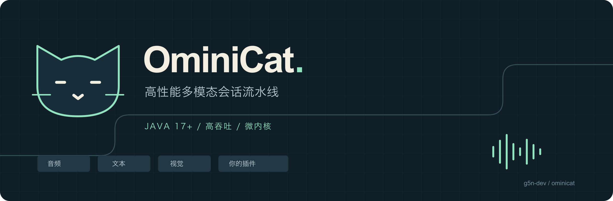</a></p>

<p align="center"><a href="#先运行起来">快速开始</a> · <a href="#嵌入-java-应用">嵌入应用</a> · <a href="#开发插件">开发插件</a> · <a href="#linux-框架性能实测">Linux 实测</a> · <a href="#高性能从哪里来">执行机制</a> · <a href="docs/configuration.md">配置</a> · <a href="docs/studio.md">Studio</a></p>

**OminiCat 是 Java 17+ 多模态会话微内核。** 用统一帧连接音频、文本、图像、转写、模型与会话处理器；通过配置组合插件，可嵌入现有 Java 应用，也可独立运行为 WebSocket 服务容器。

内核仅依赖 JDK，负责有界调度、取消、排空与生命周期，媒体、模型和应用策略由插件提供。当前为 **0.1 开发预览版**；[验证报告](reports/verification.md)记录了 **297 项通过测试、512 个随机种子**及本地协议故障验证。真实服务兼容性与部署容量仍需在目标环境验证。

[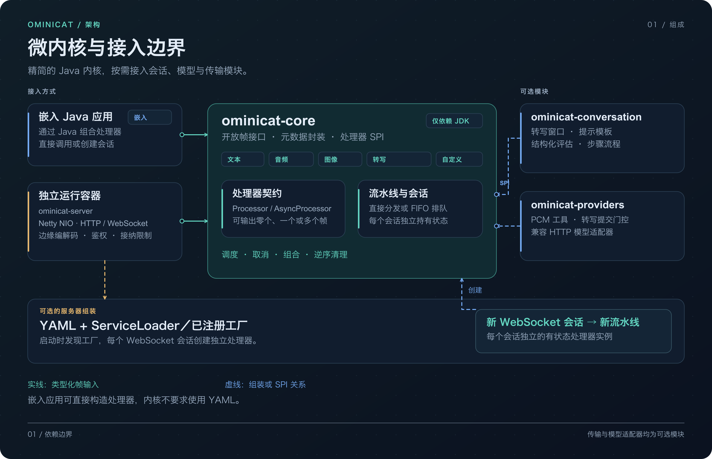](docs/assets/zh-CN/architecture-overview.svg)

## Linux 框架性能实测

在 **Ubuntu 24.04 原生运行器**和 **CentOS Stream 9 容器用户态**分别完成 OminiCat、Pipecat 1.15.0、Apache Camel 4.22.2 LTS 的无模型排队路径对比。两条作业共 **90 个独立进程、17,406,385 个测量输出**，全部通过逐帧输出、计数、拒绝与资源清理校验。

[](reports/comparison/linux-ubuntu24-java17-2026-10-31/overview.svg)

下表为**四阶段、单帧在途（W=1）**时，五个独立进程各项指标的中位数：

| 独立 Linux 作业 | 框架 | 处理速率 · 帧/秒 | 终点 p99 · µs | 采样进程峰值 RSS · MiB |
| --- | --- | ---: | ---: | ---: |
| Ubuntu 24.04 | **OminiCat** | **49,084** | **17.30** | 144.1 |
| Ubuntu 24.04 | Pipecat 1.15.0 | 5,300 | 220.35 | 93.5 |
| Ubuntu 24.04 | Apache Camel 4.22.2 LTS | 42,756 | 20.41 | 188.7 |
| CentOS Stream 9 用户态 | **OminiCat** | **66,567** | **12.44** | 145.3 |
| CentOS Stream 9 用户态 | Pipecat 1.15.0 | 10,019 | 130.88 | 88.0 |
| CentOS Stream 9 用户态 | Apache Camel 4.22.2 LTS | 59,527 | 13.78 | 188.9 |

每个平台测量 **3 套框架 × 3 种阶段数（1／4／16）× 5 个新进程 = 45 轮**，每进程预热 3 秒、测量 5 秒。相同数值变换使用不可变帧，每阶段创建新值。OminiCat 使用 `PipelineSession`，Pipecat 使用原生排队处理器，Camel 使用单消费者 SEDA；各自的对象、运行时、调度与公开 API 成本均计入。模型、网络、编解码及启动和清理不在计时区间内。

处理速率覆盖完整调用循环；终点延迟在输出校验之后、调用方确认之前结束。**W=1 速率不代表饱和吞吐或生产容量。** RSS 每 50 ms 采样，包含运行时、依赖和共同的 16 MiB 测量缓冲区；它不是框架独占内存、存活堆或 B/op，短暂峰值可能被漏采。Java 使用 `-Xms128m -Xmx512m`，Python 没有对应的受管堆上限。

| 环境 | Ubuntu 作业 | CentOS 作业 |
| --- | --- | --- |
| 用户态 | Ubuntu 24.04.5 LTS · x86_64 | CentOS Stream 9 · x86_64，固定摘要的官方容器 |
| CPU 型号／可用逻辑处理器 | AMD EPYC 9V74／4 | AMD EPYC 9V45／4 |
| Java | Temurin 17.0.21 | Red Hat OpenJDK 17.0.20.1 |
| Python | CPython 3.12.15 | CPython 3.12.15 |
| 内核边界 | Ubuntu 运行器内核 | **共享 Ubuntu 运行器内核**，验证 CentOS 用户态 |

同一作业内三套框架顺序执行并轮换次序；两条作业使用独立共享主机，没有独占 CPU。**仅比较同一作业内的结果，不据此给操作系统排名**；运行时、原生调度和对象模型的差异也不能归因于某一项内核设计。完整报告保留五轮最小—最大范围，不将其当作置信区间。

<details>
<summary>查看 CentOS Stream 9 用户态的完整对比图</summary>

[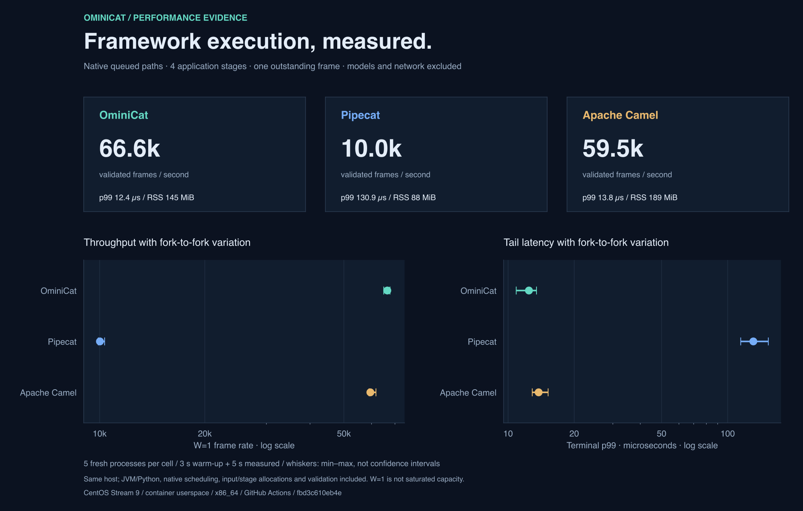](reports/comparison/linux-centos9-java17-2026-10-31/overview.svg)

</details>

[Ubuntu 完整报告与逐轮数据](reports/comparison/linux-ubuntu24-java17-2026-10-31/README.md) · [CentOS 完整报告与逐轮数据](reports/comparison/linux-centos9-java17-2026-10-31/README.md) · [协议与复跑步骤](comparison/README.md) · [已完成的 CI 运行](https://github.com/g5n-dev/ominicat/actions/runs/41222330745) · [自动采集工作流](.github/workflows/framework-comparison.yml)。

## 高性能从哪里来

**连续的同步阶段只交接一次会话队列，随后在同一个工作线程里直接调用。** 外部帧通过有界 FIFO 交给会话；`next.accept` 用类型化帧直接进入下一阶段。增加一个同步阶段，会增加处理器调用、取消校验和实际处理工作，无需再增加一组阶段队列、协程任务或内部编解码。外部异步结果才通过独立 SPI 从下一阶段重新入队。

本次比较使用的是三套框架各自的公开排队路径：

| 框架 | 本次实际执行路径 | 保留的成本 |
| --- | --- | --- |
| **OminiCat** | 会话 FIFO → 单 worker 上的同步处理链 → 终端校验 → 有界确认队列 | 队列锁、每阶段 generation 校验、scoped sink、continuation 和新数值帧分配 |
| **Pipecat 1.15.0** | Worker 输入队列 → 每个排队应用阶段：输入优先队列 → input 协程 → 处理队列 → process 协程 → 下一阶段 | 每阶段两个常驻协程任务、原生 Frame 元数据、事件循环、输出事件，以及测试程序的载荷不可变保护；源汇使用 direct mode |
| **Apache Camel 4.22.2 LTS** | 一个 SEDA 入口 → consumer → 同一路由的 `process` 链 → 请求应答完成 | Exchange 关联副本、完成回调和同步，以及通用路由／生命周期机制；并非每阶段都有 SEDA 队列 |

[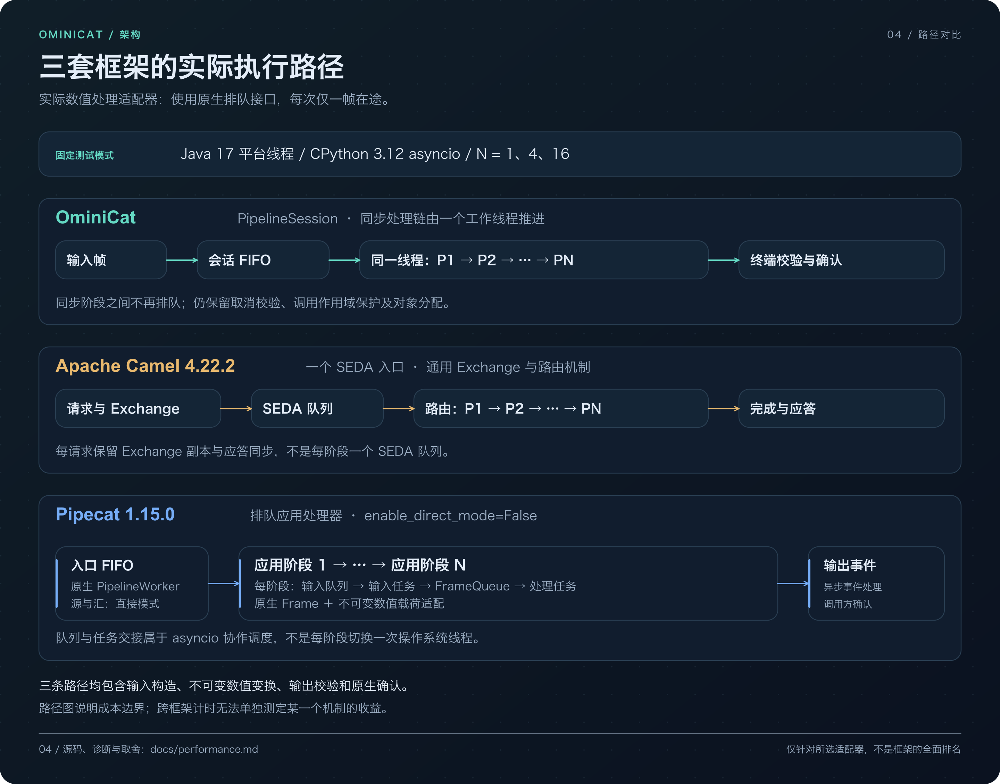](docs/assets/zh-CN/framework-paths.svg)

因此，OminiCat 的优势原理是**缩短同步阶段之间的框架路径，同时保留会话所有权和取消保护**。与 Pipecat 的这个排队模式相比，它省去了同步应用阶段之间的队列／协程交接；与 Camel 相比，两者都有单入口队列，差别在类型化处理器契约与通用 Exchange／路由／应答机制。源码说明结构差异，Linux 测试记录这些完整路径的实际结果。

Pipecat 也提供 direct mode，Camel 也有 `direct:` 端点；这些直接调用模式未纳入本次排队矩阵，不能套用这里的比值。[固定版本源码与模式边界](docs/performance.md#why-the-measured-paths-differ)。

| 四阶段、单帧在途 | OminiCat／Pipecat 处理速率 | OminiCat／Camel 处理速率 | 进程 CPU 微秒／帧：OminiCat／Pipecat／Camel |
| --- | ---: | ---: | ---: |
| Ubuntu 24.04 | **9.26×** | **1.15×** | **18.95／188.67／23.56** |
| CentOS Stream 9 用户态 | **6.64×** | **1.12×** | **13.72／99.80／16.08** |

比值为**同一 Linux 作业内五进程中位数之比**，不是置信区间，也不是配对实验。CPU 成本来自测量阶段的整进程 CPU 时间除以校验通过的帧数，包含运行时、框架和测试程序；单帧终点延迟不包含全部确认返回过程。

[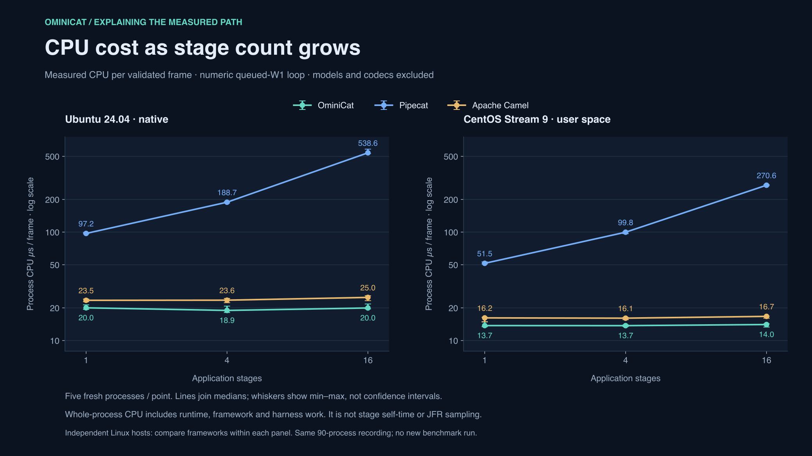](docs/assets/framework-cost-scaling.svg)

从 1 阶段扩展到 16 阶段，两条 Linux 作业中 OminiCat 保留约 **97.8%** 的单阶段处理速率；Pipecat 分别保留 **18.0%／19.0%**，Camel 为 **92.0%／95.7%**。这与各自阶段间的工作结构相符，但不能把完整速度差全部归因于队列：语言运行时、原生帧对象、不可变载荷保护、校验与确认也在计时中。

取舍也应公开：四阶段时，**Pipecat 的采样进程 RSS 比 OminiCat 低 35.1%／39.4%**；部分 CentOS 轮次与 Camel 的速率或 p99 范围重叠。这里不承诺每轮、每种场景都领先，也不把 W=1 结果当作饱和吞吐或生产容量。[完整 1／4／16 阶段数据、固定版本源码、profile 观察与边界](docs/performance.md)。

<details>
<summary>查看 OminiCat 的直接调用、异步续接与资源边界</summary>

[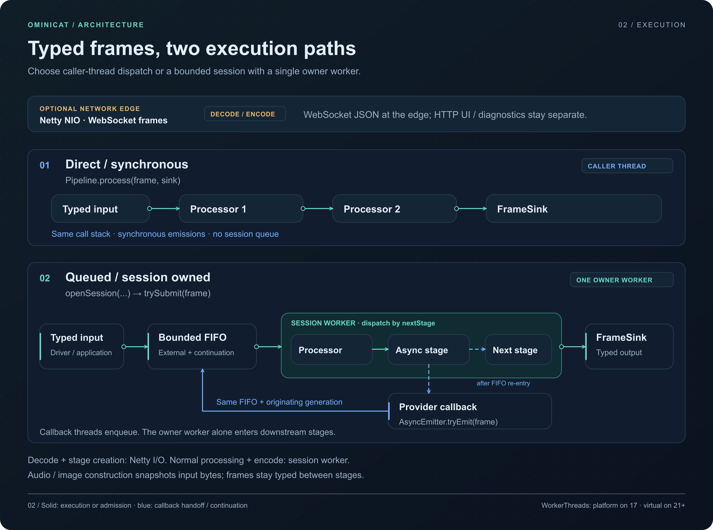](docs/assets/execution-path.svg)

[Pipeline](ominicat-core/src/main/java/io/ominicat/core/Pipeline.java) 的同步阶段保留调用生命周期保护和 continuation 分配；[PipelineSession](ominicat-core/src/main/java/io/ominicat/core/PipelineSession.java) 用锁和 FIFO 管理会话工作。直接嵌入可省去会话调度，调用方自行负责串行访问和清理。配置发现和处理器组装在派发帧之前完成。

媒体构造会防御性复制字节；JSON／Base64 在网络边缘处理，均有实际成本。服务器的处理器在会话 worker 运行，解码与连接组装仍在 Netty I/O 回调中。这组实测使用 **Java 17 平台线程**，不证明虚拟线程或外部异步模型回调更快。

[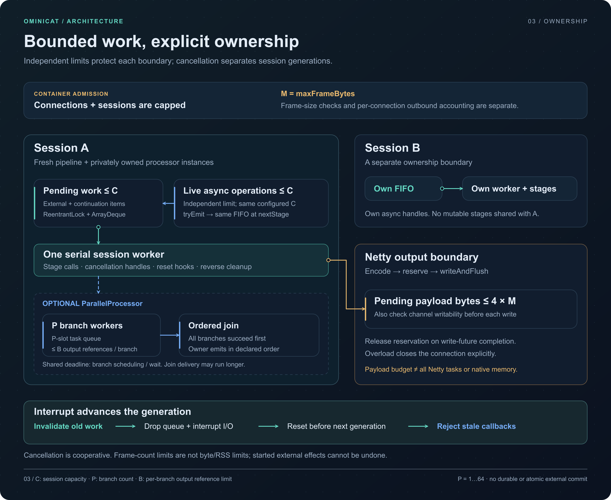](docs/assets/bounded-runtime.svg)

输入队列、活跃异步句柄、分支输出和网络待发送字节各有独立上限；它们不能合并解释为总内存预算。中断提升 generation、清理排队项并拒绝旧回调；已发生的外部作用不能撤销，阻塞插件仍须配合取消。[架构与生命周期](docs/architecture.md) · [配置](docs/configuration.md)。

</details>

## Linux CPU、分配与 GC

以下来自 **Ubuntu 作业的 OminiCat 四阶段独立 JFR 诊断**。整段记录包含 JVM／框架启动、预热、5 秒 W=1 测量、测量程序及清理，共有 **41 个 CPU 栈采样、445 个分配采样**。它与前述未插桩的 45 轮计时分开，不能用来替换主表或推导精确 B/op。

[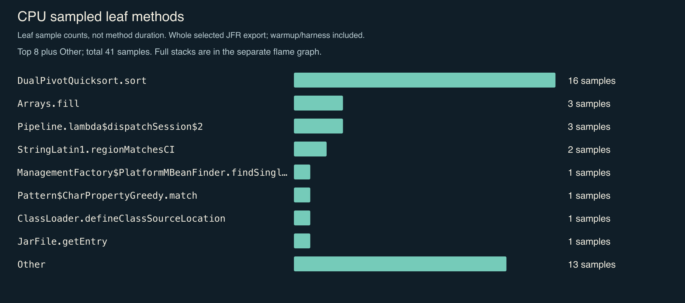](reports/comparison/linux-ubuntu24-java17-2026-10-31/profiles/ominicat/cpu-hotspots.svg)

[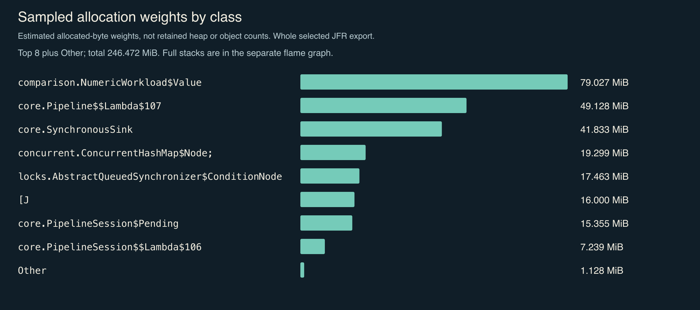](reports/comparison/linux-ubuntu24-java17-2026-10-31/profiles/ominicat/allocation-hotspots.svg)

分配权重反映采样分布，包含测量程序的延迟数组；它不是存活堆或精确对象数量。CPU 采样也包含初始化和排序，少量样本不能证明某条路径没有成本。

[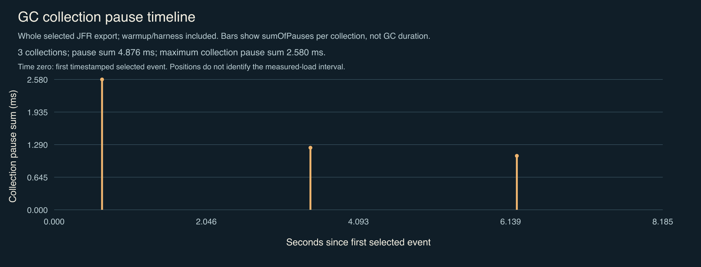](reports/comparison/linux-ubuntu24-java17-2026-10-31/profiles/ominicat/gc-pauses.svg)

这份记录包含 **3 次 GC**，累计暂停 **4.876 ms**，单次暂停合计最大 **2.580 ms**；时间位置相对首个选定事件，包含预热和测量程序。

<details>
<summary>展开完整 CPU 与分配调用栈</summary>

图中保留导出数据提供的全部正权重栈帧，并标明源记录截断或不可用的栈。点击预览打开 SVG 原图，可放大并查看方法提示。

[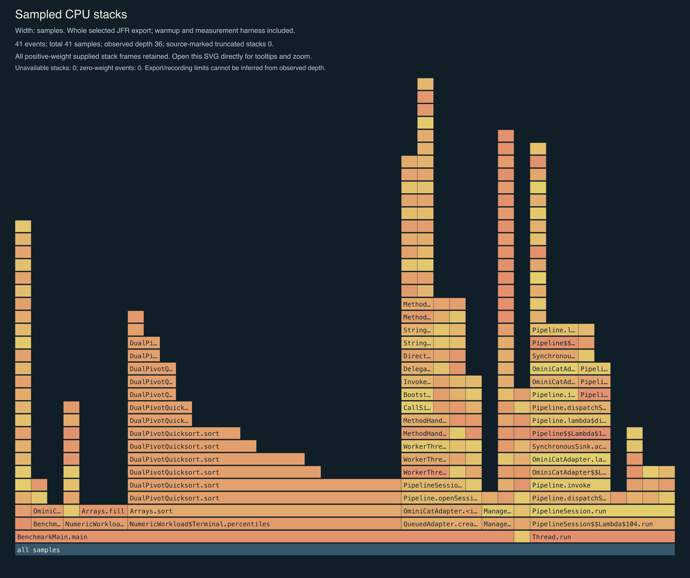](reports/comparison/linux-ubuntu24-java17-2026-10-31/profiles/ominicat/cpu-flamegraph.svg)

[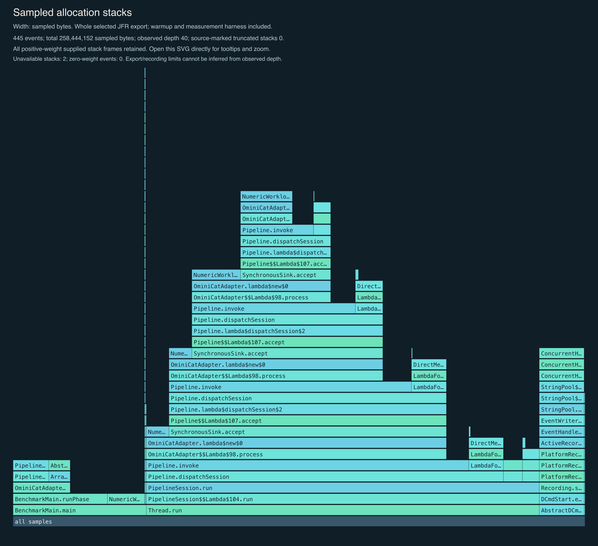](reports/comparison/linux-ubuntu24-java17-2026-10-31/profiles/ominicat/allocation-flamegraph.svg)

</details>

[Ubuntu 诊断与采集范围](reports/comparison/linux-ubuntu24-java17-2026-10-31/profiles/README.md) · [OminiCat 详细诊断](reports/comparison/linux-ubuntu24-java17-2026-10-31/profiles/ominicat/profiles.md) · [CentOS 诊断](reports/comparison/linux-centos9-java17-2026-10-31/profiles/README.md)。Java JFR 与 Python cProfile 的采集区间和指标不同，不作跨语言分配或 CPU 百分比排名。

## 先运行起来

最低支持 **JDK 17**；同一 Java 17 字节码在 17／21／25 上验证，21+ 自动选择虚拟线程。仓库自带 Maven Wrapper，详见[版本兼容](docs/java-compatibility.md)。

```bash
git clone https://github.com/g5n-dev/ominicat.git
cd ominicat
./mvnw -B verify
java -jar ominicat-server/target/ominicat-server.jar --config config/demo.yaml
```

打开 [OminiCat Studio](http://127.0.0.1:8080)。默认 `echo` 配置不需要模型密钥；大盘按输入、实际处理阶段和产出分列，点击任务查看内容与保留的事件，再进入独立调试页连接、发送文字、麦克风录音、图片或转写。

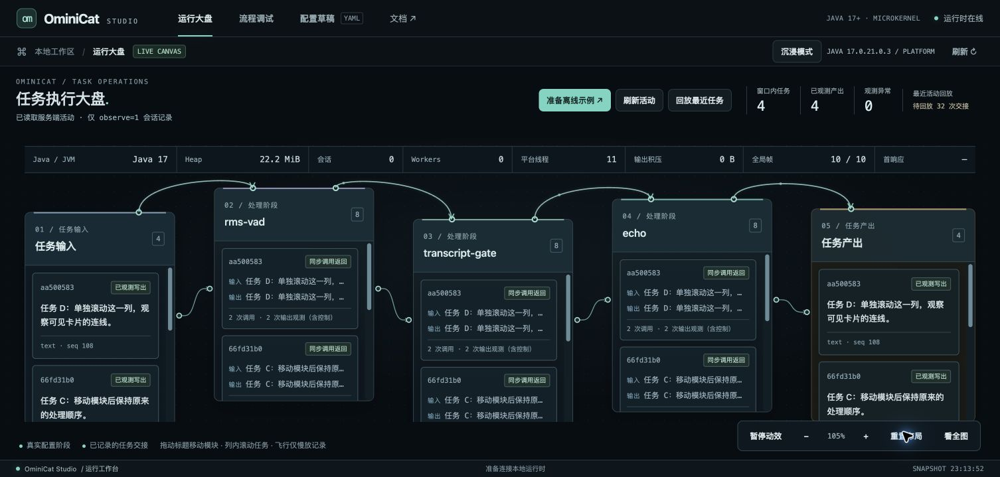

动态交接回放来自可选的活动记录，刻意放慢快速事件，不能当作逐节点实时耗时或任务提交证明。Studio 保留有界内容预览；活动 API 是运行时级操作视图，部署时应设置鉴权和访问范围。普通连接默认不记录阶段活动。

[大盘与调试使用说明](docs/studio.md) · [三阶段离线示例](config/studio.yaml) · [浏览器与资源验证](reports/studio/README.md)。

默认配置还提供健康检查和 Prometheus 指标：

```bash
curl http://127.0.0.1:8080/health
curl http://127.0.0.1:8080/metrics
```

也可使用已安装的 Maven 3.9+ 执行 `mvn -B verify`。配置鉴权后，指标和会话入口需要相应凭据，详见[配置与部署](docs/configuration.md)。

## 小内核，可组合的能力

| 层 | 提供的机制 |
|---|---|
| 微内核 | 零第三方运行依赖、统一帧、有界队列、跨版本工作线程、取消栅栏、排空与资源回收 |
| 流式扩展 | 同步处理器和独立的异步回调 SPI；回调重新进入有界调度队列 |
| 编排 | 命名分支与确定顺序的汇合、分支截止时间、输出前降级、独立异步出口 |
| 会话 | 稳定片段 ID、修订与最终提交、角色和说话人分离、时间区间、有界窗口与快照 |
| 可选媒体引用 | 来源、轨道、时间基准、生产者作用域和片段版本；明确区间/点/未知位置、显式帧映射与有界导入导出 |
| 可配置策略 | 带版本和证据的结构化评估、提示模板、可寻址步骤与条件路由 |
| 容器 | Netty WebSocket、YAML 配置、SPI 发现、鉴权、容量限制、Prometheus 指标 |

模块依赖保持分离，内核的零第三方依赖不等于整个服务没有依赖：

| 模块 | 职责 | 生产依赖 |
| --- | --- | --- |
| `ominicat-core` | 帧、管线、会话生命周期与插件 SPI | 仅 JDK |
| `ominicat-conversation` | 转写窗口、评估、提示模板、步骤流程与可选媒体引用 | Core |
| `ominicat-providers` | 兼容模型适配器、回显与 PCM 工具 | Core、Jackson |
| `ominicat-server` | Netty 容器、YAML 组装与 Studio | 运行时模块、Netty、Jackson YAML |
| `ominicat-benchmarks` | JMH、分配率与会话负载测量 | Core、JMH |

### 配置管线

```yaml
host: 127.0.0.1
port: 8080
queueCapacity: 256
maxSessions: 256
stages:
  - type: transcript-gate
  - type: conversation-evaluator
    options:
      speaker: agent
      requiredPhrases: "hello,thank you"
      policyVersion: "example-v1"
```

每个会话创建独立处理器实例。YAML 的 `type` 选择已安装工厂，`options` 的值为字符串；模型配置通过环境变量名引用凭据。服务器在绑定端口前创建并关闭配置中的处理器进行预检。工厂构造应快速完成，不应发起模型请求。详见[配置与鉴权](docs/configuration.md)。

`Frame` 是开放接口，支持自定义事件，也提供 `Text`、`Audio`、`Image`、`Transcript`、`Failure` 与 `Cancel`。可选 `FrameEnvelope` 为帧携带会话、轮次、关联、因果和时间信息，`EnvelopeProcessor.wrap` 保留同步与异步阶段的元数据。

音频为 PCM16LE，带流标识和每通道采样位置；转写带稳定片段标识、修订号、说话人、角色、起止时间及 final 标记。持久化、跨进程恢复身份和外部作用的提交点由应用管理。

## 嵌入 Java 应用

无需启动 WebSocket 服务，即可直接使用核心 API。将下面代码保存为仓库根目录的 `EmbedDemo.java`；示例接纳一帧，等待输出与处理器清理完成后退出：

```java
import io.ominicat.core.Frame;
import io.ominicat.core.Pipeline;
import io.ominicat.core.SessionOptions;

public final class EmbedDemo {
    public static void main(String[] args) {
        var pipeline = Pipeline.builder()
            .add((frame, next) -> next.accept(frame))
            .build();

        try (var session = pipeline.openSession(
                SessionOptions.defaults(), System.out::println)) {
            if (!session.trySubmit(new Frame.Text("Hello, OminiCat."))) {
                throw new IllegalStateException("Session input is full or closed");
            }
            session.finish();
            session.completion().join();
        }
    }
}
```

前面的构建已生成包含核心模块的服务 JAR，可用 JDK 17 的源码启动方式运行：

```bash
java --class-path ominicat-server/target/ominicat-server.jar EmbedDemo.java
```

处理器可以输出零帧、一帧或多帧。`trySubmit()` 返回 `false` 时，调用方处理满队列或入口关闭；`finish()` 关闭外部入口并排空已接纳工作及活跃异步调用，`completion()` 在逆序清理结束后完成。`interrupt()` 隔离旧 generation 并准备下一轮，不撤销已发生的外部作用；`close()` 发起协作式取消，等待清理仍需使用 `completion()`。每个会话应新建管线和处理器实例。

纯同步嵌入也可调用 `Pipeline.process(frame, sink)`，省去会话队列；调用方自行串行访问并关闭处理器。同步 `next` 仅在当前调用中有效，不能在返回后或其他线程调用。外部回调使用 `AsyncProcessor`，通过 `openSession` 运行；必须处理 `tryEmit()` 拒绝，并在结束或失败时调用 `complete()`／`fail()`。详见[生命周期](docs/architecture.md)与[异步插件契约](docs/plugins.md#streaming-callbacks)。

## 开发插件

实现 `ProcessorFactory` 并通过 Java `ServiceLoader` 注册，无需改动内核。下面的插件仅将文本转为大写，其他帧原样传递。保存为 `UppercaseFactory.java`：

```java
package example;

import io.ominicat.core.Frame;
import io.ominicat.core.FrameSink;
import io.ominicat.core.Processor;
import io.ominicat.core.spi.ProcessorFactory;
import java.util.Locale;
import java.util.Map;

public final class UppercaseFactory implements ProcessorFactory {
    @Override public String type() { return "uppercase"; }

    @Override public Processor create(Map<String, String> options) {
        if (!options.isEmpty()) {
            throw new IllegalArgumentException("uppercase accepts no options");
        }
        return new Processor() {
            @Override public void process(Frame frame, FrameSink next) throws Exception {
                if (frame instanceof Frame.Text text) {
                    next.accept(new Frame.Text(text.text().toUpperCase(Locale.ROOT)));
                } else {
                    next.accept(frame);
                }
            }
        };
    }
}
```

在仓库根目录准备编译与打包目录：

```bash
mkdir -p plugin-classes/META-INF/services plugins
javac --release 17 -cp ominicat-server/target/ominicat-server.jar \
  -d plugin-classes UppercaseFactory.java
```

将以下单行保存到 `plugin-classes/META-INF/services/io.ominicat.core.spi.ProcessorFactory`：

```text
example.UppercaseFactory
```

再将下面配置保存为 `config/custom.yaml`：

```yaml
host: 127.0.0.1
port: 8080
stages:
  - type: uppercase
    options: {}
```

打包插件后，以 classpath 方式启动容器；若前面的示例仍占用 8080 端口，先停止它：

```bash
jar --create --file plugins/uppercase.jar -C plugin-classes .
java -cp 'ominicat-server/target/ominicat-server.jar:plugins/*' \
  io.ominicat.server.OminiCat --config config/custom.yaml
```

在 Studio 调试页连接并发送 `hello`，输出为 `HELLO`。以上 classpath 分隔符适用于 Linux／macOS，Windows 使用 `;`。作为 Maven 依赖时，插件使用 `io.ominicat:ominicat-core:0.1.0-SNAPSHOT`；先在本仓库运行 `./mvnw install`，当前产物尚未发布到 Maven Central。

工厂应拒绝未知或无效选项，每次 `create()` 返回独立处理器。处理器需配合中断，并在 `close()` 释放其资源。更完整的回调、组合与部署契约见[插件开发文档](docs/plugins.md)。

## 适配器与示例

- [离线回显](config/demo.yaml)：文字、音频、图像和转写的传输验证。
- [语音管线](config/voice.yaml)：分段转写 → 提示模板 → 流式文本生成 → 语音合成。
- [图像输入](config/vision.yaml)：编码图像进入兼容模型接口。
- [独立音轨](config/dual-stream.yaml)：声道拆分、各流隔离及可配置归属。
- [会话策略](config/conversation.yaml)、[步骤流程](config/steps.yaml)和[确定性回放](examples/README.md)。

现有兼容 HTTP 转写适配器将有界 PCM 语音片段封装为 WAV 上传，产出最终转写；语音合成收集文字至轮次边界，再返回 24 kHz 单声道 PCM；文本模型通过 SSE 输出。RMS 检测器提供可配置静音时长的能量事件。厂商原生双向语音流可通过 `AsyncProcessor` 接入，具体适配器需要独立实现和验证。WebRTC、自动说话人分离、回声消除、持久化消息投递与自动重连不包含在当前发行物中。

## 复跑与验证

```bash
# 测试、HTML 覆盖率报告、CycloneDX 依赖清单
./mvnw -B -Pcoverage,sbom clean verify

# 独立 JMH、有界并发负载、JFR 与 GC，输出留在本地
./scripts/profile.sh quick reports/local/run

# 对默认 echo 服务做真实 WebSocket 往返测量
java scripts/WebSocketLoad.java ws://127.0.0.1:8080/ws 32 5000
```

完整三框架对比还需 CPython 3.12，按[对比复跑步骤](comparison/README.md)构建独立测试程序并运行 45 轮。相关 PR／main 变更自动触发 [Linux 工作流](.github/workflows/framework-comparison.yml)，也可手动触发；成功产物保留 30 天，包含逐轮 JSON、来源清单、校验和及安全诊断图，排除原始记录与私有日志。

本地 `profile.sh` 生成 `report.md`、`profiles.md`、CPU／分配分布图、完整栈图、GC 时间图及原始诊断。保留选定事件后可用 `python3 scripts/summarize_profiles.py reports/local/run` 重生成图；`full` 增加 JMH 预热与测量时间。发布前仅打包经过隐私检查的白名单文件。[测量方法](docs/performance.md) · [持续资源验证复跑](validation/README.md)。

## 继续阅读

以下深入文档目前主要为英文，API、配置项与示例可直接对应本页：

- [架构、所有权与生命周期](docs/architecture.md)
- [配置、鉴权与部署](docs/configuration.md)
- [帧协议](docs/protocol.md)与[插件开发](docs/plugins.md)
- [通用场景覆盖矩阵](docs/scenario-coverage.md)
- [不可变媒体引用与导入导出 API](docs/media-references.md)
- [Studio 运行大盘与独立流程调试](docs/studio.md)
- [迭代计划与验收标准](docs/iteration-plan.md)
- [跨项目接入契约提案](docs/integration-contracts.md)
- [时间区间、分段与注释契约提案](docs/temporal-annotations.md)
- [会话扩展](ominicat-conversation/README.md)与[适配器能力](ominicat-providers/README.md)

采用 [Apache License 2.0](LICENSE)。OminiCat 是独立 Java 实现，采用自身的 API 和线协议。
