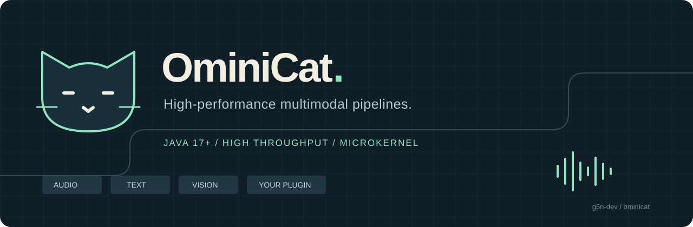
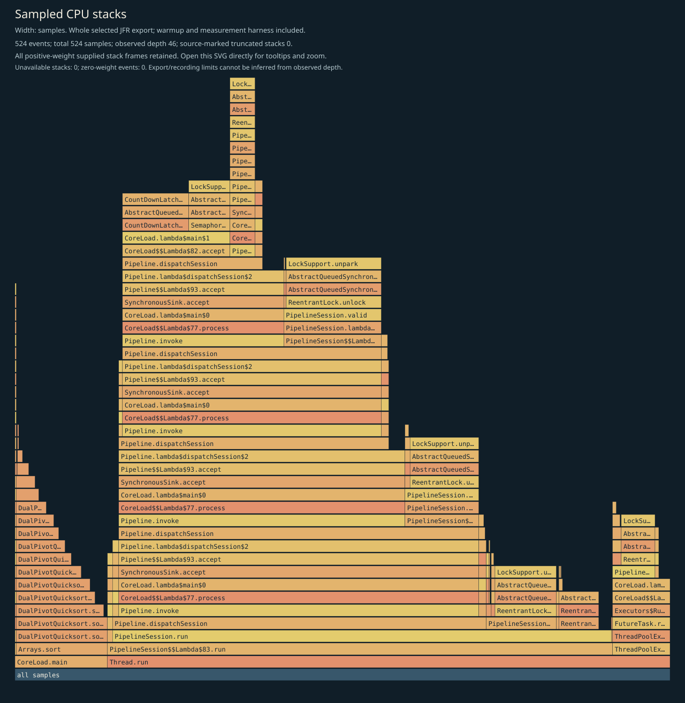
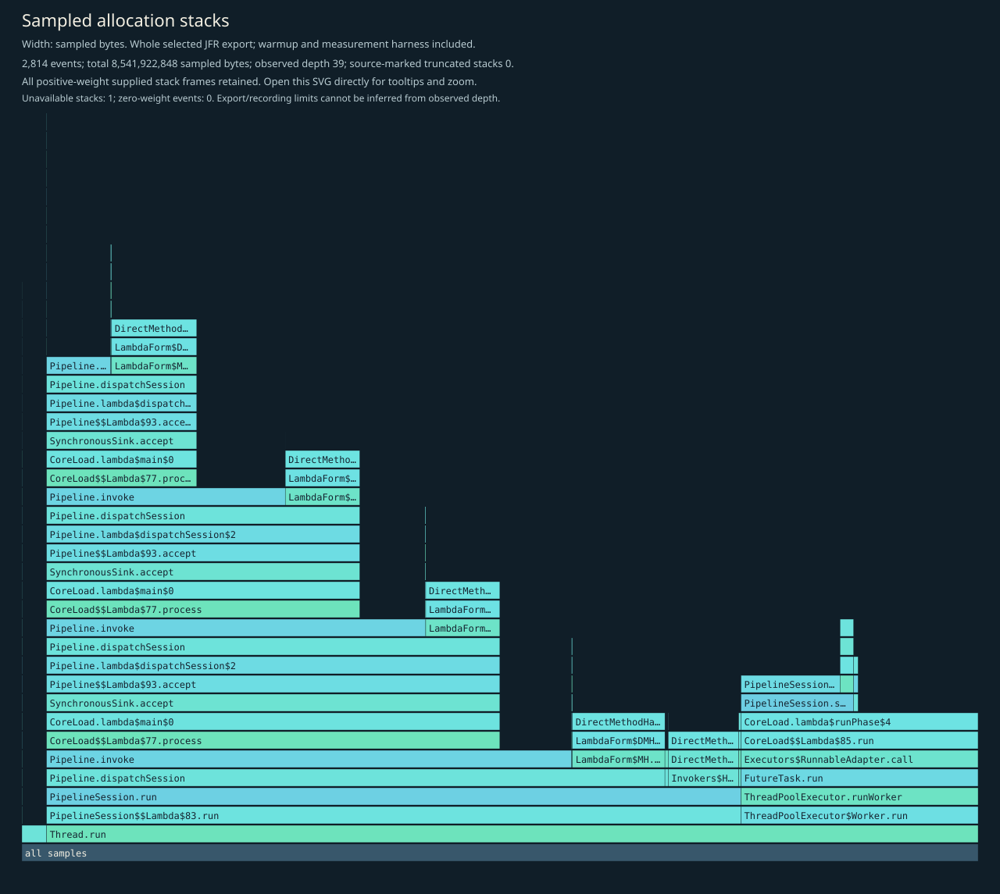
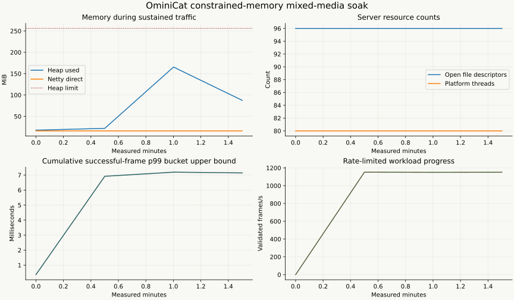

<p align="center"></p>

<p align="center"><a href="README.md">English</a> · <a href="#先运行起来">快速开始</a> · <a href="docs/architecture.md">架构</a> · <a href="docs/configuration.md">配置</a> · <a href="docs/plugins.md">插件开发</a> · <a href="#java-17-性能实测">性能实测</a> · <a href="#profile">Profile</a></p>

**OminiCat 是高性能 Java 多模态会话微内核，面向高吞吐与低调度开销设计。** 用统一帧契约连接音频、文本、图像、转写、模型和会话处理器；既能放进现有 Java 应用，也能独立启动为 WebSocket 服务容器。

当前为 **0.1 开发预览版**。核心机制有本地测试和可复跑的性能证据，真实厂商长连接、长稳运行和部署容量仍需在目标环境验证。

[Java 17 验证报告](reports/verification.md)包含 **256 项通过测试、512 个随机种子和真实协议故障验证**，覆盖响应体保持打开时的中断、资源释放与下一轮恢复。[内核与资源剖析](reports/java17/http-cancellation/README.md)及[Java 21 历史报告](reports/deep/README.md)保留原始产物与测量范围。

## Java 17 性能实测

高性能是运行时的核心设计目标，已有[可复跑的基准数据](reports/java17/kernel/report.md)：

| 测量项 | 实测结果 | 负载范围 |
| --- | ---: | --- |
| 同步内核分发 | **4,054 万次/秒** | 四阶段数值变换，单个 JMH 测试线程 |
| 会话平均往返 | **7.104 微秒/次** | 四阶段、单帧在途，包含入队、工作线程调度与输出交接 |
| 同步分发分配量 | **328 B/次** | 四阶段本地数值帧负载 |
| 有界并发处理 | **270.6 万帧/秒** | 16 会话 × 四阶段，p99 **1.436 毫秒**；2,500 万测量帧，0 拒绝 |

测量环境：Java 17.0.21、Apple M2 Pro / macOS arm64、512 MiB 堆、平台工作线程；JMH 使用两个独立进程，每个进程预热 3 × 1 秒、测量 5 × 1 秒。主机同时承担开发和验证任务。这些指标对应本地数值帧的分发与调度；网络往返和模型调用有独立的测量范围。[JMH 原始数据](reports/java17/kernel/jmh.json) · [并发负载数据](reports/java17/kernel/load.json) · [CPU / 分配 / GC 剖析](reports/java17/kernel/profiles.md)。

性能设计落在具体机制上：

- **直接分发**：核心仅依赖 JDK，统一帧直接经过处理器调用；同步嵌入路径无需会话调度或 JSON 转换。
- **会话独占**：线性阶段由会话工作线程串行调度，显式并行分支使用受限分支工作线程；异步回调回到会话队列，各会话可并行推进。
- **显式背压**：输入、异步在途任务、分支并行度与缓冲、网络待发送字节均有上限，过载可观察、可配置。
- **跨版本线程后端**：Java 17 使用平台线程，Java 21 及以上自动使用虚拟线程；容器中的阻塞处理器工作与 Netty 网络事件循环分开执行。

[性能设计与测量方法](docs/performance.md) · [资源曲线与故障验证](reports/java17/http-cancellation/README.md)。

## Profile

### CPU、内存分配与 GC

这份 **Java 17 内核剖析**包含 524 个 CPU 栈采样和 2,814 个分配采样，覆盖预热、有界数值帧负载及测量程序，包括百分位排序。CPU 图宽度表示采样数，分配图宽度表示估计的分配字节权重；后者与存活堆大小、对象数量是不同指标。





| 内核 JFR 记录 | 实测值 |
| --- | ---: |
| GC 次数 | **33** |
| GC 累计暂停 | **33.959 ms** |
| 最长记录 GC 暂停 | **1.715 ms** |

GC 数据来自包含预热和测量程序的整段内核记录。[完整剖析](reports/java17/kernel/profiles.md) · [选定 JFR 事件](reports/java17/kernel/jfr-events.json.gz) · [GC 日志](reports/java17/kernel/gc.txt) · [源码与运行环境](reports/java17/kernel/measurement-context.json)。当前发行包的核心字节码保持一致，详见[产物差异](reports/java17/http-cancellation/artifact-delta.json)。

### 堆、直接内存与线程

下面是独立的 **120.127 秒混合媒体 WebSocket 回显资源验证**：先预热 10 秒，再运行 64 个持续连接（各约 20 帧/秒）和 4 个连接轮换工作任务（每轮暂停 100 ms）；共验证 **138,239 帧、4,377 次新连接，0 失败**，会话、工作线程和待发送数据全部排空。堆上限为 256 MiB，直接内存上限为 128 MiB。



| 资源 | 预热后 | 排空后 |
| --- | ---: | ---: |
| 请求完整 GC 后的已用堆 | 12.687 MiB | 7.795 MiB |
| Netty 池化直接内存保留量 | 16 MiB | 16 MiB |
| 打开的文件描述符 | 96 | 32 |
| 平台线程 | 80 | 16 |

曲线展示负载期间的定期采样，已用堆包含等待回收的临时对象。排空后 NMT committed 为 **484.658 MiB**，包含固定堆、原生线程栈、JVM 内部结构和剖析开销，与 RSS 是不同指标。[资源验证报告](reports/java17/http-cancellation/README.md) · [采样数据](reports/java17/http-cancellation/soak-samples.jsonl) · [GC 后对比](reports/java17/http-cancellation/soak-summary.json) · [原生内存诊断](reports/java17/http-cancellation/resource-diagnostics.json)。内核剖析与这次资源验证分别保留各自的负载和产物范围。

### 本地生成 Profile

准备 JDK 17+ 和 Python 3：

```bash
./scripts/profile.sh quick reports/local/profile
python3 scripts/summarize_profiles.py reports/local/profile
```

输出包含 `report.md`、`profiles.md`、CPU / 分配 SVG 及本地 JFR / GC 数据。使用 `full` 可增加 JMH 预热和测量时间。[剖析方法](docs/performance.md) · [持续资源验证复跑说明](validation/README.md)。

## 先运行起来

最低支持 **JDK 17**，构建和运行均以 Java 17 为基线；Java 21 及以上自动使用虚拟线程。仓库自带 Maven Wrapper，详见[版本兼容与验证](docs/java-compatibility.md)。

```bash
git clone https://github.com/g5n-dev/ominicat.git
cd ominicat
./mvnw -B verify
java -jar ominicat-server/target/ominicat-server.jar --config config/demo.yaml
```

打开 [本地体验页](http://127.0.0.1:8080)，发送文字、麦克风录音、图片或带说话人的转写。默认 `echo` 配置不需要模型密钥，直接验证输入到输出的完整通路。

## 小内核，可组合的能力

| 层 | 提供的机制 |
|---|---|
| 微内核 | 零第三方运行依赖、统一帧、有界队列、跨版本工作线程、取消栅栏、排空与资源回收 |
| 流式扩展 | 同步处理器和独立的异步回调 SPI；回调重新进入有界调度队列 |
| 编排 | 命名分支与确定顺序的汇合、截止时间、输出前降级、独立异步出口 |
| 会话 | 稳定片段 ID、修订与最终提交、角色和说话人分离、时间区间、窗口与快照 |
| 可配置策略 | 带版本和证据的结构化评估、提示模板、可寻址步骤与条件路由 |
| 容器 | Netty WebSocket、YAML 配置、SPI 发现、鉴权、容量限制、Prometheus 指标 |

```yaml
host: 127.0.0.1
port: 8080
queueCapacity: 256
maxSessions: 256
stages:
  - type: transcript-gate
  - type: conversation-evaluator
    options:
      speaker: agent
      requiredPhrases: "hello,thank you"
      policyVersion: "example-v1"
```

每个会话创建独立的处理器实例。新能力实现 `ProcessorFactory`，通过 Java `ServiceLoader` 注册，再由 YAML 选择；内核无需依赖具体厂商或应用策略。

`FrameEnvelope` 把会话、轮次、关联、因果和时间信息带入管线。媒体采用明确格式：音频为 PCM16LE，带流标识和采样位置；转写带稳定片段标识、修订号、说话人、角色、起止时间以及 final 标记。`EnvelopeProcessor.wrap` 保留同步和异步阶段的元数据。

## 适配器与示例

- [离线回显](config/demo.yaml)：文字、音频、图像和转写的传输验证。
- [语音管线](config/voice.yaml)：分段转写 → 提示模板 → 流式文本生成 → 语音合成。
- [图像输入](config/vision.yaml)：编码图像进入兼容模型接口。
- [独立音轨](config/dual-stream.yaml)：声道拆分、各流隔离及可配置归属。
- [会话策略](config/conversation.yaml)、[步骤流程](config/steps.yaml)和[确定性回放](examples/README.md)。

现有兼容 HTTP 转写适配器处理有界语音片段，语音合成按轮次缓冲；文本模型通过 SSE 输出。厂商原生双向语音流可通过 `AsyncProcessor` 接入，具体适配器需要独立实现和验证。WebRTC、自动说话人分离、回声消除、持久化消息投递与自动重连不包含在当前发行物中。

## 性能与验证

```bash
# 测试、HTML 覆盖率报告、CycloneDX 依赖清单
./mvnw -B -Pcoverage,sbom clean verify

# 独立进程 JMH、分配率、有界并发负载、JFR 与 GC
scripts/profile.sh quick reports/local/run

# 对默认 echo 服务做真实 WebSocket 往返测量
java scripts/WebSocketLoad.java ws://127.0.0.1:8080/ws 32 5000
```

查看[测量方法](docs/performance.md)、[Java 17 实测](reports/java17/kernel/report.md)、[CPU / 分配 / GC 分析](reports/java17/kernel/profiles.md)和[验证摘要](reports/verification.md)。报告标明 JVM、负载、预热、采样和限制，区分内核分发、队列延迟与网络往返；它们不代表模型推理延迟或生产容量。

## 继续阅读

- [架构、所有权与生命周期](docs/architecture.md)
- [配置、鉴权与部署](docs/configuration.md)
- [帧协议](docs/protocol.md)与[插件开发](docs/plugins.md)
- [通用场景覆盖矩阵](docs/scenario-coverage.md)
- [迭代计划与验收标准](docs/iteration-plan.md)
- [跨项目接入契约提案](docs/integration-contracts.md)
- [时间区间、分段与注释契约提案](docs/temporal-annotations.md)
- [会话扩展](ominicat-conversation/README.md)与[适配器能力](ominicat-providers/README.md)

采用 [Apache License 2.0](LICENSE)。OminiCat 是独立 Java 实现，采用自身的 API 和线协议。
