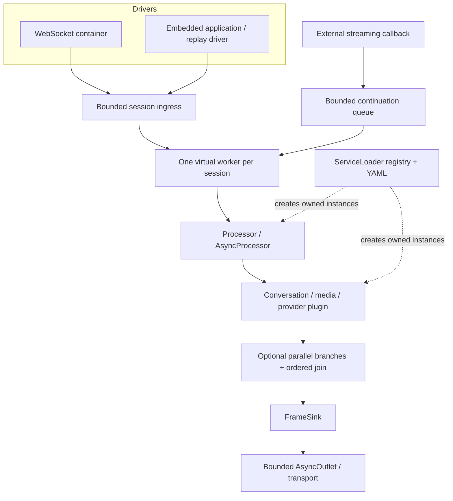

# Runtime architecture

OminiCat is a Java 21 microkernel for multimodal conversations. The kernel provides scheduling and lifecycle mechanisms; plugins provide media processing, model calls and application policy. A new provider does not require a kernel change.

| Module | Responsibility | Production dependencies |
|---|---|---|
| `ominicat-core` | Frames, envelopes, processor SPI, lifecycle, bounded queues, composition | JDK only |
| `ominicat-conversation` | Final transcript windows, policy evaluation, prompt composition, step flows | Core |
| `ominicat-providers` | PCM utilities, transcript gate, compatible HTTP model adapters | Core, Jackson |
| `ominicat-server` | Netty WebSocket/HTTP, YAML assembly, authentication, metrics, playground | Core, plugins, Netty, Jackson |
| `ominicat-benchmarks` | JMH, allocation and bounded load measurement | Core, JMH |

## Contracts

`Frame` is open. Extensions can introduce events without editing a central subtype list. Built-in media frames snapshot input bytes and return independent read-only buffers. Audio is interleaved signed PCM16 little endian; `streamId` identifies a track and `startSample` identifies its per-channel sample position (`-1` means unavailable).

`Transcript` separates speaker identity from application role. A source supplies a stable `segmentId`, nonnegative revision, time range, final flag and confidence (`-1` means unavailable). Explicit IDs are required when an ASR source revises a segment's time range. The six-argument convenience constructor derives an ID from speaker/time range for simple immutable segments.

`transcript-gate` makes partial replacement and final commit explicit: revisions replace earlier partials; identical committed finals are suppressed; contradictory committed facts fail. Deduplication is bounded to retained IDs. The conversation window evaluates committed finals and exposes eviction counts; it never labels a retained window as a complete session.

`FrameEnvelope` is a first-class frame. `EnvelopeProcessor.wrap` preserves session, turn and correlation IDs while deriving new IDs and causation links for emitted frames, including asynchronous emissions. Inject IDs and a monotonic clock for replay. Raw frames remain available for simple local pipelines and low-overhead kernels. Nanosecond fields share one local monotonic clock domain; remote capture clocks must be normalized by the driver before comparison. These caller-owned IDs are correlation data, not authentication identities.

`Failure` and scoped `Cancel` are typed application events. A processor exception fails its session. The generic transport passes scoped cancellation events to application logic; the explicit `interrupt` command interrupts the current session generation. An application that owns request IDs must implement request-specific cancellation rather than treating a request as an entire session.

## Scheduling and ownership

Each session exclusively owns a fresh pipeline and its processor instances. Synchronous processor invocations, reset hooks and cleanup run serially on one virtual worker. A processor may emit zero, one or many frames synchronously. It must not retain a synchronous `FrameSink` for later use.

`AsyncProcessor` is the separate callback contract. Its emitter queues continuations at the next stage, with the originating cancellation generation. Callback threads never enter downstream processors directly. Continuations share the bounded session queue, active invocations are bounded, and producers must handle explicit rejection. `complete()` releases an invocation; `fail()` propagates failure. Registered cancellation handles close on the worker. A driver must configure deadlines for callbacks that might never complete.

Ordinary control frames have no hidden kernel effects. `finish()` closes intake and drains accepted work and outstanding asynchronous invocations; `completion()` resolves after reverse cleanup. With async processors, callback arrival order determines continuation order; an END payload is not an implicit cross-branch barrier. The server closes a drained connection only after session completion.

`interrupt()` invalidates the previous generation, discards queued work, interrupts blocking I/O and serializes `onInterrupt()` before the next generation. Late callbacks are rejected. Already-started external effects cannot be revoked; plugins must cooperate with cancellation. `close()` is immediate cooperative cancellation; callers can await the completion future.

## Composition and failure

`ParallelProcessor` owns named, distinct branch instances, bounds each branch's buffered frames, applies one deadline and emits joined results in declaration order only after every branch succeeds. A failure, timeout or parent interruption cancels siblings. It is an explicit fork/join node, not an arbitrary YAML DAG scheduler.

`FallbackProcessor` uses a secondary only if the primary fails before any output. It never replays a partially delivered stream or falls back on interruption. Adapter deadlines remain explicit. `AsyncOutlet` separates slow delivery from the session worker using a bounded queue; saturation, sink failures and drain completion are observable. It does not supply durable retries or exactly-once delivery.

The server bounds sessions, frame bytes, ingress capacity and pending outbound bytes. Overload is explicit rather than a silent loss of control frames. Client code must react to errors/closure and stop sending. Global quotas and multi-node admission control belong in an edge service or application plugin.

## State and integration boundaries

Conversation and step-flow snapshots are validated runtime state. Applications choose a durable store, commit point, access controls and reconnection identity. Restore does not replay completed external effects. The runtime does not claim crash recovery, durable message delivery, a media echo canceller, WebRTC transport, distributed orchestration, or live provider-specific ASR implementations.

Stateful plugins can be composed in-process. External model services, message queues and stores can scale separately. Keep credentials in environment variables or a deployment secret manager; include only environment variable names in YAML. The process loads plugins from its classpath at startup; runtime bundle hot-unload is not provided.
