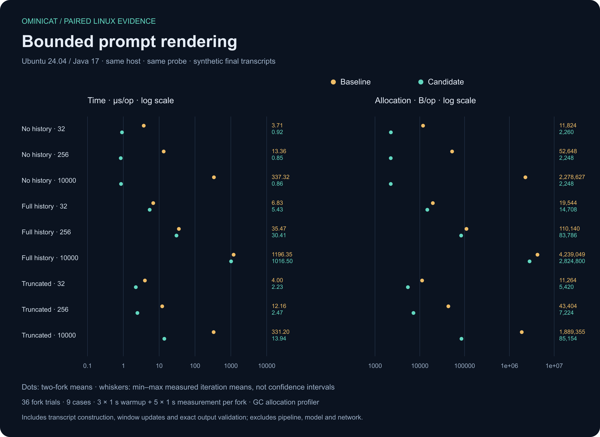

<!-- ominicat-language-nav -->
[简体中文](zh-CN/performance-audit.md) · **English**
<!-- /ominicat-language-nav -->

# Performance audit

This audit examines local framework work, excluding model and network latency. It separates source-confirmed work from measured optimization benefits. Existing numeric-frame framework comparisons do not measure prompt construction, media codecs, asynchronous providers or Studio observation.

## Selected increment: bounded prompt rendering

The original prompt path called `ConversationWindow.snapshot()` only to obtain turns. That also recomputed interval unions and per-speaker statistics. It assembled every retained history line before discarding old lines, even when a template omitted history. These costs are unnecessary for producing the same prompt.

The optimized path reads an immutable turn-only snapshot, caches the number of history placeholders, and constructs only the complete history suffix that fits the configured character budget. A template without history returns after its base-prompt limit check. Transcript retention, deduplication, error messages, interruption, UTF-16 budgets and single-pass substitution retain their existing behavior. Public evaluation snapshots still calculate their full metrics.

The [paired Linux workflow](../.github/workflows/prompt-cost.yml) uses the same [JMH probe](../ominicat-benchmarks/src/main/java/io/ominicat/benchmarks/PromptCostProbe.java) with baseline and candidate runtime JARs. Nine cases cover 32, 256 and 10,000 retained turns with omitted, full or truncated history. Setup seeds a full window outside timing; every measured operation creates a new final transcript, updates the real window, renders and checks the exact expected output. The full-string oracle is included in both timings. This is a prompt-stage cost, not kernel dispatch or end-to-end conversation latency.

One Ubuntu 24.04 / Java 17 job executes baseline → candidate → candidate → baseline sequentially: two independent JVM forks per side and case, with three one-second warmups and five one-second measurements in each fork. Every fork verifies the actual core, conversation and probe JAR hashes. The [collector](../scripts/prompt_cost.py) rejects incomplete matrices, changed raw data, mixed runtimes and settings. Hosted-runner noise remains; observed ranges are not confidence intervals or a production capacity estimate.

## Paired Linux results

The [successful comparison](https://github.com/g5n-dev/ominicat/actions/runs/41237981646) measured baseline 208b0c4 against candidate d0d63ff. The [complete raw evidence](../reports/performance-audit/prompt-render-2026-11-01/manifest.json) and [fork means / iteration ranges](../reports/performance-audit/prompt-render-2026-11-01/comparison.json) remain archived. These runtime and probe source fingerprints match the shipped implementation; later publication changes add diagnostics and documentation.

| Turns | History | Baseline µs/op | Optimized µs/op | Time reduction | Baseline B/op | Optimized B/op | Allocation reduction |
| ---: | --- | ---: | ---: | ---: | ---: | ---: | ---: |
| 32 | full | 6.827 | 5.434 | 20.4% | 19544.0 | 14708.3 | 24.7% |
| 32 | none | 3.710 | 0.917 | 75.3% | 11824.0 | 2260.0 | 80.9% |
| 32 | trimmed | 4.000 | 2.231 | 44.2% | 11264.0 | 5420.1 | 51.9% |
| 256 | full | 35.470 | 30.412 | 14.3% | 110140.3 | 83785.7 | 23.9% |
| 256 | none | 13.364 | 0.847 | 93.7% | 52648.1 | 2248.0 | 95.7% |
| 256 | trimmed | 12.160 | 2.469 | 79.7% | 43404.1 | 7224.1 | 83.4% |
| 10000 | full | 1196.349 | 1016.495 | 15.0% | 4239049.0 | 2824799.8 | 33.4% |
| 10000 | none | 337.319 | 0.862 | 99.7% | 2278627.2 | 2248.1 | 99.9% |
| 10000 | trimmed | 331.202 | 13.939 | 95.8% | 1889355.0 | 85153.8 | 95.5% |

Every mean improved in this run; full-history time improvements are smaller than omitted/truncated-history gains. These are observed means, not guaranteed speedups. Full history still requires constructing and checking the complete output. Truncated history still takes an immutable turn-list snapshot, so its allocation grows with retained window size even when few lines fit. A future traversal optimization needs its own bounded ownership and equivalence tests.

## Current Linux kernel baseline

A fresh [Java 17 profile run](https://github.com/g5n-dev/ominicat/actions/runs/41237014639) measured the unchanged kernel at revision 208b0c4 on Linux/amd64, Temurin 17.0.21 and four available processors. The [complete allowlisted archive](../reports/performance-audit/linux-java17-2026-11-01/report.md) binds sources, artifact hashes, JMH settings and CPU/allocation/GC figures. Three forks each used five two-second warmups and eight two-second measurements; the table retains JMH's 99.9% error estimate. Direct dispatch and session round trips are separate workloads.

| Mode | Stages | Score | JMH error | Unit | Allocation B/op |
| --- | ---: | ---: | ---: | --- | ---: |
| Direct dispatch | 1 | 59,090,636.005 | ± 1,174,249.131 | ops/s | 112.000 |
| Direct dispatch | 4 | 22,189,603.035 | ± 239,393.999 | ops/s | 328.000 |
| Direct dispatch | 16 | 5,514,447.752 | ± 21,234.574 | ops/s | 1192.001 |
| Session round trip | 1 | 23.226 | ± 1.595 | us/op | 248.042 |
| Session round trip | 4 | 22.363 | ± 1.472 | us/op | 488.033 |
| Session round trip | 16 | 23.365 | ± 1.441 | us/op | 1448.037 |

Overall allocation grows by about 72 B per added direct stage and 80 B per added session stage. This includes transformed numeric frames and invocation machinery, so it does not isolate the cost of the guards. Whole-recording allocation samples also show captured continuations and scoped sinks. These results justify a focused allocation experiment, not a promised speedup. The archived report's generic shared-development-machine sentence is a template warning; the actual collector is the linked GitHub runner, whose other tenants are not observed.

The new CPU recording contains 1,200 leaf samples, including 637 at LockSupport.unpark. Only 150 of those have session validity checks in their supplied stack; 302 come through the load driver's semaphore release and 77 through queue take. Counting every unpark sample as kernel validity cost would misattribute the harness. These counts cover warmup/load/sorting and are not time percentages.

[Open the complete CPU, allocation and GC figures](../reports/performance-audit/linux-java17-2026-11-01/profiles.md).

## Remaining optimization candidates

| Candidate | Confirmed work | Evidence needed before changing behavior |
| --- | --- | --- |
| Synchronous invocation allocation | [Dispatch](../ominicat-core/src/main/java/io/ominicat/core/Pipeline.java) creates a captured continuation plus a scoped sink per stage. Both appear in [Linux allocation samples](../reports/comparison/linux-ubuntu24-java17-2026-10-31/profiles/ominicat/profiles.md). Samples are not exact allocation per operation. | Matching Linux allocation and latency baselines, plus raw/envelope async and media-construction probes. Try a disposable combined invocation; retain thread/lifetime checks and reference release. Never reactivate a retired sink. |
| Generation validity reads | [Session validity](../ominicat-core/src/main/java/io/ominicat/core/PipelineSession.java) takes the session lock at each stage boundary and final output. | Contended multi-submitter and bounded-inflight tests, paired CPU/latency/allocation evidence. A published per-generation ticket is an experiment; ordinary unsynchronized field reads cannot replace cancellation fencing. |
| Outbound wire representations | [Frame encoding](../ominicat-server/src/main/java/io/ominicat/server/FrameCodec.java) creates a JSON tree, Base64 data and a string before the [transport](../ominicat-server/src/main/java/io/ominicat/server/OminiCatServer.java) measures UTF-8 bytes and creates the network frame. | Isolate text/audio/image encoding before trying an internal byte-oriented path. Preserve public encoding, Unicode, exact byte limits, ordering and buffer release. Keep immutable input snapshots. |
| Activity journal lock scope | [Journal reads](../ominicat-server/src/main/java/io/ominicat/server/ActivityJournal.java) serialize a whole event page while holding the same monitor used by traced writers. | Multi-session append plus concurrent pagination, exact cursor/gap checks and bounded immutable event snapshots. Measure observation-enabled workloads separately from default sessions. |
| Transcription request copies | [Transcription buffering](../ominicat-providers/src/main/java/io/ominicat/providers/TranscriptionFactory.java) copies PCM through temporary chunks, accumulation, WAV and multipart materialization. Source inspection identifies at least six payload-length copies before upload, excluding growth, immutable input construction and HTTP internals. This is a copy count, not measured allocation or RSS. | Separate append, WAV and complete request construction with exact byte oracles, stream isolation, interruption and near-limit inputs. Preserve defensive ownership. |
| SSE parsing | [Chat parsing](../ominicat-providers/src/main/java/io/ominicat/providers/ChatFactory.java) performs character scanning, line/event assembly and JSON-tree parsing for streamed text. | In-memory UTF-8 event fixtures with fragmented reads, per-event allocation and first-event delivery. Retain strict decoding, limits, cancellation, CR handling and the explicit completion marker. |
| Parallel result copies and flush batching | [Branch joining](../ominicat-core/src/main/java/io/ominicat/core/ParallelProcessor.java) copies a private reference buffer; transport flushes each output. | Measure these separately. Reference transfer can retain excess capacity; flush batching can worsen single-frame tail latency. Preserve all-success ordered joins, deadlines and per-frame transport reservations. |

## Acceptance and follow-up

Prompt regression tests compare complete outputs with an independently assembled suffix oracle, including random event sequences, repeated placeholders, Unicode, literal placeholder text, errors, deduplication and interruption. The normal Java 17/21/25 checks remain required. Runtime changes need coverage/SBOM verification and 512 stress seeds.

The kernel allocation experiment remains behind the [existing baseline prerequisites](iteration-plan.md#performance-evidence). Async weak references, generation fences, scoped sinks and immutable media snapshots carry verified lifecycle responsibilities. Source inspection identifies candidates; only matched before/after evidence can establish a benefit.
