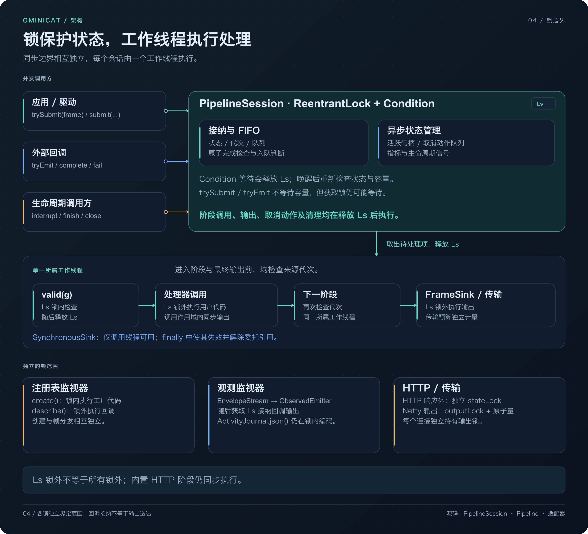
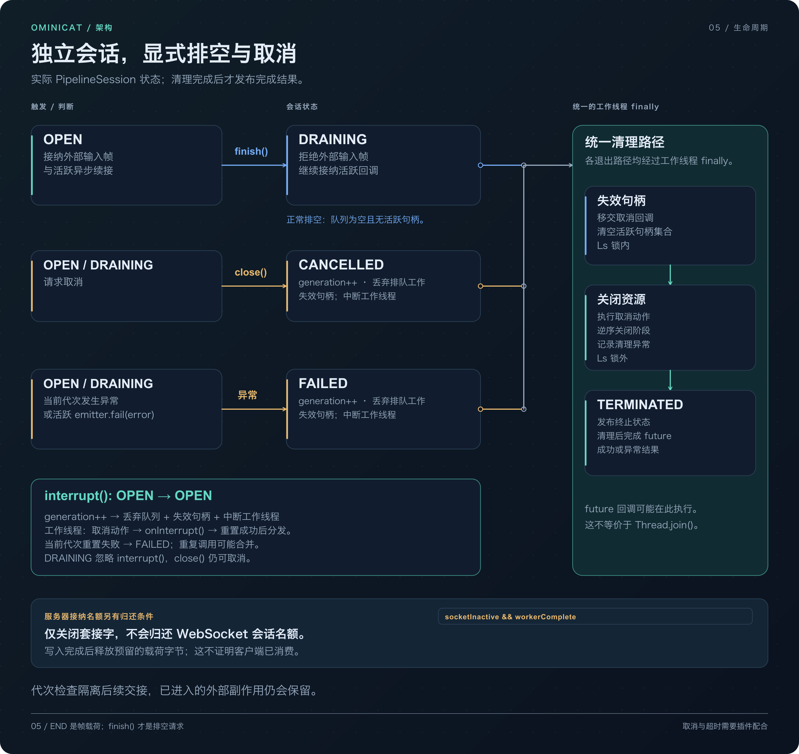

<!-- ominicat-language-nav -->
**简体中文** · [English](../architecture.md) · [中文文档目录](index.md)
<!-- /ominicat-language-nav -->

# 运行时架构

OminiCat 是用于多模态会话的 Java 17+ 微内核。内核提供调度与生命周期机制；插件提供媒体处理、模型调用和应用策略。接入新的提供方无需修改内核。

图中将依赖与组装关系同帧流分开。Java 应用可以直接使用内核。服务器 YAML 与工厂发现提供可配置容器体验；提供方和会话状态依赖核心契约，不会成为内核策略。启动时发现工厂，再为每个 WebSocket 会话创建配置中的处理器。

| 模块 | 职责 | 生产依赖 |
|---|---|---|
| `ominicat-core` | 帧、信封、处理器 SPI、生命周期、有界队列与组合 | 仅 JDK |
| `ominicat-conversation` | 最终转写窗口、策略评估、提示组合与步骤流程 | Core |
| `ominicat-providers` | PCM 工具、转写门控与兼容 HTTP 模型适配器 | Core、Jackson |
| `ominicat-server` | Netty WebSocket／HTTP、YAML 组装、鉴权、指标与调试页 | Core、插件、Netty、Jackson |
| `ominicat-benchmarks` | JMH、分配与有界负载测量 | Core、Conversation、JMH |

## 两条执行路径

| 入口 | 执行与所有权 | 成本边界 |
| --- | --- | --- |
| `Pipeline.process(frame, sink)` | 在调用方线程同步调用处理器。调用方串行访问并关闭处理器。已被会话接管或包含 `AsyncProcessor` 的管线拒绝直接使用。 | 没有会话 FIFO 或阶段间编解码；每次调用仍创建具有作用域的 `SynchronousSink` 和续接。 |
| `openSession(...).trySubmit(frame)` | 有界 FIFO 为一个所有者工作线程提供任务。已接纳回调将 `(frame, generation, nextStage)` 放入同一 FIFO，由该工作线程续接下游阶段。 | 执行仍有队列锁、待处理记录、generation 检查和线程交接成本。已接纳的入队顺序决定续接顺序。 |

独立服务器使用 Netty NIO 事件循环处理传输。帧解码和连接／阶段组装发生在 I/O 回调中；正常处理器执行与输出编码发生在会话工作线程上，之后交由 Netty 写出。这是处理边界，不表示所有昂贵操作都已移出事件循环。

源码：[Pipeline](../../ominicat-core/src/main/java/io/ominicat/core/Pipeline.java)、[SynchronousSink](../../ominicat-core/src/main/java/io/ominicat/core/SynchronousSink.java)、[PipelineSession](../../ominicat-core/src/main/java/io/ominicat/core/PipelineSession.java)、[服务器回调与输出](../../ominicat-server/src/main/java/io/ominicat/server/OminiCatServer.java)。

## 契约

`Frame` 是开放接口。扩展可引入事件，无需修改中央子类型列表。内置媒体帧对输入字节建立快照，返回独立的只读缓冲区。音频为交错排列的有符号 PCM16 小端数据；`streamId` 标识音轨，`startSample` 表示按通道计的采样位置（`-1` 表示不可用）。

`Transcript` 将说话人身份与应用角色分开。来源提供稳定的 `segmentId`、非负修订号、时间范围、最终标志与置信度（`-1` 表示不可用）。ASR 来源修订片段时间范围时，必须使用显式 ID。六参数便捷构造函数根据说话人／时间范围派生 ID，适用于简单不可变片段。

`transcript-gate` 明确区分中间结果替换与最终提交：修订替换较早的中间结果；相同的已提交最终结果被抑制；矛盾的已提交事实导致失败。去重仅覆盖保留的 ID。会话窗口评估已提交最终结果并提供淘汰计数，不会把保留窗口称作完整会话。

`FrameEnvelope` 本身也是帧。`EnvelopeProcessor.wrap` 在保留会话、轮次与关联 ID 的同时，为输出帧派生新 ID 和因果链接，也适用于异步输出。回放时注入 ID 和单调时钟。简单本地管线和低开销内核仍可使用裸帧。纳秒字段共享一个本地单调时钟域；远程采集时钟必须由驱动归一化后才能比较。这些由调用方管理的 ID 是关联数据，不是鉴权身份。

`Failure` 和带作用域的 `Cancel` 是类型化应用事件。当前 generation 的处理器异常会使所属会话失败。通用传输将带作用域的取消事件传给应用逻辑；显式 `interrupt` 命令中断当前会话 generation。管理请求 ID 的应用必须实现请求级取消，不能把一个请求等同于整个会话。

## 调度与所有权

同一份 Java 17 字节码可运行于 Java 17、21 和 25。`WorkerThreads` 在 Java 17 使用命名守护平台线程，在 Java 21+ 通过公开 JDK API 发现虚拟线程工厂。工作线程能力发现发生在初始化期间，不在帧分发路径中。两个后端的分支执行器都有显式并发与队列上限。详见 [Java 兼容性](java-compatibility.md)。

每个会话独占新建的管线及处理器实例。同步处理器调用、重置钩子和清理都在一个会话工作线程上串行执行。处理器可同步输出零帧、一帧或多帧，不得保存同步 `FrameSink` 供以后使用。

`AsyncProcessor` 是独立的回调契约。它的 emitter 携带原始取消 generation，把续接放入队列，从下一阶段继续。回调线程绝不直接进入下游处理器。续接共享有界会话队列；活跃异步调用另有独立计数上限。`tryEmit` 成功只表示队列接纳，不表示下游已执行或结果已交付。生产者必须处理拒绝，并最终调用 `complete()` 或 `fail()`。

## 锁职责与回调边界

单个会话工作线程串行处理状态；`ReentrantLock` 协调调用方、回调生产者与工作线程。锁保护的是短暂的状态和队列操作，不覆盖一次完整处理调用。同步下游阶段在 FIFO 出队后，继续由同一工作线程执行，并在每个阶段边界重新检查 generation。检查结束后先释放会话锁，再调用阶段或输出 sink。

| 保护机制 | 保护的职责 | 持有期间的边界 |
| --- | --- | --- |
| 会话 `ReentrantLock` 与 `Condition` | 入口状态、generation、FIFO、活跃句柄、取消队列与指标 | 队列接纳／取出及生命周期变更。处理器调用、取消动作、重置钩子与逆序清理均在此锁外执行。 |
| 信封与可选观测包装器的 monitor | 回调终态、元数据与委托句柄引用 | 输出时可能在仍持有包装器 monitor 的情况下进入核心会话锁。提供方取消动作在包装器释放自身 monitor 后执行。 |
| 显式并行分支锁 | 每个分支的处理、重置与关闭所有权 | 分支代码执行时持有自身锁。这不同于调用处理器前即释放的会话锁。 |
| HTTP 响应体 `stateLock` | subscription／需求状态、当前字节缓冲区与终态 | 本地检查及缓冲区／队列更新。阻塞的 `items.take()`、`Subscription.request(1)` 与 `Subscription.cancel()` 均在此 monitor 外执行。 |
| 服务器 `outputLock` | 可写性检查、载荷字节预留、写出提交与关闭帧提交 | `writeAndFlush` 提交发生在 monitor 内，网络完成是异步的；其 future 无论成功或失败都会归还预留量。 |
| `PluginRegistry` monitor | 工厂注册、查找与处理器创建 | `register` 在同步保护内调用 `factory.type`，`create` 在同步保护内调用 `factory.create`。`describe` 获取配置快照后，在 monitor 外调用描述方法。发现流程不属于逐帧分发路径。 |
| 可选 `ActivityJournal` monitor | 环形记录写入、会话编号与事件分页序列化 | 当前 `json` 在写入方共用的 monitor 内构建并编码页面，并未对脱离锁的快照进行序列化。 |

对于带信封且开启观测的异步输出，包装器嵌套顺序为信封 monitor → 观测 monitor → 会话锁。观测包装器追加 journal 事件前，核心已释放自己的锁，但包装器 monitor 可能仍被持有。这是当前实现的嵌套关系，不表示任意插件调用都无锁，或总在所有锁外执行。Studio 观测需要显式启用；序号表示 journal 插入顺序，不是全局因果顺序。

`SynchronousSink` 只允许在所属调用线程上输出。`process` 返回或抛出时，`finally` 路径会清除所属线程与下游委托引用。因此，即使缓存了已失效的 sink，也无法继续调用或通过它保留下游对象图。核心异步句柄则以弱引用指向所属会话。会话强引用活跃句柄，并在各操作结束时移除；已完成句柄会清除取消动作引用。信封包装器在结束时还会断开 emitter、元数据、ID 供应器与时钟引用。插件或 SDK 如果自行捕获了媒体或应用对象，仍需自行管理那些引用。

## 生命周期、取消与释放

| 操作 | 状态与已接纳工作 | 完成边界 |
| --- | --- | --- |
| 普通 `Frame.Control(END)` | 应用载荷，没有隐含的内核状态变更。服务器在接纳 END 命令后，另行调用 `finish()`。 | 标记可能在更早的异步调用发出最终续接前经过下游，并不是排空屏障。 |
| `finish()` | `OPEN` → `DRAINING`。关闭外部入口；活跃 emitter 仍可在容量允许时加入续接。 | 工作线程等待 FIFO 为空且没有活跃句柄后，再执行清理。永不结束的回调可能阻止排空；插件需要有限截止时间。 |
| `interrupt()` | 仅在 `OPEN` 生效：推进 generation、清空排队工作、使句柄失效并中断工作线程；入口保持开放。 | 工作线程先执行取消动作，再按阶段顺序执行 `onInterrupt()` 重置，随后恢复处理工作。当前 generation 的取消／重置若失败，则进入 `FAILED` 并清理；重置会在首个抛错钩子处停止，不再续接工作。多次请求可以合并成一次重置，不保证每次请求都对应一次钩子调用。 |
| `close()` | `OPEN` 或 `DRAINING` → `CANCELLED`：关闭入口、清空排队工作、使句柄失效并中断工作线程。 | 不等待合作式清理即返回。完成 future 报告取消及保留的清理错误。 |
| 当前 generation 的处理器异常或活跃 `AsyncEmitter.fail()` | 会话进入 `FAILED`，推进 generation，取消待处理与活跃工作。 | 取消动作与阶段逆序清理均先于异常完成；清理错误会附加保留。 |

工作线程在会话锁内从队列取出取消动作，解锁后再调用。最终收尾时，它排空剩余取消动作，逆序关闭处理器，发布逻辑 `TERMINATED`，再完成 future。`completion()` 是这个清理屏障。future 在工作线程上完成，因此同步完成回调可能在线程返回前就在该线程上运行；它不保证物理线程已经完成 `Thread.join()`。

`complete()` 结束一次异步调用，不确认其已入队输出是否已被消费。正常完成会清除注册的取消动作，而不执行它；插件必须自行释放正常路径的提供方资源。取消动作只允许在会话工作线程的 `processAsync` 调用期间注册一次。一个已正常完成的句柄，即使随后会话被中断，也仍保持正常完成状态；但此前已入队的输出仍可能被后续中断丢弃。

generation 检查阻止陈旧续接入队，并检查下游入口。它不会撤销已经获准进入调用的输出或外部作用。缓慢或不配合取消的处理器代码、取消动作或清理过程都可能拖延工作线程；中断与配置中的超时均不是硬实时关闭保证。

传输另有生命周期。裸 TCP 连接槽位在 channel 关闭时归还。已接纳的 WebSocket 会话槽位则只归还一次，而且必须同时确认 socket 已不活跃、工作线程清理已完成。单独关闭 socket 不会释放该会话容量。Netty 写出 future 归还载荷字节预留量，也不表示对端已消费消息。

### HTTP 适配器与响应所有权

内置 `openai-chat`、`openai-transcribe` 和 `openai-speech` 工厂创建的仍是同步 `Processor`。在会话路径上，工作线程发起 HTTP 请求并读取响应。JDK Flow 回调写入独立的内部响应体队列；它们不是 `AsyncEmitter` 回调，不执行下游阶段。一个请求中的 `List<ByteBuffer>` 批次与一个终态槽位提供背压，无需轮询或为每个响应建立读取线程。批次数量与原始响应字节预算是两种独立限制。

HTTP 请求超时与响应体截止时间分属两个阶段：后者在响应头到达后才开始。过期状态先记录，再关闭响应体。阻塞读取响应体时若发生中断，会取消 subscription、恢复线程中断标志并抛出 `InterruptedIOException`。关闭会清除队列／缓冲区／subscription 引用、唤醒读取方，再在响应体 monitor 外取消上游；迟到数据被忽略。正常终态通知释放 subscription 引用，但会保留先到数据，按顺序读取后才暴露 EOF 或错误。即使解析或下游代码抛出，每个适配器也会关闭自己的 `Response`，取消截止时间任务并关闭响应体。共享 HTTP 连接池与守护截止时间调度器仍属于进程生命周期。

Chat 可能在稍后的提供方错误发生前就已经输出文本；没有 `[DONE]` 时不会输出成功的 `TURN_END`。Speech 只在完整读取并校验 PCM 响应后输出音频。转写与语音合成在请求前已消耗相应缓冲输入，失败不会自动将它重新排队，也不会自动重试远端操作。转写中断会丢弃待处理 PCM，同时保留已接纳采样的时间线。这些本地清理动作均无法回滚提供方已经收到的远端请求。

### 源码与可执行证据

| 契约 | 实现 | 本地可执行证据 |
| --- | --- | --- |
| 有界回调 → FIFO → 工作线程续接；END 与排空的区别 | [PipelineSession](../../ominicat-core/src/main/java/io/ominicat/core/PipelineSession.java)、[AsyncEmitter](../../ominicat-core/src/main/java/io/ominicat/core/AsyncEmitter.java) | [AsyncSessionTest](../../ominicat-core/src/test/java/io/ominicat/core/AsyncSessionTest.java)、[AsyncRaceStressTest](../../ominicat-core/src/test/java/io/ominicat/core/AsyncRaceStressTest.java) |
| 调用生命周期与回调引用释放 | [SynchronousSink](../../ominicat-core/src/main/java/io/ominicat/core/SynchronousSink.java)、[EnvelopeProcessor](../../ominicat-core/src/main/java/io/ominicat/core/EnvelopeProcessor.java) | [SinkLifetimeTest](../../ominicat-core/src/test/java/io/ominicat/core/SinkLifetimeTest.java)、[RetiredCallbackRetentionTest](../../ominicat-core/src/test/java/io/ominicat/core/RetiredCallbackRetentionTest.java) |
| 并行分支处理／重置／关闭的串行化 | [ParallelProcessor](../../ominicat-core/src/main/java/io/ominicat/core/ParallelProcessor.java) | [CompositeLifetimeTest](../../ominicat-core/src/test/java/io/ominicat/core/CompositeLifetimeTest.java) |
| HTTP 需求量、终态顺序、取消与截止时间 | [CompatibleClient](../../ominicat-providers/src/main/java/io/ominicat/providers/CompatibleClient.java) | [PublisherInputStreamTest](../../ominicat-providers/src/test/java/io/ominicat/providers/PublisherInputStreamTest.java)、[ProviderFaultMatrixTest](../../ominicat-providers/src/test/java/io/ominicat/providers/ProviderFaultMatrixTest.java) |
| 提供方响应体保持开启：断连释放及同一 socket 的中断恢复 | [ChatFactory](../../ominicat-providers/src/main/java/io/ominicat/providers/ChatFactory.java)、[服务器生命周期](../../ominicat-server/src/main/java/io/ominicat/server/OminiCatServer.java) | [HttpBodyCancellationTest](../../ominicat-server/src/test/java/io/ominicat/server/HttpBodyCancellationTest.java)、[SpeechFactoryTest](../../ominicat-providers/src/test/java/io/ominicat/providers/SpeechFactoryTest.java) |
| 声明与工厂创建的区别；可选活动记录顺序与上限 | [PluginRegistry](../../ominicat-core/src/main/java/io/ominicat/core/spi/PluginRegistry.java)、[ActivityJournal](../../ominicat-server/src/main/java/io/ominicat/server/ActivityJournal.java) | [PluginCapabilityTest](../../ominicat-core/src/test/java/io/ominicat/core/spi/PluginCapabilityTest.java)、[ActivityJournalTest](../../ominicat-server/src/test/java/io/ominicat/server/ActivityJournalTest.java)、[ActivitySessionTest](../../ominicat-server/src/test/java/io/ominicat/server/ActivitySessionTest.java) |

这些 fixture 验证本地调度、协议与清理行为，不证明远端服务可用性、模型质量、通用内存上限或生产环境关闭延迟。

## 独立资源限制

| 边界 | 已实现的限制 | 单位与重要范围 |
| --- | --- | --- |
| 待处理会话工作 | 使用 `ReentrantLock` 和 `ArrayDeque`，满足 `queue.size() <= C` | 队列项，包括已接纳异步续接；正在执行的帧不属于待处理队列项。 |
| 活跃异步调用 | `asyncHandles.size() <= C` | 使用相同配置 `SessionOptions.queueCapacity` 的独立计数上限，不是队列与在途工作共享的预算。 |
| 显式并行分支 | `P` 个工作线程、`P` 槽位的执行器任务队列，每个分支最多缓冲 `B` 个输出帧引用 | 分支调度／等待使用共同截止时间。汇合后的交付可以持续更久；数量限制不约束载荷字节或总 RSS。 |
| 网络输出 | 待发送编码载荷字节最多为 `4 * maxFrameBytes`，另检查通道可写性 | 写 future 完成后释放预留。这不约束每个 Netty 任务或原生分配，写完成也不代表客户端已消费。 |
| 服务器接纳 | 配置的连接／会话容量 | TCP 名额在 channel 关闭时归还。WebSocket 会话名额还需等待工作线程清理完成，因此缓慢清理仍会占用会话容量。 |

这些限制对应不同的所有权边界。队列或句柄数量不能约束所有载荷字节、原生分配或第三方插件保留的内存。

源码：[会话入口、句柄与 generation 检查](../../ominicat-core/src/main/java/io/ominicat/core/PipelineSession.java)、[并行组合](../../ominicat-core/src/main/java/io/ominicat/core/ParallelProcessor.java)、[有界工作线程执行器](../../ominicat-core/src/main/java/io/ominicat/core/WorkerThreads.java)、[服务器输出／接纳](../../ominicat-server/src/main/java/io/ominicat/server/OminiCatServer.java)。

## 组合与失败

`ParallelProcessor` 拥有具名且彼此独立的分支实例，限制各分支缓冲帧数，应用一个截止时间，并仅在所有分支成功后按声明顺序输出汇合结果。失败、超时或父级中断会取消兄弟分支。它是显式 fork/join 节点，不是任意 YAML DAG 调度器。

`FallbackProcessor` 仅在主处理器尚未输出任何内容就失败时使用备用处理器。它不会重放已经部分交付的流，也不会在中断时降级。适配器截止时间仍需显式设置。`AsyncOutlet` 用有界队列把慢交付与会话工作线程分开；饱和、sink 失败和排空完成均可观察。它不提供持久化重试或恰好一次交付。

服务器限制会话数、帧字节数、入口容量和待发送字节数。过载会显式暴露，不会静默丢失控制帧。客户端代码必须响应错误／关闭并停止发送。全局配额和多节点接纳控制属于边缘服务或应用插件的职责。

## 状态与接入边界

会话与步骤流程快照是经过校验的运行态状态。应用选择持久化存储、提交点、访问控制与重连身份。恢复不会重放已完成的外部作用。运行时不声称提供崩溃恢复、持久化消息交付、媒体回声消除器、WebRTC 传输、分布式编排或厂商专用实时 ASR 实现。

有状态插件可在进程内组合。外部模型服务、消息队列与存储可独立扩容。凭据应放在环境变量或部署密钥管理系统中；YAML 仅包含环境变量名。进程启动时从 classpath 加载插件，不提供运行时插件包热卸载。

## 性能证据与图表源码

[Linux 性能指南](performance.md)将这些实现机制与明确的负载、诊断范围对应起来。当前公开图表使用 [Ubuntu 和 CentOS CI 记录](reports/comparison/README.md)；测量不为单项架构选择分配因果加速比。

五张图都有可编辑的 SVG 原图，带可访问标题／描述，不依赖外部资源。文档嵌入预渲染 PNG，因此读者无需 Mermaid 或 SVG 支持；点击图表可打开矢量原图。使用 `python3 scripts/render_architecture.py` 重新生成 SVG，再用 `python3 scripts/localize_readme.py` 更新中文入口图，最后用 `python3 scripts/render_doc_previews.py` 刷新 2× PNG 预览（本地化预览需要 librsvg 和中文字体）。共享图在两份 README 与本指南间复用；中文版本沿用相同的源图几何和翻译目录。CI 校验翻译新鲜度、源图／预览哈希及图片链接。[图表源码](../../scripts/render_architecture.py) · [预览导出器](../../scripts/render_doc_previews.py) · [翻译维护](i18n/README.md)。
