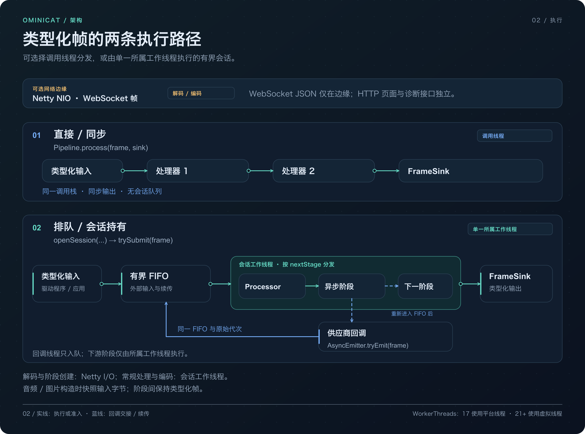
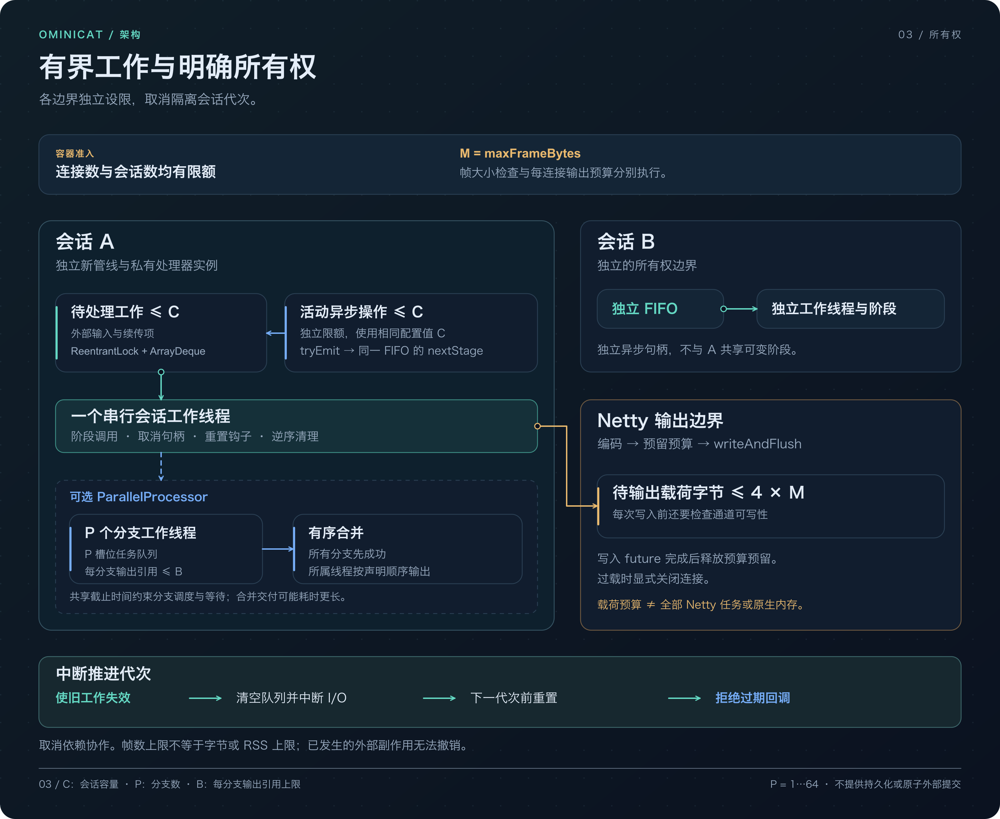

<!-- ominicat-language-nav -->
**简体中文** · [English](../architecture.md) · [中文文档目录](index.md)
<!-- /ominicat-language-nav -->

# 运行时架构

OminiCat 是用于多模态会话的 Java 17+ 微内核。内核提供调度与生命周期机制；插件提供媒体处理、模型调用和应用策略。接入新的提供方无需修改内核。

图中将依赖与组装关系同帧流分开。Java 应用可以直接使用内核。服务器 YAML 与工厂发现提供可配置容器体验；提供方和会话状态依赖核心契约，不会成为内核策略。启动时发现工厂，再为每个 WebSocket 会话创建配置中的处理器。

| 模块 | 职责 | 生产依赖 |
|---|---|---|
| `ominicat-core` | 帧、信封、处理器 SPI、生命周期、有界队列与组合 | 仅 JDK |
| `ominicat-conversation` | 最终转写窗口、策略评估、提示组合与步骤流程 | Core |
| `ominicat-providers` | PCM 工具、转写门控与兼容 HTTP 模型适配器 | Core、Jackson |
| `ominicat-server` | Netty WebSocket／HTTP、YAML 组装、鉴权、指标与调试页 | Core、插件、Netty、Jackson |
| `ominicat-benchmarks` | JMH、分配与有界负载测量 | Core、JMH |

## 两条执行路径

| 入口 | 执行与所有权 | 成本边界 |
| --- | --- | --- |
| `Pipeline.process(frame, sink)` | 在调用方线程同步调用处理器。调用方串行访问并关闭处理器。已被会话接管或包含 `AsyncProcessor` 的管线拒绝直接使用。 | 没有会话 FIFO 或阶段间编解码；每次调用仍创建具有作用域的 `SynchronousSink` 和续接。 |
| `openSession(...).trySubmit(frame)` | 有界 FIFO 为一个所有者工作线程提供任务。已接纳回调将 `(frame, generation, nextStage)` 放入同一 FIFO，由该工作线程续接下游阶段。 | 执行仍有队列锁、待处理记录、generation 检查和线程交接成本。回调到达顺序决定续接顺序。 |

独立服务器使用 Netty NIO 事件循环处理传输。帧解码和连接／阶段组装发生在 I/O 回调中；正常处理器执行与输出编码发生在会话工作线程上，之后交由 Netty 写出。这是处理边界，不表示所有昂贵操作都已移出事件循环。

源码：[Pipeline](../../ominicat-core/src/main/java/io/ominicat/core/Pipeline.java)、[SynchronousSink](../../ominicat-core/src/main/java/io/ominicat/core/SynchronousSink.java)、[PipelineSession](../../ominicat-core/src/main/java/io/ominicat/core/PipelineSession.java)、[服务器回调与输出](../../ominicat-server/src/main/java/io/ominicat/server/OminiCatServer.java)。

## 契约

`Frame` 是开放接口。扩展可引入事件，无需修改中央子类型列表。内置媒体帧对输入字节建立快照，返回独立的只读缓冲区。音频为交错排列的有符号 PCM16 小端数据；`streamId` 标识音轨，`startSample` 表示按通道计的采样位置（`-1` 表示不可用）。

`Transcript` 将说话人身份与应用角色分开。来源提供稳定的 `segmentId`、非负修订号、时间范围、最终标志与置信度（`-1` 表示不可用）。ASR 来源修订片段时间范围时，必须使用显式 ID。六参数便捷构造函数根据说话人／时间范围派生 ID，适用于简单不可变片段。

`transcript-gate` 明确区分中间结果替换与最终提交：修订替换较早的中间结果；相同的已提交最终结果被抑制；矛盾的已提交事实导致失败。去重仅覆盖保留的 ID。会话窗口评估已提交最终结果并提供淘汰计数，不会把保留窗口称作完整会话。

`FrameEnvelope` 本身也是帧。`EnvelopeProcessor.wrap` 在保留会话、轮次与关联 ID 的同时，为输出帧派生新 ID 和因果链接，也适用于异步输出。回放时注入 ID 和单调时钟。简单本地管线和低开销内核仍可使用裸帧。纳秒字段共享一个本地单调时钟域；远程采集时钟必须由驱动归一化后才能比较。这些由调用方管理的 ID 是关联数据，不是鉴权身份。

`Failure` 和带作用域的 `Cancel` 是类型化应用事件。处理器异常会使所属会话失败。通用传输将带作用域的取消事件传给应用逻辑；显式 `interrupt` 命令中断当前会话 generation。管理请求 ID 的应用必须实现请求级取消，不能把一个请求等同于整个会话。

## 调度与所有权

同一份 Java 17 字节码可运行于 Java 17、21 和 25。`WorkerThreads` 在 Java 17 使用命名守护平台线程，在 Java 21+ 通过公开 JDK API 发现虚拟线程工厂。工作线程能力发现发生在初始化期间，不在帧分发路径中。两个后端的分支执行器都有显式并发与队列上限。详见 [Java 兼容性](java-compatibility.md)。

每个会话独占新建的管线及处理器实例。同步处理器调用、重置钩子和清理都在一个会话工作线程上串行执行。处理器可同步输出零帧、一帧或多帧，不得保存同步 `FrameSink` 供以后使用。

`AsyncProcessor` 是独立的回调契约。它的 emitter 携带原始取消 generation，把续接放入队列，从下一阶段继续。回调线程绝不直接进入下游处理器。续接共享有界会话队列，活跃调用数也有限制，生产者必须处理显式拒绝。`complete()` 释放一次调用，`fail()` 传播失败。注册的取消句柄在工作线程关闭。对于可能永不完成的回调，驱动必须配置截止时间。

普通控制帧没有隐含的内核作用。`finish()` 关闭入口，排空已接纳工作和未结束的异步调用；`completion()` 在逆序清理完成后结束。使用异步处理器时，回调到达顺序决定续接顺序；END 载荷不是隐式的跨分支屏障。服务器仅在会话完成后关闭已排空的连接。

`interrupt()` 使前一 generation 失效，丢弃排队工作，中断阻塞 I/O，并在下一 generation 前串行执行 `onInterrupt()`。迟到回调被拒绝。已经启动的外部作用无法撤销；插件必须配合取消。`close()` 立即发起合作式取消；调用方可以等待完成 future。

## 独立资源限制

| 边界 | 已实现的限制 | 单位与重要范围 |
| --- | --- | --- |
| 待处理会话工作 | 使用 `ReentrantLock` 和 `ArrayDeque`，满足 `queue.size() <= C` | 队列项，包括已接纳异步续接；正在执行的帧不属于待处理队列项。 |
| 活跃异步调用 | `asyncHandles.size() <= C` | 使用相同配置 `SessionOptions.queueCapacity` 的独立计数上限，不是队列与在途工作共享的预算。 |
| 显式并行分支 | `P` 个工作线程、`P` 槽位的执行器任务队列，每个分支最多缓冲 `B` 个输出帧引用 | 分支调度／等待使用共同截止时间。汇合后的交付可以持续更久；数量限制不约束载荷字节或总 RSS。 |
| 网络输出 | 待发送编码载荷字节最多为 `4 * maxFrameBytes`，另检查通道可写性 | 写 future 完成后释放预留。这不约束每个 Netty 任务或原生分配，写完成也不代表客户端已消费。 |
| 服务器接纳 | 配置的连接／会话容量 | 连接不再活跃且工作线程清理完成后才释放名额，因此缓慢的合作式清理仍会占用容量。 |

开放会话的 `interrupt()` 推进 generation、丢弃待处理工作并隔离过期回调。处理器重置和逆序清理遵循所有权契约。取消无法回滚已启动的外部作用。`finish()` 排空已接纳工作与未结束异步调用；应用需为可能永不完成的回调设置截止时间。

源码：[会话入口、句柄与 generation 检查](../../ominicat-core/src/main/java/io/ominicat/core/PipelineSession.java)、[并行组合](../../ominicat-core/src/main/java/io/ominicat/core/ParallelProcessor.java)、[有界工作线程执行器](../../ominicat-core/src/main/java/io/ominicat/core/WorkerThreads.java)、[服务器输出／接纳](../../ominicat-server/src/main/java/io/ominicat/server/OminiCatServer.java)。

## 组合与失败

`ParallelProcessor` 拥有具名且彼此独立的分支实例，限制各分支缓冲帧数，应用一个截止时间，并仅在所有分支成功后按声明顺序输出汇合结果。失败、超时或父级中断会取消兄弟分支。它是显式 fork/join 节点，不是任意 YAML DAG 调度器。

`FallbackProcessor` 仅在主处理器尚未输出任何内容就失败时使用备用处理器。它不会重放已经部分交付的流，也不会在中断时降级。适配器截止时间仍需显式设置。`AsyncOutlet` 用有界队列把慢交付与会话工作线程分开；饱和、sink 失败和排空完成均可观察。它不提供持久化重试或恰好一次交付。

服务器限制会话数、帧字节数、入口容量和待发送字节数。过载会显式暴露，不会静默丢失控制帧。客户端代码必须响应错误／关闭并停止发送。全局配额和多节点接纳控制属于边缘服务或应用插件的职责。

## 状态与接入边界

会话与步骤流程快照是经过校验的运行态状态。应用选择持久化存储、提交点、访问控制与重连身份。恢复不会重放已完成的外部作用。运行时不声称提供崩溃恢复、持久化消息交付、媒体回声消除器、WebRTC 传输、分布式编排或厂商专用实时 ASR 实现。

有状态插件可在进程内组合。外部模型服务、消息队列与存储可独立扩容。凭据应放在环境变量或部署密钥管理系统中；YAML 仅包含环境变量名。进程启动时从 classpath 加载插件，不提供运行时插件包热卸载。

## 性能证据与图表源码

[Linux 性能指南](performance.md)将这些实现机制与明确的负载、诊断范围对应起来。当前公开图表使用 [Ubuntu 和 CentOS CI 记录](reports/comparison/README.md)；测量不为单项架构选择分配因果加速比。

三张图都有可编辑的 SVG 原图，带可访问标题／描述，不依赖外部资源。文档嵌入预渲染 PNG，因此读者无需 Mermaid 或 SVG 支持；点击图表可打开矢量原图。使用 `python3 scripts/render_architecture.py` 重新生成 SVG，再用 `python3 scripts/localize_readme.py` 更新中文入口图，最后用 `python3 scripts/render_doc_previews.py` 刷新 2× PNG 预览（本地化预览需要 librsvg 和中文字体）。共享图在两份 README 与本指南间复用；中文版本沿用相同的源图几何和翻译目录。CI 校验翻译新鲜度、源图／预览哈希及图片链接。[图表源码](../../scripts/render_architecture.py) · [预览导出器](../../scripts/render_doc_previews.py) · [翻译维护](i18n/README.md)。
