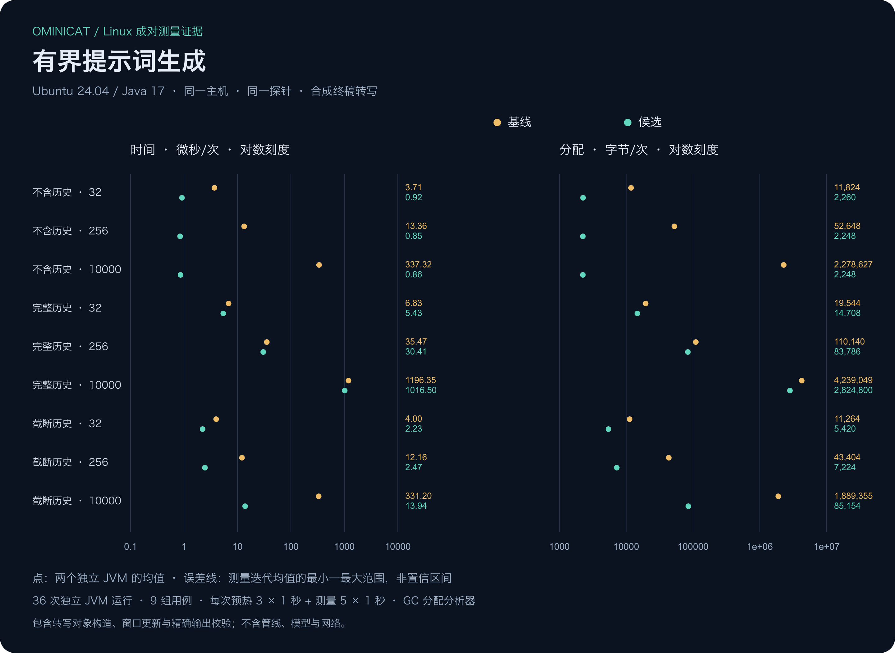

<!-- ominicat-language-nav -->
**简体中文** · [English](../performance-audit.md) · [中文文档目录](index.md)
<!-- /ominicat-language-nav -->

# 性能深度审计

本次审计检查框架自身的本地工作，不包含模型与网络延迟，并区分源码可确认的工作量与实测优化收益。现有数值帧竞品对比不覆盖提示词构造、媒体编解码、异步提供方或 Studio 观测。

## 选定增量：有界提示词渲染

原提示词路径调用 `ConversationWindow.snapshot()` 只为获取轮次，却同时重算了区间并集及逐说话人统计。它先拼出全部保留历史再丢弃旧行，即使模板没有引用历史也会如此。生成相同提示词并不需要这些工作。

优化后读取只含轮次的不可变快照，在构造时缓存历史占位符数量，只构建能放入字符预算的完整历史后缀。模板不使用历史时，检查基础提示长度后直接返回。转写保留、去重、异常消息、中断、UTF-16 预算与单遍替换维持现有行为；公开评估快照仍计算完整指标。

[Linux 配对工作流](../../.github/workflows/prompt-cost.yml)使用同一份 [JMH 探针](../../ominicat-benchmarks/src/main/java/io/ominicat/benchmarks/PromptCostProbe.java)，切换基线与候选运行时 JAR。九种用例覆盖 32、256、10,000 条保留记录，以及不使用历史、完整历史、截短历史。准备阶段在计时外填满窗口；每次测量创建新最终转写、更新真实窗口、渲染并逐字校验预期输出。两版计时均包含完整字符串校验。这是提示词阶段成本，不是内核分发或端到端对话延迟。

同一 Ubuntu 24.04／Java 17 作业依次执行基线 → 候选 → 候选 → 基线：每版每用例有两个独立 JVM，每个 JVM 预热三次一秒、测量五次一秒。每个进程核对实际加载的核心、会话与探针 JAR 哈希。[采集器](../../scripts/prompt_cost.py)拒绝缺失矩阵、原始数据变更、运行时与设置混用。共享运行器仍有噪声；观察范围不是置信区间，也不代表生产容量。

## Linux 配对结果

[成功的对比作业](https://github.com/g5n-dev/ominicat/actions/runs/41237981646)测量了基线 208b0c4 与候选 d0d63ff。[完整原始证据](../../reports/performance-audit/prompt-render-2026-11-01/manifest.json)及[各 JVM 均值／迭代范围](../../reports/performance-audit/prompt-render-2026-11-01/comparison.json)已归档。其运行时与探针源码指纹对应交付实现，后续发布改动增加诊断资料和文档。

| 保留条数 | 历史模式 | 基线 µs/op | 优化后 µs/op | 耗时下降 | 基线 B/op | 优化后 B/op | 分配下降 |
| ---: | --- | ---: | ---: | ---: | ---: | ---: | ---: |
| 32 | 完整历史 | 6.827 | 5.434 | 20.4% | 19544.0 | 14708.3 | 24.7% |
| 32 | 无历史 | 3.710 | 0.917 | 75.3% | 11824.0 | 2260.0 | 80.9% |
| 32 | 截短历史 | 4.000 | 2.231 | 44.2% | 11264.0 | 5420.1 | 51.9% |
| 256 | 完整历史 | 35.470 | 30.412 | 14.3% | 110140.3 | 83785.7 | 23.9% |
| 256 | 无历史 | 13.364 | 0.847 | 93.7% | 52648.1 | 2248.0 | 95.7% |
| 256 | 截短历史 | 12.160 | 2.469 | 79.7% | 43404.1 | 7224.1 | 83.4% |
| 10000 | 完整历史 | 1196.349 | 1016.495 | 15.0% | 4239049.0 | 2824799.8 | 33.4% |
| 10000 | 无历史 | 337.319 | 0.862 | 99.7% | 2278627.2 | 2248.1 | 99.9% |
| 10000 | 截短历史 | 331.202 | 13.939 | 95.8% | 1889355.0 | 85153.8 | 95.5% |

本轮各组均值均有改善，完整历史的耗时改善小于不使用历史／截短历史。这些是观测均值，不是保证的加速比例。完整历史仍须构建并校验全部输出；截短历史仍读取不可变轮次列表快照，因此即使只保留少数输出行，其分配量仍随保留窗口增大。后续遍历优化需要独立的有界所有权与等价性验证。

## 当前 Linux 内核基线

新执行的 [Java 17 profile 作业](https://github.com/g5n-dev/ominicat/actions/runs/41237014639)测量了版本 208b0c4 的既有内核，环境为 Linux/amd64、Temurin 17.0.21，四个可用处理器。[完整白名单归档](reports/performance-audit/linux-java17-2026-11-01/report.md)绑定源码、产物哈希、JMH 设置及 CPU／分配／GC 图表。三个独立 JVM 各预热五次两秒、测量八次两秒；表中保留 JMH 的 99.9% 误差估计。直接派发和会话往返是两种独立负载。

| 模式 | 阶段数 | 结果 | JMH 误差 | 单位 | 分配 B/op |
| --- | ---: | ---: | ---: | --- | ---: |
| 直接派发 | 1 | 59,090,636.005 | ± 1,174,249.131 | ops/s | 112.000 |
| 直接派发 | 4 | 22,189,603.035 | ± 239,393.999 | ops/s | 328.000 |
| 直接派发 | 16 | 5,514,447.752 | ± 21,234.574 | ops/s | 1192.001 |
| 会话往返 | 1 | 23.226 | ± 1.595 | us/op | 248.042 |
| 会话往返 | 4 | 22.363 | ± 1.472 | us/op | 488.033 |
| 会话往返 | 16 | 23.365 | ± 1.441 | us/op | 1448.037 |

每新增一个阶段，直接派发的整体分配约增加 72 B，会话路径约增加 80 B。这包含变换后的数值帧和调用机制，不能单独归因为保护对象的成本。整段记录的分配采样也出现了捕获的续接对象与作用域接收器。这些结果支持开展定向分配实验，不代表已经证明加速。归档报告中关于开发机器共享的通用句子属于模板提示；真实采集环境以所链 GitHub 运行器为准，其其他租户并未被观测。

新 CPU 记录共有 1,200 个叶节点样本，其中 637 个位于 LockSupport.unpark。其完整提供栈中，150 个经过会话有效性检查，302 个经过负载驱动的信号量释放，77 个经过取队列操作。不能把全部 unpark 样本都归因于内核有效性检查，否则会错误归因测量程序的成本。样本包含预热／负载／排序阶段，不是耗时百分比。

## 其余优化候选

| 候选 | 已确认的工作 | 改变行为前需要的证据 |
| --- | --- | --- |
| 同步调用分配 | [分发](../../ominicat-core/src/main/java/io/ominicat/core/Pipeline.java)每阶段创建捕获的续接对象与作用域接收器；两者均出现在 [Linux 分配采样](reports/comparison/linux-ubuntu24-java17-2026-10-31/profiles/ominicat/profiles.md)中。采样不等于精确的每操作分配量。 | 匹配的 Linux 分配及延迟基线，加上普通帧／信封异步和媒体构造探针。可试一次性的组合调用对象，保留线程／生命周期检查和引用释放，禁止重新激活已退役接收器。 |
| 代次有效性读取 | [会话有效性检查](../../ominicat-core/src/main/java/io/ominicat/core/PipelineSession.java)在每个阶段边界及最终输出获取会话锁。 | 多提交者竞争、有界在途负载及配对 CPU／延迟／分配证据。正确发布的逐代票据只是实验方案，不能用普通无同步字段读取替代取消栅栏。 |
| 出站线协议中间表示 | [帧编码](../../ominicat-server/src/main/java/io/ominicat/server/FrameCodec.java)创建 JSON 树、Base64 与字符串，随后[传输层](../../ominicat-server/src/main/java/io/ominicat/server/OminiCatServer.java)计算 UTF-8 字节并创建网络帧。 | 先隔离文本／音频／图像编码，再试内部字节输出路径。保留公开编码、Unicode、精确字节上限、顺序和缓冲释放；保留不可变输入快照。 |
| 活动记录锁范围 | [日志读取](../../ominicat-server/src/main/java/io/ominicat/server/ActivityJournal.java)持有与被追踪写入者相同的监视器，完成整页事件序列化。 | 多会话追加与并发分页，精确游标／缺口检查，以及有界不可变事件快照。开启观测的负载应与默认会话分开测量。 |
| 转写请求复制 | [转写缓冲](../../ominicat-providers/src/main/java/io/ominicat/providers/TranscriptionFactory.java)使 PCM 经过临时块、累积缓冲、WAV 与 multipart 实体化。源码至少可确认上传前六次载荷长度的复制，不含扩容、不可变输入构造和 HTTP 内部。这是复制次数，不是实测分配或 RSS。 | 分开测追加、WAV 及完整请求构造，逐字节验证输出，并检查流隔离、中断及接近上限的输入。保留防御性所有权。 |
| SSE 解析 | [聊天解析](../../ominicat-providers/src/main/java/io/ominicat/providers/ChatFactory.java)对流式文本逐字符扫描、组装行／事件，并解析 JSON 树。 | 用内存 UTF-8 事件及碎片化读取测每事件分配和首事件交付。保留严格解码、限制、取消、CR 处理和显式完成标记。 |
| 并行结果复制与刷出合并 | [分支汇合](../../ominicat-core/src/main/java/io/ominicat/core/ParallelProcessor.java)复制私有引用缓冲；传输逐输出刷出。 | 二者分别测量。转移引用可能更久保留富余容量，合并刷出可能恶化单帧尾延迟。保留全成功后的有序汇合、截止时间和逐帧传输预算预留。 |

## 验收与后续

提示词回归测试使用独立构造的后缀预期逐字比较完整输出，覆盖随机事件序列、重复占位符、Unicode、字面占位符文本、错误、去重与中断。仍要求常规 Java 17／21／25 检查通过；运行时变更需要覆盖率／SBOM 验证和 512 个压力种子。

内核分配实验仍遵循[现有基线前置条件](iteration-plan.md#性能证据)。异步弱引用、代次栅栏、作用域接收器与不可变媒体快照承担已经验证的生命周期职责。源码检查用于提出候选，匹配的前后实验才能证明收益。
