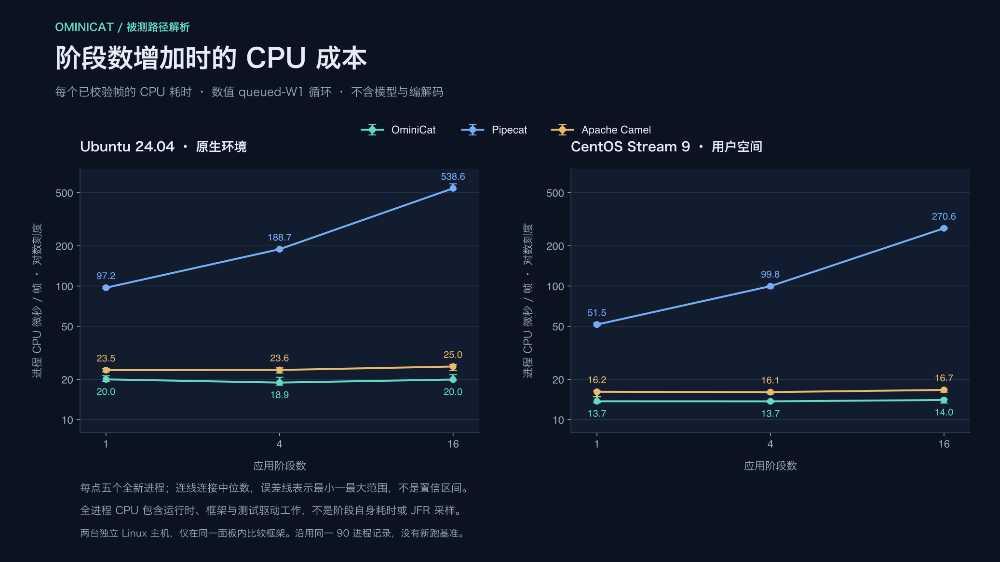

<!-- ominicat-language-nav -->
**简体中文** · [English](../performance.md) · [中文文档目录](index.md)
<!-- /ominicat-language-nav -->

# 性能设计与 Linux 证据

OminiCat 通过精简的 Java 17+ 内核控制派发开销、排队工作和所有权边界。公开性能图使用 **Ubuntu 24.04 与 CentOS Stream 9 用户态 CI 记录**。[完整证据](reports/comparison/README.md)包含每个进程的结果、源码／运行时／依赖清单、图表与校验和。

## 已发布的 Linux 基线

每个环境都运行了三套原生排队实现：OminiCat、Pipecat 1.15.0 和 Apache Camel 4.22.2 LTS。每个环境覆盖 1/4/16 个应用阶段、每单元五个进程，共完成 45 个全新进程；合计验证 **17,406,385 个测量输出**。四阶段中位数如下：

| 环境 | 框架 | 帧/秒 · W=1 | 终点 p99 µs | 测量阶段峰值 RSS MiB |
| --- | --- | ---: | ---: | ---: |
| Ubuntu 24.04 原生 | OminiCat | 49,084 | 17.30 | 144.1 |
| Ubuntu 24.04 原生 | Pipecat | 5,300 | 220.35 | 93.5 |
| Ubuntu 24.04 原生 | Apache Camel | 42,756 | 20.41 | 188.7 |
| CentOS Stream 9 用户态 | OminiCat | 66,567 | 12.44 | 145.3 |
| CentOS Stream 9 用户态 | Pipecat | 10,019 | 130.88 | 88.0 |
| CentOS Stream 9 用户态 | Apache Camel | 59,527 | 13.78 | 188.9 |

Ubuntu 使用 AMD EPYC 9V74、四个可用逻辑处理器、Temurin 17.0.21、CPython 3.12.15 和 glibc 2.39。CentOS 使用 AMD EPYC 9V45、四个可用逻辑处理器、发行版 OpenJDK 17.0.20.1、CPython 3.12.15 和 glibc 2.34。CentOS 是运行在 Ubuntu 运行器上、以摘要固定的官方容器，共享运行器内核。两者是独立主机：应在每条作业内比较框架，而不是跨作业比较操作系统。

[](../assets/zh-CN/reports/comparison/linux-ubuntu24-java17-2026-10-31/overview.svg)

[Ubuntu 图表与原始结果](reports/comparison/linux-ubuntu24-java17-2026-10-31/README.md) · [CentOS 图表与原始结果](reports/comparison/linux-centos9-java17-2026-10-31/README.md) · [已记录的 CI 运行](https://github.com/g5n-dev/ominicat/actions/runs/41222330745) · [发布与归档溯源](../../reports/comparison/linux-ci-41222330745.json)。

## 实测路径为何不同

OminiCat 线性同步路径的设计收益在于：**只进行一次会话交接，随后在同一工作线程上调用所有应用阶段**。同步输出的阶段可立即用类型化帧调用后继；阶段增加不要求增加调度任务或阶段队列。这样让常用路径保持精简，同时仍由会话管理取消、重置与清理。

这描述的是避免了哪些工作，不是将全部基准差距归因于此。三套被测适配器实际执行的路径如下：

| 被测路径部分 | OminiCat | Pipecat 1.15.0 | Apache Camel 4.22.2 LTS |
| --- | --- | --- | --- |
| 入口 | `trySubmit` 进入容量为一的会话 FIFO；一个平台工作线程 | 工作线程输入队列 → asyncio 事件循环上的原生排队应用处理器 | `ProducerTemplate.requestBody` 进入容量为一的 SEDA 端点；一个消费者 |
| 应用阶段之间 | 会话工作线程上的类型化递归调用；每阶段创建变换后的 `Value` | 每个默认排队阶段经过输入优先队列／输入任务，再经处理队列／处理任务，随后转发 | 同一路由的 `process` 链在单一 SEDA 入口之后运行；不会为每阶段插入 SEDA 队列 |
| 每次调用的机制 | generation 有效性检查、限定作用域的 `SynchronousSink`、捕获的 continuation 及帧／值分配 | 原生 `Frame` 初始化／元数据、调度，以及适配器的不可变数值载荷保护 | Exchange/Message 状态、关联 Exchange 副本、完成回调／同步及路由执行 |
| 终端 → 调用方 | 输出校验器，随后是有界确认队列和调用方校验 | 原生下游输出事件派发、校验器和 asyncio 确认事件 | 输出校验器，随后是原生 InOut 请求／应答完成和调用方校验 |

[](../assets/zh-CN/framework-paths.svg)

此版本的 Pipecat pipeline/source/sink 处理器使用 direct mode，**配置的应用阶段**使用默认排队模式。每个此类阶段有两个常驻协程任务，不是每帧新建两个任务，也不是切换两次操作系统线程。原生下游输出事件会创建终端任务，其成本仍计入。实验没有把所有 Pipecat 处理器改成直接调用，也没有限制其内部队列；W=1 仅限制基准接纳的在途工作。

Camel 同样在同步路由之前只有一个队列，因此队列数量不能解释 OminiCat 与 Camel 的差别。Camel 请求／应答保留关联 Exchange 准备与完成同步，OminiCat 保留自己的 generation／sink 检查和确认队列。复制的是 Exchange 状态／关联信息，不是每阶段深复制数值载荷。比较将这些公开路径一并测量，没有移除某个框架的正常机制。

其他框架也提供避开这些队列边界的路径：Pipecat 的 [`enable_direct_mode=True`](https://github.com/pipecat-ai/pipecat/blob/v1.15.0/src/pipecat/processors/frame_processor.py#L230-L251) 立即处理帧，Camel 的 [`direct:` 组件](https://camel.apache.org/components/4.22.x/direct-component.html) 在同一 Camel context 内同步调用消费者。OminiCat 的 `Pipeline.process` 同样省去会话排队。这些模式**未纳入本次排队矩阵**；直接模式比较需要独立的适配器与生命周期范围。已发布的比值不代表这些框架所有配置的排名。

来源：被测检出版本的 [OminiCat 适配器](https://github.com/g5n-dev/ominicat/blob/fbd3c610eb4e2c8ad0c4bc53fcebfdb903bbb96a/comparison/benchmarks/src/main/java/io/ominicat/comparison/OminiCatAdapter.java), [Camel 适配器](https://github.com/g5n-dev/ominicat/blob/fbd3c610eb4e2c8ad0c4bc53fcebfdb903bbb96a/comparison/benchmarks/src/main/java/io/ominicat/comparison/CamelAdapter.java), [Pipecat 适配器](https://github.com/g5n-dev/ominicat/blob/fbd3c610eb4e2c8ad0c4bc53fcebfdb903bbb96a/comparison/pipecat/benchmark.py)；原生 [Pipecat 处理器](https://github.com/pipecat-ai/pipecat/blob/v1.15.0/src/pipecat/processors/frame_processor.py#L726-L757), [Pipecat 管线](https://github.com/pipecat-ai/pipecat/blob/v1.15.0/src/pipecat/pipeline/pipeline.py), [Camel SEDA 生产者](https://github.com/apache/camel/blob/camel-4.22.2/components/camel-seda/src/main/java/org/apache/camel/component/seda/SedaProducer.java#L63-L125)与[Camel 路由管线](https://github.com/apache/camel/blob/camel-4.22.2/core/camel-core-processor/src/main/java/org/apache/camel/processor/Pipeline.java#L84-L118).

## 结合阶段扩展与 CPU 解读结果

[](../assets/zh-CN/framework-cost-scaling.svg)

下列比值使用同一 Linux 作业的**五进程处理速率中位数**相除，不是配对运行比值、加速比置信区间或饱和吞吐比值。

| 环境 | 阶段数 | OminiCat / Pipecat 处理速率 | OminiCat / Camel 处理速率 |
| --- | ---: | ---: | ---: |
| Ubuntu 24.04 | 1 | 4.70× | 1.10× |
| Ubuntu 24.04 | 4 | 9.26× | 1.15× |
| Ubuntu 24.04 | 16 | 25.46× | 1.17× |
| CentOS Stream 9 用户态 | 1 | 3.45× | 1.12× |
| CentOS Stream 9 用户态 | 4 | 6.64× | 1.12× |
| CentOS Stream 9 用户态 | 16 | 17.74× | 1.14× |

从单阶段增加到 16 阶段时，两条作业中 OminiCat 都保留 **97.8%** 的单阶段处理速率。Ubuntu / CentOS 上，Camel 分别保留 **92.0% / 95.7%**，Pipecat 为 **18.0% / 19.0%**。结合路径检查可见，当每个阶段增加调度与帧构造时，阶段数会影响结果。但这不能确定差距中有多少来自调度器、语言、帧元数据或基准适配器。

每个已校验帧的进程 CPU 微秒数，等于测量阶段进程 CPU 时间除以输出数量。它包含基准循环、变换、校验器、确认及进程各线程上的运行时工作，既不是终点墙钟延迟，也不是逐阶段 CPU 归因。整循环处理速率还包含终点计时停止后的调用方确认；从吞吐倒数中减去延迟中位数并不能分离确认成本。

<details>
<summary>所有阶段数的中位数：处理速率、终点 p99、CPU 成本与 RSS</summary>

| 环境 | 阶段数 | 框架 | 帧/秒 · W=1 | 终点 p99 µs | 进程 CPU µs/帧 | 测量阶段峰值 RSS MiB |
| --- | ---: | --- | ---: | ---: | ---: | ---: |
| Ubuntu | 1 | OminiCat | 48,330.11 | 17.211 | 20.02 | 127.88 |
| Ubuntu | 1 | Pipecat | 10,287.85 | 109.327 | 97.19 | 93.45 |
| Ubuntu | 1 | Apache Camel | 43,766.91 | 19.740 | 23.49 | 187.85 |
| Ubuntu | 4 | OminiCat | 49,083.83 | 17.296 | 18.95 | 144.15 |
| Ubuntu | 4 | Pipecat | 5,299.93 | 220.352 | 188.67 | 93.51 |
| Ubuntu | 4 | Apache Camel | 42,755.82 | 20.410 | 23.56 | 188.68 |
| Ubuntu | 16 | OminiCat | 47,273.73 | 17.562 | 19.97 | 145.89 |
| Ubuntu | 16 | Pipecat | 1,856.45 | 588.249 | 538.61 | 93.73 |
| Ubuntu | 16 | Apache Camel | 40,261.62 | 24.287 | 24.99 | 192.50 |
| CentOS 用户态 | 1 | OminiCat | 66,985.74 | 12.364 | 13.73 | 145.93 |
| CentOS 用户态 | 1 | Pipecat | 19,405.11 | 63.945 | 51.53 | 87.97 |
| CentOS 用户态 | 1 | Apache Camel | 59,887.15 | 14.137 | 16.17 | 189.25 |
| CentOS 用户态 | 4 | OminiCat | 66,567.06 | 12.443 | 13.72 | 145.28 |
| CentOS 用户态 | 4 | Pipecat | 10,018.98 | 130.875 | 99.80 | 88.04 |
| CentOS 用户态 | 4 | Apache Camel | 59,526.61 | 13.776 | 16.08 | 188.88 |
| CentOS 用户态 | 16 | OminiCat | 65,540.53 | 12.097 | 14.04 | 146.50 |
| CentOS 用户态 | 16 | Pipecat | 3,694.49 | 332.986 | 270.65 | 88.26 |
| CentOS 用户态 | 16 | Apache Camel | 57,329.89 | 15.122 | 16.70 | 188.89 |

每个延迟单元是五个进程各自分位数的中位数，不是将所有进程合并后的分位数。源数值与全部五轮结果保留在 [Ubuntu 汇总](../../reports/comparison/linux-ubuntu24-java17-2026-10-31/summary.json)和 [CentOS 汇总](../../reports/comparison/linux-centos9-java17-2026-10-31/summary.json)中。

</details>

### 取舍与反例

- **每种阶段数下，Pipecat 的采样进程 RSS 都更低。** 四阶段时，其中位数在 Ubuntu 上比 OminiCat 低 35.1%，CentOS 上低 39.4%。OminiCat 四阶段 RSS 比 Camel 低 23.6% / 23.1%。这些是采用不同运行时堆策略的整进程观测，不是框架独占的分配节省。
- **与 Camel 的个别范围存在重叠。** CentOS 单阶段处理速率范围有重叠：OminiCat 为 61,951.58–68,604.53，Camel 为 57,632.92–63,146.58 帧/秒。其单阶段和四阶段 p99 范围也有重叠。对比 Camel，OminiCat 在六个单元的处理速率、p50/p99、每帧 CPU 和 RSS 中位数上均领先；独立运行并不支持不加限定地宣称每次 OminiCat 观测都优于每次 Camel 观测。
- **阶段扩展不是逐阶段成本估计。** OminiCat 的 Ubuntu 四阶段处理速率中位数比单阶段高 1.56%，CentOS 16 阶段 p99 中位数低于四阶段值。固定交接／校验成本、JIT 和共享主机噪声，都使简单相减无法推导每阶段纳秒成本。
- **适配器也有耗时。** [Ubuntu Pipecat cProfile](reports/comparison/linux-ubuntu24-java17-2026-10-31/profiles/pipecat/profile.md) 中，基准不可变载荷的 `NumericFrame.__setattr__` 位居单函数自身时间首位（0.343092 秒），原生队列／帧方法和 asyncio 也出现在记录里。这是独立插桩诊断，不能把未插桩的速度比全部归于 Pipecat 内部。

数值比较不使用 envelope、媒体字节快照、并行分支、外部异步服务或网络传输。它们的限制与生命周期机制在其他负载下很重要，但不能解释本次测量差距。若要量化某项具体优化，需要在同一主机上进行聚焦的前后消融对照。

## 实现如何控制成本

[](../assets/zh-CN/execution-path.svg)

| 机制与源码 | 避免或控制的工作 | 仍然存在的成本与边界 |
| --- | --- | --- |
| [类型化派发](../../ominicat-core/src/main/java/io/ominicat/core/Pipeline.java) | 同步阶段在同一调用栈上调用下一处理器，不引入每阶段线协议编解码、队列或线程交接。直接嵌入可省去会话调度。 | [作用域 sink](../../ominicat-core/src/main/java/io/ominicat/core/SynchronousSink.java) 校验调用线程／寿命。sink 和捕获的 continuation 会分配对象；直接调用方管理串行访问和清理。 |
| [会话所有权](../../ominicat-core/src/main/java/io/ominicat/core/PipelineSession.java) | 单一拥有者工作线程串行执行线性阶段、重置与逆序清理。外部回调将下一阶段的 continuation 入队。 | FIFO 使用 `ReentrantLock`、`Condition` 和 `ArrayDeque`。队列项和线程交接有成本。异步 continuation 顺序取决于回调到达。 |
| [独立工作限额](../../ominicat-core/src/main/java/io/ominicat/core/PipelineSession.java) | 待处理项和活跃异步句柄分别受配置容量的数量限制；饱和会明确反馈。 | 两者不共享一个合并预留池，也不是总内存限制。载荷大小、正在执行的工作和插件状态应分别预算。 |
| [有界并行组合](../../ominicat-core/src/main/java/io/ominicat/core/ParallelProcessor.java) | 显式分支工作线程和逐分支输出缓冲限制并发与保留的帧引用；全部分支成功后按声明顺序汇合结果。 | 共享截止时间覆盖分支调度／等待，不覆盖所有下游投递。缓冲帧引用不等于载荷字节／RSS 限额，已发射的 sink 外部作用不能回滚。 |
| [容器处理边界](../../ominicat-server/src/main/java/io/ominicat/server/OminiCatServer.java) | 正常处理器工作在会话工作线程运行，与 Netty NIO 事件循环分离；网络写入前检查待发送编码载荷字节和可写性。 | 解码与连接／阶段组装仍在 I/O 回调中。输出编码、Netty 任务、套接字和原生缓冲都有各自成本。写入完成不等于客户端消费。 |
| [工作线程能力发现](../../ominicat-core/src/main/java/io/ominicat/core/WorkerThreads.java) | Java 17 平台线程和 Java 21+ 虚拟线程共用 Java 17 兼容 API；能力发现不在帧派发中执行。 | 虚拟线程不会让 CPU 计算天然更快。分支执行器在两种后端都保留显式限额。已发布比较使用 Java 17 平台线程。 |
| [媒体快照](../../ominicat-core/src/main/java/io/ominicat/core/Frame.java) | 已构造的不可变帧实例可按引用跨阶段传递，不暴露可变载荷存储。 | 音频／图像构造复制字节，getter 创建只读视图。JSON/Base64、新媒体构造与可选 envelope 标识都有额外成本，数值 profile 不测这些成本。 |

这些是可从源码核实的机制，不是已测得的因果加速比。同行框架比较保留运行时、帧对象、调度器和测量程序差异，测量所声明的完整路径，不分离每个设计选择的贡献。[架构、限制与生命周期图](architecture.md)。

## 比较测量了什么

[协议](comparison/protocol.md)固定了不可变数值工作和独立输出校验器。每条管线／会话接纳**一个在途帧**，每个应用阶段创建相同的数值变换。OminiCat 使用 `PipelineSession`，Pipecat 使用原生排队处理器，Camel 使用单消费者 SEDA。原生生命周期和元数据差异仍被计入，因此不代表功能或背压等价。

每个进程预热三秒、测量五秒，框架顺序在不同进程间轮换。处理速率覆盖完整的已校验客户端循环。单输入终点延迟从构造／提交之前开始，在输出校验之后、调用方确认之前停止，因此与整循环吞吐有不同计时边界。

保留五进程中位数及观测最小—最大范围；范围不是置信区间。W=1 速率不是饱和容量或生产规模估计。模型、编解码、网络交换和音频质量不在此 profile 中。收集器校验每个输出、nonce、计数、序列、变换值、计时绑定及清理结果。缺失、重复、被修改、失败或混合来源的观测都会阻止发布。

精确且预触页的 16 MiB 采样缓冲最多保留 2,000,000 次观测。溢出会让采集失败，不会静默抽样或截断。父进程每 50 ms 采样进程 RSS，分别报告整进程与测量阶段峰值。RSS 包含运行时、依赖和共同缓冲，不是 B/op 或存活堆，也可能漏掉短暂峰值。Java 使用 `-Xms128m -Xmx512m`，Python 没有对应的受管堆限制。系统报告的主机内存、CPU 亲和性和可读取 cgroup 限制单独记录。

## CPU、分配与 GC

[Ubuntu 诊断报告](reports/comparison/linux-ubuntu24-java17-2026-10-31/profiles/README.md)和 [CentOS 诊断报告](reports/comparison/linux-centos9-java17-2026-10-31/profiles/README.md)来自**额外的插桩进程**，其计时不纳入 90 进程矩阵。

Java JFR 覆盖进程启动、预热、测量循环、测量程序工作和清理，申请 64 帧栈采集／导出及 1 ms 执行采样。渲染器保留提供的栈，报告采样权重与 GC 暂停时间线。Ubuntu 的 OminiCat 记录包含 41 个 CPU 样本、445 个分配样本和三次回收；GC 暂停总和 4.876 ms，单次回收暂停合计最大值 2.580 ms。CPU 样本是稀疏观测，不是方法时长。分配权重是估计，不是存活堆或精确的每操作字节数。

Pipecat cProfile 只采集预热之后、清理之前的测量事件循环阶段。其确定性调用自身时间包含可见的等待／系统调用，不能解析原生内部栈；它不是 Java CPU 样本，也不能作为跨语言 B/op 坐标。采样事件为零不能证明其他负载下或采样阈值以下不存在相关行为。

完整导出栈见 [Ubuntu CPU](../assets/zh-CN/reports/comparison/linux-ubuntu24-java17-2026-10-31/profiles/ominicat/cpu-flamegraph.svg)、[Ubuntu 分配](../assets/zh-CN/reports/comparison/linux-ubuntu24-java17-2026-10-31/profiles/ominicat/allocation-flamegraph.svg)及上方各框架诊断索引。数值观测、原始归档哈希、工具哈希和精确的发布变动记录在[发布溯源](../../reports/comparison/linux-ci-41222330745.json)中。

## 运行 Linux 工作流

[比较工作流](../../.github/workflows/framework-comparison.yml)在相关拉取请求和受保护 main 推送时运行，也支持手动触发。Ubuntu 使用原生运行器；CentOS 在以摘要固定的官方镜像内使用原生 RPM Python/JDK。每条作业完成全部 45 个单元、独立诊断和白名单／校验和发布后再上传。作业摘要包含四阶段中位数与产物说明。产物在 30 天后过期；已提交的基线长期可查。

实际发行版和架构经过检查，上下文绑定测量的 Git 修订与内核。清单包含实际 JDK/Python 版本、CPU 型号、libc、依赖清单、源码哈希、亲和性及可读取 cgroup 限制。共享托管运行器没有独占 CPU 隔离。CI 用于采集证据，不设置固定吞吐阈值，也不自动替换已记录的主指标。

## 在 Linux 上复现

使用实际 Java 17 JDK、CPython 3.12 及[比较指南](comparison/README.md#linux-ci)所列原生依赖。在同一主机上串行运行构建与测量：

```sh
./mvnw -B -ntp -pl ominicat-core -am install -DskipTests
./mvnw -B -ntp -f comparison/benchmarks/pom.xml clean verify
python3.12 -m venv reports/local/framework-env
reports/local/framework-env/bin/python -m pip install -r comparison/requirements.lock
reports/local/framework-env/bin/python comparison/run.py \
  --java "$JAVA_HOME/bin/java" --python reports/local/framework-env/bin/python \
  --output reports/local/framework-run
reports/local/framework-env/bin/python comparison/report.py \
  reports/local/framework-run reports/local/framework-publish
```

[同一指南](comparison/README.md#独立诊断分析)提供独立 JFR/cProfile 和白名单打包命令。使用新的输出目录，收集器会拒绝过期结果。原始 JFR、profiler dump、环境和私有日志留在本地。

## 重建原理说明图

[派生数据](../assets/framework-costs.json)保留每个指标的全部五次观测、两份来源清单与 suite 哈希，基于同一批 90 个已归档 Linux 进程重算，不是新测量或优化实验。导出器先校验所有原始文件，再计算比值和 CPU 成本；SVG 嵌入派生数据哈希，PNG 清单将各预览绑定到对应 SVG。

使用由 [comparison/requirements.lock](../../comparison/requirements.lock)安装的环境，并准备生成 PNG 所需的 `rsvg-convert`：

```sh
python scripts/render_performance_explainer.py
python scripts/localize_readme.py
python scripts/render_doc_previews.py
```

CI 通过仅依赖标准库的 `python3 scripts/render_performance_explainer.py --check` 与预览检查，拒绝被修改／缺失的原始证据、过期派生数据及绑定其他数据的 CPU 图。路径拓扑依据上方固定版本源码链接审查；数值检查不认证因果解释。

## 其他探测与比较

`scripts/profile.sh quick reports/local/profile` 运行同步 JMH、其分配 profiler、有界并发负载及 JFR；`full` 延长独立进程、预热与测量。发布 B/op 或优化结果前，应使用源码、主机、JDK、工作线程后端、堆、阶段数与载荷匹配的 Linux 记录。上方排队框架矩阵不提供 Linux 同步派发或并发饱和负载的主指标。

独立的回环传输探测可先启动默认容器，再运行：

```sh
java -jar ominicat-server/target/ominicat-server.jar --config config/demo.yaml
# In another terminal:
java scripts/WebSocketLoad.java ws://127.0.0.1:8080/ws 32 5000
```

该探测为每条连接预热 100 帧，从 `sendText` 计时到匹配响应。其负载与计时范围不同于数值内核派发。慢客户端、TLS、大载荷、独立到达流量和真实 provider 链都需要各自的探测。

独立的[每周 profile 工作流](../../.github/workflows/performance.yml)在 Linux 上以 Java 17 和 21 运行 profiling，保留白名单产物 30 天。成功只代表采集与校验完成。拟议实验和验收边界见[迭代计划](iteration-plan.md)。

修改时应保留原始观测，并在吞吐、延迟和分配之外报告不确定性。只有匹配的前后实验才能归因改进；现有跨框架比较不是优化消融实验，也不代表模型延迟。
