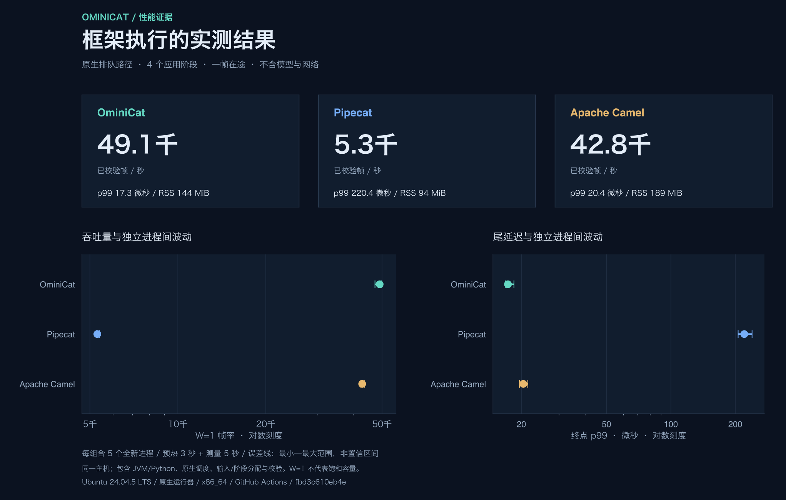
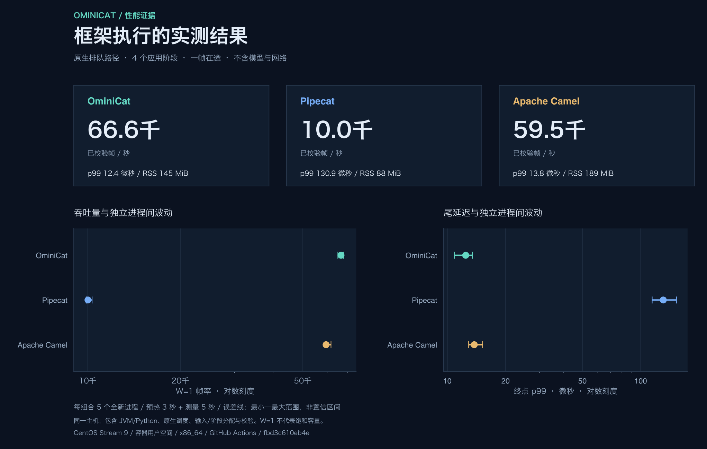

<!-- ominicat-language-nav -->
**简体中文** · [English](../../../../reports/comparison/README.md) · [中文文档目录](../../index.md)
<!-- /ominicat-language-nav -->

# 框架性能证据

相同排队路径协议在不调用模型或网络的条件下运行 OminiCat、Pipecat 1.15.0 和 Apache Camel 4.22.2 LTS。每个平台都提供完整 **45 个新进程**：1/4/16 个应用阶段，每组五个进程，预热三秒、测量五秒，W=1。表格展示四阶段中位数；完整报告保留每轮独立进程及观测范围。

## Linux CI / 2026-10-31 UTC

[成功的工作流运行](https://github.com/g5n-dev/ominicat/actions/runs/41222330745) · [归档摘要与源码来源](../../../../reports/comparison/linux-ci-41222330745.json) · [复现与自动触发](../../comparison/README.md#linux-ci)

两项作业均通过完整矩阵与独立诊断：**90 个新进程、17,406,385 个通过校验的测量输出**。原始观测、测量清单、选定 JFR 事件及诊断数值保留其 CI 数据。图表、报告链接和发布元数据使用[公开渲染器](../../../../comparison/report.py)与[诊断发布器](../../../../comparison/package_diagnostics.py)生成；原始归档哈希、工具哈希及精确逐文件变更均有记录。所有已发布文件均通过校验和验证。GitHub 托管的可下载产物在 30 天后过期；已提交证据仍可获取。

每项作业在自己的运行器上依次运行三套框架。两项作业使用不同 CPU 型号与 JDK 发行版；它们是各作业内的独立框架对比，不是隔离 Ubuntu／CentOS 或内核差异的实验。W=1 帧速率不是饱和吞吐或生产容量。进程 RSS 包含运行时、依赖和共同的 16 MiB 缓冲区。插桩诊断不纳入计时矩阵。

### Ubuntu 24.04.5 LTS / 原生 x86_64

AMD EPYC 9V74，四个可用逻辑处理器；Temurin 17.0.21+9、CPython 3.12.15、glibc 2.39。全部 45 个进程通过，校验了 7,198,018 个测量输出。

| 框架 | 帧/秒 · W=1 | 终点 p99 µs | 测量阶段峰值 RSS MiB |
| --- | ---: | ---: | ---: |
| OminiCat | 49,084 | 17.30 | 144.1 |
| Pipecat | 5,300 | 220.35 | 93.5 |
| Apache Camel | 42,756 | 20.41 | 188.7 |

[完整图表与范围](linux-ubuntu24-java17-2026-10-31/README.md) · [CPU／分配／GC／Python 诊断](linux-ubuntu24-java17-2026-10-31/profiles/README.md) · [清单](../../../../reports/comparison/linux-ubuntu24-java17-2026-10-31/manifest.json) · [校验和](../../../../reports/comparison/linux-ubuntu24-java17-2026-10-31/SHA256SUMS)

### CentOS Stream 9 / 容器用户态 / x86_64

AMD EPYC 9V45，四个可用逻辑处理器；发行版 OpenJDK 17.0.20.1+1、CPython 3.12.15、glibc 2.34。官方镜像按摘要锁定。本次覆盖 Ubuntu 24.04 运行器上的 CentOS 用户态，共享运行器的 Linux 内核。全部 45 个进程通过，校验了 10,208,367 个测量输出。

| 框架 | 帧/秒 · W=1 | 终点 p99 µs | 测量阶段峰值 RSS MiB |
| --- | ---: | ---: | ---: |
| OminiCat | 66,567 | 12.44 | 145.3 |
| Pipecat | 10,019 | 130.88 | 88.0 |
| Apache Camel | 59,527 | 13.78 | 188.9 |

[完整图表与范围](linux-centos9-java17-2026-10-31/README.md) · [CPU／分配／GC／Python 诊断](linux-centos9-java17-2026-10-31/profiles/README.md) · [清单](../../../../reports/comparison/linux-centos9-java17-2026-10-31/manifest.json) · [校验和](../../../../reports/comparison/linux-centos9-java17-2026-10-31/SHA256SUMS)
