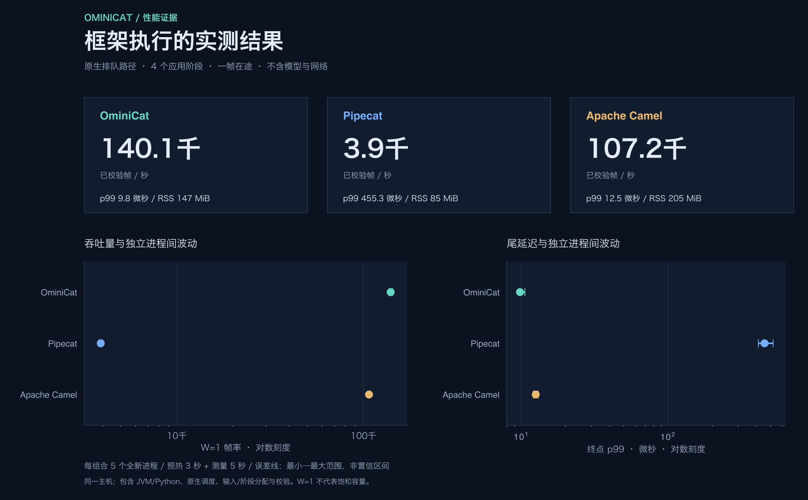
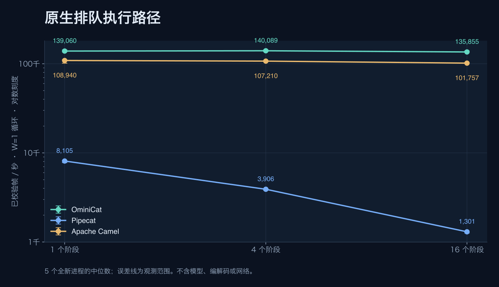
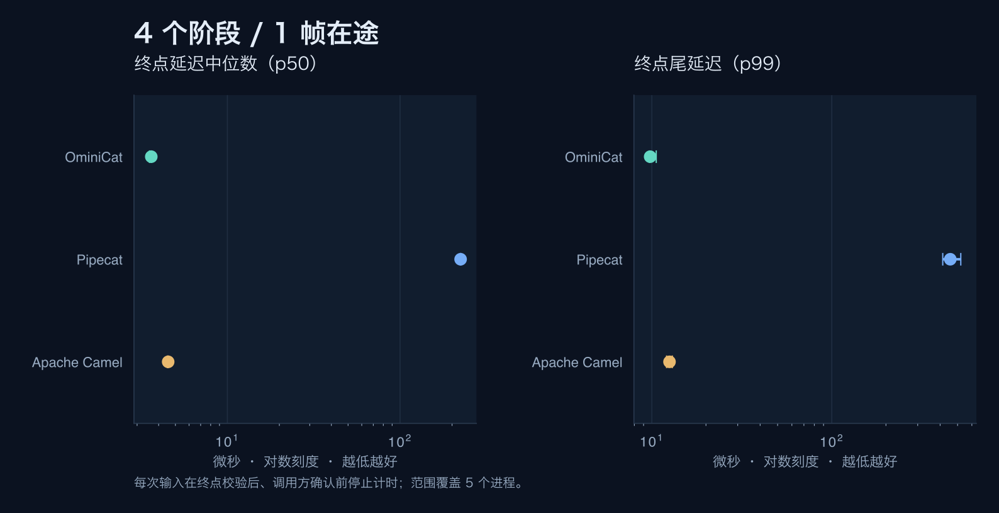
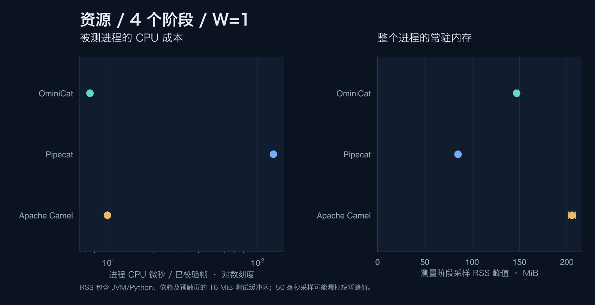

<!-- ominicat-language-nav -->
**简体中文** · [English](../../../../../reports/comparison/java17-2026-10-31/README.md) · [中文文档目录](../../../index.md)
<!-- /ominicat-language-nav -->

# 无模型框架对比

记录于 2026-10-31，环境为 Darwin / arm64，10 个逻辑处理器。[清单](../../../../../reports/comparison/java17-2026-10-31/manifest.json)将每个结果绑定到协议、被测 JAR、经验证的已安装 Python 依赖清单及精确源码指纹。全部 **45 个新进程**均通过输出、计数、拒绝和清理检查；没有省略失败轮次。

## 测量内容

一个进程、一条管线／会话，**一个在途数据帧**。1 / 4 / 16 个应用阶段分别执行相同的不可变数值变换。吞吐覆盖完整客户端循环；终点延迟在输出校验后、确认返回调用方之前结束。不计启动和清理。每个进程预热 3 秒、测量 5 秒。下表给出五个独立进程的中位数及观测最小—最大范围；它们**不是置信区间**。

| 框架 | 阶段数 | 帧/秒 · W=1 | p50 µs | p99 µs | 测量阶段峰值 RSS MiB |
| --- | ---: | ---: | ---: | ---: | ---: |
| OminiCat | 1 | 139,059.79 (135,988.56–143,214.95) | 3.54 (3.50–3.58) | 10.04 (9.12–10.54) | 146.23 (145.03–148.23) |
| Pipecat | 1 | 8,105.28 (7,774.47–8,211.78) | 99.46 (99.33–99.92) | 217.96 (199.25–271.25) | 84.98 (84.83–85.23) |
| Apache Camel | 1 | 108,939.53 (101,539.29–110,858.15) | 4.00 (3.96–4.08) | 12.12 (11.38–14.38) | 203.72 (199.05–215.08) |
| OminiCat | 4 | 140,088.62 (137,468.18–143,133.24) | 3.62 (3.54–3.62) | 9.79 (9.71–10.58) | 146.95 (145.53–149.27) |
| Pipecat | 4 | 3,906.31 (3,818.11–3,962.96) | 224.17 (223.42–224.88) | 455.29 (413.50–520.83) | 85.03 (84.91–85.45) |
| Apache Camel | 4 | 107,210.42 (105,759.88–108,434.15) | 4.54 (4.50–4.54) | 12.54 (12.08–13.00) | 205.38 (201.58–209.33) |
| OminiCat | 16 | 135,855.35 (135,281.48–139,110.99) | 3.83 (3.83–3.88) | 10.04 (9.71–10.67) | 148.52 (146.61–149.78) |
| Pipecat | 16 | 1,301.28 (1,261.52–1,312.37) | 725.67 (720.17–730.12) | 1,145.50 (1,129.42–1,429.29) | 85.20 (85.11–85.52) |
| Apache Camel | 16 | 101,756.89 (100,992.57–103,090.52) | 5.46 (5.17–5.54) | 14.00 (13.50–14.42) | 207.12 (204.78–211.67) |

## 测量规格边界

| 引擎 | 被测路径 | 执行范围 |
| --- | --- | --- |
| OminiCat 0.1.0-SNAPSHOT | PipelineSession，容量 1，终点回调 + 调用方确认队列 | Java 17 平台会话工作线程；精确源码哈希见清单 |
| Pipecat 1.15.0 | PipelineWorker / WorkerRunner，默认排队 FrameProcessor 模式，原生下游输出钩子 | CPython 3.12 / 普通 asyncio；显式关闭 RTVI、轮次追踪、指标、用量、追踪与心跳；仍计入原生输出事件分发 |
| Apache Camel 4.22.2 LTS | SEDA，大小 1，单消费者，不丢弃，请求／响应确认 | Java 17 平台消费者；计入 Exchange、Message 和原生请求／响应成本 |

Pipecat 是多模态帧管线对照。Camel 是 Java 路由框架对照，不是语音质量的等价对照。不同运行时、调度器架构、原生帧元数据与公开 API 仍计入各自被测路径。相同输出校验器与 W=1 限制不会使内部队列／背压或生命周期契约相同。本实验不约束 Pipecat 内部队列；测量程序限制的是接纳工作量。

图表没有将 OminiCat 的同步分发主指标与其他框架的排队路径比较。不测量模型、编解码、传输、音频质量、中断延迟、饱和负载或生产会话容量。这项受控合成测量不能证明框架普遍优越。

测量期间使用同一操作系统采集器每 50 ms 采样 RSS，包含运行时、导入依赖及预触碰的 16 MiB 样本缓冲区。Java 使用 -Xms128m -Xmx512m；Python 没有对应的受管堆上限。RSS 不是框架独占分配、存活堆、原生内存占用或 B/op，可能漏采短暂峰值。共享开发主机没有独占 CPU 隔离。重复轮次间轮换引擎顺序；JIT、GC、主机负载与温度效应仍是混杂因素。

## 复现与检查

参见[基准说明](../../../comparison/README.md)、[协议](../../../comparison/protocol.md)、[完整结果集](../../../../../reports/comparison/java17-2026-10-31/suite.json)及逐进程[原始 JSON](../../../../../reports/comparison/java17-2026-10-31/raw)。采集会拒绝非零退出、过期输出、错误数值、缺失／重复用例、混用清单、时长不足的阶段以及缺失资源样本。报告生成会在绘图前重新验证原始结果哈希。

官方来源：[Pipecat 发行版](https://github.com/pipecat-ai/pipecat/releases/tag/v1.15.0), [排队处理器源码](https://github.com/pipecat-ai/pipecat/blob/v1.15.0/src/pipecat/processors/frame_processor.py), [工作单元源码](https://github.com/pipecat-ai/pipecat/blob/v1.15.0/src/pipecat/pipeline/worker.py), [Camel 4.22.2 / Java 兼容性](https://camel.apache.org/releases/release-4.22.2/), [SEDA 语义](https://camel.apache.org/components/4.22.x/seda-component.html).

## 独立插桩诊断

[CPU 采样、分配栈、GC 与 Python 调用剖析](profiles/README.md)在额外运行中采集。插桩计时不纳入上述 45 进程对比。Java JFR 与 Python cProfile 保留各自不同的采集范围。
