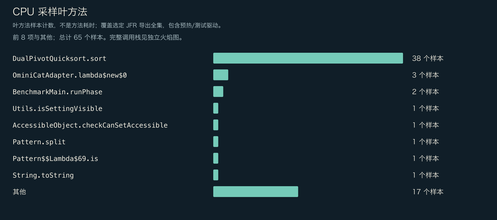
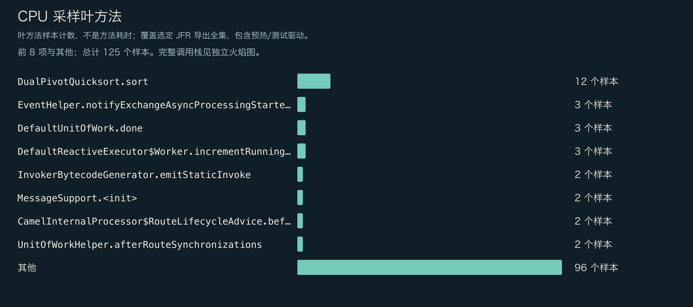
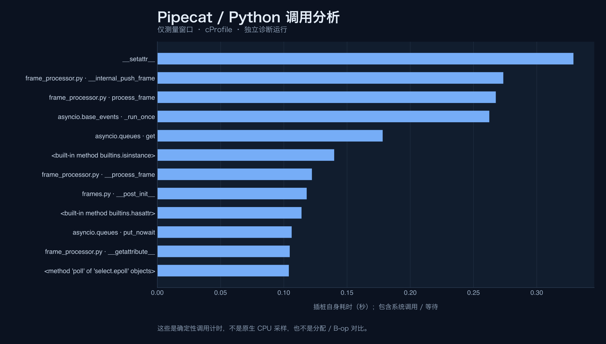

<!-- ominicat-language-nav -->
**简体中文** · [English](../../../../../../reports/comparison/linux-centos9-java17-2026-10-31/profiles/README.md) · [中文文档目录](../../../../index.md)
<!-- /ominicat-language-nav -->

# 独立诊断剖析

这些记录解释各自经过插桩的负载，不替代 45 个未插桩计时结果中的任何一个。Java 使用采样 JFR，覆盖进程启动、预热、测量和清理；Python 仅在测量的事件循环阶段使用确定性 cProfile。百分比与分配观测的范围不同，不能放在共同的跨语言坐标上排名。

## OminiCat / Java 17

[CPU 与分配栈、类型权重及 GC](ominicat/profiles.md) · [采集上下文](../../../../../../reports/comparison/linux-centos9-java17-2026-10-31/profiles/ominicat/diagnostic-summary.json)

## Apache Camel / Java 17

[CPU 与分配栈、类型权重及 GC](camel/profiles.md) · [采集上下文](../../../../../../reports/comparison/linux-centos9-java17-2026-10-31/profiles/camel/diagnostic-summary.json)

## Pipecat / CPython 3.12

[调用统计与采集范围](pipecat/profile.md) · [安全 JSON](../../../../../../reports/comparison/linux-centos9-java17-2026-10-31/profiles/pipecat/summary.json)

Python 的导入、启动、预热和清理不在采集范围内；Python／暴露的原生调用计时包含等待和系统调用，不解析原生实现内部。Java 整段记录的采样包含初始化与测量程序。分配采样权重不是存活堆或精确 B/op。零事件不能证明不存在。原始 JFR、Python 剖析转储、未压缩导出与诊断日志保留在本地。

[未插桩框架主对比](../README.md).
