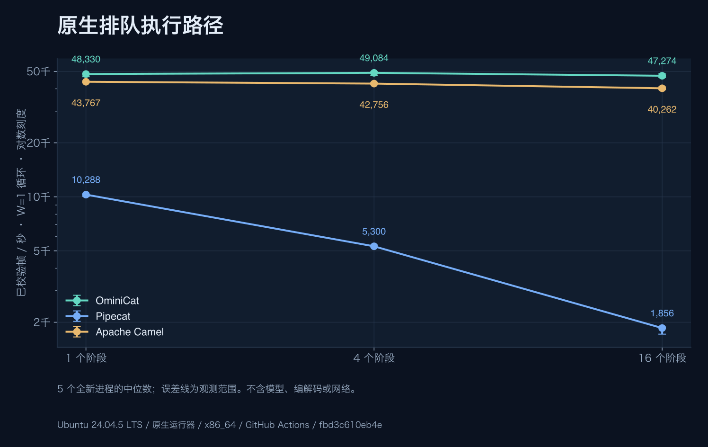
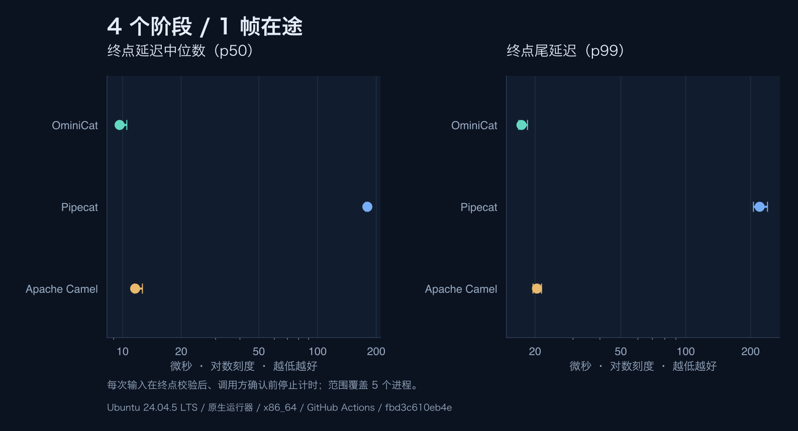
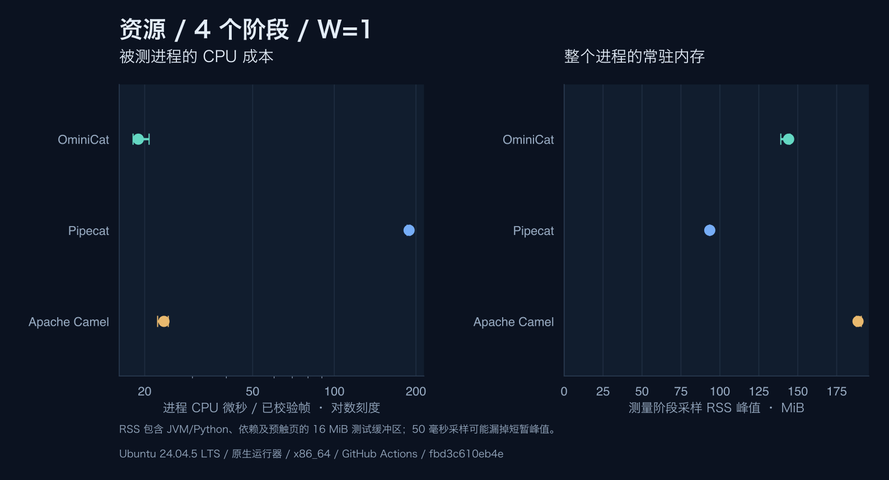

<!-- ominicat-language-nav -->
**简体中文** · [English](../../../../../reports/comparison/linux-ubuntu24-java17-2026-10-31/README.md) · [中文文档目录](../../../index.md)
<!-- /ominicat-language-nav -->

# 无模型框架对比

记录于 2026-10-31，环境为 Linux / x86_64，4 个逻辑处理器。[清单](../../../../../reports/comparison/linux-ubuntu24-java17-2026-10-31/manifest.json)将每个结果绑定到协议、被测 JAR、经验证的已安装 Python 依赖清单及精确源码指纹。全部 **45 个新进程**均通过输出、计数、拒绝和清理检查；没有省略失败轮次。

## Linux CI 环境

**Ubuntu 24.04.5 LTS / x86_64**。GitHub 托管的原生 Ubuntu 24.04.5 LTS 运行器。内核： `7.0.0-1017-azure`。CPU： `AMD EPYC 9V74 80-Core Processor`。[工作流运行](https://github.com/g5n-dev/ominicat/actions/runs/41222330745)；测量修订为 `fbd3c610eb4e2c8ad0c4bc53fcebfdb903bbb96a`。Java／Python 版本、libc、亲和性及可读取的 cgroup 限制均在清单中。三套引擎在该作业内顺序运行。不同平台作业使用独立主机；这些测量不是隔离发行版／内核差异的实验。

## 测量内容

一个进程、一条管线／会话，**一个在途数据帧**。1 / 4 / 16 个应用阶段分别执行相同的不可变数值变换。吞吐覆盖完整客户端循环；终点延迟在输出校验后、确认返回调用方之前结束。不计启动和清理。每个进程预热 3 秒、测量 5 秒。下表给出五个独立进程的中位数及观测最小—最大范围；它们**不是置信区间**。

| 框架 | 阶段数 | 帧/秒 · W=1 | p50 µs | p99 µs | 测量阶段峰值 RSS MiB |
| --- | ---: | ---: | ---: | ---: | ---: |
| OminiCat | 1 | 48,330.11 (46,679.12–48,620.97) | 9.87 (9.78–10.62) | 17.21 (17.03–17.98) | 127.88 (126.38–128.04) |
| Pipecat | 1 | 10,287.85 (10,064.21–10,356.62) | 90.21 (89.09–91.88) | 109.33 (106.19–120.60) | 93.45 (93.37–93.52) |
| Apache Camel | 1 | 43,766.91 (43,218.91–44,122.09) | 11.15 (11.04–12.02) | 19.74 (19.23–20.56) | 187.85 (184.67–190.53) |
| OminiCat | 4 | 49,083.83 (47,294.72–49,884.08) | 9.66 (9.64–10.52) | 17.30 (16.81–18.45) | 144.15 (139.11–145.00) |
| Pipecat | 4 | 5,299.93 (5,254.87–5,388.38) | 180.17 (176.73–181.77) | 220.35 (206.20–239.59) | 93.51 (93.43–93.57) |
| Apache Camel | 4 | 42,755.82 (42,314.73–43,459.39) | 11.60 (11.49–12.64) | 20.41 (19.57–21.42) | 188.68 (187.61–190.77) |
| OminiCat | 16 | 47,273.73 (46,287.69–48,410.62) | 10.16 (9.83–11.03) | 17.56 (16.79–17.81) | 145.89 (143.88–146.20) |
| Pipecat | 16 | 1,856.45 (1,717.31–1,883.09) | 531.39 (524.29–573.49) | 588.25 (565.80–658.88) | 93.73 (93.60–93.75) |
| Apache Camel | 16 | 40,261.62 (39,562.81–40,998.84) | 13.09 (12.87–14.28) | 24.29 (21.60–25.09) | 192.50 (175.39–202.03) |

## 测量规格边界

| 引擎 | 被测路径 | 执行范围 |
| --- | --- | --- |
| OminiCat 0.1.0-SNAPSHOT | PipelineSession，容量 1，终点回调 + 调用方确认队列 | Java 17 平台会话工作线程；精确源码哈希见清单 |
| Pipecat 1.15.0 | PipelineWorker / WorkerRunner，默认排队 FrameProcessor 模式，原生下游输出钩子 | CPython 3.12 / 普通 asyncio；显式关闭 RTVI、轮次追踪、指标、用量、追踪与心跳；仍计入原生输出事件分发 |
| Apache Camel 4.22.2 LTS | SEDA，大小 1，单消费者，不丢弃，请求／响应确认 | Java 17 平台消费者；计入 Exchange、Message 和原生请求／响应成本 |

Pipecat 是多模态帧管线对照。Camel 是 Java 路由框架对照，不是语音质量的等价对照。不同运行时、调度器架构、原生帧元数据与公开 API 仍计入各自被测路径。相同输出校验器与 W=1 限制不会使内部队列／背压或生命周期契约相同。本实验不约束 Pipecat 内部队列；测量程序限制的是接纳工作量。

图表没有将 OminiCat 的同步分发主指标与其他框架的排队路径比较。不测量模型、编解码、传输、音频质量、中断延迟、饱和负载或生产会话容量。这项受控合成测量不能证明框架普遍优越。

测量期间使用同一操作系统采集器每 50 ms 采样 RSS，包含运行时、导入依赖及预触碰的 16 MiB 样本缓冲区。Java 使用 -Xms128m -Xmx512m；Python 没有对应的受管堆上限。RSS 不是框架独占分配、存活堆、原生内存占用或 B/op，可能漏采短暂峰值。共享主机没有独占 CPU 隔离。重复轮次间轮换引擎顺序；JIT、GC、主机负载与温度效应仍是混杂因素。

## 复现与检查

参见[基准说明](../../../comparison/README.md)、[协议](../../../comparison/protocol.md)、[完整结果集](../../../../../reports/comparison/linux-ubuntu24-java17-2026-10-31/suite.json)及逐进程[原始 JSON](../../../../../reports/comparison/linux-ubuntu24-java17-2026-10-31/raw)。采集会拒绝非零退出、过期输出、错误数值、缺失／重复用例、混用清单、时长不足的阶段以及缺失资源样本。报告生成会在绘图前重新验证原始结果哈希。

官方来源：[Pipecat 发行版](https://github.com/pipecat-ai/pipecat/releases/tag/v1.15.0), [排队处理器源码](https://github.com/pipecat-ai/pipecat/blob/v1.15.0/src/pipecat/processors/frame_processor.py), [工作单元源码](https://github.com/pipecat-ai/pipecat/blob/v1.15.0/src/pipecat/pipeline/worker.py), [Camel 4.22.2 / Java 兼容性](https://camel.apache.org/releases/release-4.22.2/), [SEDA 语义](https://camel.apache.org/components/4.22.x/seda-component.html).

## 独立插桩诊断

[CPU 采样、分配栈、GC 与 Python 调用剖析](profiles/README.md)在额外运行中采集。插桩计时不纳入上述 45 进程对比。Java JFR 与 Python cProfile 保留各自不同的采集范围。

本文中的中文基准说明与协议链接指向当前文档；本次测量使用的固定版本英文协议链接，保留在页面顶部语言切换所对应的原始英文报告中。
