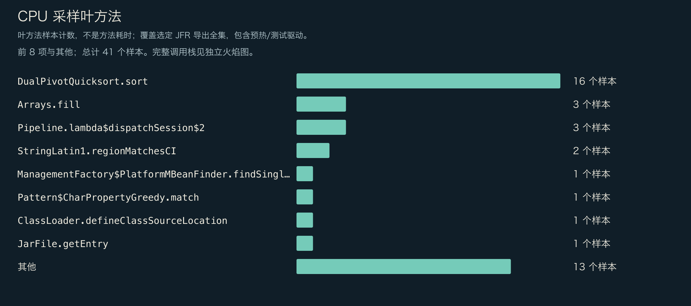
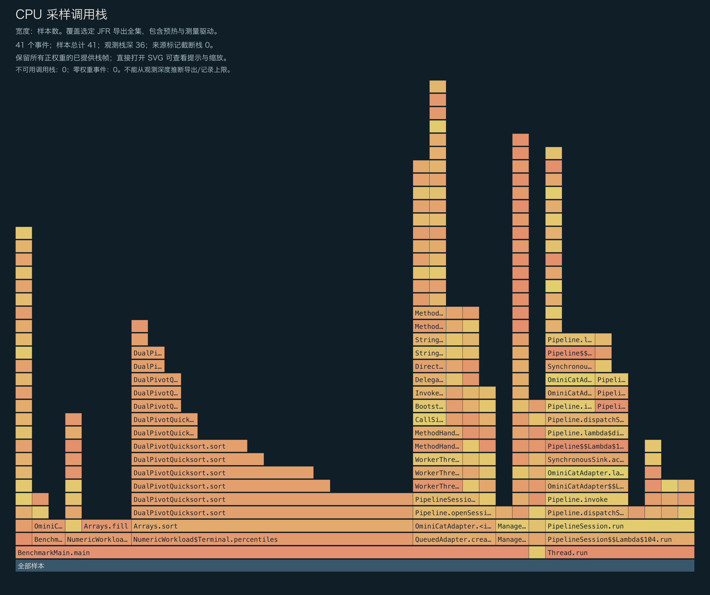
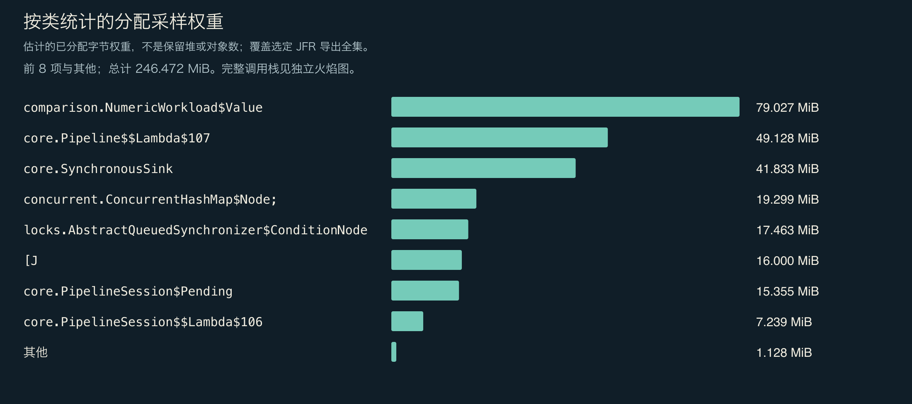
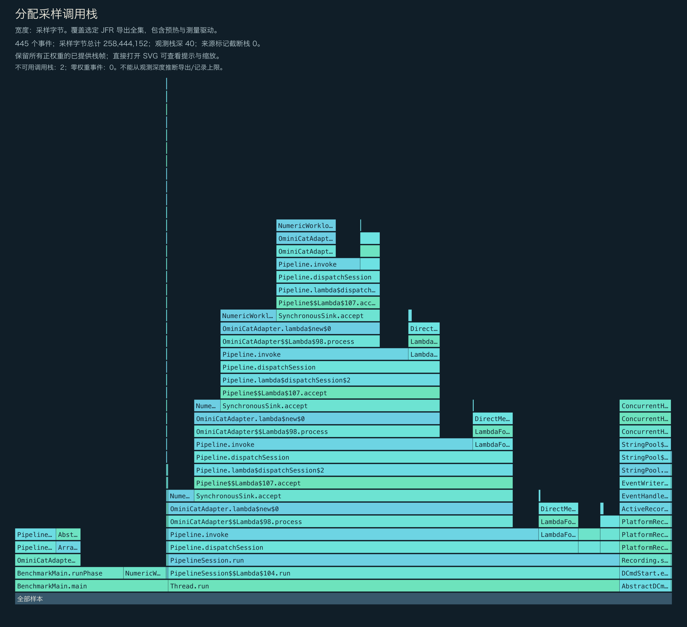
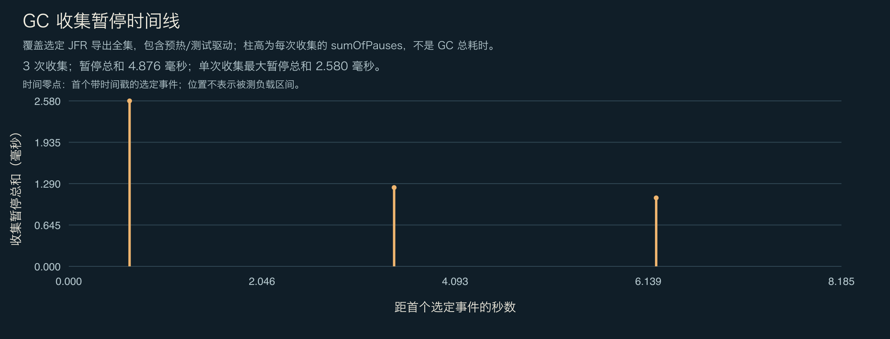

<!-- ominicat-language-nav -->
**简体中文** · [English](../../../../../../../reports/comparison/linux-ubuntu24-java17-2026-10-31/profiles/ominicat/profiles.md) · [中文文档目录](../../../../../index.md)
<!-- /ominicat-language-nav -->

# CPU、分配与 GC 剖析

选定记录的全部范围：JVM／框架启动、准备、3 秒预热、5 秒 W=1 测量、测量程序及清理。不按阶段过滤。这是独立插桩诊断，不是主计时、框架独占分配、存活堆，也不是跨语言共用的每操作字节数坐标。

## 所提供的完整 CPU 调用栈

保留所提供的全部正权重栈帧；零权重事件不占面积。观测深度不能证明记录或导出没有上限。图中标明源记录标记的截断和不可用栈。直接打开 SVG 可查看完整方法提示。

## CPU 叶节点采样

| 方法 | 样本数 |
|---|---:|
| `java.util.DualPivotQuicksort.sort` | 16 |
| `java.util.Arrays.fill` | 3 |
| `io.ominicat.core.Pipeline.lambda$dispatchSession$2` | 3 |
| `java.lang.StringLatin1.regionMatchesCI` | 2 |
| `java.lang.management.ManagementFactory$PlatformMBeanFinder.findSingleton` | 1 |
| `java.util.regex.Pattern$CharPropertyGreedy.match` | 1 |
| `java.lang.ClassLoader.defineClassSourceLocation` | 1 |
| `java.util.jar.JarFile.getEntry` | 1 |
| `java.lang.invoke.InvokerBytecodeGenerator.clinit` | 1 |
| `jdk.internal.org.objectweb.asm.Frame.execute` | 1 |
| `java.util.ImmutableCollections$SetN.iterator` | 1 |
| `io.ominicat.core.PipelineSession$$Lambda$106+0x00007fe69c00e648.1824005787.<init>` | 1 |

## 分配采样权重

权重估计分配采样分布，不是存活堆或精确对象数量。测量程序保留精确延迟数组；它的 `long[]` 分配被刻意保留可见。不从此记录推算每操作分配量。

| 类型 | 采样权重 (MiB) |
|---|---:|
| `io.ominicat.comparison.NumericWorkload$Value` | 79.03 |
| `io.ominicat.core.Pipeline$$Lambda$107+0x00007fe69c00e870.344576214` | 49.13 |
| `io.ominicat.core.SynchronousSink` | 41.83 |
| `[Ljava.util.concurrent.ConcurrentHashMap$Node;` | 19.30 |
| `java.util.concurrent.locks.AbstractQueuedSynchronizer$ConditionNode` | 17.46 |
| `[J` | 16.00 |
| `io.ominicat.core.PipelineSession$Pending` | 15.35 |
| `io.ominicat.core.PipelineSession$$Lambda$106+0x00007fe69c00e648.1824005787` | 7.24 |
| `java.lang.invoke.MethodType` | 0.38 |
| `[B` | 0.38 |
| `java.lang.String` | 0.37 |
| `java.util.concurrent.CopyOnWriteArrayList$COWIterator` | 0.00 |

## 所提供的完整分配调用栈

## GC 与竞争

- 记录的垃圾回收次数：3。
- 记录的 GC 累计暂停：4.876 ms；单次回收暂停合计最大值：2.580 ms。
- 监视器竞争事件：0；虚拟线程固定事件：该运行时不可用。
- GC 位置相对首个带时间戳的选定事件，不是测量负载开始时间。图中包含预热／测量程序事件。回收暂停合计不是整个 GC 的持续时间。
- 零采样事件不能证明不存在。采样、事件阈值和负载持续时间限制了这些观测。

证据：[选定事件，gzip JSON](../../../../../../../reports/comparison/linux-ubuntu24-java17-2026-10-31/profiles/ominicat/jfr-events.json.gz), [测量报告](report.md).
原始 JFR 在本地生成，并有意排除在 Git 之外；公开剖析时不要记录真实凭据或会话载荷。

[GC 暂停时间线](../../../../../../assets/zh-CN/reports/comparison/linux-ubuntu24-java17-2026-10-31/profiles/ominicat/gc-pauses.svg).
