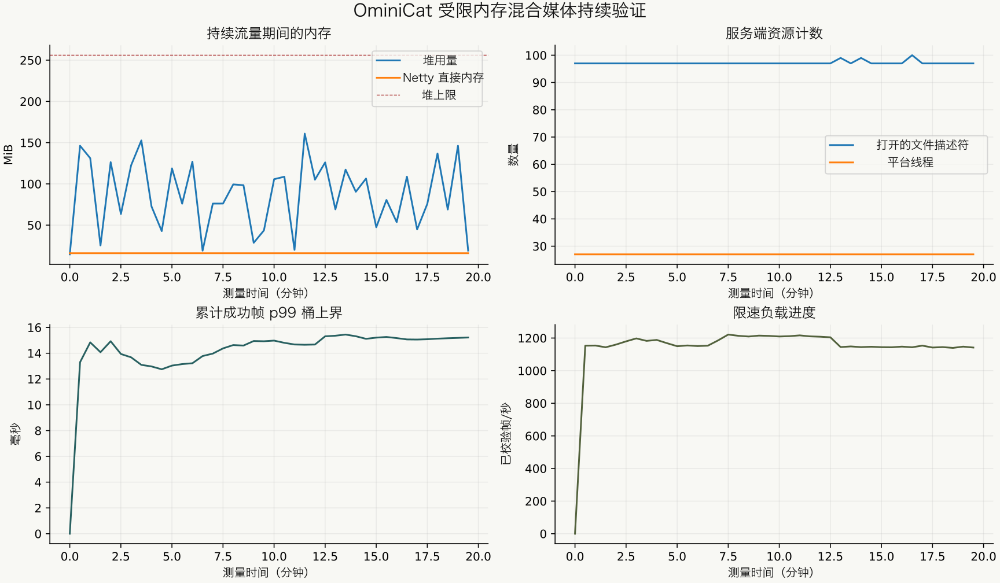

<!-- ominicat-language-nav -->
**简体中文** · [English](../../../../reports/deep/README.md) · [中文文档目录](../../index.md)
<!-- /ominicat-language-nav -->

# 深度验证报告

这是针对所标识源码修订版本和产物的历史 Java 21 验证。Java 17 基线及当前兼容性变更见 [Java 17 报告](../java17/README.md)。

记录于 **2026-10-31, Asia/Shanghai**。本报告区分已完成的验证与尚未产生结果的工作。输入均为生成的测试数据；未使用生产对话。

**已完成：**最终发行版的 234 项测试全部通过，失败、错误和跳过数均为零，其中包括 512 种子内核压力测试、独立状态/媒体判定模型，以及真实本地 TCP/HTTP/WebSocket 故障夹具。[Java 21/25 与容器 CI](https://github.com/g5n-dev/ominicat/actions/runs/41178416003) 已通过。较早的两次原生传输资源运行，分别在各自标识的源码变体上完成了 180 秒和 60 秒测试。

**已完成——固定产物资源运行：**先预热 60 秒，再完成 **1,200.174 秒实测**、**1,405,303 个已验证帧**、**42,729 个新连接**，**意外失败数为零**，会话/工作线程/输出均完全排空。预先声明的十一项数值检查全部通过。

**待完成——真实兼容服务：**尚未提供测试端点、凭据环境变量名称和模型配置。未记录任何真实服务请求或真实提供方成功结果。

硬件/工具链详情记录在[环境清单](../../../../reports/deep/environment.json)中。

## 证据与来源

| 产物 | 用途 |
| --- | --- |
| [验证结果](../../../../reports/deep/verification.json) | 各模块测试与覆盖率计数 |
| [最终源码 CI](../../../../reports/deep/ci.json) | Java 21/25、容器、源码卫生与驱动冒烟测试结果 |
| [冻结源码与产物清单](../../../../reports/deep/frozen-artifact.json) | 发行包 SHA-256 及用于构建它的生产文件 |
| [持续运行摘要](../../../../reports/deep/soak-summary.json) | 已完成时长、计数、排空检查与保留资源观测 |
| [持续资源图](../../../assets/zh-CN/reports/deep/soak-resources.svg) | 已完成运行的资源样本与延迟/速率时间线 |
| [内核测量报告](kernel/report.md) | 独立的分派/分配测量及其复现条件 |
| [依赖审计](../../../../reports/deep/dependency-audit.json) | 已记录的带版本依赖查询及返回的安全公告匹配 |
| [静态分析](../../../../reports/deep/static-analysis.json) | 最终源码发现项及保留的审查处理结论 |

持续资源运行所用产物的 SHA-256 为：

```text
081520dcc8c78baea46c013f78a3be0878bcba1c24789bce3b8c6c535710978f
```

其生产源码汇总 SHA-256 为 `f960008e9dd2b7a9da3eb2d8b934851f191e8d1d63c2ca546e51972797bc014d`。记录的加固源码逐文件匹配修订版本 `f66c2d5af76d9d19c997f41bcd0292aafb1434c7`。清单也保留了加固前的基础修订版本。增量重新打包改变了 ZIP 条目顺序；全部 3,906 个条目的内容和元数据保持一致。实测 JAR 本身按所述 SHA-256 原样保留。早期源码变体的证据另行标注。之后一项局部 SSE CR 交付修复另有受影响路径回归与字节码等价证据；该修复并未追溯纳入资源运行产物。

## 完整测试验证

干净的全仓库验证已完成，内核压力重复设置为 512 个种子。[GitHub CI](https://github.com/g5n-dev/ominicat/actions/runs/41178416003) 在 Java 21 和 25 上也已通过，包括容器生命周期/身份验证和验证驱动的冒烟运行。覆盖率描述的是该次运行覆盖的路径，并非正确性的概率。

| 模块 | 测试数 | 失败 / 错误 / 跳过 | 已覆盖行 | 已覆盖分支 |
| --- | ---: | --- | ---: | ---: |
| 内核 | 80 | 0 / 0 / 0 | 617/655 — 94.20% | 322/400 — 80.50% |
| 对话 | 40 | 0 / 0 / 0 | 416/434 — 95.85% | 297/360 — 82.50% |
| 提供方 | 57 | 0 / 0 / 0 | 363/367 — 98.91% | 282/314 — 89.81% |
| 服务器 | 57 | 0 / 0 / 0 | 463/498 — 92.97% | 296/370 — 80.00% |
| **总计** | **234** | **0 / 0 / 0** | | |

构建使用隔离的源码快照及各自的输出目录，没有替换正在运行的验证进程所使用的类。针对原始实现而故意失败的对照保留为回归证据，不计入成功验证。

### 内核调度、所有权与生命周期

512 种子内核运行执行了 **1,572,864 次选定的随机操作**，另有 1,024 个终止资源场景和 512 个分叉/汇合用例。独立模型检查有界准入、FIFO 行为、已接受帧计数、中断代次、终止结果、有序汇合和资源所有权。回调场景同时覆盖原始适配器和保留元数据的信封适配器。

可达性回归有意保留无效回调，验证已终止的输入/输出、委托对象和 ID 供应器对象图可以被回收。另一项独立检查在禁用虚拟线程跟踪时，保持活动回调可达。此次记录的运行未跳过任何可达性检查。随机种子可复现操作选择，不能复现精确的 JVM 线程调度。

种子、失败对照和复现命令见[内核对抗验证](../../ominicat-core/DEEP_VERIFICATION.md)。

### 提供方、媒体与对话判定模型

本地故障矩阵包括 42 种 Unicode SSE 分片/行结束符组合、完成标记之前全部 65 个提前字节截断点、畸形 UTF-8/JSON、响应限制、十种非成功 HTTP 状态、重定向、慢响应头、停滞的文本/音频响应体，以及部分输出后真实发生的 TCP 重置。确定性夹具会在截止时间清理仍在进行时解除 EOF 阻塞，检查超时不能变成成功的部分响应。

独立生成的用例包括：

- **352,000 次转录门控操作**，覆盖 32,000 个片段，包含打乱顺序的修订、重复/过期输入和冲突的最终提交。
- **32,000 个对话轮次**，其中包含 3,200 次与离散时间占用位集的区间/窗口比较，以及快照恢复。
- 跨三个音轨的 **1,440 个 PCM 帧与 108 个 WAV 请求**。精确字节和格式头由独立音轨缓冲区检查；时间线转换使用独立的 `BigInteger` 判定模型。
- **1,000 个证据位置**，检查已提交片段、角色、时间区间及匹配摘录。
- **250 个已完成的 HTTP 请求**，配置较长截止时间，检查超时任务立即退役，以及在 JVM 提供描述符计数时描述符增长有界。

19 个故障/判定模型测试方法又额外重复了三次，均未失败。这些生成用例计数与 JUnit 测试方法计数不同。精确种子和命令见[提供方/对话矩阵](../../ominicat-providers/DEEP_VERIFICATION.md)。

## 已复现缺陷与修正

| 领域 | 已复现失败或已验证缺口 | 修正与保留检查 |
| --- | --- | --- |
| 同步发出 | 捕获的接收器可能在返回后、外部线程上或之后的调用期间发出数据 | 每次调用的线程/生命周期边界；无效句柄解除下游引用 |
| 组合 | 失败的主分支或已完成的分支可能重用捕获的接收器；并行关闭可能允许之后继续交付汇合结果 | 作用域受限的子接收器、交付之间的取消检查及明确的所有权规则 |
| 清理 | 一个子对象的 `Error` 可能跳过其他自有资源；重复阶段身份可能导致同一资源关闭两次 | 完整聚合清理结果、保留致命错误、幂等组合关闭及拒绝重复身份 |
| 已退役回调 | 保留的原始/信封回调对象使已终止会话、载荷或适配器对象图仍可达 | 弱会话所有权与终止时解除引用，并用保留回调的可达性测试检查 |
| WebSocket 准入 | 非协作工作线程仍存活时，关闭套接字就释放了其会话槽位 | 在套接字关闭和工作线程清理均完成前保留准入占用 |
| 慢消费者 | 无法刷出的关闭帧可能使准入占用滞留；Pong 写入绕过输出预算 | 立即协作取消、两秒后强制关闭套接字，以及数据/控制共享输出预算 |
| 原始套接字 | HTTP 套接字和握手未完成的套接字不受 WebSocket 准入控制 | 在分配 HTTP 处理器前设置独立且有限的连接上限 |
| 服务器工厂所有权 | 启动/会话工厂或清理中的 `Error` 跳过已创建的处理器 | 尝试清理全部自有资源；保留致命启动错误并净化连接初始化失败信息 |
| 回环地址主机标识 | 原生连接中，攻击者控制且相互匹配的 Host 和 Origin 在无令牌时被接受 | 在未认证的回环监听器上拒绝非回环主机标识；六项原生回归包含 IPv6 |
| SSE 解码 | 合法的仅 CR 事件失败；畸形 UTF-8 被静默替换 | 支持 LF/CRLF/CR 和开头的 BOM；拒绝畸形 UTF-8 |
| 响应边界与截止时间 | 解码和取消需要明确的字节/超时所有权边界 | 解码前统计原始字节；关闭响应体前标记到期；立即移除已取消的超时任务 |
| 恢复状态 | 修订号溢出使流程部分前进；淘汰计数可能回绕为负数 | 变更前检查递增，失败时保留先前快照 |

原始内核回归对照报告 13 个失败和一个错误，共计 16 项测试。最初四项原生服务器对照报告三个失败。四项提供方/对话失败对照在修正前也都失败。这些观测确立的是特定已复现缺陷，并非所有可能缺陷的完整清单。

主机标识测试证明了传输层接受行为及其修正；它**没有**演示浏览器 DNS 重绑定利用。已配置令牌的部署保留其身份验证边界。没有测试提取提供方凭据或其他套接字的对话。

## 已完成的原生传输资源运行

这些较早运行使用[服务器验证报告](../../ominicat-server/DEEP_VERIFICATION.md)中记录的源码哈希。它们早于最终的回环 Host 加固，必须与下面的固定产物运行区分开。

| 工作负载或结果 | 180 秒运行 | 60 秒任务采样运行 |
| --- | ---: | ---: |
| 实际测量时长 | 180.441 s | 60.473 s |
| 并发原生客户端 | 16 | 16 |
| 总连接速率限制 | 100/s | 100/s |
| 成功的连接/交换/断开周期 | 17,248 | 5,744 |
| Ping/Pong 交换 | 2,464 | 816 |
| 故意不读取的 TCP 消费者 | 60 | 20 |
| 意外失败 / 准入拒绝 | 0 / 0 | 0 / 0 |
| 已报告的 Netty 泄漏警告 | 0 | 0 |

两次运行都使用 PARANOID Netty 泄漏检测和 512 MiB 最大堆。池化直接内存保留量保持在 16 MiB。在 180 秒运行中，采样描述符数量为 58 到 92，平台线程数量为 31 到 35；最终样本分别为 58 和 31。连接、活动会话、准入槽位、工作线程和待处理输出均排空至零。

独立的任务采样运行观测到排队的工作线程事件循环任务为 0–5 个，计划任务为 0–15 个，排空后两者均归零。堆样本包含等待回收的临时对象，不能描述为保留堆。更早的一次未限节奏客户端生成器耗尽了本地临时端口；该次未成功运行不计入通过的持续测试或吞吐量主张。

## 已完成的固定产物资源运行

| 请求条件 | 配置 |
| --- | --- |
| 预热 | 60 秒 |
| 测量区间 | 1,200 秒 |
| 常驻客户端 | 64 个，每个约 20 frames/s |
| 连接更替 | 额外四个工作线程，周期之间暂停 100 ms |
| 服务器堆 / 直接内存限制 | 256 MiB / 128 MiB |
| 观测手段 | PARANOID Netty 泄漏检测、JFR、资源/GC 采样和源码/产物哈希 |
| 载荷 | 文本、PCM 音频、最终转录、编码图像和因果信封 |
| 实际测量时长 / 已验证帧 / 新连接 | **1,200.174 s / 1,405,303 / 42,729** |
| 失败/进展/排空结果 | **0 个失败；每个客户端均有进展；排空后自有资源指标全部为零** |
| 常驻连接交换 p50 / p95 / p99 | **7.382 / 10.498 / 15.260 ms**，为直方图桶上界 |

驱动检查序列化载荷及信封因果/关联信息、会话/轮次身份、时间信息保留和事件 ID 派生。每个客户端都必须有进展。完成条件要求已记录失败数为零，并通过有界轮询确认活动会话、保留的准入占用、存活工作线程和待输出字节全部排空。指标请求本身也是一个传输连接，不会被误认为泄漏的 WebSocket。

这是按节奏发流的闭环正确性/资源工作负载，并非饱和基准测试。连接更替交换延迟不包含握手时间。已完成的[摘要](../../../../reports/deep/soak-summary.json)、[数值样本](../../../../reports/deep/soak-samples.jsonl)和[资源图](../../../assets/zh-CN/reports/deep/soak-resources.svg)适用于所述产物。延迟包含泄漏检测/剖析开销，以及共享开发主机上的响应验证；它不是生产 SLA。

[](../../../assets/zh-CN/reports/deep/soak-resources.svg)

实测帧包括 1,011,623 个文本帧、210,900 个音频帧、140,600 个转录、28,120 个图像和 14,060 个因果信封。各类型计数和延迟计数与成功总数一致。连接更替交换的 p99 为 **4.883 ms**，不包含握手时间。常驻连接交换的最大值为 **135.484 ms**；尾部样本被保留，没有丢弃。

| 保留量/资源观测 | 预热后 | 排空后 |
| --- | ---: | ---: |
| 请求完整 GC 后的已用堆 | 13.566 MiB | 7.173 MiB |
| Netty 直接内存保留量 | 16 MiB | 16 MiB |
| 打开的文件描述符 | 97 | 33 |
| 平台线程 | 27 | 27 |
| 活动/已准入会话、存活工作线程、待处理输出 | 流量活跃 | 全部为零 |

[排空后类直方图摘要](../../../../reports/deep/resource-diagnostics.json)发现，选定的 PipelineSession、回调句柄、同步接收器、音频/图像/信封和 WebSocket 处理器实例均为零。工厂单例和服务器基础设施按预期保留。这些是选定的可达性/资源观测，并非对所有可能泄漏的证明。未观测到 Netty 泄漏警告。驱动还通过了[负对照](../../../../reports/deep/harness-controls.json)：故意破坏的回复和不产生进展的服务都按要求失败。

JFR 录制覆盖整个进程 **1,345 秒**的执行，包括启动、预热、实测流量、排空和诊断。见[事件摘要](../../../../reports/deep/soak-jfr-summary.txt)、[采样热点方法](../../../../reports/deep/soak-hot-methods.txt)、[采样分配类](../../../../reports/deep/soak-allocation-by-class.txt)和[GC 暂停](../../../../reports/deep/soak-gc-pauses.txt)。类直方图诊断会请求额外 GC；这些事件仍保留在录制中。原始 JFR 留在本地。Native Memory Tracking 报告**已提交 502.247 MiB**（比此前诊断基线低 7.065 MiB），包含固定的 256 MiB 堆、JVM 线程/代码/GC/元数据及剖析开销。这既不是 RSS，也不是整个进程只占 256 MiB 的内存主张。诊断 JSON 保留了完整的原生内存分类明细。

独立的[内核报告](kernel/report.md)测得 4 阶段直接分派为每秒 40.01 百万次操作，会话往返为 8.229 µs/op。[历史比较](kernel/comparison.md)公开记录了调用保护带来的分配增加和更低的直接分派吞吐量；共享主机运行不能隔离因果关系。正确性检查没有被表述为无成本。

## 资源运行后的 CR 流式修正

最终一项保持流打开的检查复现了局部活性缺陷：CR 解析器会先向前读取可选 LF，再分派已经完整的事件。有限响应体的分片测试未暴露该问题。解析器修正为遇到 CR 立即返回，把可选 LF 的消费推迟到下一次读取。两个新增的保持流打开测试方法覆盖带 BOM 和不带 BOM 的 LF/CRLF/CR。最终全项目干净测试套件通过了 234 项测试，使用 512 个压力种子。[60.062 秒真实本地 HTTP 流](../../../../reports/deep/sse-cr-streaming.json)交付了全部 6,000 个有序 Unicode 块；每一块都在生产者写入下一块之前被观测到。DONE 在生产者仍保持响应体打开时完成。这些本地夹具结果不是真实提供方证据。

[发行差异清单](../../../../reports/deep/release-delta.json)记录最终 JAR SHA-256，以及恰好两个已更改/新增的字节码条目：`ChatFactory.class` 和 `ChatFactory$SseLines.class`。全部 69 个内核/服务器/对话类及其他所有现有条目都逐字节相同。20 分钟资源运行使用的是上述产物 081520...；没有在这一局部提供方变更上整体重跑。最终发行版通过了 234 项测试及这一受影响路径的流检查，而不可变的资源运行证据单独保留。针对[精确最终 JAR 的短时打包冒烟测试](../../../../reports/deep/release-smoke.json)也已通过：实测 10.172 秒、1,076 个混合媒体帧、360 个新连接、零失败且自有资源完全排空。它不能替代此前的持续运行。

## 依赖与静态分析审查

记录的 OSV 批量查询检查了 **13 个带版本的第三方坐标**，于 2026-10-31 返回**零个匹配安全公告**。这是该日期数据库对所记录集合的结果，不能证明软件或其依赖不存在漏洞。[审计](../../../../reports/deep/dependency-audit.json)保留包版本和查询来源。

已完成的最终源码 SpotBugs 扫描采用最大分析力度和较低报告阈值。它报告 **23 个发现项：零个高、五个中和十八个低等级**，没有分析错误或缺失类。[记录的审查](../../../../reports/deep/static-analysis.json)解释了有意采用的注册表同步、受检异常 SPI 边界、考虑所有权的清理和溢出验证。警告仍然可见，没有为制造零警告结果而被抑制。CR 修复后，受影响的内核/提供方扫描已更新；对话/服务器字节码保持不变。所有扫描的生产类都已与最终发行 JAR 比较。审查记录分别保留了此前资源运行产物哈希和最终发行哈希。

## 待完成——真实兼容服务验证

没有可用端点、可用测试凭据的环境变量名称或模型配置。因此没有可报告的外部服务成功结果。

显式启用的探针对每项已配置能力最多发送一个请求，使用简短的生成输入和有界响应：精确文本标记、纯色图像、简短本地语音夹具和短语音合成。它记录检查、长度/哈希和音频数值测量，不记录提供方原始文本、端点详情或凭据。语音输出检查验证 PCM 大小和非静音，不能确立可懂度或声学质量。成功的本地 HTTP 夹具不能替代这项待完成的真实检查。

## 复现与解读

在隔离检出目录中使用 Java 21+ 运行完整套件：

```sh
./mvnw -B -Pcoverage,sbom -Dominicat.stress.seeds=512 clean verify
```

[验证驱动](../../validation/README.md)记录持续运行和显式启用真实服务的命令。上述模块报告包含确定性种子、聚焦故障的命令和原始失败对照。[内核报告](kernel/report.md)单独记录剖析工作负载；不能将内核分派数值表述为网络或模型响应延迟。

这些证据不能证明穷尽的并发安全、不存在所有泄漏或漏洞、多日稳定性、模型准确率、生产容量或 SLA。取消是协作式的，无法撤销已经进入执行的外部效果。必须同时考虑载荷大小、会话数量和队列容量；有界帧数不是通用的机器内存上限。自定义插件自行负责其行为、截止时间和外部副作用。持久交付、崩溃恢复、自动说话人分离，以及连续的提供方原生 ASR/TTS，仍不属于所含适配器已展示的能力。
