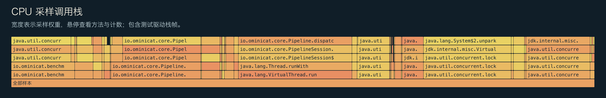
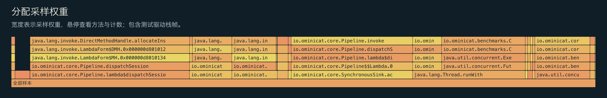

<!-- ominicat-language-nav -->
**简体中文** · [English](../../../../../reports/deep/kernel/profiles.md) · [中文文档目录](../../../index.md)
<!-- /ominicat-language-nav -->

# CPU、分配与 GC 性能剖析

根据有界内核负载中选取的 JFR 事件生成。样本包含负载测试驱动、预热和精确百分位数排序；它们不是模型或网络性能剖析。主机同时运行了限速的 64 个常驻 + 4 个连接更替客户端正确性持续测试。

## CPU 叶方法采样

| 方法 | 样本数 |
|---|---:|
| `io.ominicat.core.Pipeline.dispatchSession` | 166 |
| `java.lang.System$2.unparkVirtualThread` | 122 |
| `io.ominicat.core.PipelineSession.valid` | 106 |
| `jdk.internal.misc.Unsafe.getAndBitwiseAndInt` | 87 |
| `java.util.concurrent.CountDownLatch$Sync.tryReleaseShared` | 81 |
| `java.util.DualPivotQuicksort.sort` | 58 |
| `java.lang.VirtualThread.parkNanos` | 29 |
| `java.util.concurrent.locks.ReentrantLock$Sync.lock` | 26 |
| `java.lang.Thread.interrupted` | 23 |
| `java.lang.VirtualThread.unpark` | 15 |
| `java.util.concurrent.Semaphore.release` | 14 |
| `io.ominicat.benchmarks.CoreLoad.lambda$runPhase$4` | 11 |

## 分配采样权重

权重估计的是采样得到的分配分布，而非保留堆大小或精确对象数量。测试驱动保留完整的延迟数组；其中的 `long[]` 分配会有意体现在结果中。每次操作的分配估计值应使用 JMH `gc.alloc.rate.norm`。

| 类 | 采样权重（MiB） |
|---|---:|
| `io.ominicat.core.Pipeline$$Lambda.0x000000d80100cac8` | 2,902.08 |
| `io.ominicat.core.SynchronousSink` | 2,139.99 |
| `io.ominicat.benchmarks.CoreLoad$Probe` | 1,192.09 |
| `io.ominicat.core.PipelineSession$Pending` | 783.80 |
| `io.ominicat.core.PipelineSession$$Lambda.0x000000d80100b958` | 575.02 |
| `[J` | 211.19 |
| `java.util.concurrent.locks.AbstractQueuedSynchronizer$ExclusiveNode` | 202.38 |
| `java.util.concurrent.ScheduledThreadPoolExecutor$ScheduledFutureTask` | 68.58 |
| `java.util.concurrent.locks.AbstractQueuedSynchronizer$SharedNode` | 53.34 |
| `java.util.concurrent.locks.AbstractQueuedSynchronizer$ConditionNode` | 40.30 |
| `java.lang.VirtualThread$$Lambda.0x000000d80103eaf0` | 38.57 |
| `java.util.concurrent.Executors$RunnableAdapter` | 33.88 |

## GC 与争用

- 已记录的垃圾收集次数：30。
- 已记录的 GC 暂停时间之和：37.279 ms；单次收集的最大暂停时间之和：4.496 ms。
- 监视器争用事件：0；虚拟线程固定事件：0。
- 采样事件数为零并不能证明事件不存在。这些观测受采样、事件阈值和工作负载时长的限制。

证据：[选定事件，gzip JSON](../../../../../reports/deep/kernel/jfr-events.json.gz)、[GC 日志](../../../../../reports/deep/kernel/gc.txt)、[测量报告](report.md)。
原始 JFR 在本地生成，并有意排除在 Git 之外；面向公开性能剖析时，不要录制真实凭据或对话载荷。
