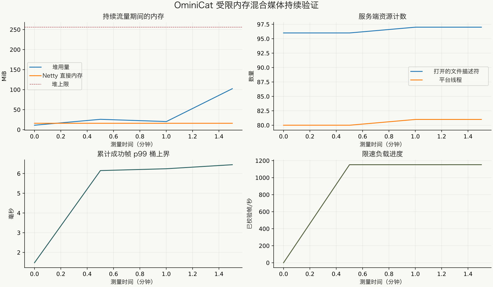

<!-- ominicat-language-nav -->
**简体中文** · [English](../../../../reports/java17/README.md) · [中文文档目录](../../index.md)
<!-- /ominicat-language-nav -->

# Java 17 兼容性验证

这里记录初始 Java 17 兼容性产物（preview.3）。后续的 [HTTP 响应体取消修正](http-cancellation/README.md)具有独立的源码、测试和发行包证据。

记录于 **2026-10-31, Asia/Shanghai**。Java 17 是每个模块的构建/运行时基线；Java 21+ 自动选择虚拟工作线程。输入为合成本地夹具。未调用任何外部模型服务。

## 全项目验证

一次干净的 reactor 构建在 **Homebrew OpenJDK 17.0.21.0.3**、macOS/aarch64 上运行，使用 512 个内核压力种子：

```sh
./mvnw -B -ntp -Pcoverage,sbom -Dominicat.stress.seeds=512 clean verify
```

**244 项测试通过，失败、错误和跳过数均为零。**完整回归套件得以保留；九个新增内核用例检查后端选择、有界执行、拒绝、排空、中断、被丢弃任务的所有权和 `ExecutorCompletionService` 包装器。另一项真实 WebSocket 测试检查工作线程后端和断开连接后的清理。[计数](../../../../reports/java17/verification.json) · [已净化的构建输出](../../../../reports/java17/verification.txt)。

| 模块 | 测试数 | 失败 / 错误 / 跳过 | 行覆盖率 | 分支覆盖率 |
| --- | ---: | --- | ---: | ---: |
| `ominicat-core` | 89 | 0 / 0 / 0 | 92.34% | 79.67% |
| `ominicat-conversation` | 40 | 0 / 0 / 0 | 95.85% | 82.50% |
| `ominicat-providers` | 57 | 0 / 0 / 0 | 98.91% | 89.81% |
| `ominicat-server` | 58 | 0 / 0 / 0 | 93.04% | 80.37% |

独立模块运行的内核 **89/89** 和服务器 **58/58** 检查也在 Java 17 和 21 上全部通过。[CI 矩阵](https://github.com/g5n-dev/ominicat/actions/workflows/ci.yml)在 Java **17、21 和 25** 上运行完整套件与验证工具。容器任务检查默认镜像确实报告 Java 17。受保护的 `main` 要求五项具名检查全部通过；PR 检查构成最终合并门槛。

## 运行时与字节码范围

最终服务器 JAR 在 Java 17 上构建并运行。SHA-256：

```text
370e4e056d2336526ffe5f4975470671b195235eeb43623efed873bc2e32883e
```

[产物/源码清单](../../../../reports/java17/frozen-artifact.json)记录每个生产源码/资源及 POM。其源码汇总为 `1d5f10c841306ca5871ada654e8ff72aae10604f20b893490e93a7237e2cb69b`。阴影打包 JAR 中全部 **3,611 个基础类**均兼容 Java 17：91 个类的类文件主版本为 61，2,159 个为 50，1,361 个为 52。带版本的多发行条目不属于这次基础类扫描。测量后只修正了一行交付工作线程 Javadoc。清单保留了两个源码哈希；该注释更改后重新构建，每个 JAR 条目的内容均相同，因此实测产物原样保留。实际 Java 17 执行为这一结构检查提供了补充。[完全相同的 Java 17 构建 JAR 还在 Java 21 上运行](../../../../reports/java17/java21-artifact-smoke.json)，未重新编译：实测 10.000 秒、1,056 个已验证混合媒体帧、352 个新连接、零失败、使用虚拟工作线程且自有资源完全排空。

`WorkerThreads` 在 Java 17 上使用有名称的守护平台线程，在 Java 21+ 上发现公共虚拟线程工厂。反射不在帧分派路径内。分支执行器在两个后端都有明确的工作线程数和队列上限。取消代次、同步接收器生命周期、串行会话所有权和逆序清理仍由回归套件覆盖。[兼容性指南](../../java-compatibility.md)解释部署/线程预算影响。

## 精确产物的混合媒体资源运行

上述 JAR 在预热十秒后完成了 **120.118 秒实测**，使用 64 个常驻客户端（每个约 20 frames/s）和四个按节奏发起连接更替的工作线程。配置包括 256 MiB 堆、128 MiB 直接内存限制、PARANOID Netty 泄漏检测、JFR 和 Native Memory Tracking。JFR 与诊断是本地测试开销，不是生产默认配置。

- **138,388 个已验证帧**、**4,395 个实测新连接**、**意外失败数为零**。
- 文本、PCM 音频、转录、编码图像和因果信封均与其序列化输入核对。所有客户端均有进展；全部帧类型与延迟计数相互吻合。
- 十一项[预先声明的检查](../../../../reports/java17/soak-criteria.json)全部通过。会话、保留的准入占用、流水线工作线程和待处理输出均排空至零。
- 常驻连接 p50/p95/p99：**0.778 / 3.293 / 6.149 ms**，为直方图桶上界；最大值为 52.465 ms。连接更替交换 p99 为 2.667 ms，不包含握手时间。

| 服务器资源 | 预热后 | 排空后 |
| --- | ---: | ---: |
| 请求完整 GC 后的已用堆 | 11.159 MiB | 7.718 MiB |
| Netty 池化直接内存保留量 | 16 MiB | 16 MiB |
| 打开的描述符 | 96 | 33 |
| JDK 平台线程数量 | 80 | 17 |

平台工作线程会计入 Java 17 的线程数；这与较新 JDK 上的虚拟工作线程计数方式不同。指标请求本身解释了剩余的传输连接。排空后类直方图显示，选定的会话、回调/接收器、音频/图像/信封和 WebSocket 处理器实例均为零。未观测到 Netty 泄漏警告。这些有限观测不能证明所有可能的泄漏都不存在。

NMT 在排空后报告**已提交 484.589 MiB**，包含固定堆、线程栈、JVM 内部结构和剖析。这**不是 RSS**，也不是整个进程只占 256 MiB 的内存主张。其差分基线在实测流量期间采集，并不恰好对应预热结束时刻。完整 JFR 录制还包含启动、预热、排空、空闲和诊断收集；其中的 153 次 GC 事件不限于 120 秒区间。该录制中单次收集的最大暂停时间之和为 12.176 ms。

[摘要](../../../../reports/java17/soak-summary.json) · [数值样本](../../../../reports/java17/soak-samples.jsonl) · [诊断](../../../../reports/java17/resource-diagnostics.json) · [JFR 事件计数](../../../../reports/java17/soak-jfr-summary.txt)。

[](../../../assets/zh-CN/reports/java17/soak-resources.svg)

时间线显示流量期间的周期采样；排空后数值单独列于表中。这是在共享开发主机上按节奏发流的闭环正确性/资源工作负载，主机同时用于剖析和其他验证。它不是饱和基准测试、生产 SLA 或多日稳定性测试。

## 其他受影响路径检查

| 探针 | 已完成结果 | 来源 |
| --- | --- | --- |
| Java 17 上保持响应体打开的仅 CR HTTP 流 | 60.063 s；全部 6,000 个 Unicode 块精确、有序，且在下一次写入前被观测到；DONE 在生产者 EOF 前完成 | [结果](../../../../reports/java17/sse-cr-streaming.json)、[运行时/源码/命令](../../../../reports/java17/sse-metadata.json) |
| Java 17 上的原生 TCP | 60.584 s；5,753 个周期、816 次 Ping/Pong 交换、20 个不读取的消费者；失败/拒绝数为零且资源完全排空 | [结果](../../../../reports/java17/native-soak-60s.json)、[源码变体](../../../../reports/java17/native-provenance.json) |

原生运行使用较早的 `WorkerThreads` 直接 Future 取消实现；服务器生产文件和工作线程工厂与最终实现匹配。[完整源码清单](../../../../reports/java17/native-source-sha256.json)保留了这一差异。它不会被重新标记为最终 JAR 的运行。精确最终产物具有上述独立的全项目和混合媒体证据。

## Java 17 CPU、分配与调度剖析

[内核报告](kernel/report.md)记录一次真实的双 fork JMH 运行、GC 分配测量和 25 百万个有界负载帧。四阶段同步分派测得 **40.536 百万 ops/s，328 B/op**；一个尚未完成帧的会话往返测得 **7.104 微秒/op**。独立的 16 会话负载完成了 25 百万个实测帧，拒绝数为零，吞吐量为 2.706 百万 frames/s，p99 为 1,436.041 微秒。

这些是不同的工作负载，计时范围各不相同。共享主机执行不能确立 Java 17 与 Java 21 比较的因果关系。[CPU/分配火焰图与 GC](kernel/profiles.md)保留了负载测试驱动和延迟数组的成本。Java 17 不提供虚拟线程固定事件；报告将其标记为不可用。

## 复现与限制

按上述方式在 JDK 17 上构建，然后遵循[验证指南](../../validation/README.md)。Java 17 资源回归使用 120 秒实测、十秒预热和 64 个客户端，然后通过以下命令分析：

```sh
python validation/summarize.py reports/local/java17/soak reports/local/java17/analysis validation/java17-soak-criteria.json
```

使用具有固定绘图依赖的独立环境。原始 JFR、私有配置和机器特定日志留在本地。[历史 Java 21 基线](../baseline/report.md)和 [20 分钟深度运行](../deep/README.md)保留其原始源码/产物；它们不描述此次兼容性移植。由于尚未提供测试端点、凭据环境变量名称或模型配置，真实提供方验证仍未运行。
