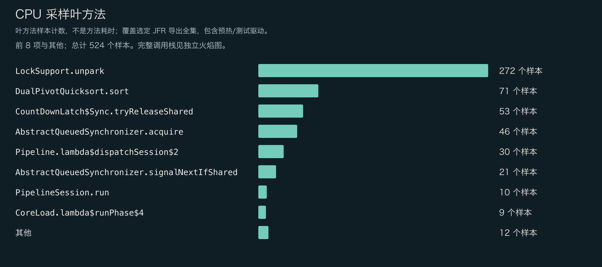
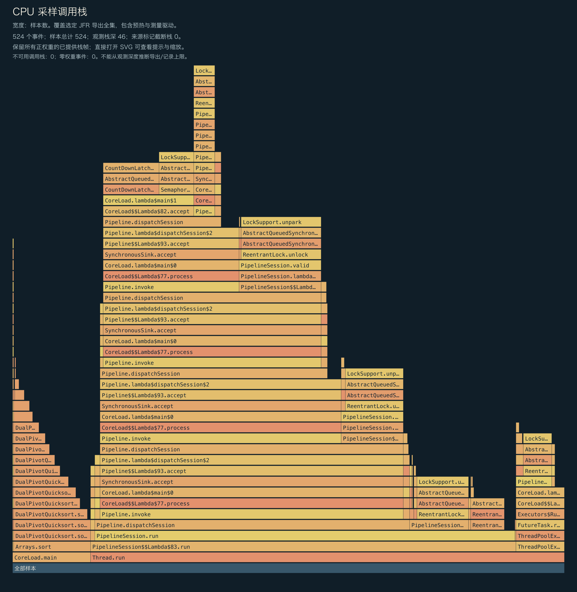
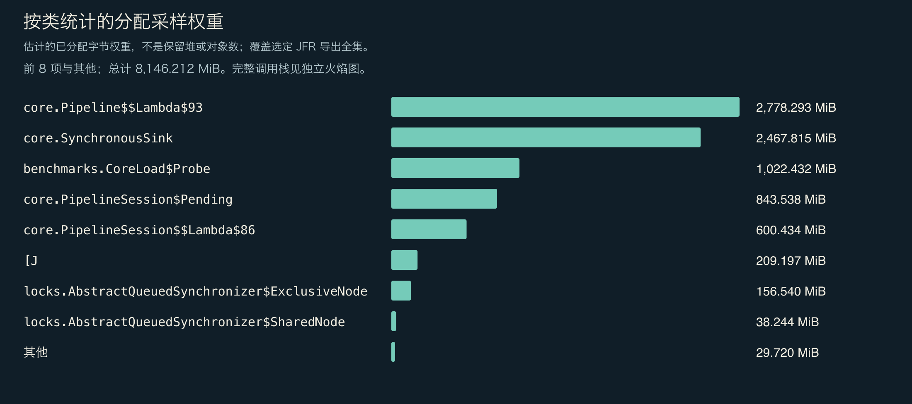
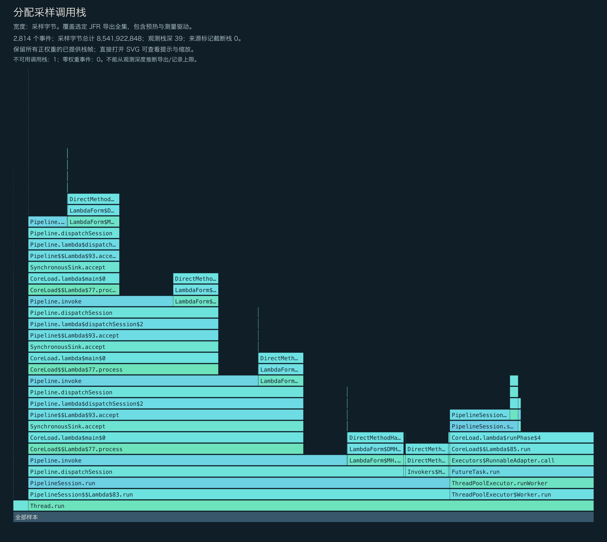
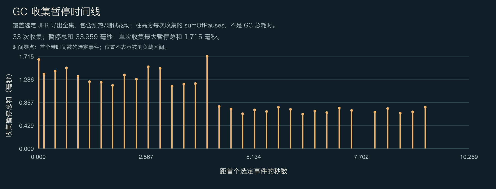

<!-- ominicat-language-nav -->
**简体中文** · [English](../../../../../reports/java17/kernel/profiles.md) · [中文文档目录](../../../index.md)
<!-- /ominicat-language-nav -->

# CPU、分配与 GC 性能剖析

根据有界内核负载中选取的 JFR 事件生成。样本包含负载测试驱动、预热和精确百分位数排序；它们不是模型或网络性能剖析。主机同时承担开发工作，并并发运行 120 秒的按节奏发流/原生 Java 17 兼容性验证。这不是独占主机基准测试、受控 A/B 实验，也不是服务器/提供方容量测试。

原始录制通过 `jfr print --stack-depth 64` 重新导出，恢复了最多 46 帧的 CPU 栈和最多 39 帧的分配栈。将栈重新投影到早期导出默认的五帧后，全部 3,371 条事件记录都与早期导出匹配；时间戳、采样权重和测量结果均未改变。[导出来源记录](../../../../../reports/java17/kernel/measurement-context.json) 保留原始录制和先前导出的指纹。原始 JFR 留在本地。

## 已提供的完整 CPU 栈

所有已提供且权重为正的栈帧都被保留；零权重事件不占面积。观测到的深度不能证明录制或导出没有深度上限。图中显示源数据标记的截断和不可用栈。直接打开 SVG 可查看完整的方法提示。

## CPU 叶方法采样

| 方法 | 样本数 |
|---|---:|
| `java.util.concurrent.locks.LockSupport.unpark` | 272 |
| `java.util.DualPivotQuicksort.sort` | 71 |
| `java.util.concurrent.CountDownLatch$Sync.tryReleaseShared` | 53 |
| `java.util.concurrent.locks.AbstractQueuedSynchronizer.acquire` | 46 |
| `io.ominicat.core.Pipeline.lambda$dispatchSession$2` | 30 |
| `java.util.concurrent.locks.AbstractQueuedSynchronizer.signalNextIfShared` | 21 |
| `io.ominicat.core.PipelineSession.run` | 10 |
| `io.ominicat.benchmarks.CoreLoad.lambda$runPhase$4` | 9 |
| `java.util.concurrent.locks.AbstractQueuedSynchronizer$ConditionObject.await` | 2 |
| `java.util.concurrent.locks.LockSupport.park` | 2 |
| `java.lang.invoke.DirectMethodHandle.allocateInstance` | 2 |
| `java.util.DualPivotQuicksort.mixedInsertionSort` | 2 |

## 分配采样权重

权重估计的是采样得到的分配分布，而非保留堆大小或精确对象数量。测试驱动保留完整的延迟数组；其中的 `long[]` 分配会有意体现在结果中。每次操作的分配估计值应使用 JMH `gc.alloc.rate.norm`。

| 类 | 采样权重（MiB） |
|---|---:|
| `io.ominicat.core.Pipeline$$Lambda$93+0x000000700100fd60.2065602256` | 2,778.29 |
| `io.ominicat.core.SynchronousSink` | 2,467.82 |
| `io.ominicat.benchmarks.CoreLoad$Probe` | 1,022.43 |
| `io.ominicat.core.PipelineSession$Pending` | 843.54 |
| `io.ominicat.core.PipelineSession$$Lambda$86+0x000000700100f6e8.1407567661` | 600.43 |
| `[J` | 209.20 |
| `java.util.concurrent.locks.AbstractQueuedSynchronizer$ExclusiveNode` | 156.54 |
| `java.util.concurrent.locks.AbstractQueuedSynchronizer$SharedNode` | 38.24 |
| `java.util.concurrent.locks.AbstractQueuedSynchronizer$ConditionNode` | 28.13 |
| `jdk.internal.org.objectweb.asm.SymbolTable$Entry` | 1.00 |
| `java.lang.InterruptedException` | 0.33 |
| `[B` | 0.25 |

## 已提供的完整分配栈

## GC 与争用

- 已记录的垃圾收集次数：33。
- 已记录的 GC 暂停时间之和：33.959 ms；单次收集的最大暂停时间之和：1.715 ms。
- 监视器争用事件：0；虚拟线程固定事件：此运行时不提供。
- GC 位置以选取事件中首个带时间戳的事件为基准，而非实测负载开始时刻。图中包含预热/测试驱动事件。每次收集的暂停时间之和并非完整的 GC 持续时间。
- 采样事件数为零并不能证明事件不存在。这些观测受采样、事件阈值和工作负载时长的限制。

证据：[选定事件，gzip JSON](../../../../../reports/java17/kernel/jfr-events.json.gz)、[测量报告](report.md)。
原始 JFR 在本地生成，并有意排除在 Git 之外；面向公开性能剖析时，不要录制真实凭据或对话载荷。

[GC 日志](../../../../../reports/java17/kernel/gc.txt)。
