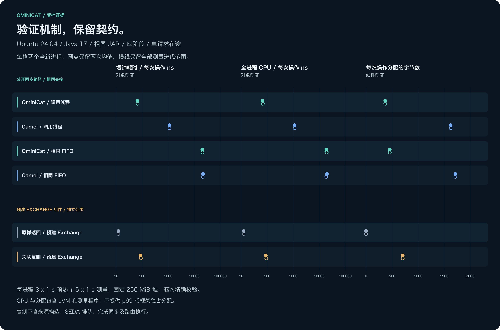

<!-- ominicat-language-nav -->
**简体中文** · [English](../../../../../reports/mechanisms/java17-2026-11-02/README.md) · [中文文档目录](../../../index.md)
<!-- /ominicat-language-nav -->

# Java 机制对照证据 — 2026-11-02

本轮实验测量三个具体机制：同步公开执行路径、包装两套框架的相同外部队列／工作线程／确认组合，以及带关联元数据的 Exchange 复制。不修改生产运行时。下列主结果仅来自[运行 41387743749](https://github.com/g5n-dev/ominicat/actions/runs/41387743749)。

工作流与完整的 91 文件证据包均通过校验，包含十二个测量 JVM 和五组独立诊断。发布检查覆盖白名单、隐私、源码／制品绑定及校验和；诊断计时仍与主表分开。

[](../../../../assets/zh-CN/reports/mechanisms/java17-2026-11-02/costs.svg)

## 记录环境与方法

| 项目 | 记录值 |
| --- | --- |
| 主机 | Ubuntu 24.04.5 LTS；Linux 7.0.0-1017-azure；x86_64 |
| CPU 配额 | AMD EPYC 7763 64-Core Processor；本任务可见 4 个逻辑处理器，亲和性数量为 4 |
| JVM | Eclipse Adoptium OpenJDK 17.0.21+9；固定 256 MiB 堆 |
| 框架／工具 | Camel 4.22.2；当前 OminiCat 核心；JMH 1.37 |
| 负载 | 4 个处理不可变数值的阶段；1 个在途请求；1 个基准线程 |
| 采样安排 | 6 组组合，先正序再逆序；12 个全新 JVM；每组 2 个独立 JVM |
| 每个独立 JVM | 3 × 1 秒预热；5 × 1 秒测量迭代 |
| 采集时间 | 2026-11-02T04:19:26.238399+00:00 |

任务运行于共享 GitHub 运行器，没有独占 CPU 隔离。每次墙钟耗时测量包含输入构造、四次变换、精确的顺序／数值／数量／线程校验、同步后端返回，以及所选模式中的完整外部交接与确认。复制操作使用下述预建源对象。启动、准备阶段校验、排空、关闭与报告生成均在基准方法之外。

JMH 以 `ns/op` 报告平均耗时。分配量来自 `gc.alloc.rate.norm`，单位为 `B/op`，包含框架、测试工具及参与统计的 JVM 线程。全进程 CPU 指标为 `process.cpu.ns/op`：两个迭代分析钩子间的进程 CPU 增量，除以 JMH 的 `getAllOps()`。该区间包含钩子工作、JIT、GC 及其他 JVM 线程，并非阶段自身耗时。本轮不测量 p99、RSS、模型、媒体编解码或网络。

[清单](../../../../../reports/mechanisms/java17-2026-11-02/evidence/measurements/manifest.json)记录精确主机、JVM、参数、依赖哈希及完整源码目录。本次采集使用干净的源码版本 `d6a9cdffef4fe4e00d30ff814e0bd1b92a59f189`，源码指纹为 `e6df4f37d63b613e27db58d3524c1a8225dfea99b63d48eee97935f71926e6a4`，可执行 JAR 的 SHA-256 为 `a3156be9d9908ad00aa9fb6d6c6b9e8dbf281c189de75e1e15503df3702a002c`。每个全新 JVM 都校验实际加载的 JAR 来源。

## 六组测量结果

每项为两个独立 JVM 均值的中位数；样本只有两个，因此等于两者中点。[完整汇总](evidence/measurements/summary.md)保留两个均值和全部十次测量迭代的范围，[summary.json](../../../../../reports/mechanisms/java17-2026-11-02/evidence/measurements/summary.json)保留每次迭代。图中分别绘制两个均值点，线段表示观测迭代的最小—最大范围。这些范围不是置信区间，派生差值使用未舍入的均值计算。

| 组合 | 墙钟耗时 ns/op | 全进程 CPU ns/op | 分配 B/op |
| --- | ---: | ---: | ---: |
| `ominicat-caller` | 66.339 | 67.457 | 368.000413 |
| `camel-caller` | 1,122.604 | 1,136.710 | 1,624.125335 |
| `ominicat-handoff` | 20,590.533 | 19,168.987 | 455.910356 |
| `camel-handoff` | 21,544.793 | 19,199.635 | 1,714.367391 |
| `identity` | 12.360 | 12.499 | 0.000825 |
| `correlated-copy` | 88.161 | 90.942 | 704.005886 |

保留 identity 微小但非零的分配值，没有将其四舍五入为零；归一化的全 JVM 观测不能证明框架操作完全不分配对象。

## 对照能够说明什么

### 同步公开路径

OminiCat 的调用线程路径测得 66.339 ns/op，Camel 为 1,122.604 ns/op；在此样例中，后者耗时约为前者的 16.92 倍。二者均执行四个数值阶段和相同的校验。OminiCat 使用真实 `Pipeline.process` API，保留有调用作用域的同步输出接口。Camel 通过 `ProducerTemplate.requestBody` 进入真实 `direct:` InOut 路由，设置 `synchronous=true`、`block=false` 和 `failIfNoConsumers=true`；仍包含 Exchange／Message 访问、路由及正常错误处理。这是公开路径比较，不代表功能对等，也没有隔离到单条指令成本。

Camel 在同一受支持 JVM 上提供直接调用与进程内排队两种公开路径，因此适合作为 Java 路由对照。固定的 [4.22.2 LTS 版本](https://camel.apache.org/releases/release-4.22.2/)支持 Java 17、21 和 25；[Direct 组件说明](https://camel.apache.org/components/4.22.x/direct-component.html)及[固定版本 DirectProducer](https://github.com/apache/camel/blob/camel-4.22.2/components/camel-direct/src/main/java/org/apache/camel/component/direct/DirectProducer.java)解释所选同步路由。本报告不将其视为语音功能对等框架。

### 相同的外部交接

两个交接组合使用同一实现：容量为一的 `ArrayBlockingQueue` 入口、一个持续存活的平台工作线程，以及容量为一的确认队列。工作线程仅在同步后端返回并通过终点结果校验后发布成功。提前输出正确数值、随后抛出异常，仍然属于调用失败。

以各框架自己的交接中位数减去调用线程中位数，OminiCat 增加 20,524.193 ns/op，Camel 增加 20,422.188 ns/op。这描述当前设置下完整外部队列／工作线程／确认组合的观测影响，没有将队列锁、调度唤醒、对象逃逸、缓存或 GC 分别隔离。

交接中位数分别为 20,590.533 和 21,544.793 ns/op；测量迭代范围相互重叠，分别为 18,894.141–22,305.599 和 20,737.539–22,482.092 ns/op。对于这些短小的数值操作，外部交接占据主要耗时，因此调用线程路径的比例不会原样延续。这些组合没有使用 `PipelineSession` 或 SEDA，不能据此认定其原生队列成本、饱和吞吐或生产容量。

### 预建 Exchange 的复制

复制样例使用预建 InOut Exchange，包含固定的交换／消息 ID、一个固定头字段、一个应用属性、预备好的关联元数据和不可变数值载荷。源对象构造及源 ID 初始化在计时之外。identity 与复制执行相同的载荷／元数据读取校验；复制必须产生独立 Exchange，同时保留载荷引用与消息标识。

`ExchangeHelper.createCorrelatedCopy(source, false, true)` 测得 88.161 ns/op、704.005886 B/op；identity 对照为 12.360 ns/op、0.000825 B/op。此预建形态的墙钟耗时差为 75.801 ns/op。参数与 [SedaProducer.prepareCopy](https://github.com/apache/camel/blob/camel-4.22.2/components/camel-seda/src/main/java/org/apache/camel/component/seda/SedaProducer.java)相同；[ExchangeHelper](https://github.com/apache/camel/blob/camel-4.22.2/core/camel-support/src/main/java/org/apache/camel/support/ExchangeHelper.java)准备关联与独立 Exchange 状态，而非深拷贝此不可变数值载荷。

这个独立操作不包含源构造、SEDA 排队、完成 latch、结果复制回传或路由执行。不能把它的耗时与交接差、同步路径差相加，解释[先前原生排队比较](../../comparison/README.md)中某个百分比的差距。JIT、对象逃逸、分配、缓存状态和 GC 会相互影响；先前负载的计时与生命周期边界也不同。

## 独立的 CPU、分配与 GC 诊断

全部五组诊断均已完成。配置请求每 10 ms 进行 CPU 执行采样，记录与导出最多 64 层调用栈；选定事件 JSON 导出超过 128 MiB 时拒绝继续，不截断证据。[诊断清单](../../../../../reports/mechanisms/java17-2026-11-02/evidence/diagnostics/manifest.json)将它们绑定至同一测量制品与源码。

每组使用独立的带分析器 Java 17 JVM，设置 `-f 0`，执行两次 1 秒预热和两次 1 秒测量迭代。整段记录包含 JVM／框架启动、准备、测试工具与关闭，没有按测量阶段过滤。CPU 样本覆盖 JVM 线程，分配宽度是采样分配字节权重，GC 暂停总和覆盖选定的整段记录。它们既不是十二个主测量 JVM，也不是新增的主表计时样本。identity 对照有意不采集诊断。

| 诊断组合 | 范围与索引 | CPU 火焰图 | 分配火焰图 | CPU 热点 | 分配热点 | GC 暂停 |
| --- | --- | --- | --- | --- | --- | --- |
| `ominicat-caller` | [报告](evidence/diagnostics/ominicat-caller/report.md) / [索引](evidence/diagnostics/ominicat-caller/profiles.md) | [PNG](../../../../assets/zh-CN/reports/mechanisms/java17-2026-11-02/evidence/diagnostics/ominicat-caller/cpu-flamegraph.svg) / [SVG](../../../../assets/zh-CN/reports/mechanisms/java17-2026-11-02/evidence/diagnostics/ominicat-caller/cpu-flamegraph.svg) | [PNG](../../../../assets/zh-CN/reports/mechanisms/java17-2026-11-02/evidence/diagnostics/ominicat-caller/allocation-flamegraph.svg) / [SVG](../../../../assets/zh-CN/reports/mechanisms/java17-2026-11-02/evidence/diagnostics/ominicat-caller/allocation-flamegraph.svg) | [PNG](../../../../assets/zh-CN/reports/mechanisms/java17-2026-11-02/evidence/diagnostics/ominicat-caller/cpu-hotspots.svg) / [SVG](../../../../assets/zh-CN/reports/mechanisms/java17-2026-11-02/evidence/diagnostics/ominicat-caller/cpu-hotspots.svg) | [PNG](../../../../assets/zh-CN/reports/mechanisms/java17-2026-11-02/evidence/diagnostics/ominicat-caller/allocation-hotspots.svg) / [SVG](../../../../assets/zh-CN/reports/mechanisms/java17-2026-11-02/evidence/diagnostics/ominicat-caller/allocation-hotspots.svg) | [PNG](../../../../assets/zh-CN/reports/mechanisms/java17-2026-11-02/evidence/diagnostics/ominicat-caller/gc-pauses.svg) / [SVG](../../../../assets/zh-CN/reports/mechanisms/java17-2026-11-02/evidence/diagnostics/ominicat-caller/gc-pauses.svg) |
| `camel-caller` | [报告](evidence/diagnostics/camel-caller/report.md) / [索引](evidence/diagnostics/camel-caller/profiles.md) | [PNG](../../../../assets/zh-CN/reports/mechanisms/java17-2026-11-02/evidence/diagnostics/camel-caller/cpu-flamegraph.svg) / [SVG](../../../../assets/zh-CN/reports/mechanisms/java17-2026-11-02/evidence/diagnostics/camel-caller/cpu-flamegraph.svg) | [PNG](../../../../assets/zh-CN/reports/mechanisms/java17-2026-11-02/evidence/diagnostics/camel-caller/allocation-flamegraph.svg) / [SVG](../../../../assets/zh-CN/reports/mechanisms/java17-2026-11-02/evidence/diagnostics/camel-caller/allocation-flamegraph.svg) | [PNG](../../../../assets/zh-CN/reports/mechanisms/java17-2026-11-02/evidence/diagnostics/camel-caller/cpu-hotspots.svg) / [SVG](../../../../assets/zh-CN/reports/mechanisms/java17-2026-11-02/evidence/diagnostics/camel-caller/cpu-hotspots.svg) | [PNG](../../../../assets/zh-CN/reports/mechanisms/java17-2026-11-02/evidence/diagnostics/camel-caller/allocation-hotspots.svg) / [SVG](../../../../assets/zh-CN/reports/mechanisms/java17-2026-11-02/evidence/diagnostics/camel-caller/allocation-hotspots.svg) | [PNG](../../../../assets/zh-CN/reports/mechanisms/java17-2026-11-02/evidence/diagnostics/camel-caller/gc-pauses.svg) / [SVG](../../../../assets/zh-CN/reports/mechanisms/java17-2026-11-02/evidence/diagnostics/camel-caller/gc-pauses.svg) |
| `ominicat-handoff` | [报告](evidence/diagnostics/ominicat-handoff/report.md) / [索引](evidence/diagnostics/ominicat-handoff/profiles.md) | [PNG](../../../../assets/zh-CN/reports/mechanisms/java17-2026-11-02/evidence/diagnostics/ominicat-handoff/cpu-flamegraph.svg) / [SVG](../../../../assets/zh-CN/reports/mechanisms/java17-2026-11-02/evidence/diagnostics/ominicat-handoff/cpu-flamegraph.svg) | [PNG](../../../../assets/zh-CN/reports/mechanisms/java17-2026-11-02/evidence/diagnostics/ominicat-handoff/allocation-flamegraph.svg) / [SVG](../../../../assets/zh-CN/reports/mechanisms/java17-2026-11-02/evidence/diagnostics/ominicat-handoff/allocation-flamegraph.svg) | [PNG](../../../../assets/zh-CN/reports/mechanisms/java17-2026-11-02/evidence/diagnostics/ominicat-handoff/cpu-hotspots.svg) / [SVG](../../../../assets/zh-CN/reports/mechanisms/java17-2026-11-02/evidence/diagnostics/ominicat-handoff/cpu-hotspots.svg) | [PNG](../../../../assets/zh-CN/reports/mechanisms/java17-2026-11-02/evidence/diagnostics/ominicat-handoff/allocation-hotspots.svg) / [SVG](../../../../assets/zh-CN/reports/mechanisms/java17-2026-11-02/evidence/diagnostics/ominicat-handoff/allocation-hotspots.svg) | [PNG](../../../../assets/zh-CN/reports/mechanisms/java17-2026-11-02/evidence/diagnostics/ominicat-handoff/gc-pauses.svg) / [SVG](../../../../assets/zh-CN/reports/mechanisms/java17-2026-11-02/evidence/diagnostics/ominicat-handoff/gc-pauses.svg) |
| `camel-handoff` | [报告](evidence/diagnostics/camel-handoff/report.md) / [索引](evidence/diagnostics/camel-handoff/profiles.md) | [PNG](../../../../assets/zh-CN/reports/mechanisms/java17-2026-11-02/evidence/diagnostics/camel-handoff/cpu-flamegraph.svg) / [SVG](../../../../assets/zh-CN/reports/mechanisms/java17-2026-11-02/evidence/diagnostics/camel-handoff/cpu-flamegraph.svg) | [PNG](../../../../assets/zh-CN/reports/mechanisms/java17-2026-11-02/evidence/diagnostics/camel-handoff/allocation-flamegraph.svg) / [SVG](../../../../assets/zh-CN/reports/mechanisms/java17-2026-11-02/evidence/diagnostics/camel-handoff/allocation-flamegraph.svg) | [PNG](../../../../assets/zh-CN/reports/mechanisms/java17-2026-11-02/evidence/diagnostics/camel-handoff/cpu-hotspots.svg) / [SVG](../../../../assets/zh-CN/reports/mechanisms/java17-2026-11-02/evidence/diagnostics/camel-handoff/cpu-hotspots.svg) | [PNG](../../../../assets/zh-CN/reports/mechanisms/java17-2026-11-02/evidence/diagnostics/camel-handoff/allocation-hotspots.svg) / [SVG](../../../../assets/zh-CN/reports/mechanisms/java17-2026-11-02/evidence/diagnostics/camel-handoff/allocation-hotspots.svg) | [PNG](../../../../assets/zh-CN/reports/mechanisms/java17-2026-11-02/evidence/diagnostics/camel-handoff/gc-pauses.svg) / [SVG](../../../../assets/zh-CN/reports/mechanisms/java17-2026-11-02/evidence/diagnostics/camel-handoff/gc-pauses.svg) |
| `correlated-copy` | [报告](evidence/diagnostics/correlated-copy/report.md) / [索引](evidence/diagnostics/correlated-copy/profiles.md) | [PNG](../../../../assets/zh-CN/reports/mechanisms/java17-2026-11-02/evidence/diagnostics/correlated-copy/cpu-flamegraph.svg) / [SVG](../../../../assets/zh-CN/reports/mechanisms/java17-2026-11-02/evidence/diagnostics/correlated-copy/cpu-flamegraph.svg) | [PNG](../../../../assets/zh-CN/reports/mechanisms/java17-2026-11-02/evidence/diagnostics/correlated-copy/allocation-flamegraph.svg) / [SVG](../../../../assets/zh-CN/reports/mechanisms/java17-2026-11-02/evidence/diagnostics/correlated-copy/allocation-flamegraph.svg) | [PNG](../../../../assets/zh-CN/reports/mechanisms/java17-2026-11-02/evidence/diagnostics/correlated-copy/cpu-hotspots.svg) / [SVG](../../../../assets/zh-CN/reports/mechanisms/java17-2026-11-02/evidence/diagnostics/correlated-copy/cpu-hotspots.svg) | [PNG](../../../../assets/zh-CN/reports/mechanisms/java17-2026-11-02/evidence/diagnostics/correlated-copy/allocation-hotspots.svg) / [SVG](../../../../assets/zh-CN/reports/mechanisms/java17-2026-11-02/evidence/diagnostics/correlated-copy/allocation-hotspots.svg) | [PNG](../../../../assets/zh-CN/reports/mechanisms/java17-2026-11-02/evidence/diagnostics/correlated-copy/gc-pauses.svg) / [SVG](../../../../assets/zh-CN/reports/mechanisms/java17-2026-11-02/evidence/diagnostics/correlated-copy/gc-pauses.svg) |

| 诊断组合 | CPU 执行样本 | 分配样本 | GC 收集次数 | 暂停总和 ms | 单次收集最大暂停总和 ms |
| --- | ---: | ---: | ---: | ---: | ---: |
| `ominicat-caller` | 287 | 1325 | 127 | 101.714887 | 4.957060 |
| `camel-caller` | 270 | 1380 | 33 | 56.626077 | 5.392455 |
| `ominicat-handoff` | 8 | 202 | 1 | 3.964694 | 3.964694 |
| `camel-handoff` | 15 | 670 | 3 | 11.811734 | 5.733589 |
| `correlated-copy` | 238 | 1353 | 178 | 141.635232 | 5.735054 |

CPU 项是采样调用栈出现次数，不是方法持续时间。两个交接记录分别只有 8 和 15 个执行样本，且包含启动活动，无法支持精确的阶段归因。调用线程记录包含 `Pipeline.lambda$dispatch$1` 和 `CamelInternalProcessor.process`，复制记录包含 `MessageSupport.copyFromWithNewBody`。这些观测用于定位提供的调用栈，不为未插桩计时差分配归因百分比。

各组诊断配置相同的预热与测量时长，但完成的操作数不同；整段记录的启动与关闭时长也会变化。CPU 样本总量、分配权重与 GC 次数没有按操作数归一化，不能当成 `B/op`，也不能用来排列机制优劣。OminiCat 调用线程的 127 次收集对比 Camel 的 33 次，不代表前者每次操作分配更差：应使用独立主 JMH 对该明确负载给出的分配估计，即 368.000413 与 1,624.125335 B/op。交接路径的稀疏 CPU 样本不能转成百分比判定机制胜负。暂停总和是各次收集暂停之和，不是整个收集持续时间，也不是仅覆盖主测量阶段的暂停。

原始 JFR、私有配置、未压缩事件导出及未经审阅的工具日志均不进入公开白名单。每组报告与上下文明确其带分析器范围；缺少样本不证明没有活动，采样分配权重也不是精确的 `B/op`。

## 尝试记录与保留证据

主表仅使用最新一次运行。此前已完成的测量单独保留，不将不同 JVM、主机或可执行文件哈希混入主汇总。

| 运行 | 结果与保留证据 |
| --- | --- |
| [41385218510](https://github.com/g5n-dev/ominicat/actions/runs/41385218510) | 测量完成，但诊断预检错误归类一份私有 JFR 配置日志，未保存测量制品即失败。本报告不使用此次运行的任何数值。 |
| [41386037966](https://github.com/g5n-dev/ominicat/actions/runs/41386037966) | 测量已保存。以 1 ms CPU 采样、64 层调用栈导出诊断时，超过 128 MiB 选定 JSON 上限。独立[汇总](earlier-measurements/41386037966/summary.md)、[原始汇总](../../../../../reports/mechanisms/java17-2026-11-02/earlier-measurements/41386037966/summary.json)与[清单](../../../../../reports/mechanisms/java17-2026-11-02/earlier-measurements/41386037966/manifest.json)可供核查。 |
| [41387434975](https://github.com/g5n-dev/ominicat/actions/runs/41387434975) | 测量已保存。推送绘图器修正时取消了诊断，本报告不将其标为诊断失败。独立[汇总](earlier-measurements/41387434975/summary.md)、[原始汇总](../../../../../reports/mechanisms/java17-2026-11-02/earlier-measurements/41387434975/summary.json)与[清单](../../../../../reports/mechanisms/java17-2026-11-02/earlier-measurements/41387434975/manifest.json)可供核查。 |
| [41387743749](https://github.com/g5n-dev/ominicat/actions/runs/41387743749) | 本报告主测量及全部五组独立诊断均成功完成；完整发布证据包已通过校验。 |

此前分配的主机包括 AMD EPYC 7763 和 AMD EPYC 9V74。即使 CPU 标签相同，也不能认定是同一物理运行器或独占 CPU 条件。应在每份归档自己的主机／JVM／参数范围内比较；它们不是合并样本，也不是运行时优化前后对照。

## 源码、校验与复现

[协议](../../../comparison/mechanism-protocol.md)定义六组组合及其限制。[Java 工具](../../../../../comparison/mechanisms/src/main/java/io/ominicat/mechanisms/PathHarness.java)、[复制样例](../../../../../comparison/mechanisms/src/main/java/io/ominicat/mechanisms/ExchangeCopyFixture.java)、[采集器](../../../../../comparison/mechanism_evidence.py)和[诊断采集器](../../../../../comparison/mechanism_profiles.py)提供实现。测量前，独立模块的 32 项正确性测试已在 Java 17、21 和 25 通过，覆盖输出失败、线程所有权、输出后异常、清理、复制与 CPU／来源校验；计时证据仍仅对应 Java 17。

[测量套件](../../../../../reports/mechanisms/java17-2026-11-02/evidence/measurements/suite.json)、[源码／依赖清单](../../../../../reports/mechanisms/java17-2026-11-02/evidence/measurements/manifest.json)、十二份原始 JMH JSON 和通过隐私检查的日志均保留，并附[校验和](../../../../../reports/mechanisms/java17-2026-11-02/evidence/measurements/SHA256SUMS)。没有静默忽略失败组合或只保留最佳 JVM。复现须明确选择 Java 17，并使用全新目标目录：

```sh
./mvnw -B -ntp -pl ominicat-core -am install -DskipTests
./mvnw -B -ntp -f comparison/mechanisms/pom.xml verify
python3 comparison/mechanism_evidence.py collect --root . --output reports/local/mechanism-capture/evidence/measurements
python3 comparison/mechanism_profiles.py collect --root . --output reports/local/mechanism-capture
python3 comparison/mechanism_evidence.py check reports/local/mechanism-capture/evidence/measurements
python3 comparison/mechanism_profiles.py check reports/local/mechanism-capture/evidence
```
