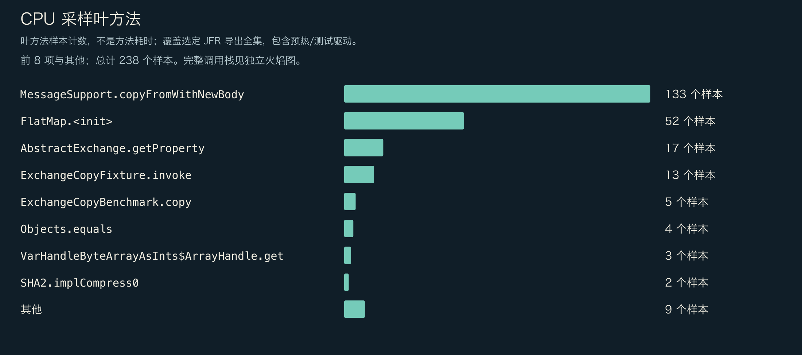
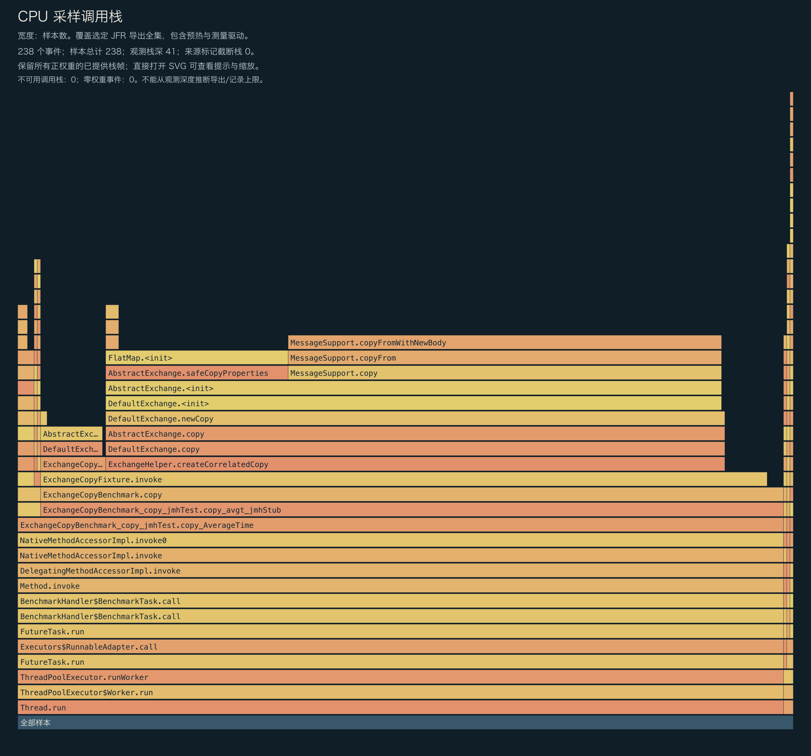
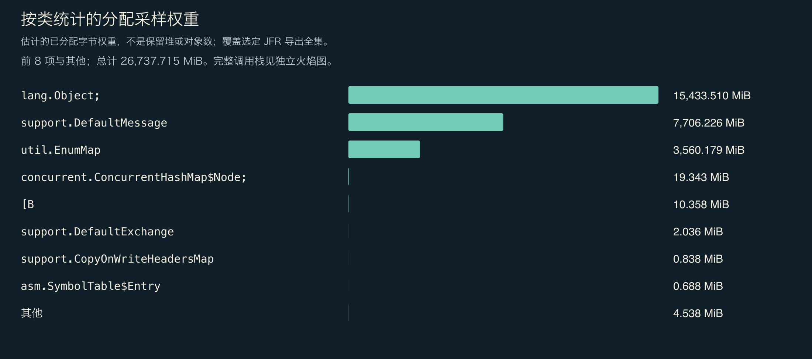
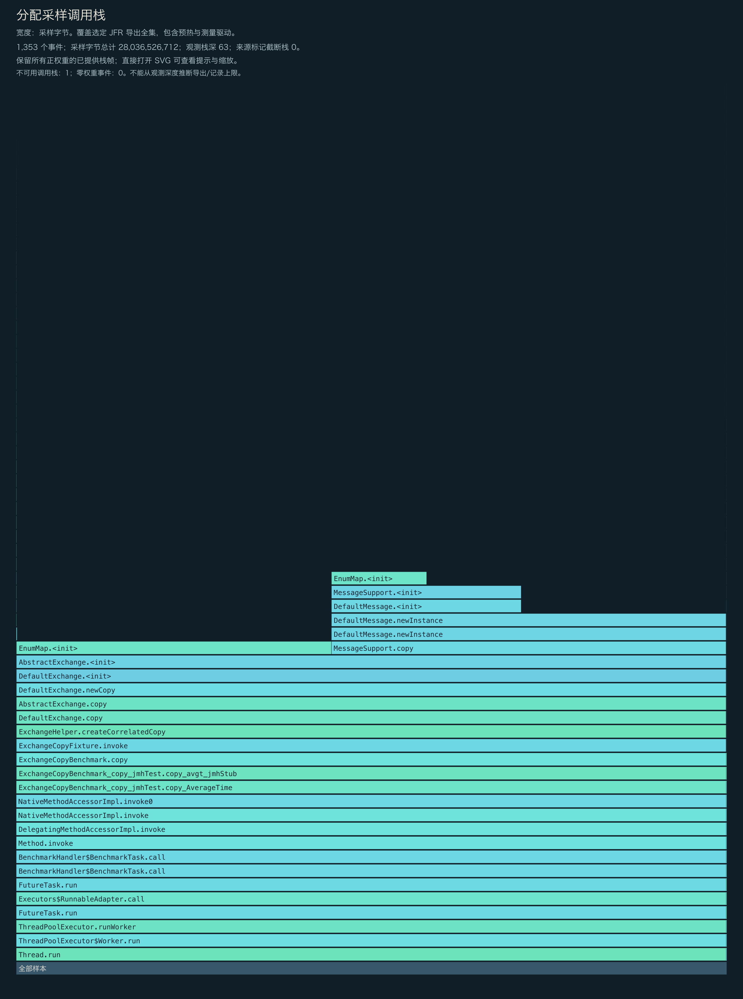
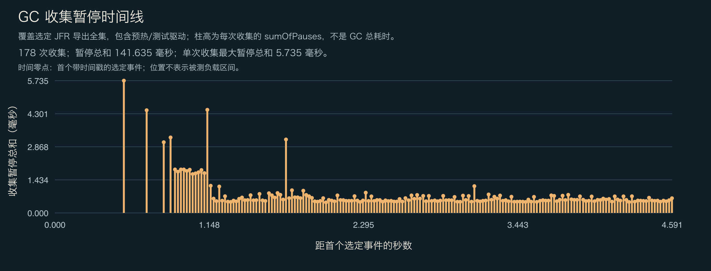

<!-- ominicat-language-nav -->
**简体中文** · [English](../../../../../../../../reports/mechanisms/java17-2026-11-02/evidence/diagnostics/correlated-copy/profiles.md) · [中文文档目录](../../../../../../index.md)
<!-- /ominicat-language-nav -->

# CPU、分配与 GC 分析

独立运行、启用分析工具的 Java 17 JMH 诊断 JVM：整段录制包含 JVM／框架启动、初始化、两次各 1 秒的预热迭代、两次各 1 秒的测量迭代、测试工具与收尾过程。不按阶段过滤。CPU 执行采样请求 10ms 周期；分配使用 profile.jfc 的默认配置。录制与导出的栈最多保留 64 层帧。这些数据不能作为主性能计时、框架独占 CPU、保留堆、精确对象数量、p99 延迟或 RSS 测量。

## 完整展示已提供的 CPU 栈

所有已提供且权重为正的栈帧都会保留；零权重事件不占图形面积。观察到的深度不能证明录制或导出没有上限。图中会标示来源注明的截断与不可用栈。直接打开 SVG 可查看完整的方法提示。

## CPU 叶方法样本

| 方法 | 样本数 |
|---|---:|
| `org.apache.camel.support.MessageSupport.copyFromWithNewBody` | 133 |
| `org.apache.camel.support.FlatMap.<init>` | 52 |
| `org.apache.camel.support.AbstractExchange.getProperty` | 17 |
| `io.ominicat.mechanisms.ExchangeCopyFixture.invoke` | 13 |
| `io.ominicat.mechanisms.ExchangeCopyBenchmark.copy` | 5 |
| `java.util.Objects.equals` | 4 |
| `java.lang.invoke.VarHandleByteArrayAsInts$ArrayHandle.get` | 3 |
| `sun.security.provider.SHA2.implCompress0` | 2 |
| `org.apache.camel.ExchangePropertyKey.asExchangePropertyKey` | 2 |
| `jdk.internal.loader.BuiltinClassLoader.isSealed` | 1 |
| `java.lang.invoke.LambdaForm$BasicType.basicTypeSlots` | 1 |
| `java.lang.String.isLatin1` | 1 |

## 采样分配权重

权重估计采样分配的分布，不代表保留堆或精确对象数量。此 JMH 机制实验没有精确延迟数组。每操作分配量请使用另行进行、不启用本次诊断录制的 JMH 测量；不能从这些样本推断该估计值。

| 类 | 采样权重（MiB） |
|---|---:|
| `[Ljava.lang.Object;` | 15,433.51 |
| `org.apache.camel.support.DefaultMessage` | 7,706.23 |
| `java.util.EnumMap` | 3,560.18 |
| `[Ljava.util.concurrent.ConcurrentHashMap$Node;` | 19.34 |
| `[B` | 10.36 |
| `org.apache.camel.support.DefaultExchange` | 2.04 |
| `org.apache.camel.support.CopyOnWriteHeadersMap` | 0.84 |
| `jdk.internal.org.objectweb.asm.SymbolTable$Entry` | 0.69 |
| `jdk.internal.org.objectweb.asm.ByteVector` | 0.43 |
| `jdk.internal.org.objectweb.asm.MethodWriter` | 0.41 |
| `[C` | 0.39 |
| `java.util.zip.ZipFile$ZipFileInflaterInputStream` | 0.38 |

## 完整展示已提供的分配栈

## GC 与竞争

- 已记录垃圾收集次数：178。
- 已记录 GC 暂停总和：141.635 ms；单次 GC 的最大暂停总和：5.735 ms。
- 监视器竞争事件：0；虚拟线程固定事件：当前运行时不可用。
- GC 的位置相对于第一个带时间戳的选定事件，而非 JMH 测量开始时刻。图中包含预热与测试工具事件。单次 GC 的暂停总和不是整次 GC 的持续时间。
- 零采样事件不能证明事件不存在。采样方式、事件阈值与负载持续时间限制了这些观察结果。

证据：[选定事件，gzip JSON](../../../../../../../../reports/mechanisms/java17-2026-11-02/evidence/diagnostics/correlated-copy/jfr-events.json.gz)、[诊断报告](report.md)。
原始 JFR 在本地生成，并有意排除在 Git 之外；公开分析时不要录入真实凭据或会话载荷。
