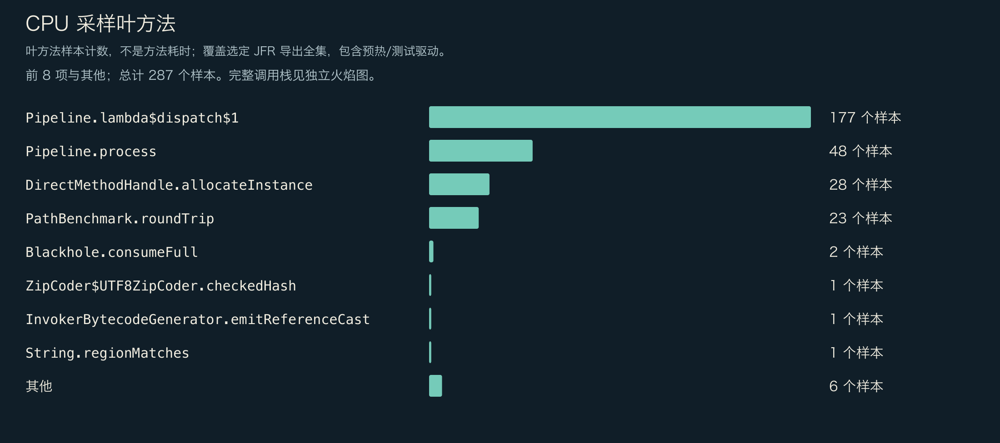
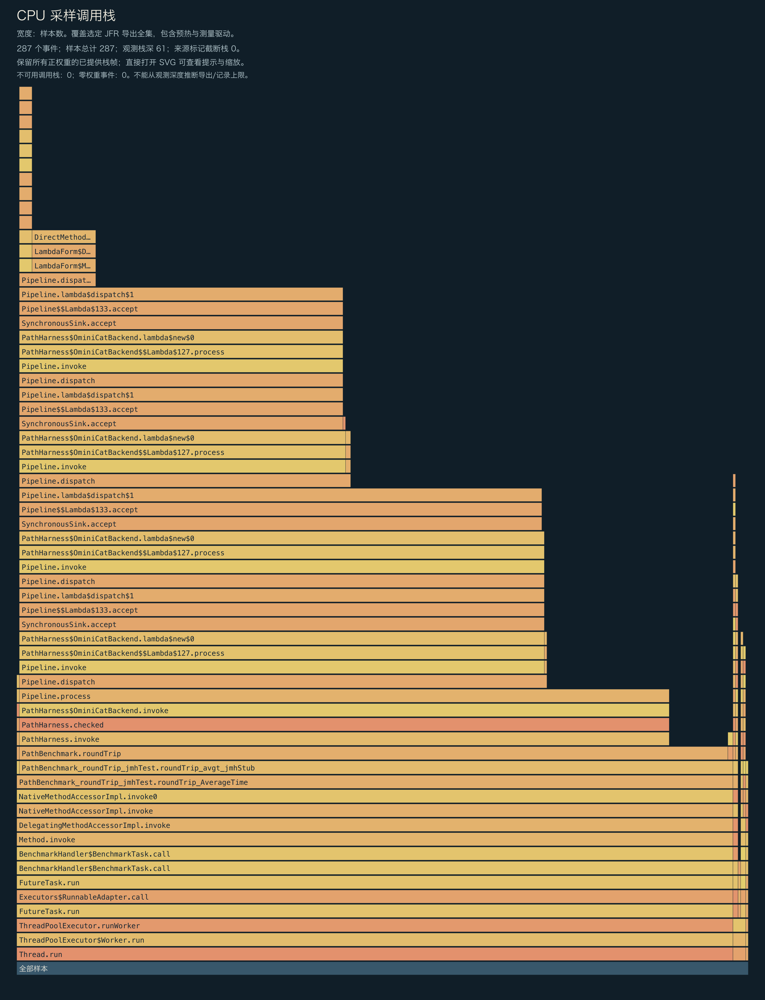
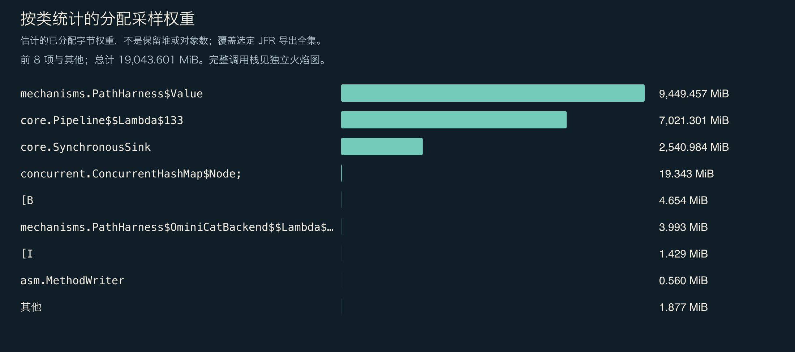
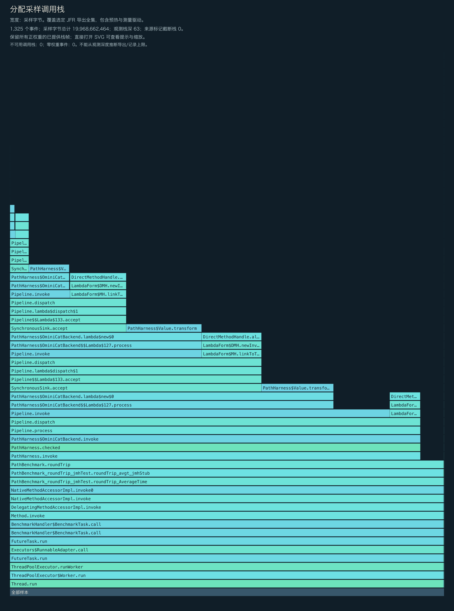
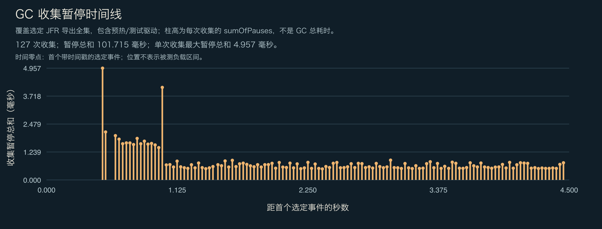

<!-- ominicat-language-nav -->
**简体中文** · [English](../../../../../../../../reports/mechanisms/java17-2026-11-02/evidence/diagnostics/ominicat-caller/profiles.md) · [中文文档目录](../../../../../../index.md)
<!-- /ominicat-language-nav -->

# CPU、分配与 GC 分析

独立运行、启用分析工具的 Java 17 JMH 诊断 JVM：整段录制包含 JVM／框架启动、初始化、两次各 1 秒的预热迭代、两次各 1 秒的测量迭代、测试工具与收尾过程。不按阶段过滤。CPU 执行采样请求 10ms 周期；分配使用 profile.jfc 的默认配置。录制与导出的栈最多保留 64 层帧。这些数据不能作为主性能计时、框架独占 CPU、保留堆、精确对象数量、p99 延迟或 RSS 测量。

## 完整展示已提供的 CPU 栈

所有已提供且权重为正的栈帧都会保留；零权重事件不占图形面积。观察到的深度不能证明录制或导出没有上限。图中会标示来源注明的截断与不可用栈。直接打开 SVG 可查看完整的方法提示。

## CPU 叶方法样本

| 方法 | 样本数 |
|---|---:|
| `io.ominicat.core.Pipeline.lambda$dispatch$1` | 177 |
| `io.ominicat.core.Pipeline.process` | 48 |
| `java.lang.invoke.DirectMethodHandle.allocateInstance` | 28 |
| `io.ominicat.mechanisms.PathBenchmark.roundTrip` | 23 |
| `org.openjdk.jmh.infra.Blackhole.consumeFull` | 2 |
| `java.util.zip.ZipCoder$UTF8ZipCoder.checkedHash` | 1 |
| `java.lang.invoke.InvokerBytecodeGenerator.emitReferenceCast` | 1 |
| `java.lang.String.regionMatches` | 1 |
| `java.lang.invoke.MethodHandleNatives.canBeCalledVirtual` | 1 |
| `java.util.zip.ZipFile$CleanableResource.releaseInflater` | 1 |
| `java.util.stream.AbstractPipeline.evaluate` | 1 |
| `io.ominicat.mechanisms.PathHarness$Oracle.stage` | 1 |

## 采样分配权重

权重估计采样分配的分布，不代表保留堆或精确对象数量。此 JMH 机制实验没有精确延迟数组。每操作分配量请使用另行进行、不启用本次诊断录制的 JMH 测量；不能从这些样本推断该估计值。

| 类 | 采样权重（MiB） |
|---|---:|
| `io.ominicat.mechanisms.PathHarness$Value` | 9,449.46 |
| `io.ominicat.core.Pipeline$$Lambda$133+0x00007f65bc0deeb0.818152665` | 7,021.30 |
| `io.ominicat.core.SynchronousSink` | 2,540.98 |
| `[Ljava.util.concurrent.ConcurrentHashMap$Node;` | 19.34 |
| `[B` | 4.65 |
| `io.ominicat.mechanisms.PathHarness$OminiCatBackend$$Lambda$132+0x00007f65bc0dec88.490283198` | 3.99 |
| `[I` | 1.43 |
| `jdk.internal.org.objectweb.asm.MethodWriter` | 0.56 |
| `java.util.concurrent.ConcurrentHashMap$Node` | 0.40 |
| `java.net.URL` | 0.40 |
| `[C` | 0.39 |
| `jdk.internal.org.objectweb.asm.ByteVector` | 0.28 |

## 完整展示已提供的分配栈

## GC 与竞争

- 已记录垃圾收集次数：127。
- 已记录 GC 暂停总和：101.715 ms；单次 GC 的最大暂停总和：4.957 ms。
- 监视器竞争事件：0；虚拟线程固定事件：当前运行时不可用。
- GC 的位置相对于第一个带时间戳的选定事件，而非 JMH 测量开始时刻。图中包含预热与测试工具事件。单次 GC 的暂停总和不是整次 GC 的持续时间。
- 零采样事件不能证明事件不存在。采样方式、事件阈值与负载持续时间限制了这些观察结果。

证据：[选定事件，gzip JSON](../../../../../../../../reports/mechanisms/java17-2026-11-02/evidence/diagnostics/ominicat-caller/jfr-events.json.gz)、[诊断报告](report.md)。
原始 JFR 在本地生成，并有意排除在 Git 之外；公开分析时不要录入真实凭据或会话载荷。
