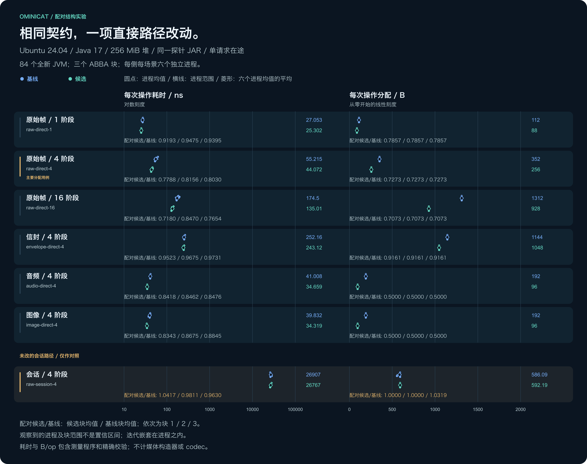
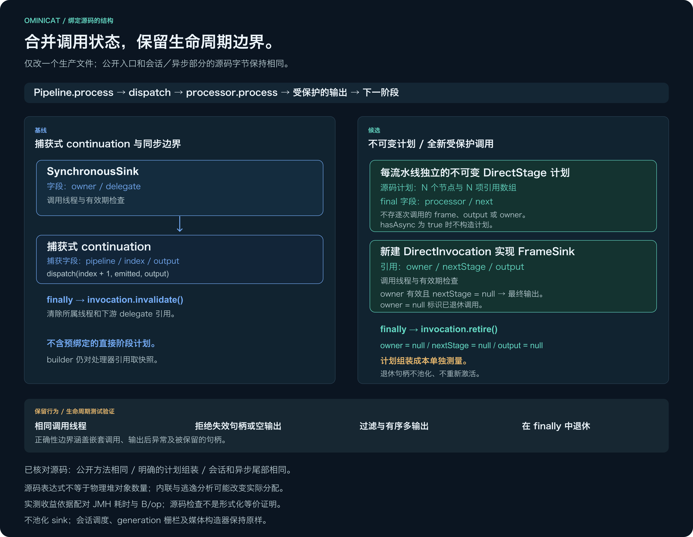

<!-- ominicat-language-nav -->
**简体中文** · [English](../../../../../reports/performance-audit/direct-state-2026-11-02/README.md) · [中文文档目录](../../../index.md)
<!-- /ominicat-language-nav -->

# 成对直接调用状态证据 — 2026-11-02

第三版候选在 [Ubuntu 运行 41401882524](https://github.com/g5n-dev/ominicat/actions/runs/41401882524) 中满足全部预先登记的观测目标。`raw-direct-4` 的成对区组平均时间比对应 **20.09%** 的下降，分配量下降 **27.27%**；`envelope-direct-4` 分别下降 **3.57%** 和 **8.39%**。这是同一探针、成对运行时 JAR 下，一项受控直接调用表示变更的结果，不能推广为整个框架、模型延迟或生产容量的提升。

完整的 223 文件主测量及诊断归档，以及独立的 21 文件构建归档均通过检查。前两版候选及其未达标、不确定结果继续保留；最终结果没有通过删除场景或放宽目标取得。

[](../../../../assets/zh-CN/reports/performance-audit/direct-state-2026-11-02/costs.svg)

## 受控源码与行为

[](../../../../assets/zh-CN/reports/performance-audit/direct-state-2026-11-02/structure.svg)

[基线源码](../../../../../reports/performance-audit/direct-state-2026-11-02/sources/baseline-Pipeline.java) 求值一个捕获管线、当前索引和输出的 continuation，再用 `SynchronousSink` 包装它。最终[候选源码](../../../../../reports/performance-audit/direct-state-2026-11-02/sources/candidate-Pipeline.java) 为每条管线预先绑定不可变的 `DirectStage` 计划。其 final 字段保存处理器和下一阶段，另一个数组保存阶段引用。对于包含 N 个阶段的同步管线，这在源码布局中增加 N 个计划节点和一个含 N 个引用的数组。计划不含每次调用的帧、输出或所属线程字段。

每次直接调用仍获得全新、未池化的状态：`owner`、`nextStage` 和 `output`；`finally` 清除这三个引用。存活调用中的 `nextStage == null` 会转发到终端输出；`owner == null` 表示调用已退休。线程与生命周期检查、null 拒绝、过滤、有序多次输出、嵌套调用和异常传播仍属于契约。包含 `AsyncProcessor` 的管线不构建 N 阶段计划，但管线对象仍有新增字段。仅通过会话使用的不含异步处理器的管线也要支付计划构建成本。

| 证据层 | 能够确认的范围 |
| --- | --- |
| 归档源码 | 生产内核源码中只有 `Pipeline.java` 不同。渲染器检查精确的已知构造器、字段和直接调用实现形态；公开方法源码区间及完整会话／异步后缀逐字节相同。这不保证 class 文件或编译生成的 lambda 编号相同。 |
| 行为与生命周期 | 新增的 9 项[生命周期测试](../../../../../ominicat-core/src/test/java/io/ominicat/core/DirectInvocationLifecycleTest.java) 在旧基线和候选上均通过，覆盖过期／错误线程 sink、过滤与多次输出、嵌套调用、输出后抛错及被长期保存的句柄解除引用。仓库验证通过 390 项测试：core 120、conversation 75、providers 74、server 90、benchmarks 31，无失败、错误或跳过。Java 17 覆盖率／SBOM 验证及 512 个压力种子通过；Java 17/21/25 兼容性检查也通过。 |
| 成对运行时测量 | 七场景、84 fork 实验用同一个共享探针对比两个真实内核 JAR。每个 fork 都验证实际加载来源；每次计时调用都进行精确结果与线程所有权检查。 |
| 独立诊断 | 四个独立插桩 JVM 提供 CPU 调用栈、采样分配和 GC 背景。这些权重不是额外计时样本，也不是每次操作的分配估计。 |

这些证据支持该测试范围内组合表示变更的效果。源码中的分配表达式不能直接计算物理堆对象数量：内联、逃逸分析、字段布局和调用形态可能相互作用。JFR 样本及这些差值都不能隔离某一项 JIT 变换，也不能解释此前 Camel SEDA 差距中的某个百分比。

## 环境与计时

| 项目 | 记录值 |
| --- | --- |
| 主机 | Ubuntu 24.04.5 LTS；Linux 7.0.0-1017-azure；x86_64 |
| CPU 配额 | INTEL(R) XEON(R) PLATINUM 8573C；任务可见 4 个逻辑处理器，亲和性数量为 4 |
| JVM／测试工具 | Eclipse Adoptium OpenJDK 17.0.21+9；JMH 1.37；固定 256 MiB 堆；一个基准线程 |
| 主测量计划 | 7 个场景；3 个 ABBA 区组；84 个全新单 fork JVM；每侧每场景 6 个 fork |
| 每个主测量 fork | 3 × 1 s 预热；5 × 1 s 测量；AverageTime `ns/op`；GC profiler `B/op` |
| 场景顺序 | 每个区组／场景按基线、候选、候选、基线运行；第 2 个区组反转场景顺序 |
| 主测量采集时间 | 2026-11-02T06:45:49.143239+00:00 |

主机是没有独占 CPU 隔离的共享托管运行器。数值输入和变换后的不可变帧在计时内构造，独立的序号、值、顺序、数量、线程 oracle 与成功后端返回也在计时内。envelope 场景使用真实 `EnvelopeProcessor` 适配器；确定性 ID 准备、供应函数调用及元数据／因果关系检查均计时。主场景的 setup、来源哈希计算、管线构建、清理和报告生成不在主基准方法计时内。

媒体场景循环使用 64 个预建不可变帧：音频为 640 字节、16 kHz 单声道 PCM，图像为标记为 `image/png` 的 64 KiB 合成载荷。检查精确帧身份和阶段顺序。媒体构造、防御性快照、编解码和图像有效性不在计时范围内。会话对照包含真实的容量为一的 `PipelineSession` 入口、容量为一的回复队列，以及收到回复后等待成功处理计数器；正确帧先输出、随后抛错不能通过检查。

## 七个稳态场景

时间和分配量列是六个 fork 均值的算术平均值。每个成对 C/B 列先给出三个区组比值的算术平均值，再给出其观测最小值至最大值。每个区组比值用两个候选 fork 均值的平均值，除以两个基线 fork 均值的平均值。变化百分比为 `100 × (1 − mean block ratio)`，**不是**两个全局平均值列直接相除的结果。

| 直接调用场景 | 基线 ns/op | 候选 ns/op | 成对时间 C/B 均值 [范围] | 基线 B/op | 候选 B/op | 成对分配量 C/B 均值 [范围] |
| --- | ---: | ---: | --- | ---: | ---: | --- |
| `raw-direct-1` | 27.05332 | 25.30190 | 0.935440 [0.919298–0.947532] | 112.000161 | 88.000150 | 0.785714 [0.785714–0.785715] |
| `raw-direct-4` | 55.21457 | 44.07219 | 0.799119 [0.778756–0.815576] | 352.000328 | 256.000262 | 0.727273 [0.727273–0.727273] |
| `raw-direct-16` | 174.49622 | 135.01103 | 0.776780 [0.718003–0.846970] | 1312.001037 | 928.000803 | 0.707317 [0.707317–0.707317] |
| `envelope-direct-4` | 252.15870 | 243.11872 | 0.964313 [0.952305–0.973089] | 1144.001499 | 1048.001446 | 0.916084 [0.916084–0.916084] |
| `audio-direct-4` | 41.00787 | 34.65904 | 0.845194 [0.841766–0.847633] | 192.000244 | 96.000206 | 0.500000 [0.500000–0.500000] |
| `image-direct-4` | 39.83210 | 34.31896 | 0.862098 [0.834251–0.884550] | 192.000237 | 96.000204 | 0.500000 [0.500000–0.500000] |

[摘要](evidence/measurements/summary.md)和[完整 JSON](../../../../../reports/performance-audit/direct-state-2026-11-02/evidence/measurements/summary.json)保留每侧每场景的全部三个比值、六个 fork 均值及 30 个测量迭代。图中的点和线展示 fork 均值及这六个均值的范围，不是迭代极值。fork 和区组是重复实验单位；同一个 fork 内的迭代不是独立重复。范围不是置信区间，舍入后的端点可能相同。

六个直接调用场景在每个区组都满足原定规则：主场景 `raw-direct-4` 的分配量 C/B ≤0.90，直接调用场景的时间 C/B ≤1.05，分配量 C/B ≤1.01。记录结果为 `observed-targets-met`。这是预先登记的实验判定，不是托管 CI 性能门禁、统计显著性结论或普适保证。

### 未变更的会话对照

| 对照场景 | 基线 ns/op | 候选 ns/op | 成对时间 C/B 均值 [范围] | 基线 B/op | 候选 B/op | 成对分配量 C/B 均值 [范围] |
| --- | ---: | ---: | --- | ---: | ---: | --- |
| `raw-session-4` | 26906.98109 | 26767.08696 | 0.995270 [0.963048–1.041690] | 586.089036 | 592.192980 | 1.010636 [0.999999–1.031893] |

`raw-session-4` 路径没有变更，保留其全部范围，包括其中一个区组的分配量增加。它不参与直接调用目标的判定，既不用于校正运行器噪声，也不能挽救未达标的直接调用场景；本报告不宣称会话提速。

## 每条管线的初始化取舍

独立的[构建摘要](startup-evidence/summary.md)、[JSON](../../../../../reports/performance-audit/direct-state-2026-11-02/startup-evidence/summary.json)和[绑定清单](../../../../../reports/performance-audit/direct-state-2026-11-02/startup-evidence/manifest.json)公开新增计划的初始化成本。`DirectPlanStartupProbe.invoke` 每次操作创建真实的四阶段 builder 和管线。四个不同的处理器桩、不可变输入和终端 oracle 在计时外缓存。`build-4` 消费每个返回的管线，在计时外执行 setup 和最后构建实例的处理校验。`first-direct-4` 还在计时内执行并检查每次首次调用，只有同步返回后才确认成功。

每个场景一个 ABBA 区组，共 8 个全新 JVM、每侧每场景 2 个 fork，使用相同的 3 × 1 s 预热、5 × 1 s 测量和 256 MiB 堆。下表为两个 fork 均值的平均值 [fork 最小值至最大值]。这些诊断没有验收阈值，也不能覆盖主测量结论。

| 构建场景 | 基线 ns/op [范围] | 候选 ns/op [范围] | 基线 B/op [范围] | 候选 B/op [范围] |
| --- | --- | --- | --- | --- |
| `build-4` | 217.75599 [216.67130–218.84068] | 229.97745 [228.47388–231.48102] | 824.001306 [824.001299–824.001313] | 960.001374 [960.001365–960.001384] |
| `first-direct-4` | 250.63652 [248.04026–253.23279] | 259.01436 [258.06653–259.96219] | 1016.001489 [1016.001473–1016.001504] | 1048.001541 [1040.001547–1056.001536] |

观测到的构建分配量约增加 **136 B/op**；构建加首次调用的分配量约增加 **32 B/op**。候选首次调用的两个 fork 均值不同，其完整分配范围保留在报告中。这些是该测试的归一化观测，不是精确的物理对象或存活堆记账。

这些是在预热 JVM 中创建新管线的成本，**不是 OS/JVM 冷启动延迟**。不能用这些时间减去稳态探针结果，不能组合不同 oracle 推导精确摊销点，也不能推算饱和管线／会话容量。提前构建计划以初始化工作换取已测得的直接调用收益；仅用于会话的同步管线也会承担这些初始化工作。这不表示 OminiCat 的所有执行模式都会变快。

## 独立 CPU、分配与 GC 诊断

[诊断清单](../../../../../reports/performance-audit/direct-state-2026-11-02/evidence/diagnostics/manifest.json)及各场景来源上下文将四份记录绑定到主测量清单、基线／候选内核哈希与共享探针哈希。每个独立插桩 JVM 使用 `-f 0`、2 × 1 s 预热及 2 × 1 s 测量。CPU 采样请求间隔为 10 ms，分配采样限速为每秒 50 个事件，记录与导出最多保留 64 层调用栈。选定事件 JSON 超过 128 MiB 时拒绝处理，而不是截断。

| 诊断场景 | 报告／来源绑定 | CPU 火焰图 | 分配火焰图 | CPU 热点 | 分配热点 | GC 暂停 |
| --- | --- | --- | --- | --- | --- | --- |
| `baseline-raw-direct-4` | [报告](evidence/diagnostics/baseline-raw-direct-4/report.md) / [来源](../../../../../reports/performance-audit/direct-state-2026-11-02/evidence/diagnostics/baseline-raw-direct-4/diagnostic-context.json) | [PNG](../../../../assets/zh-CN/reports/performance-audit/direct-state-2026-11-02/evidence/diagnostics/baseline-raw-direct-4/cpu-flamegraph.svg) / [SVG](../../../../assets/zh-CN/reports/performance-audit/direct-state-2026-11-02/evidence/diagnostics/baseline-raw-direct-4/cpu-flamegraph.svg) | [PNG](../../../../assets/zh-CN/reports/performance-audit/direct-state-2026-11-02/evidence/diagnostics/baseline-raw-direct-4/allocation-flamegraph.svg) / [SVG](../../../../assets/zh-CN/reports/performance-audit/direct-state-2026-11-02/evidence/diagnostics/baseline-raw-direct-4/allocation-flamegraph.svg) | [PNG](../../../../assets/zh-CN/reports/performance-audit/direct-state-2026-11-02/evidence/diagnostics/baseline-raw-direct-4/cpu-hotspots.svg) / [SVG](../../../../assets/zh-CN/reports/performance-audit/direct-state-2026-11-02/evidence/diagnostics/baseline-raw-direct-4/cpu-hotspots.svg) | [PNG](../../../../assets/zh-CN/reports/performance-audit/direct-state-2026-11-02/evidence/diagnostics/baseline-raw-direct-4/allocation-hotspots.svg) / [SVG](../../../../assets/zh-CN/reports/performance-audit/direct-state-2026-11-02/evidence/diagnostics/baseline-raw-direct-4/allocation-hotspots.svg) | [PNG](../../../../assets/zh-CN/reports/performance-audit/direct-state-2026-11-02/evidence/diagnostics/baseline-raw-direct-4/gc-pauses.svg) / [SVG](../../../../assets/zh-CN/reports/performance-audit/direct-state-2026-11-02/evidence/diagnostics/baseline-raw-direct-4/gc-pauses.svg) |
| `candidate-raw-direct-4` | [报告](evidence/diagnostics/candidate-raw-direct-4/report.md) / [来源](../../../../../reports/performance-audit/direct-state-2026-11-02/evidence/diagnostics/candidate-raw-direct-4/diagnostic-context.json) | [PNG](../../../../assets/zh-CN/reports/performance-audit/direct-state-2026-11-02/evidence/diagnostics/candidate-raw-direct-4/cpu-flamegraph.svg) / [SVG](../../../../assets/zh-CN/reports/performance-audit/direct-state-2026-11-02/evidence/diagnostics/candidate-raw-direct-4/cpu-flamegraph.svg) | [PNG](../../../../assets/zh-CN/reports/performance-audit/direct-state-2026-11-02/evidence/diagnostics/candidate-raw-direct-4/allocation-flamegraph.svg) / [SVG](../../../../assets/zh-CN/reports/performance-audit/direct-state-2026-11-02/evidence/diagnostics/candidate-raw-direct-4/allocation-flamegraph.svg) | [PNG](../../../../assets/zh-CN/reports/performance-audit/direct-state-2026-11-02/evidence/diagnostics/candidate-raw-direct-4/cpu-hotspots.svg) / [SVG](../../../../assets/zh-CN/reports/performance-audit/direct-state-2026-11-02/evidence/diagnostics/candidate-raw-direct-4/cpu-hotspots.svg) | [PNG](../../../../assets/zh-CN/reports/performance-audit/direct-state-2026-11-02/evidence/diagnostics/candidate-raw-direct-4/allocation-hotspots.svg) / [SVG](../../../../assets/zh-CN/reports/performance-audit/direct-state-2026-11-02/evidence/diagnostics/candidate-raw-direct-4/allocation-hotspots.svg) | [PNG](../../../../assets/zh-CN/reports/performance-audit/direct-state-2026-11-02/evidence/diagnostics/candidate-raw-direct-4/gc-pauses.svg) / [SVG](../../../../assets/zh-CN/reports/performance-audit/direct-state-2026-11-02/evidence/diagnostics/candidate-raw-direct-4/gc-pauses.svg) |
| `baseline-envelope-direct-4` | [报告](evidence/diagnostics/baseline-envelope-direct-4/report.md) / [来源](../../../../../reports/performance-audit/direct-state-2026-11-02/evidence/diagnostics/baseline-envelope-direct-4/diagnostic-context.json) | [PNG](../../../../assets/zh-CN/reports/performance-audit/direct-state-2026-11-02/evidence/diagnostics/baseline-envelope-direct-4/cpu-flamegraph.svg) / [SVG](../../../../assets/zh-CN/reports/performance-audit/direct-state-2026-11-02/evidence/diagnostics/baseline-envelope-direct-4/cpu-flamegraph.svg) | [PNG](../../../../assets/zh-CN/reports/performance-audit/direct-state-2026-11-02/evidence/diagnostics/baseline-envelope-direct-4/allocation-flamegraph.svg) / [SVG](../../../../assets/zh-CN/reports/performance-audit/direct-state-2026-11-02/evidence/diagnostics/baseline-envelope-direct-4/allocation-flamegraph.svg) | [PNG](../../../../assets/zh-CN/reports/performance-audit/direct-state-2026-11-02/evidence/diagnostics/baseline-envelope-direct-4/cpu-hotspots.svg) / [SVG](../../../../assets/zh-CN/reports/performance-audit/direct-state-2026-11-02/evidence/diagnostics/baseline-envelope-direct-4/cpu-hotspots.svg) | [PNG](../../../../assets/zh-CN/reports/performance-audit/direct-state-2026-11-02/evidence/diagnostics/baseline-envelope-direct-4/allocation-hotspots.svg) / [SVG](../../../../assets/zh-CN/reports/performance-audit/direct-state-2026-11-02/evidence/diagnostics/baseline-envelope-direct-4/allocation-hotspots.svg) | [PNG](../../../../assets/zh-CN/reports/performance-audit/direct-state-2026-11-02/evidence/diagnostics/baseline-envelope-direct-4/gc-pauses.svg) / [SVG](../../../../assets/zh-CN/reports/performance-audit/direct-state-2026-11-02/evidence/diagnostics/baseline-envelope-direct-4/gc-pauses.svg) |
| `candidate-envelope-direct-4` | [报告](evidence/diagnostics/candidate-envelope-direct-4/report.md) / [来源](../../../../../reports/performance-audit/direct-state-2026-11-02/evidence/diagnostics/candidate-envelope-direct-4/diagnostic-context.json) | [PNG](../../../../assets/zh-CN/reports/performance-audit/direct-state-2026-11-02/evidence/diagnostics/candidate-envelope-direct-4/cpu-flamegraph.svg) / [SVG](../../../../assets/zh-CN/reports/performance-audit/direct-state-2026-11-02/evidence/diagnostics/candidate-envelope-direct-4/cpu-flamegraph.svg) | [PNG](../../../../assets/zh-CN/reports/performance-audit/direct-state-2026-11-02/evidence/diagnostics/candidate-envelope-direct-4/allocation-flamegraph.svg) / [SVG](../../../../assets/zh-CN/reports/performance-audit/direct-state-2026-11-02/evidence/diagnostics/candidate-envelope-direct-4/allocation-flamegraph.svg) | [PNG](../../../../assets/zh-CN/reports/performance-audit/direct-state-2026-11-02/evidence/diagnostics/candidate-envelope-direct-4/cpu-hotspots.svg) / [SVG](../../../../assets/zh-CN/reports/performance-audit/direct-state-2026-11-02/evidence/diagnostics/candidate-envelope-direct-4/cpu-hotspots.svg) | [PNG](../../../../assets/zh-CN/reports/performance-audit/direct-state-2026-11-02/evidence/diagnostics/candidate-envelope-direct-4/allocation-hotspots.svg) / [SVG](../../../../assets/zh-CN/reports/performance-audit/direct-state-2026-11-02/evidence/diagnostics/candidate-envelope-direct-4/allocation-hotspots.svg) | [PNG](../../../../assets/zh-CN/reports/performance-audit/direct-state-2026-11-02/evidence/diagnostics/candidate-envelope-direct-4/gc-pauses.svg) / [SVG](../../../../assets/zh-CN/reports/performance-audit/direct-state-2026-11-02/evidence/diagnostics/candidate-envelope-direct-4/gc-pauses.svg) |

| 诊断场景 | CPU 执行样本 | 分配样本 | GC 回收次数 | 暂停总和 ms | 单次回收暂停总和最大值 ms |
| --- | ---: | ---: | ---: | ---: | ---: |
| `baseline-raw-direct-4` | 342 | 225 | 154 | 97.775630 | 5.463274 |
| `candidate-raw-direct-4` | 344 | 215 | 141 | 91.618603 | 5.688608 |
| `baseline-envelope-direct-4` | 351 | 215 | 101 | 71.239833 | 3.652610 |
| `candidate-envelope-direct-4` | 355 | 211 | 99 | 71.156076 | 4.107739 |

完整记录包含 JVM 启动、setup、预热、计时循环、测试工具和清理，没有按测量阶段过滤。配置时长相同，但完成操作数不同；更快的循环可能完成更多工作。CPU／分配样本总数、分配权重和 GC 次数不能对每次操作的效率排名，也不能替代正式 JMH 的 `B/op`。CPU 样本定位实际提供的调用栈，不是方法耗时。暂停总和累加各次回收中的暂停，不是整次回收耗时，也不只覆盖主测量时间窗。

基线 raw 记录含 continuation lambda 和 `SynchronousSink` 的分配样本；候选 raw 记录含 `DirectInvocation` 样本。envelope 记录还含 `FrameEnvelope`、ID 字符串和 envelope 适配器自身的受保护 sink。这些观测与源码结构及保留的外围工作一致，但不能证明每个源码分配都会物化，也不能给某个采样方法分配收益的因果百分比。原始 JFR、私有设置、未压缩事件导出和未审查日志不公开。

## 早期尝试仍属于完整证据

前两次完整实验继续独立保留。envelope 回退没有隐藏，原始目标没有放宽。不用不同托管任务的绝对时间给原型排名，也不与最终运行混合；相同 CPU 型号名称同样不能证明使用了同一台物理运行器。

| 候选 | 记录结果 | 保留证据 |
| --- | --- | --- |
| `143deb4`／内联状态 | `targets-not-met`；envelope 时间 C/B 均值 1.057092，区组范围 1.037070–1.070106。平均增幅超过 5%，其中两个区组超过 1.05。 | [摘要](earlier-attempts/143deb4/evidence/measurements/summary.md)、[清单](../../../../../reports/performance-audit/direct-state-2026-11-02/earlier-attempts/143deb4/evidence/measurements/manifest.json)、[成本 PNG](../../../../assets/zh-CN/reports/performance-audit/direct-state-2026-11-02/earlier-attempts/143deb4/costs.svg)／[SVG](../../../../assets/zh-CN/reports/performance-audit/direct-state-2026-11-02/earlier-attempts/143deb4/costs.svg)、[结构 PNG](../../../../assets/zh-CN/reports/performance-audit/direct-state-2026-11-02/earlier-attempts/143deb4/structure.svg)／[SVG](../../../../assets/zh-CN/reports/performance-audit/direct-state-2026-11-02/earlier-attempts/143deb4/structure.svg) |
| `4e594fc`／私有辅助方法 | `uncertain`；envelope 时间 C/B 均值 1.035401，区组范围 1.005529–1.053953。点估计满足上限，但有一个区组超过 1.05。 | [摘要](earlier-attempts/4e594fc/evidence/measurements/summary.md)、[清单](../../../../../reports/performance-audit/direct-state-2026-11-02/earlier-attempts/4e594fc/evidence/measurements/manifest.json)、[成本 PNG](../../../../assets/zh-CN/reports/performance-audit/direct-state-2026-11-02/earlier-attempts/4e594fc/costs.svg)／[SVG](../../../../assets/zh-CN/reports/performance-audit/direct-state-2026-11-02/earlier-attempts/4e594fc/costs.svg)、[结构 PNG](../../../../assets/zh-CN/reports/performance-audit/direct-state-2026-11-02/earlier-attempts/4e594fc/structure.svg)／[SVG](../../../../assets/zh-CN/reports/performance-audit/direct-state-2026-11-02/earlier-attempts/4e594fc/structure.svg) |
| `f5454f4`／预绑定计划 | `observed-targets-met`；全部直接调用判据在 3 个区组内均满足。 | 本报告的[主测量摘要](../../../../../reports/performance-audit/direct-state-2026-11-02/evidence/measurements/summary.json)、[构建证据](../../../../../reports/performance-audit/direct-state-2026-11-02/startup-evidence/summary.json)和[诊断](../../../../../reports/performance-audit/direct-state-2026-11-02/evidence/diagnostics/manifest.json) |

第一次尝试记录的主机是 INTEL(R) XEON(R) PLATINUM 8573C；第二次是 AMD EPYC 7763 64-Core Processor。每份归档保留各自的源码／产物指纹、原始 fork、设置和诊断。这个过程解释原型选择，不构成跨主机提速结论，也不是最终效果的独立重复验证。

## 来源与复现

| 绑定项 | 源码修订 | 源码清单 SHA-256 | 产物 SHA-256 |
| --- | --- | --- | --- |
| `baseline` | `c2def9dcbdf3857d8bbfed8f9b27182993c764f3` | `0a53528ab1131529222f50ebbf085549e024b38e382ec808c61dd3b531234d9b` | `c662ff8d90a828c4dbc45f72b3fb3353f36596d7f36532621a8e07aa55a9df97` |
| `candidate` | `f5454f40d60166b3d6edfecb0ba384c814fe9b9f` | `b575d3ec580760f9edd554bcade8c213cba5f89f3b7dbe8efb6f130cca579ffe` | `92c4ae8b34ae3b308ad6fbb0efc02ace89076141d12bfc75b26e101a5cf36c9f` |
| `probe` | `f5454f40d60166b3d6edfecb0ba384c814fe9b9f` | `bc9f4c49ca6e7811f9da8363e2974949613c63be224efe0a7cbd5bac2c853dfa` | `cf3d64bc6d3cb2698c6599004f468b2fe016349f942935504500483d4293c381` |

原始主测量[清单](../../../../../reports/performance-audit/direct-state-2026-11-02/evidence/measurements/manifest.json)的 SHA-256 为 `20f4660045480aa46038ee830cc7cb70e24750e3ea32c50776b84162f13d91c2`。[测量套件](../../../../../reports/performance-audit/direct-state-2026-11-02/evidence/measurements/suite.json)保留全部 84 份原始 fork 结果及经过隐私检查的日志，并附[校验和](../../../../../reports/performance-audit/direct-state-2026-11-02/evidence/measurements/SHA256SUMS)。构建[校验和](../../../../../reports/performance-audit/direct-state-2026-11-02/startup-evidence/SHA256SUMS)、诊断[哈希索引](../../../../../reports/performance-audit/direct-state-2026-11-02/evidence/evidence-index.json)及原始 Pipeline 源码字节分别保留。图绑定生成器、主清单、摘要及归档源码哈希；后续发布文案不会改变已测 Java 产物。

[协议](../../../comparison/direct-state-protocol.md)、[主探针](../../../../../ominicat-benchmarks/src/main/java/io/ominicat/benchmarks/DirectStateProbe.java)、[构建探针](../../../../../ominicat-benchmarks/src/main/java/io/ominicat/benchmarks/DirectPlanStartupProbe.java)、[采集器](../../../../../comparison/direct_state_evidence.py)、[构建采集器](../../../../../comparison/direct_plan_startup.py)和[诊断采集器](../../../../../comparison/direct_state_profiles.py)定义复现方式。重新采集需要干净的基线／候选工作区、明确选定的同一 Java 17 运行时、同一个共享探针 JAR 和全新输出目录。归档指纹而不是当前工作区标识本次采集内容。

```sh
python3 comparison/direct_state_evidence.py check reports/performance-audit/direct-state-2026-11-02/evidence/measurements
python3 comparison/direct_plan_startup.py check reports/performance-audit/direct-state-2026-11-02/startup-evidence --measurements reports/performance-audit/direct-state-2026-11-02/evidence/measurements
python3 comparison/direct_state_profiles.py check reports/performance-audit/direct-state-2026-11-02/evidence
python3 comparison/render_direct_state.py reports/performance-audit/direct-state-2026-11-02 --check
```
