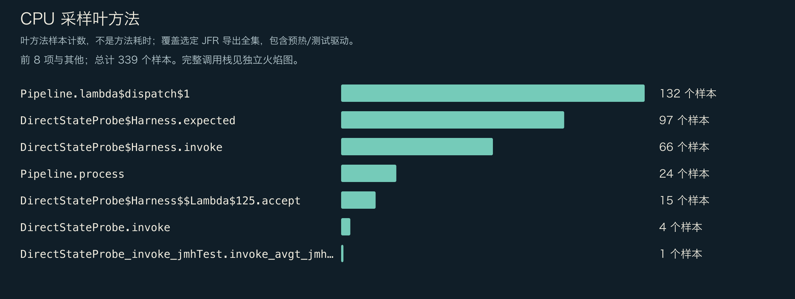
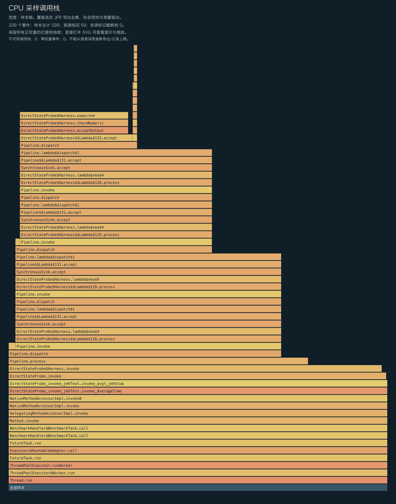
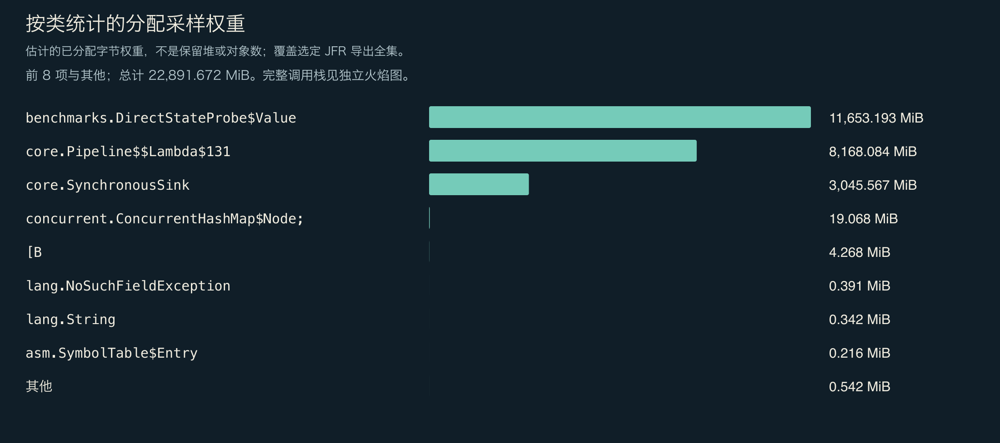
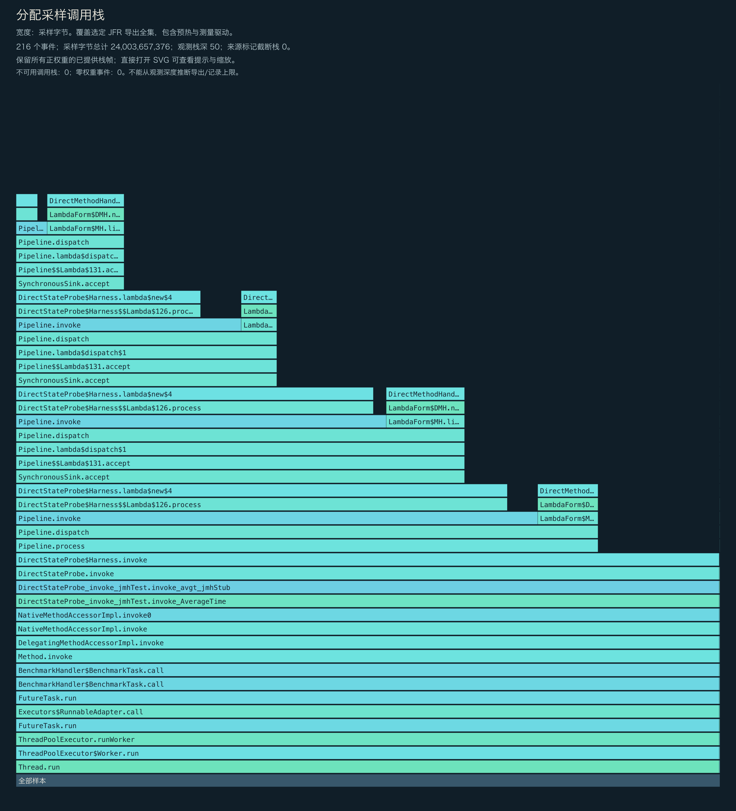
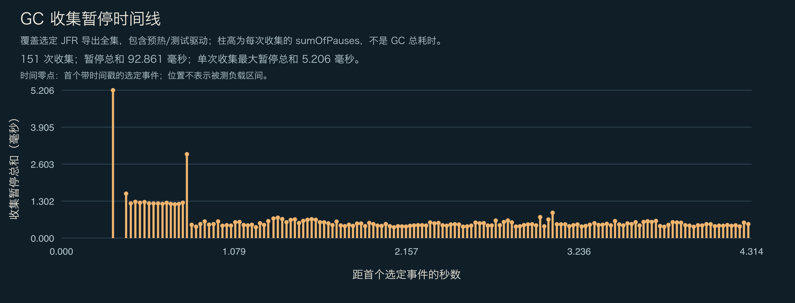

<!-- ominicat-language-nav -->
**简体中文** · [English](../../../../../../../../../../reports/performance-audit/direct-state-2026-11-02/earlier-attempts/143deb4/evidence/diagnostics/baseline-raw-direct-4/profiles.md) · [中文文档目录](../../../../../../../../index.md)
<!-- /ominicat-language-nav -->

# CPU、分配与 GC 分析

独立运行、启用诊断采集的 Java 17 JMH JVM，记录范围包括启动、准备、两轮各 1 秒的预热、两轮各 1 秒的测量、测试驱动和清理。不按阶段过滤。CPU 采样请求间隔为 10ms；分配采样限流为每秒 50 个事件；录制和导出最多保留 64 层栈帧。这些诊断不作为正式计时证据，也不用于估算每次操作的分配量、保留堆、方法耗时、p99 延迟、RSS 或生产容量。

## 完整保留已提供的 CPU 调用栈

所提供调用栈中权重大于零的每一层均予以保留；权重为零的事件不占图形面积。实际看到的深度不能证明录制或导出没有限制。图中会标明源数据报告的截断及不可用的调用栈。直接打开 SVG 可查看完整的方法提示。

## CPU 叶方法样本

| 方法 | 样本数 |
|---|---:|
| `io.ominicat.core.Pipeline.lambda$dispatch$1` | 132 |
| `io.ominicat.benchmarks.DirectStateProbe$Harness.expected` | 97 |
| `io.ominicat.benchmarks.DirectStateProbe$Harness.invoke` | 66 |
| `io.ominicat.core.Pipeline.process` | 24 |
| `io.ominicat.benchmarks.DirectStateProbe$Harness$$Lambda$125+0x00007fe1c0094a28.1669521372.accept` | 15 |
| `io.ominicat.benchmarks.DirectStateProbe.invoke` | 4 |
| `io.ominicat.benchmarks.jmh_generated.DirectStateProbe_invoke_jmhTest.invoke_avgt_jmhStub` | 1 |

## 采样分配权重

这些权重估算的是采样分配分布，并非保留堆或精确对象数量。运行时长相同的不同循环可能执行不同次数的操作。此探针不保存精确延迟数组。每次操作的分配量应以正式配对 JMH 的 B/op 为准。

| 类 | 采样权重（MiB） |
|---|---:|
| `io.ominicat.benchmarks.DirectStateProbe$Value` | 11,653.19 |
| `io.ominicat.core.Pipeline$$Lambda$131+0x00007fe1c0095978.1682136925` | 8,168.08 |
| `io.ominicat.core.SynchronousSink` | 3,045.57 |
| `[Ljava.util.concurrent.ConcurrentHashMap$Node;` | 19.07 |
| `[B` | 4.27 |
| `java.lang.NoSuchFieldException` | 0.39 |
| `java.lang.String` | 0.34 |
| `jdk.internal.org.objectweb.asm.SymbolTable$Entry` | 0.22 |
| `[Ljava.lang.Object;` | 0.20 |
| `java.net.URL` | 0.17 |
| `java.util.concurrent.ConcurrentHashMap$ForwardingNode` | 0.17 |
| `java.lang.invoke.MethodType` | 0.00 |

## 完整保留已提供的分配调用栈

## GC 与争用

- 记录的垃圾回收次数： 151.
- 记录的 GC 暂停总和： 92.861 ms; 单次回收的最大暂停总和： 5.206 ms.
- 监视器争用事件数： 0; 虚拟线程固定事件：此运行时不提供该事件。
- GC 位置相对于第一个带时间戳的已选事件，而非 JMH 测量开始时间。图中包含预热及测试驱动事件。回收暂停总和并非整次 GC 的持续时间。
- 采样事件数为零并不能证明相关行为不存在。采样、事件阈值及负载持续时间均限制了这些观测。

证据：[已选事件，gzip JSON](../../../../../../../../../../reports/performance-audit/direct-state-2026-11-02/earlier-attempts/143deb4/evidence/diagnostics/baseline-raw-direct-4/jfr-events.json.gz)、[诊断报告](report.md)。
原始 JFR 在本地生成，并明确排除在 Git 之外；用于公开分析的录制中不得包含真实凭据或对话载荷。
