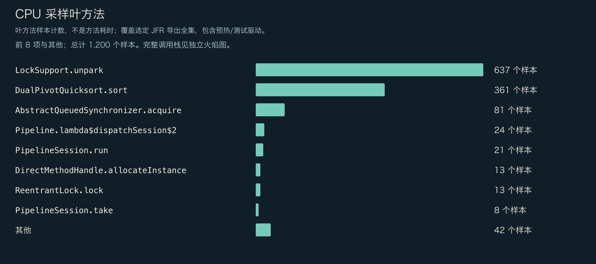
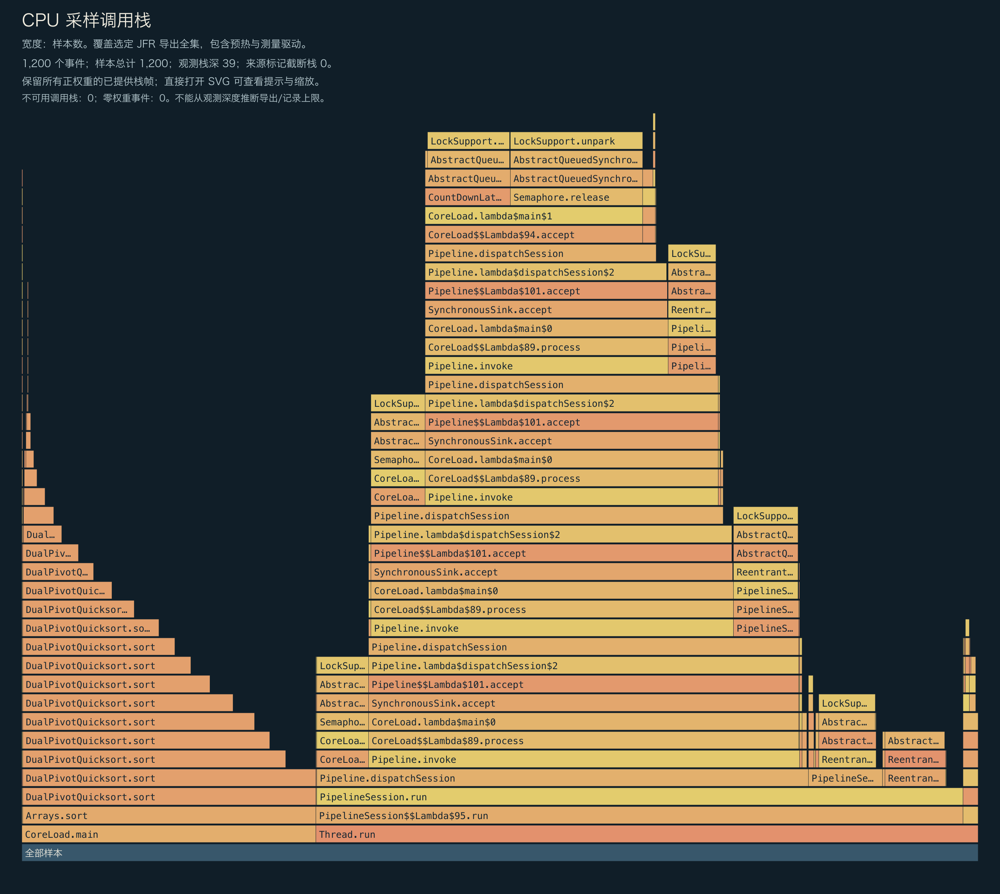
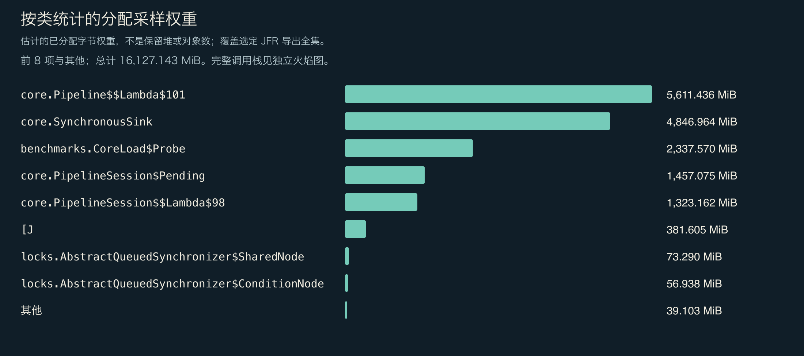
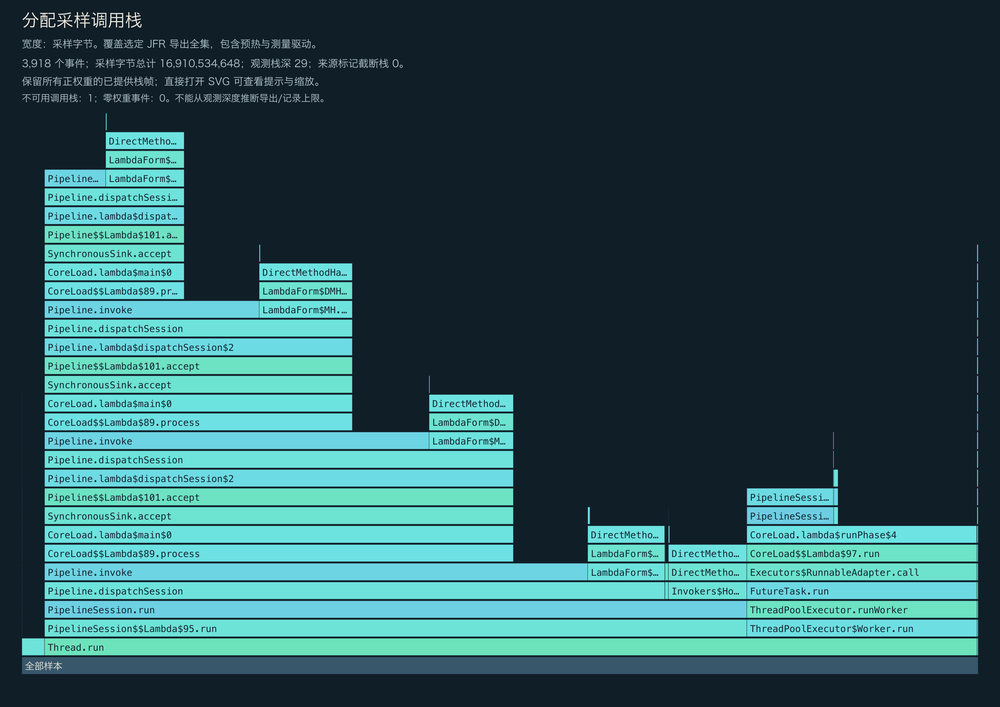
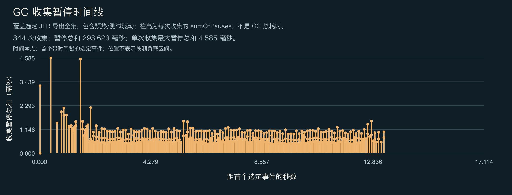

<!-- ominicat-language-nav -->
**简体中文** · [English](../../../../../reports/performance-audit/linux-java17-2026-11-01/profiles.md) · [中文文档目录](../../../index.md)
<!-- /ominicat-language-nav -->

# CPU、分配与 GC 剖析

从有界内核负载的选定 JFR 事件生成。采样包含负载程序与预热，不是模型或网络剖析。

## 所提供的完整 CPU 调用栈

保留所提供的全部正权重栈帧；零权重事件不占面积。观测深度不证明记录或导出没有上限。图中显示源记录标记的截断和不可用栈。直接打开 SVG 可查看完整方法提示。

## CPU 叶节点采样

| 方法 | 样本数 |
|---|---:|
| `java.util.concurrent.locks.LockSupport.unpark` | 637 |
| `java.util.DualPivotQuicksort.sort` | 361 |
| `java.util.concurrent.locks.AbstractQueuedSynchronizer.acquire` | 81 |
| `io.ominicat.core.Pipeline.lambda$dispatchSession$2` | 24 |
| `io.ominicat.core.PipelineSession.run` | 21 |
| `java.lang.invoke.DirectMethodHandle.allocateInstance` | 13 |
| `java.util.concurrent.locks.ReentrantLock.lock` | 13 |
| `io.ominicat.core.PipelineSession.take` | 8 |
| `java.util.DualPivotQuicksort.mixedInsertionSort` | 7 |
| `io.ominicat.core.Pipeline.dispatchSession` | 5 |
| `java.lang.Thread.interrupted` | 4 |
| `io.ominicat.benchmarks.CoreLoad.lambda$runPhase$4` | 3 |

## 分配采样权重

权重估计分配采样分布，不是存活堆或精确对象数量。测量程序保留精确延迟数组；它的 `long[]` 分配被刻意保留可见。每操作分配估计应使用 JMH `gc.alloc.rate.norm`。

| 类型 | 采样权重 (MiB) |
|---|---:|
| `io.ominicat.core.Pipeline$$Lambda$101+0x00007b312c014000.320929598` | 5,611.44 |
| `io.ominicat.core.SynchronousSink` | 4,846.96 |
| `io.ominicat.benchmarks.CoreLoad$Probe` | 2,337.57 |
| `io.ominicat.core.PipelineSession$Pending` | 1,457.07 |
| `io.ominicat.core.PipelineSession$$Lambda$98+0x00007b312c00fa10.342683394` | 1,323.16 |
| `[J` | 381.61 |
| `java.util.concurrent.locks.AbstractQueuedSynchronizer$SharedNode` | 73.29 |
| `java.util.concurrent.locks.AbstractQueuedSynchronizer$ConditionNode` | 56.94 |
| `[C` | 19.12 |
| `java.util.concurrent.locks.AbstractQueuedSynchronizer$ExclusiveNode` | 8.10 |
| `java.lang.InterruptedException` | 6.20 |
| `java.util.LinkedHashMap$LinkedKeySet` | 4.75 |

## 所提供的完整分配调用栈

## GC 与竞争

- 记录的垃圾回收次数：344。
- 记录的 GC 累计暂停：293.623 ms；单次回收暂停合计最大值：4.585 ms。
- 监视器竞争事件：0；虚拟线程固定事件：该运行时不可用。
- GC 位置相对首个带时间戳的选定事件，不是测量负载开始时间。图中包含预热／测量程序事件。回收暂停合计不是整个 GC 的持续时间。
- 零采样事件不能证明不存在。采样、事件阈值与负载时长限制了这些观测。

证据：[选定事件，gzip JSON](../../../../../reports/performance-audit/linux-java17-2026-11-01/jfr-events.json.gz), [测量报告](report.md).
原始 JFR 在本地生成，并有意排除在 Git 之外；公开剖析时不要记录真实凭据或会话载荷。

[GC 日志](../../../../../reports/performance-audit/linux-java17-2026-11-01/gc.log).
