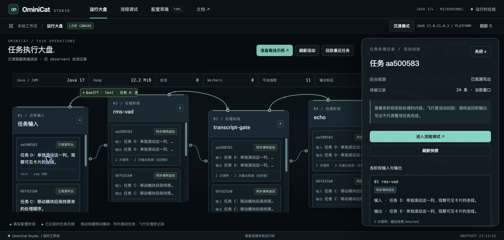
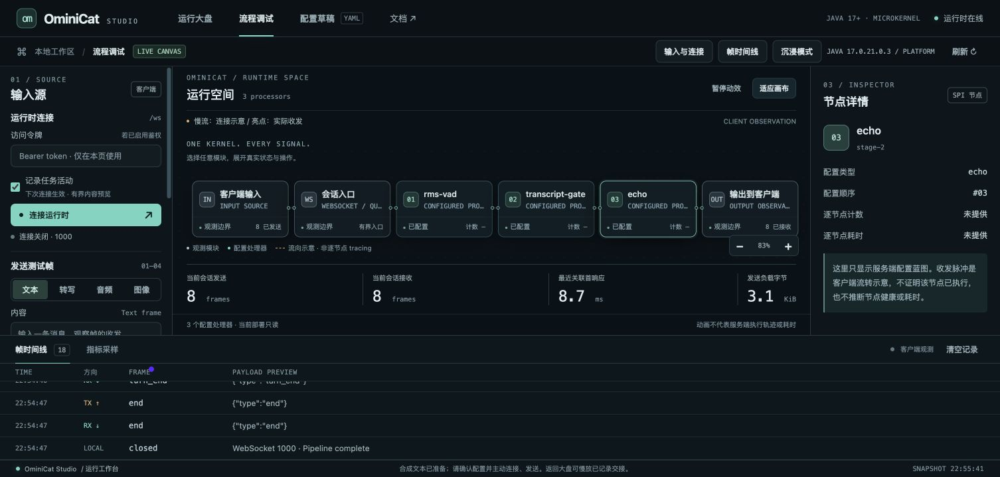

<!-- ominicat-language-nav -->
**简体中文** · [English](../../../../reports/studio/README.md) · [中文文档目录](../../index.md)
<!-- /ominicat-language-nav -->

# Studio 验证

记录日期为 2026-10-31，环境为共享 macOS/aarch64 开发主机，使用 OpenJDK 17.0.21.0.3。Studio 随 Java 服务器分发，使用浏览器同源 API，不依赖前端构建或托管模型。

## 复现

```sh
./mvnw -B -ntp -Pcoverage,sbom -Dominicat.stress.seeds=512 clean verify
node --check ominicat-server/src/main/resources/web/console.js
node --test scripts/test_console.cjs
python3 -m unittest discover -s scripts -p 'test_*.py' -v
java -jar ominicat-server/target/ominicat-server.jar --config config/studio.yaml
```

[Java 验证报告](../verification.md)记录最终测试数和覆盖率。[运行时 API 夹具](../../../../ominicat-server/src/test/java/io/ominicat/server/RuntimeApiTest.java)检查安全元数据、鉴权／来源、不可变配置、路由及真实 WebSocket 计数／排空行为。活动夹具独立覆盖 1,024 事件有界日志、128 事件游标分页、历史缺失、限定作用域的关联、内容预览限制、默认关闭观测、真实已启用观测的 WebSocket 输出、异步生命周期与取消。[浏览器平台夹具](../../../../scripts/test_console.cjs)使用 Node VM 和确定性浏览器替身测试媒体／会话竞态、轮询与任务投影；它们不是物理浏览器或麦克风测试。

## 浏览器评审

被评审的本地配置包含真实的 `rms-vad`、`transcript-gate` 和 `echo` 处理器。输入为合成数据，没有外部模型调用。大盘与调试器具有独立 URL 状态和 DOM 视图。任务卡片提供保留内容、阶段观测和输出；详情面板包含事件引用与序号顺序。活动回放与执行计时分开标注。JVM 资源口径保持明确。

[交互审查](interaction-review.md)记录了复现的滚轮／平移缺陷、原生滚动条修复、模块移动和连接检查。浏览器交互检查包括离线示例准备及显式连接／发送、任务／阶段／结果下钻、返回大盘、独立文本／转写调试、按字面显示类标记语言文本、中断／结束控制、配置草稿与窄屏布局。下方截图取自运行中的应用，不是设计稿。






未执行物理麦克风录音。文件选择按钮可以打开，但此 Chrome 自动化环境因扩展缺少 file-URL 访问权限，无法填入本地图像；未扩大扩展权限。媒体成功／竞态路径有确定性浏览器平台测试覆盖，服务端媒体协议夹具使用真实连接。此限制不被标为浏览器图像上传通过。

## 观测成本与资源范围

[活动适配器检查](../../../../reports/studio/activity-check.json)以关闭／开启／开启／关闭顺序使用同一 Java 17 服务器构建：每轮 16 条连接 × 5,000 个测量文本帧，共 **320,000 个测量帧**。每轮拒绝／失败帧均为零，活跃会话、保留接纳名额、管线工作线程和待发送输出均归零。普通连接不增加活动事件。两轮启用观测的试验各生成 979,216 个事件，保留量始终为 1,024，每页始终为 128；历史覆盖有显式报告。

| 同一构建的有限样本 | 活动关闭 | 活动开启 |
| --- | ---: | ---: |
| 传输 p99 | 486.5–521.2 µs | 615.5–634.4 µs |
| 闭环帧速率 | 63,453–65,126 /s | 57,428–59,320 /s |

这是同一 JVM 短预热后每种模式的两个样本，同时以 10 Hz 轮询聚合指标、2 Hz 轮询活动。JIT、GC 和主机负载仍是混杂因素；它不是因果开销估计、独立进程基准，也不替代内核剖析。产物哈希指向最终 UI 打包前的服务器适配器／传输候选版本。

[并发观测检查](../../../../reports/studio/observer-check.json)记录较早的 API／传输候选版本：16 条合成 WebSocket 连接、80,000 个测量帧及预热，并发读取聚合快照。它包含源码和预览产物哈希，并明确最终 UI 之前的范围。这是历史功能排空证据，不是最终活动适配器验证、吞吐基线或前后对比。

普通连接（`/ws` 或 `observe=0`）不产生活动事件、阶段观测包装、预览或逐阶段观测时钟读取。启用观测后会分配有界元数据，并串行写入共享环形缓冲；渲染和轮询也有资源成本。这些成本不在已记录的[内核基准](../java17/kernel/report.md)中。此 Studio 检查不推导逐节点 CPU、生产容量、模型质量或持久化任务保证。

活动预览可能包含用户文本。已鉴权 API 是对进程内已启用观测连接的操作视图，不是租户隔离审计存储。公开报告不包含媒体载荷、原始异常消息、模型配置、凭据及原始本地日志。
