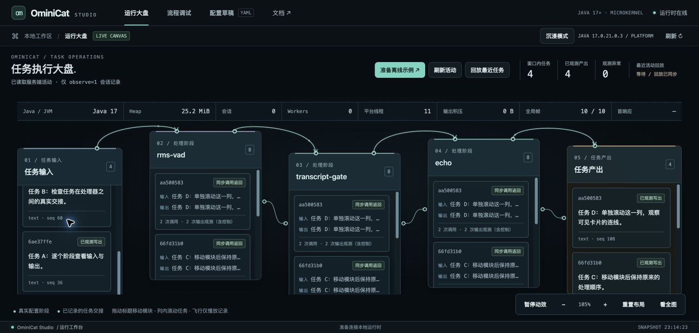
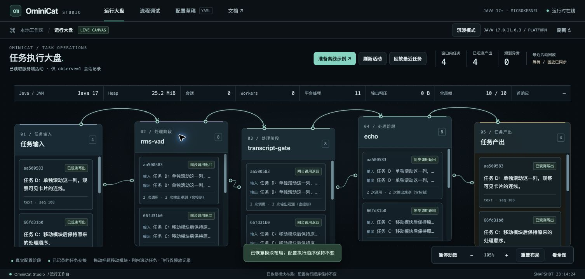

<!-- ominicat-language-nav -->
**简体中文** · [English](../../../../reports/studio/interaction-review.md) · [中文文档目录](../../index.md)
<!-- /ominicat-language-nav -->

# Studio 交互评审

评审于 2026-10-31 在 macOS 的 Chrome 中进行，使用原生 1506 × 719 视口和临时 390 × 844 响应式视口。目标是追踪真实任务内容、移动模块并检查结果，而不会误滚动整个画布。输入为合成数据，配置的处理器是 `rms-vad`、`transcript-gate` 和 `echo`。

首个候选版本未通过评审。在输入列内滚动时，列的滚动位置仍为零，画布却从 `translate(69.45px, 12px)` 移到 `translate(69.45px, -707px)`，使工作区变为空白。主连线大多被面板遮挡，任务线穿过滚动条轨道，长标识将内容挤出了详情面板首屏。

| 步骤 | 最终结果 | 证据 |
| --- | --- | --- |
| 1. 识别模块与任务交接 | 通过：可见且有方向的主连线；独立卡片交接；清晰端口与留有间距的中文标题 | [大盘](../../../assets/studio-overview.jpg) |
| 2. 滚动任务列及其末端边界 | 通过：原生列滚动推进；画布变换保持不变；裁切卡片不再留下悬空连线 | [已滚动列](../../../assets/studio-scroll.jpg) |
| 3. 拖动滚动条并使用 PageDown | 通过：常驻 12 px 滚动条可以拖动；键盘翻页滚动当前聚焦列 | 原生指针／键盘检查；[回归夹具](../../../../scripts/test_console.cjs) |
| 4. 在 105% 与 87% 缩放下拖动模块 | 通过：模块和任务端点随移动更新；画布与任务／产出计数不变；刷新保留布局 | [已移动模块](../../../assets/studio-drag.jpg) |
| 5. 打开任务详情并进入调试器 | 通过：优先显示内容和调试动作；完整标识仍可展开；调试器为独立视图 | [任务详情](../../../assets/studio-details.jpg)、[调试器](../../../assets/studio-debug.jpg) |
| 6. 平移、重置并检查窄屏布局 | 通过：空白拖动独立平移；重置恢复模块与列位置；390 px 布局没有文档溢出 | 响应式浏览器检查；之后恢复视口覆盖设置 |

滚动条问题还有第二个原因：标准滚动条颜色选择了 macOS 覆盖式滚动条，隐藏了预期的 WebKit 宽度。最终 Chromium 渲染预留 12 px（`offsetWidth 214`、`clientWidth 202`），显示常驻且可拖动的滑块。列内滚轮事件不再转为画布平移，出站交接端口位于模块外，连线避开滚动轨道。

键盘焦点、显式标签、减少动态效果／暂停行为、有界任务状态与隐藏视图清理均有自动化覆盖。十个浏览器平台夹具包含独立几何校验器，用于验证拖动移动、基于帧的交接身份、裁切、取消及刷新。夹具通过不证明完全符合可访问性规范。

已检查响应式截图和计算后的 touch-action 边界：视口允许原生行为，背景平移表面与模块把手负责手动拖动，任务列允许原生垂直滚动。没有操作物理触摸屏或屏幕阅读器；仅调整浏览器大小不被表述为物理触摸测试。麦克风／图像自动化限制仍记录在 [Studio 验证](README.md)中。
