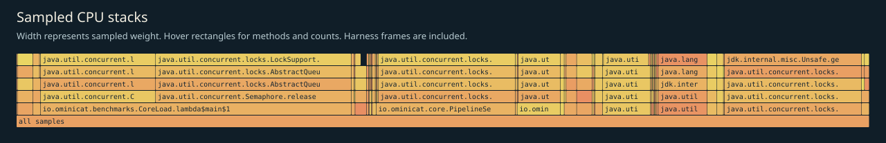
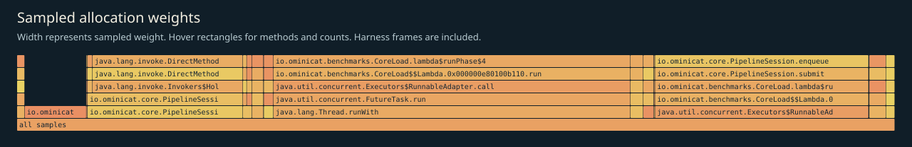

# CPU, allocation and GC profile

Generated from the selected JFR events for the bounded kernel load. Samples include the load harness and warmup; they are not a model or network profile.

## CPU leaf samples

| Method | Samples |
|---|---:|
| `java.util.concurrent.locks.LockSupport.unpark` | 515 |
| `jdk.internal.misc.Unsafe.getAndBitwiseAndInt` | 143 |
| `java.util.DualPivotQuicksort.sort` | 67 |
| `java.lang.VirtualThread.parkNanos` | 51 |
| `io.ominicat.core.PipelineSession.run` | 16 |
| `java.util.concurrent.CountDownLatch$Sync.tryReleaseShared` | 16 |
| `io.ominicat.benchmarks.CoreLoad.lambda$runPhase$4` | 11 |
| `java.lang.System$2.unparkVirtualThread` | 10 |
| `jdk.internal.vm.Continuation.yield` | 8 |
| `java.util.concurrent.locks.ReentrantLock$Sync.lockInterruptibly` | 8 |
| `java.lang.VirtualThread.unpark` | 7 |
| `java.util.concurrent.locks.AbstractQueuedSynchronizer.acquireInterruptibly` | 6 |

## Sampled allocation weights

Weights estimate sampled allocation distribution, not retained heap or exact object counts. The harness retains an exact latency array; its `long[]` allocation is intentionally visible. Use JMH `gc.alloc.rate.norm` for per-operation allocation estimates.

| Class | Sampled weight (MiB) |
|---|---:|
| `io.ominicat.benchmarks.CoreLoad$Probe` | 1,224.03 |
| `io.ominicat.core.PipelineSession$Pending` | 732.66 |
| `io.ominicat.core.PipelineSession$$Lambda.0x000000e80100bba8` | 528.60 |
| `[J` | 211.19 |
| `java.util.concurrent.locks.AbstractQueuedSynchronizer$ExclusiveNode` | 93.19 |
| `java.util.concurrent.ScheduledThreadPoolExecutor$ScheduledFutureTask` | 57.34 |
| `java.util.concurrent.ForkJoinTask$AdaptedRunnableAction` | 44.07 |
| `java.lang.VirtualThread$$Lambda.0x000000e80103e8c8` | 36.15 |
| `java.util.concurrent.ForkJoinTask$RunnableExecuteAction` | 30.36 |
| `java.util.concurrent.locks.AbstractQueuedSynchronizer$SharedNode` | 26.30 |
| `java.util.concurrent.locks.AbstractQueuedSynchronizer$ConditionNode` | 17.52 |
| `io.ominicat.core.Pipeline$$Lambda.0x000000e80100c8a0` | 4.15 |

## GC and contention

- Garbage collections recorded: 12.
- Recorded GC pause sum: 20.688 ms; longest collection pause sum: 2.197 ms.
- Monitor contention events: 0; virtual-thread pinning events: 0.
- Zero sampled events does not prove absence. Sampling, event thresholds and workload duration limit these observations.

Evidence: [selected events, gzip JSON](jfr-events.json.gz), [GC log](gc.log), [measurement report](report.md).
Raw JFR is generated locally and intentionally excluded from Git; do not record real credentials or conversation payloads for public profiling.
