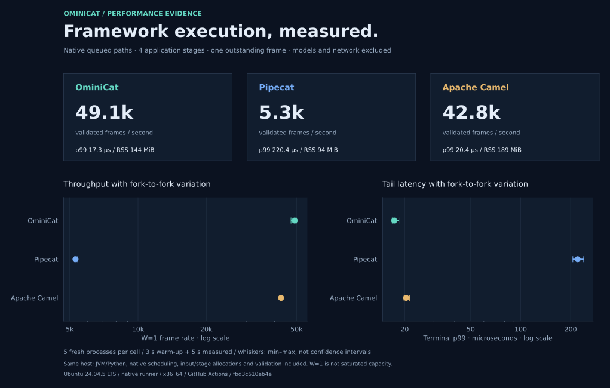
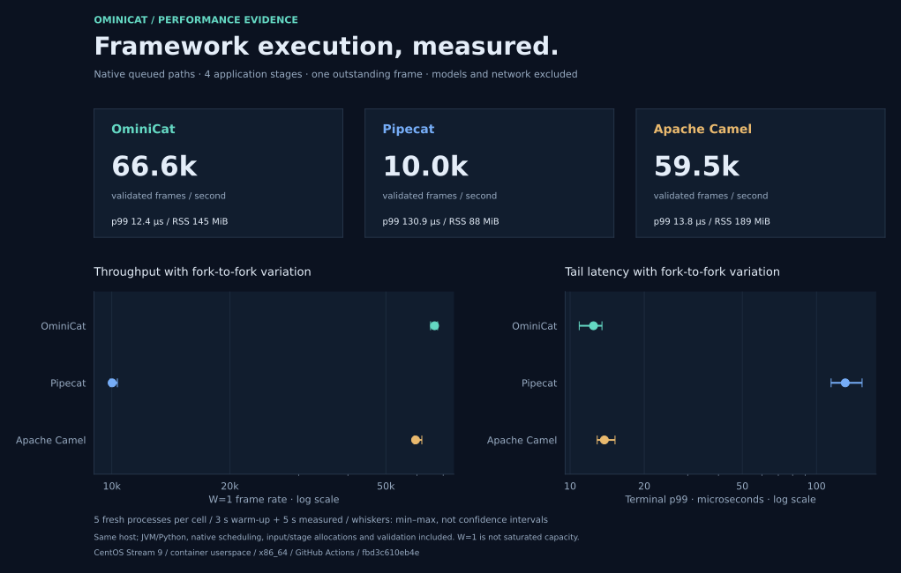

# Framework performance evidence

The same queued-path protocol runs OminiCat, Pipecat 1.15.0 and Apache Camel 4.22.2 LTS without models or network calls. Each platform supplies all **45 fresh processes**: 1/4/16 application stages, five processes per cell, three seconds warmup and five seconds measured, W=1. Tables show four-stage medians; full reports retain every fork and observed ranges.

## Linux CI / 2026-10-31 UTC

[Successful workflow run](https://github.com/g5n-dev/ominicat/actions/runs/41222330745) · [Archive digests and source provenance](linux-ci-41222330745.json) · [Reproduction and automatic triggers](../../comparison/README.md#linux-ci)

Both jobs passed their complete matrices and separate diagnostics: **90 fresh processes and 17,406,385 validated measured outputs**. Raw observations, measurement manifests, selected JFR events and numeric diagnostic observations preserve their CI data. Figures, report links and publication metadata use the [published renderer](../../comparison/report.py) and [diagnostic publisher](../../comparison/package_diagnostics.py); original archive hashes, tool hashes and exact per-file changes are recorded. All published files have verified checksums. GitHub-hosted downloadable artifacts expire after 30 days; the committed evidence remains available.

Each job runs the three frameworks sequentially on its own runner. The jobs used different CPU models and JDK distributions; these are independent same-job framework comparisons, not an experiment isolating Ubuntu/CentOS or kernel differences. W=1 frame rate is not saturated throughput or production capacity. Process RSS includes the runtime, dependencies and common 16 MiB buffer. Instrumented diagnostics are excluded from the timing matrix.

### Ubuntu 24.04.5 LTS / native x86_64

AMD EPYC 9V74, four available logical processors; Temurin 17.0.21+9, CPython 3.12.15, glibc 2.39. All 45 processes passed, validating 7,198,018 measured outputs.

| Framework | Frames/s · W=1 | Terminal p99 µs | Phase peak RSS MiB |
| --- | ---: | ---: | ---: |
| OminiCat | 49,084 | 17.30 | 144.1 |
| Pipecat | 5,300 | 220.35 | 93.5 |
| Apache Camel | 42,756 | 20.41 | 188.7 |

[Complete figures and ranges](linux-ubuntu24-java17-2026-10-31/README.md) · [CPU / allocation / GC / Python diagnostics](linux-ubuntu24-java17-2026-10-31/profiles/README.md) · [Manifest](linux-ubuntu24-java17-2026-10-31/manifest.json) · [Checksums](linux-ubuntu24-java17-2026-10-31/SHA256SUMS)

### CentOS Stream 9 / container user space / x86_64

AMD EPYC 9V45, four available logical processors; distribution OpenJDK 17.0.20.1+1, CPython 3.12.15, glibc 2.34. The official image is pinned by digest. This covers CentOS user space on an Ubuntu 24.04 runner and shares the runner's Linux kernel. All 45 processes passed, validating 10,208,367 measured outputs.

| Framework | Frames/s · W=1 | Terminal p99 µs | Phase peak RSS MiB |
| --- | ---: | ---: | ---: |
| OminiCat | 66,567 | 12.44 | 145.3 |
| Pipecat | 10,019 | 130.88 | 88.0 |
| Apache Camel | 59,527 | 13.78 | 188.9 |

[Complete figures and ranges](linux-centos9-java17-2026-10-31/README.md) · [CPU / allocation / GC / Python diagnostics](linux-centos9-java17-2026-10-31/profiles/README.md) · [Manifest](linux-centos9-java17-2026-10-31/manifest.json) · [Checksums](linux-centos9-java17-2026-10-31/SHA256SUMS)
