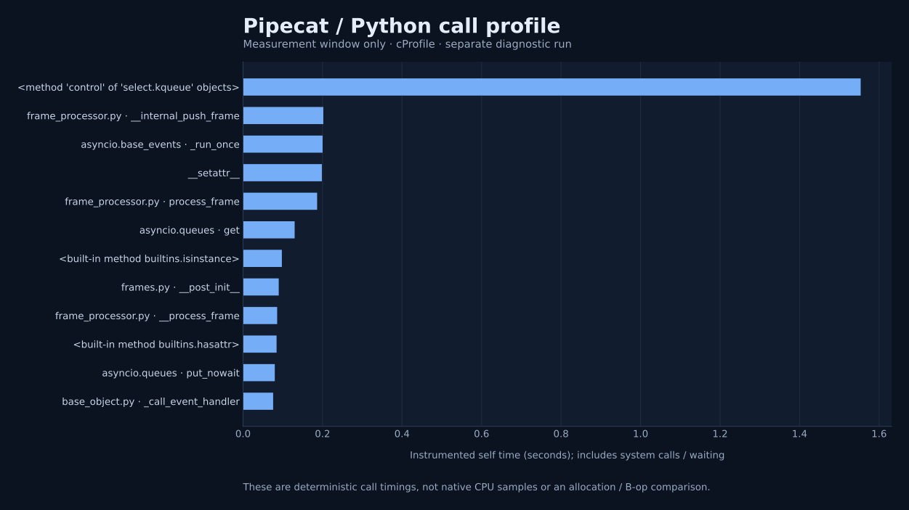

# Separate diagnostic profiles

These recordings explain their own instrumented workload. They do not replace any of the 45 unprofiled timing results. Java uses sampled JFR across process startup, warmup, measurement and teardown; Python uses deterministic cProfile only in the measured event-loop phase. Percentages and allocation observations have different scopes and must not be ranked on a common cross-language axis.

## OminiCat / Java 17

[CPU and allocation stacks, class weights and GC](ominicat/profiles.md) · [Collection context](ominicat/diagnostic-summary.json)

## Apache Camel / Java 17

[CPU and allocation stacks, class weights and GC](camel/profiles.md) · [Collection context](camel/diagnostic-summary.json)

## Pipecat / CPython 3.12

[Call statistics and collection scope](pipecat/profile.md) · [Safe JSON](pipecat/summary.json)

Python imports, startup, warmup and teardown are outside its capture; Python/native exposed call timing includes waits and system calls and does not resolve native implementation internals. Java's whole-recording samples include initialization and the benchmark harness. Sampled allocation weights are not retained heap or exact B/op. Zero events do not prove absence. Raw JFR, Python profiler dumps, uncompressed exports and diagnostic logs remain local.

[Main unprofiled framework comparison](../README.md).
