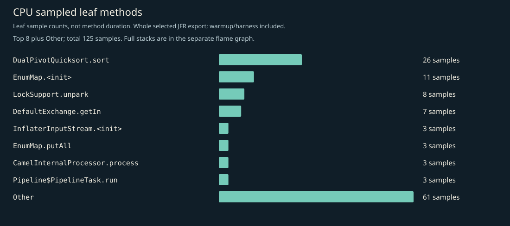
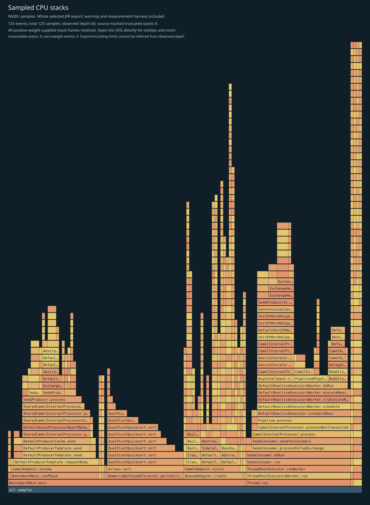
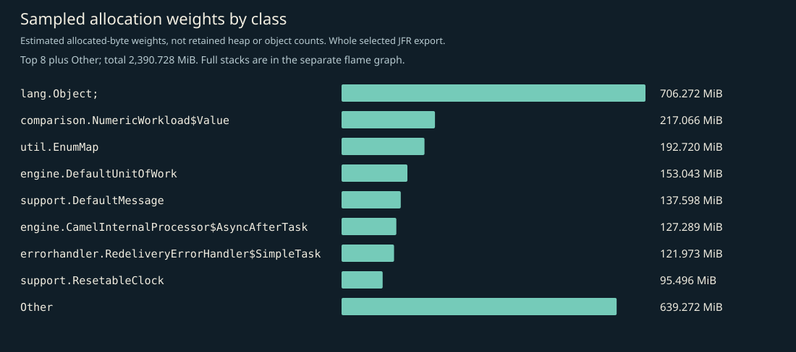
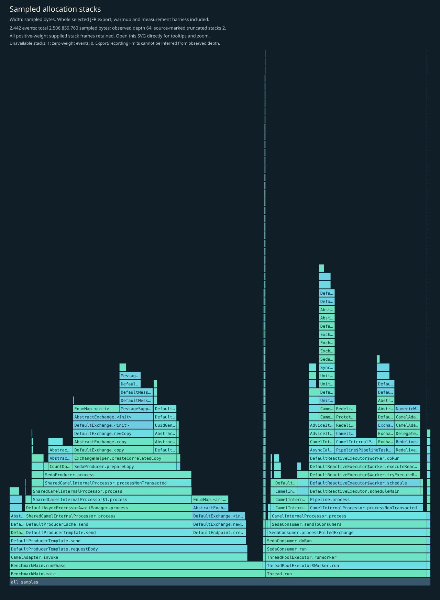
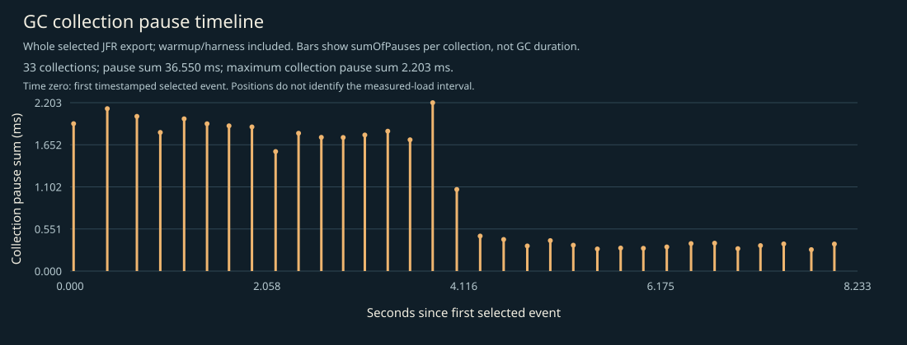

# CPU, allocation and GC profile

Whole selected recording: JVM/framework startup, setup, 3-second warmup, 5-second W=1 measurement, harness and teardown. No phase filtering. Separate profiled diagnostics; not headline timings, framework-only allocation, retained heap, or a shared cross-language bytes-per-operation axis.

## Complete supplied CPU stacks

Every positive-weight supplied stack frame is retained; zero-weight events have no area. Observed depth does not prove that the recording or export was unlimited. Source-marked truncation and unavailable stacks are shown on the figure. Open the SVG directly to inspect full method tooltips.

## CPU leaf samples

| Method | Samples |
|---|---:|
| `java.util.DualPivotQuicksort.sort` | 26 |
| `java.util.EnumMap.<init>` | 11 |
| `java.util.concurrent.locks.LockSupport.unpark` | 8 |
| `org.apache.camel.support.DefaultExchange.getIn` | 7 |
| `java.util.zip.InflaterInputStream.<init>` | 3 |
| `java.util.EnumMap.putAll` | 3 |
| `org.apache.camel.impl.engine.CamelInternalProcessor.process` | 3 |
| `org.apache.camel.processor.Pipeline$PipelineTask.run` | 3 |
| `org.apache.camel.support.EventHelper.notifyExchangeAsyncProcessingStartedEvent` | 3 |
| `org.apache.camel.support.DefaultExchange.getOut` | 3 |
| `org.apache.camel.component.seda.SedaProducer.process` | 2 |
| `java.util.concurrent.locks.AbstractQueuedSynchronizer.acquire` | 2 |

## Sampled allocation weights

Weights estimate sampled allocation distribution, not retained heap or exact object counts. The harness retains an exact latency array; its `long[]` allocation is intentionally visible. No per-operation allocation estimate is inferred from this recording.

| Class | Sampled weight (MiB) |
|---|---:|
| `[Ljava.lang.Object;` | 706.27 |
| `io.ominicat.comparison.NumericWorkload$Value` | 217.07 |
| `java.util.EnumMap` | 192.72 |
| `org.apache.camel.impl.engine.DefaultUnitOfWork` | 153.04 |
| `org.apache.camel.support.DefaultMessage` | 137.60 |
| `org.apache.camel.impl.engine.CamelInternalProcessor$AsyncAfterTask` | 127.29 |
| `org.apache.camel.processor.errorhandler.RedeliveryErrorHandler$SimpleTask` | 121.97 |
| `org.apache.camel.support.ResetableClock` | 95.50 |
| `java.util.concurrent.locks.AbstractQueuedSynchronizer$ExclusiveNode` | 82.41 |
| `java.util.ArrayList` | 79.12 |
| `java.lang.String` | 68.33 |
| `java.util.concurrent.CountDownLatch$Sync` | 60.45 |

## Complete supplied allocation stacks

## GC and contention

- Garbage collections recorded: 33.
- Recorded GC pause sum: 36.550 ms; longest collection pause sum: 2.203 ms.
- Monitor contention events: 0; virtual-thread pinning events: not available on this runtime.
- GC positions are relative to the first timestamped selected event, not the measured-load start. The figure includes warmup/harness events. Collection pause sums are not whole GC durations.
- Zero sampled events does not prove absence. Sampling, event thresholds and workload duration limit these observations.

Evidence: [selected events, gzip JSON](jfr-events.json.gz), [measurement report](report.md).
Raw JFR is generated locally and intentionally excluded from Git; do not record real credentials or conversation payloads for public profiling.

[GC log](gc.log).
