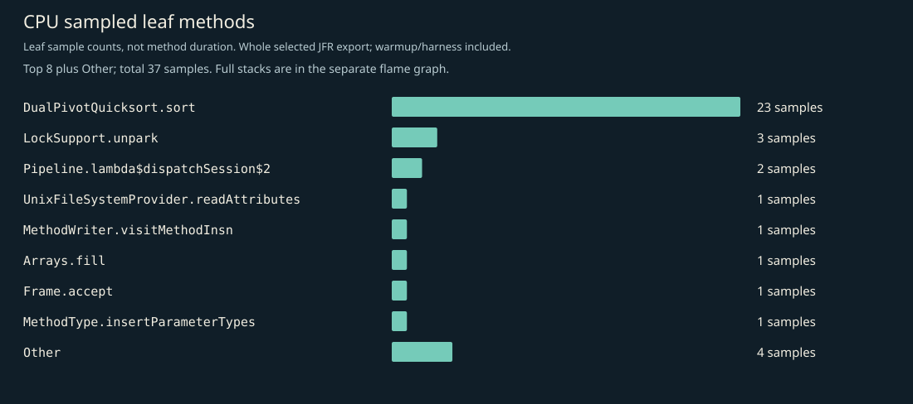
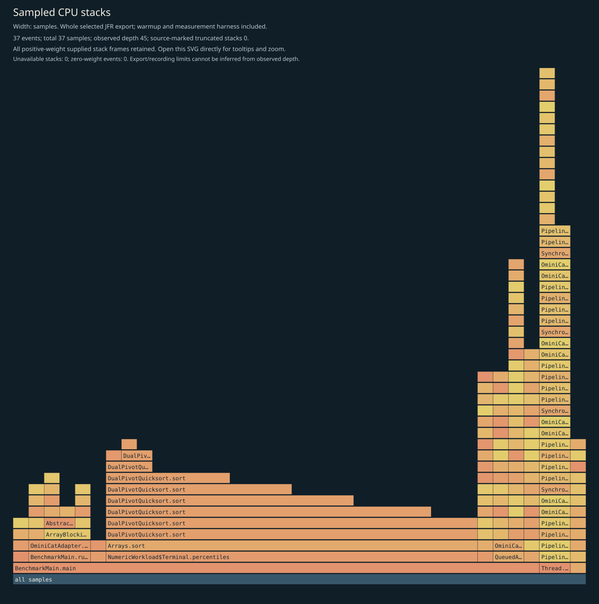
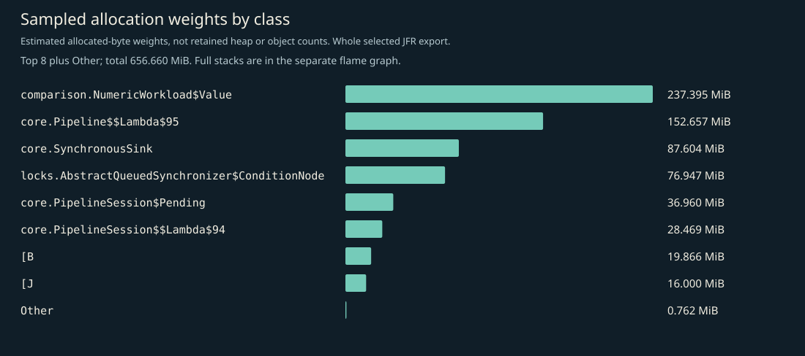
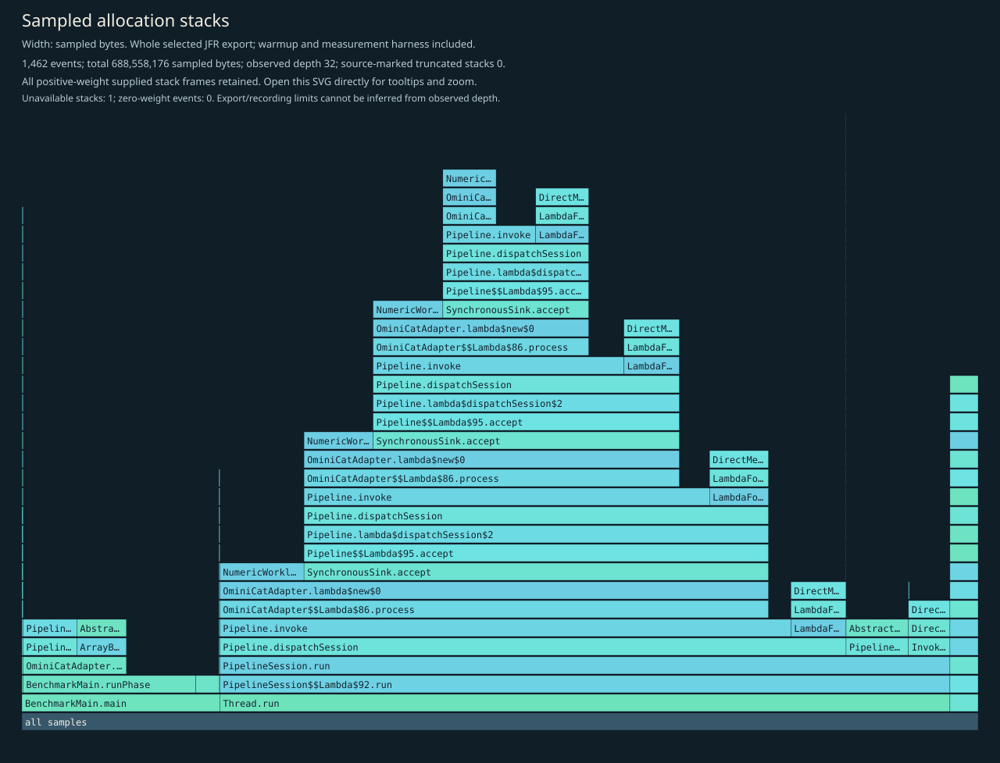
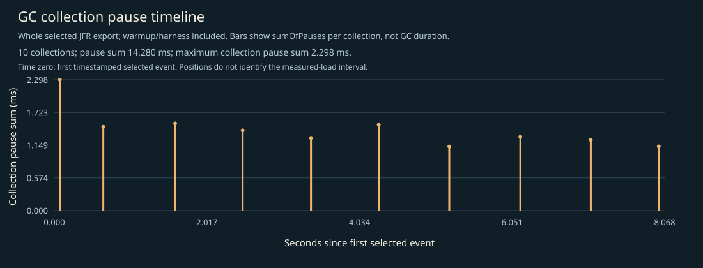

# CPU, allocation and GC profile

Whole selected recording: JVM/framework startup, setup, 3-second warmup, 5-second W=1 measurement, harness and teardown. No phase filtering. Separate profiled diagnostics; not headline timings, framework-only allocation, retained heap, or a shared cross-language bytes-per-operation axis.

## Complete supplied CPU stacks

Every positive-weight supplied stack frame is retained; zero-weight events have no area. Observed depth does not prove that the recording or export was unlimited. Source-marked truncation and unavailable stacks are shown on the figure. Open the SVG directly to inspect full method tooltips.

## CPU leaf samples

| Method | Samples |
|---|---:|
| `java.util.DualPivotQuicksort.sort` | 23 |
| `java.util.concurrent.locks.LockSupport.unpark` | 3 |
| `io.ominicat.core.Pipeline.lambda$dispatchSession$2` | 2 |
| `sun.nio.fs.UnixFileSystemProvider.readAttributes` | 1 |
| `jdk.internal.org.objectweb.asm.MethodWriter.visitMethodInsn` | 1 |
| `java.util.Arrays.fill` | 1 |
| `jdk.internal.org.objectweb.asm.Frame.accept` | 1 |
| `java.lang.invoke.MethodType.insertParameterTypes` | 1 |
| `java.util.zip.InflaterInputStream.<init>` | 1 |
| `java.lang.invoke.CallSite.makeSite` | 1 |
| `java.util.concurrent.locks.AbstractQueuedSynchronizer.acquire` | 1 |
| `java.util.DualPivotQuicksort.mixedInsertionSort` | 1 |

## Sampled allocation weights

Weights estimate sampled allocation distribution, not retained heap or exact object counts. The harness retains an exact latency array; its `long[]` allocation is intentionally visible. No per-operation allocation estimate is inferred from this recording.

| Class | Sampled weight (MiB) |
|---|---:|
| `io.ominicat.comparison.NumericWorkload$Value` | 237.40 |
| `io.ominicat.core.Pipeline$$Lambda$95+0x000000e00100c870.1787577678` | 152.66 |
| `io.ominicat.core.SynchronousSink` | 87.60 |
| `java.util.concurrent.locks.AbstractQueuedSynchronizer$ConditionNode` | 76.95 |
| `io.ominicat.core.PipelineSession$Pending` | 36.96 |
| `io.ominicat.core.PipelineSession$$Lambda$94+0x000000e00100c648.302215820` | 28.47 |
| `[B` | 19.87 |
| `[J` | 16.00 |
| `jdk.internal.org.objectweb.asm.SymbolTable$Entry` | 0.46 |
| `jdk.internal.math.FDBigInteger` | 0.30 |
| `java.lang.String` | 0.00 |
| `jdk.jfr.events.ExceptionStatisticsEvent` | 0.00 |

## Complete supplied allocation stacks

## GC and contention

- Garbage collections recorded: 10.
- Recorded GC pause sum: 14.280 ms; longest collection pause sum: 2.298 ms.
- Monitor contention events: 0; virtual-thread pinning events: not available on this runtime.
- GC positions are relative to the first timestamped selected event, not the measured-load start. The figure includes warmup/harness events. Collection pause sums are not whole GC durations.
- Zero sampled events does not prove absence. Sampling, event thresholds and workload duration limit these observations.

Evidence: [selected events, gzip JSON](jfr-events.json.gz), [measurement report](report.md).
Raw JFR is generated locally and intentionally excluded from Git; do not record real credentials or conversation payloads for public profiling.

[GC log](gc.log).
