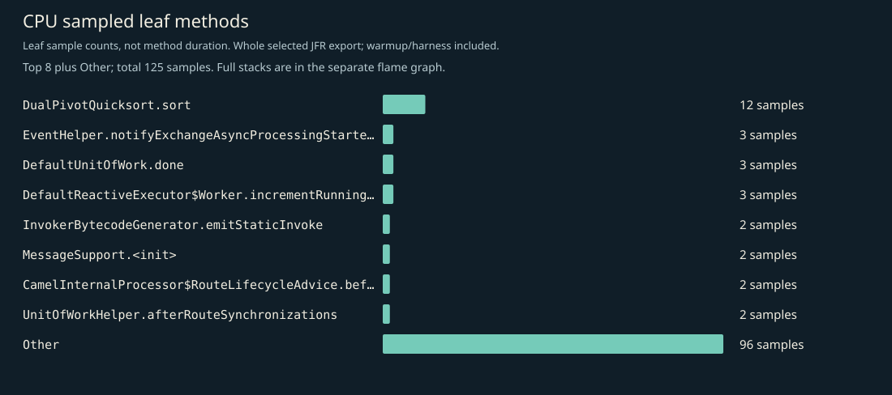
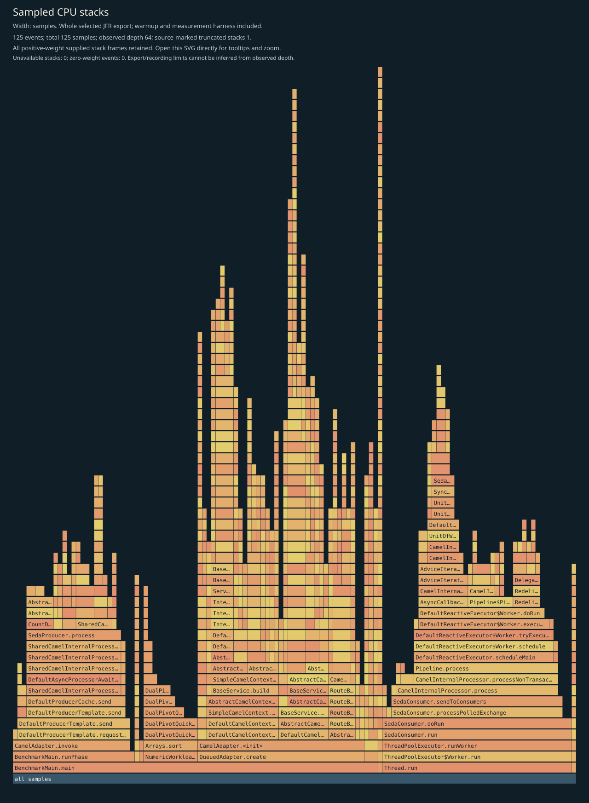
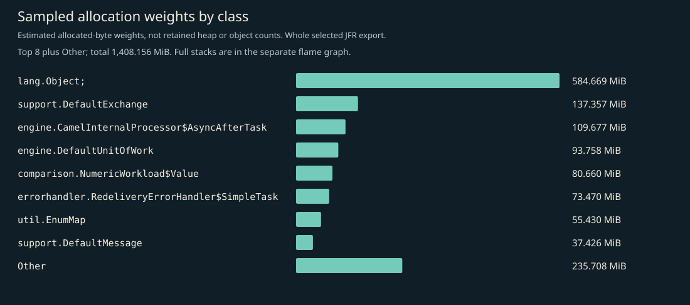
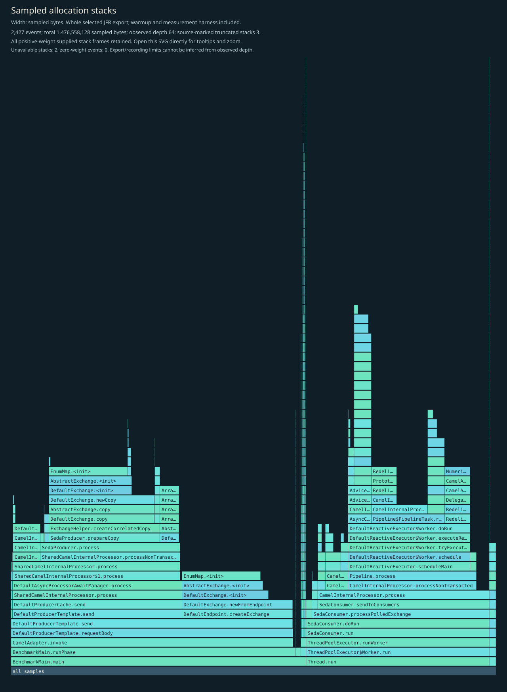
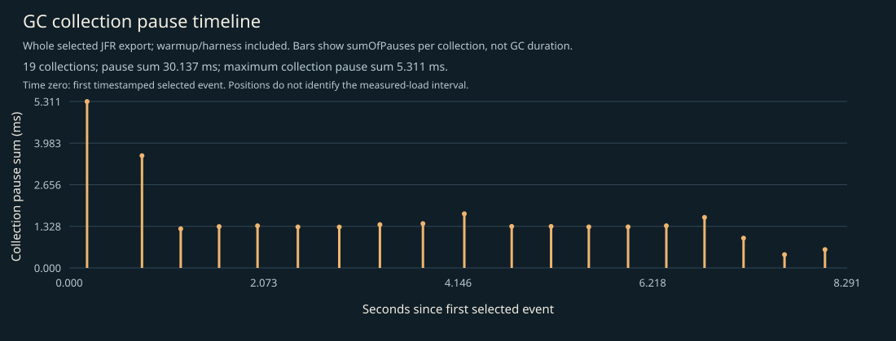

# CPU, allocation and GC profile

Whole selected recording: JVM/framework startup, setup, 3-second warmup, 5-second W=1 measurement, harness and teardown. No phase filtering. Separate profiled diagnostics; not headline timings, framework-only allocation, retained heap, or a shared cross-language bytes-per-operation axis.

## Complete supplied CPU stacks

Every positive-weight supplied stack frame is retained; zero-weight events have no area. Observed depth does not prove that the recording or export was unlimited. Source-marked truncation and unavailable stacks are shown on the figure. Open the SVG directly to inspect full method tooltips.

## CPU leaf samples

| Method | Samples |
|---|---:|
| `java.util.DualPivotQuicksort.sort` | 12 |
| `org.apache.camel.support.EventHelper.notifyExchangeAsyncProcessingStartedEvent` | 3 |
| `org.apache.camel.impl.engine.DefaultUnitOfWork.done` | 3 |
| `org.apache.camel.impl.engine.DefaultReactiveExecutor$Worker.incrementRunningWorkers` | 3 |
| `java.lang.invoke.InvokerBytecodeGenerator.emitStaticInvoke` | 2 |
| `org.apache.camel.support.MessageSupport.<init>` | 2 |
| `org.apache.camel.impl.engine.CamelInternalProcessor$RouteLifecycleAdvice.before` | 2 |
| `org.apache.camel.support.UnitOfWorkHelper.afterRouteSynchronizations` | 2 |
| `org.apache.camel.processor.Pipeline$PipelineTask.run` | 2 |
| `org.apache.camel.support.DefaultExchange.getOut` | 2 |
| `org.apache.camel.component.seda.SedaConsumer.doRun` | 2 |
| `java.util.concurrent.locks.AbstractQueuedSynchronizer.casTail` | 2 |

## Sampled allocation weights

Weights estimate sampled allocation distribution, not retained heap or exact object counts. The harness retains an exact latency array; its `long[]` allocation is intentionally visible. No per-operation allocation estimate is inferred from this recording.

| Class | Sampled weight (MiB) |
|---|---:|
| `[Ljava.lang.Object;` | 584.67 |
| `org.apache.camel.support.DefaultExchange` | 137.36 |
| `org.apache.camel.impl.engine.CamelInternalProcessor$AsyncAfterTask` | 109.68 |
| `org.apache.camel.impl.engine.DefaultUnitOfWork` | 93.76 |
| `io.ominicat.comparison.NumericWorkload$Value` | 80.66 |
| `org.apache.camel.processor.errorhandler.RedeliveryErrorHandler$SimpleTask` | 73.47 |
| `java.util.EnumMap` | 55.43 |
| `org.apache.camel.support.DefaultMessage` | 37.43 |
| `[B` | 34.62 |
| `java.util.ArrayList` | 33.96 |
| `org.apache.camel.processor.Pipeline$PipelineTask` | 18.48 |
| `java.util.concurrent.locks.ReentrantLock` | 17.48 |

## Complete supplied allocation stacks

## GC and contention

- Garbage collections recorded: 19.
- Recorded GC pause sum: 30.137 ms; longest collection pause sum: 5.311 ms.
- Monitor contention events: 0; virtual-thread pinning events: not available on this runtime.
- GC positions are relative to the first timestamped selected event, not the measured-load start. The figure includes warmup/harness events. Collection pause sums are not whole GC durations.
- Zero sampled events does not prove absence. Sampling, event thresholds and workload duration limit these observations.

Evidence: [selected events, gzip JSON](jfr-events.json.gz), [measurement report](report.md).
Raw JFR is generated locally and intentionally excluded from Git; do not record real credentials or conversation payloads for public profiling.

[GC log](gc.log).
