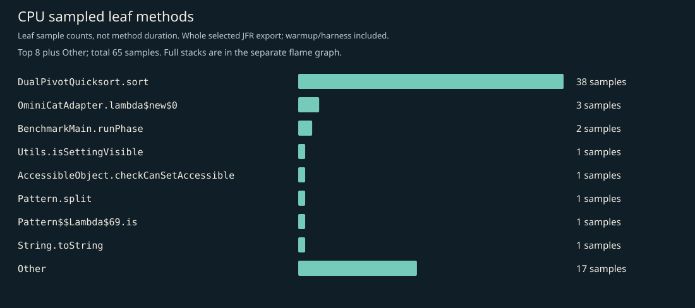
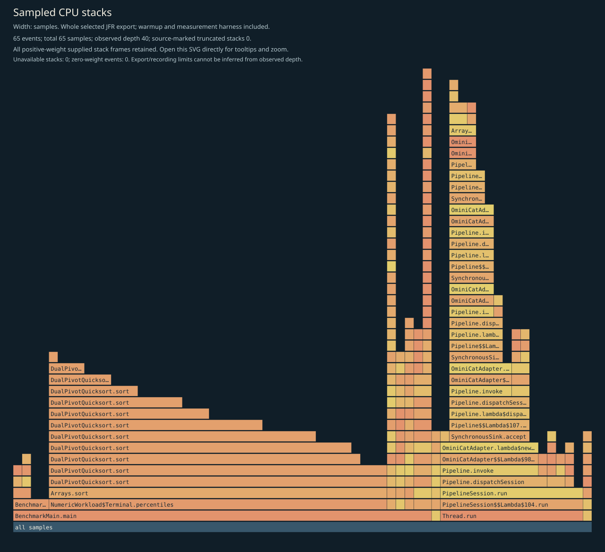
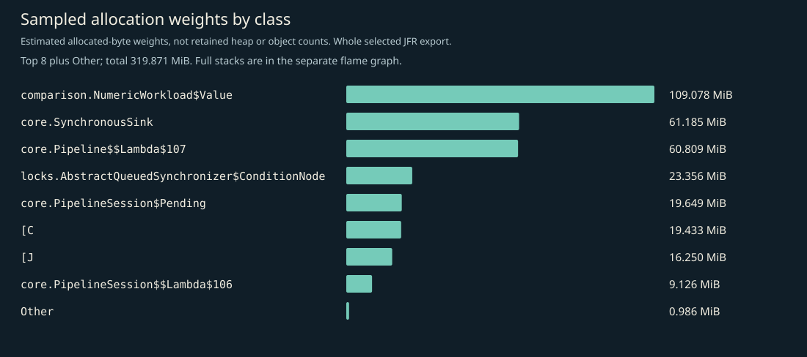
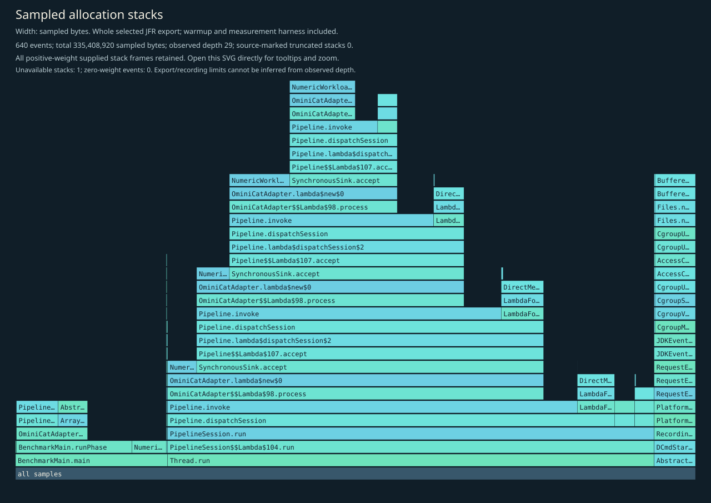
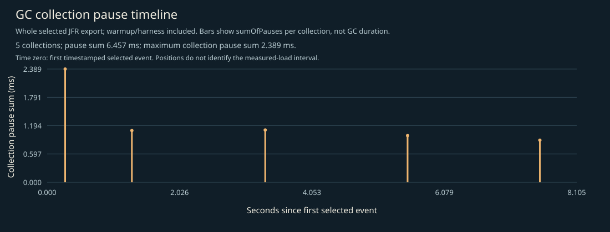

# CPU, allocation and GC profile

Whole selected recording: JVM/framework startup, setup, 3-second warmup, 5-second W=1 measurement, harness and teardown. No phase filtering. Separate profiled diagnostics; not headline timings, framework-only allocation, retained heap, or a shared cross-language bytes-per-operation axis.

## Complete supplied CPU stacks

Every positive-weight supplied stack frame is retained; zero-weight events have no area. Observed depth does not prove that the recording or export was unlimited. Source-marked truncation and unavailable stacks are shown on the figure. Open the SVG directly to inspect full method tooltips.

## CPU leaf samples

| Method | Samples |
|---|---:|
| `java.util.DualPivotQuicksort.sort` | 38 |
| `io.ominicat.comparison.OminiCatAdapter.lambda$new$0` | 3 |
| `io.ominicat.comparison.BenchmarkMain.runPhase` | 2 |
| `jdk.jfr.internal.Utils.isSettingVisible` | 1 |
| `java.lang.reflect.AccessibleObject.checkCanSetAccessible` | 1 |
| `java.util.regex.Pattern.split` | 1 |
| `java.util.regex.Pattern$$Lambda$69+0x00007f1d3c029c50.1473611564.is` | 1 |
| `java.lang.String.toString` | 1 |
| `java.lang.invoke.InvokerBytecodeGenerator.isStaticallyNameable` | 1 |
| `java.lang.invoke.MethodHandles$Lookup.linkMethodHandleConstant` | 1 |
| `java.util.concurrent.locks.AbstractQueuedSynchronizer.acquire` | 1 |
| `java.util.concurrent.locks.AbstractQueuedSynchronizer.signalNext` | 1 |

## Sampled allocation weights

Weights estimate sampled allocation distribution, not retained heap or exact object counts. The harness retains an exact latency array; its `long[]` allocation is intentionally visible. No per-operation allocation estimate is inferred from this recording.

| Class | Sampled weight (MiB) |
|---|---:|
| `io.ominicat.comparison.NumericWorkload$Value` | 109.08 |
| `io.ominicat.core.SynchronousSink` | 61.18 |
| `io.ominicat.core.Pipeline$$Lambda$107+0x00007f1d3c00e870.1084828621` | 60.81 |
| `java.util.concurrent.locks.AbstractQueuedSynchronizer$ConditionNode` | 23.36 |
| `io.ominicat.core.PipelineSession$Pending` | 19.65 |
| `[C` | 19.43 |
| `[J` | 16.25 |
| `io.ominicat.core.PipelineSession$$Lambda$106+0x00007f1d3c00e648.26485238` | 9.13 |
| `[B` | 0.59 |
| `java.lang.String` | 0.39 |
| `jdk.jfr.events.ExceptionStatisticsEvent` | 0.00 |
| `java.util.concurrent.CopyOnWriteArrayList$COWIterator` | 0.00 |

## Complete supplied allocation stacks

## GC and contention

- Garbage collections recorded: 5.
- Recorded GC pause sum: 6.457 ms; longest collection pause sum: 2.389 ms.
- Monitor contention events: 0; virtual-thread pinning events: not available on this runtime.
- GC positions are relative to the first timestamped selected event, not the measured-load start. The figure includes warmup/harness events. Collection pause sums are not whole GC durations.
- Zero sampled events does not prove absence. Sampling, event thresholds and workload duration limit these observations.

Evidence: [selected events, gzip JSON](jfr-events.json.gz), [measurement report](report.md).
Raw JFR is generated locally and intentionally excluded from Git; do not record real credentials or conversation payloads for public profiling.

[GC log](gc.log).
