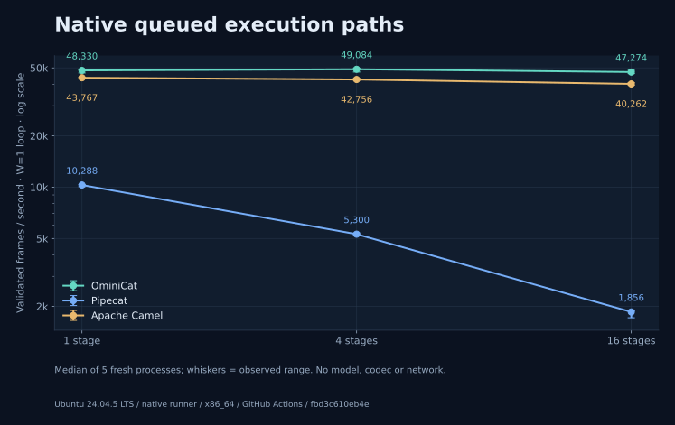
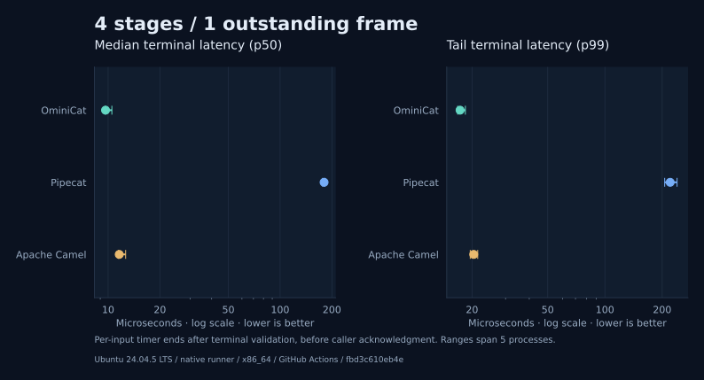
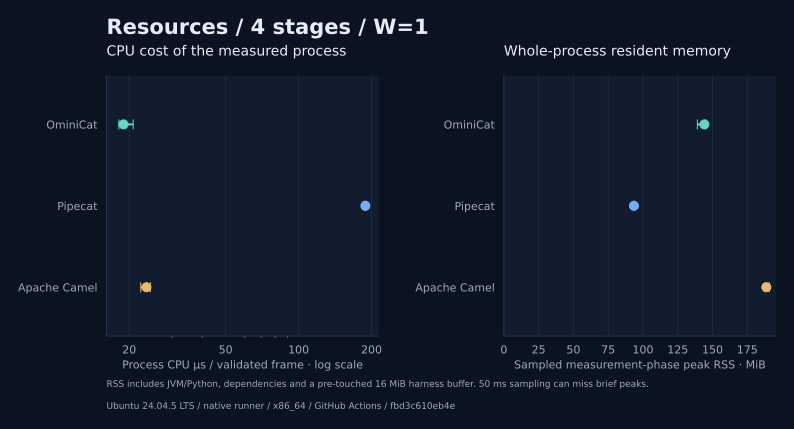

# Model-free framework comparison

Recorded 2026-10-31 on Linux / x86_64, 4 logical processors. The [manifest](manifest.json) binds every result to the protocol, measured JAR, verified installed Python dependency inventory and exact source fingerprints. All **45 fresh processes** passed output, count, rejection and cleanup checks; no failed fork was omitted.

## Linux CI environment

**Ubuntu 24.04.5 LTS / x86_64**. Native Ubuntu 24.04.5 LTS GitHub-hosted runner. Kernel: `7.0.0-1017-azure`. CPU: `AMD EPYC 9V74 80-Core Processor`. [Workflow run](https://github.com/g5n-dev/ominicat/actions/runs/41222330745); measured revision `fbd3c610eb4e2c8ad0c4bc53fcebfdb903bbb96a`. Java/Python versions, libc, affinity and readable cgroup limits are in the manifest. The three engines run sequentially within this job. Separate platform jobs use independent hosts; their measurements are not an isolated experiment on distribution/kernel differences.

## What this measures

One process, one pipeline/session, **one outstanding data frame**. Each of 1 / 4 / 16 application stages creates the same immutable numeric transformation. Throughput covers the complete client loop; terminal latency ends after output validation, before acknowledgment returns to the caller. Startup and teardown are excluded. Every process warms for 3 seconds and measures for 5 seconds. Values below are medians, followed by observed min–max ranges across five independent processes; these are **not confidence intervals**.

| Framework | Stages | Frames/s · W=1 | p50 µs | p99 µs | Peak phase RSS MiB |
| --- | ---: | ---: | ---: | ---: | ---: |
| OminiCat | 1 | 48,330.11 (46,679.12–48,620.97) | 9.87 (9.78–10.62) | 17.21 (17.03–17.98) | 127.88 (126.38–128.04) |
| Pipecat | 1 | 10,287.85 (10,064.21–10,356.62) | 90.21 (89.09–91.88) | 109.33 (106.19–120.60) | 93.45 (93.37–93.52) |
| Apache Camel | 1 | 43,766.91 (43,218.91–44,122.09) | 11.15 (11.04–12.02) | 19.74 (19.23–20.56) | 187.85 (184.67–190.53) |
| OminiCat | 4 | 49,083.83 (47,294.72–49,884.08) | 9.66 (9.64–10.52) | 17.30 (16.81–18.45) | 144.15 (139.11–145.00) |
| Pipecat | 4 | 5,299.93 (5,254.87–5,388.38) | 180.17 (176.73–181.77) | 220.35 (206.20–239.59) | 93.51 (93.43–93.57) |
| Apache Camel | 4 | 42,755.82 (42,314.73–43,459.39) | 11.60 (11.49–12.64) | 20.41 (19.57–21.42) | 188.68 (187.61–190.77) |
| OminiCat | 16 | 47,273.73 (46,287.69–48,410.62) | 10.16 (9.83–11.03) | 17.56 (16.79–17.81) | 145.89 (143.88–146.20) |
| Pipecat | 16 | 1,856.45 (1,717.31–1,883.09) | 531.39 (524.29–573.49) | 588.25 (565.80–658.88) | 93.73 (93.60–93.75) |
| Apache Camel | 16 | 40,261.62 (39,562.81–40,998.84) | 13.09 (12.87–14.28) | 24.29 (21.60–25.09) | 192.50 (175.39–202.03) |

## Profile boundaries

| Engine | Tested path | Execution scope |
| --- | --- | --- |
| OminiCat 0.1.0-SNAPSHOT | PipelineSession, capacity 1, terminal callback + caller acknowledgment queue | Java 17 platform session worker; exact source hash is in the manifest |
| Pipecat 1.15.0 | PipelineWorker / WorkerRunner, default queued FrameProcessor mode, native downstream output hook | CPython 3.12 / ordinary asyncio; explicit RTVI, turn tracking, metrics, usage, tracing and heartbeats off; native output-event dispatch remains included |
| Apache Camel 4.22.2 LTS | SEDA, size 1, one consumer, no discard, request/reply acknowledgment | Java 17 platform consumer; Exchange, Message and native request/reply costs included |

Pipecat is the multimodal frame-pipeline peer. Camel is a Java routing-framework comparison, not a voice-quality equivalent. Different runtimes, scheduler architectures, native frame metadata and public APIs remain part of each measured path. A common output oracle and W=1 limit do not make their internal queue/backpressure or lifecycle contracts identical. Pipecat's internal queues are not bounded by this experiment; the harness bounds admitted work.

The figures do not compare OminiCat's synchronous dispatch headline against another framework's queued path. They do not measure models, codecs, transport, audio quality, interruption latency, saturation or production session capacity. This controlled synthetic profile cannot establish universal framework superiority.

RSS is sampled using the same OS collector every 50 ms during measurement and includes runtime, imported dependencies and a pre-touched 16 MiB sample buffer. Java uses -Xms128m -Xmx512m; Python has no equivalent managed-heap limit. RSS is not framework-only allocation, retained heap, native footprint or B/op, and brief peaks may be missed. The shared host has no exclusive CPU isolation. Engine order rotates between repetitions; JIT, GC, host load and thermal effects remain confounders.

## Reproduce and inspect

See [benchmark instructions](https://github.com/g5n-dev/ominicat/blob/fbd3c610eb4e2c8ad0c4bc53fcebfdb903bbb96a/comparison/README.md), the [protocol](https://github.com/g5n-dev/ominicat/blob/fbd3c610eb4e2c8ad0c4bc53fcebfdb903bbb96a/comparison/protocol.md), [complete suite](suite.json) and per-process [raw JSON](raw/). Collection rejects nonzero exits, stale output, bad values, missing/duplicate cases, mixed manifests, short phases and missing resource samples. Report generation revalidates raw-result hashes before drawing.

Official sources: [Pipecat release](https://github.com/pipecat-ai/pipecat/releases/tag/v1.15.0), [queued processor source](https://github.com/pipecat-ai/pipecat/blob/v1.15.0/src/pipecat/processors/frame_processor.py), [worker source](https://github.com/pipecat-ai/pipecat/blob/v1.15.0/src/pipecat/pipeline/worker.py), [Camel 4.22.2 / Java compatibility](https://camel.apache.org/releases/release-4.22.2/), [SEDA semantics](https://camel.apache.org/components/4.22.x/seda-component.html).

## Separate instrumented diagnostics

[CPU samples, allocation stacks, GC and Python call profiles](profiles/README.md) are collected in additional runs. Their instrumented timings are excluded from the 45-process comparison above. Java JFR and Python cProfile retain their different collection scopes.
