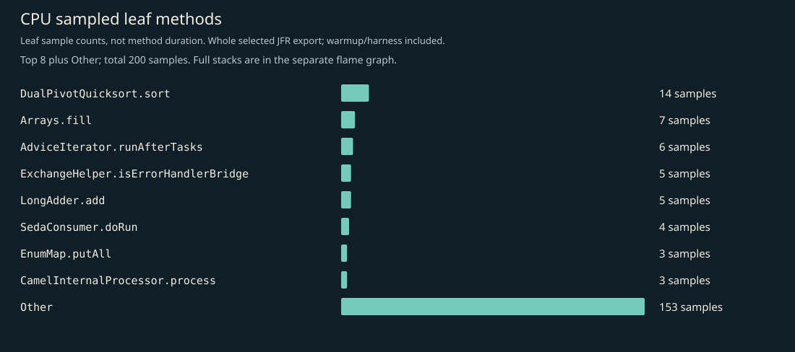
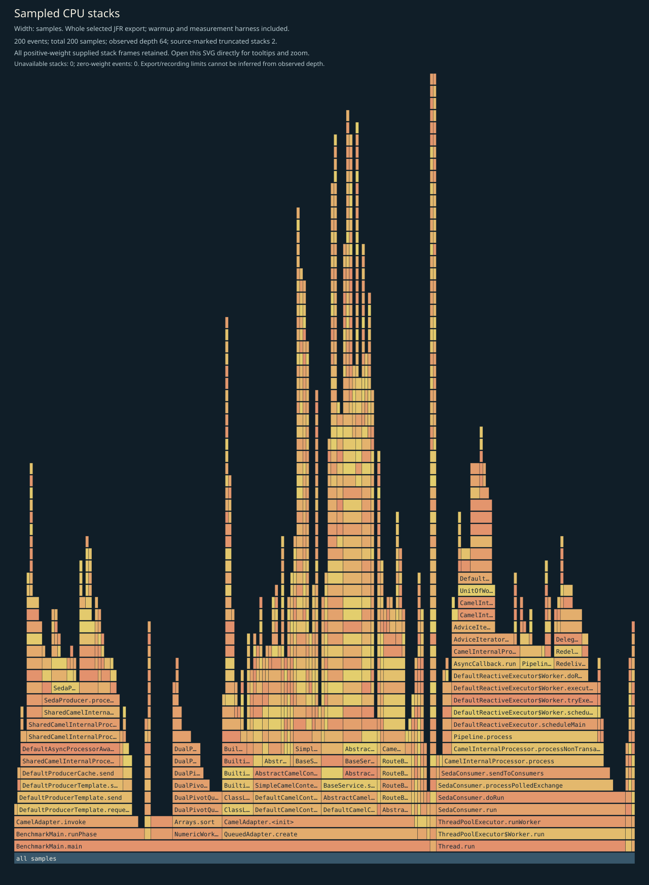
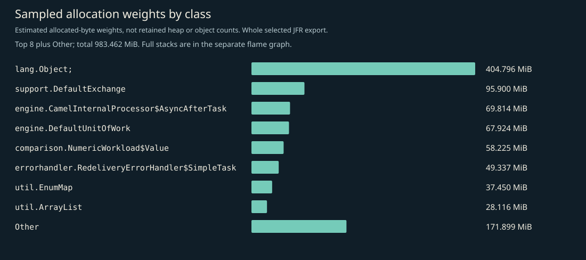
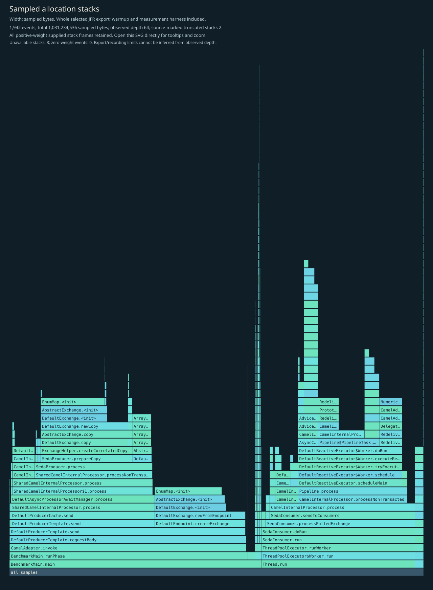
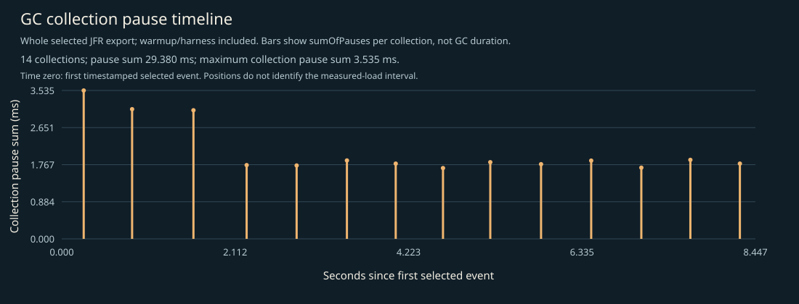

# CPU, allocation and GC profile

Whole selected recording: JVM/framework startup, setup, 3-second warmup, 5-second W=1 measurement, harness and teardown. No phase filtering. Separate profiled diagnostics; not headline timings, framework-only allocation, retained heap, or a shared cross-language bytes-per-operation axis.

## Complete supplied CPU stacks

Every positive-weight supplied stack frame is retained; zero-weight events have no area. Observed depth does not prove that the recording or export was unlimited. Source-marked truncation and unavailable stacks are shown on the figure. Open the SVG directly to inspect full method tooltips.

## CPU leaf samples

| Method | Samples |
|---|---:|
| `java.util.DualPivotQuicksort.sort` | 14 |
| `java.util.Arrays.fill` | 7 |
| `org.apache.camel.impl.engine.AdviceIterator.runAfterTasks` | 6 |
| `org.apache.camel.support.ExchangeHelper.isErrorHandlerBridge` | 5 |
| `java.util.concurrent.atomic.LongAdder.add` | 5 |
| `org.apache.camel.component.seda.SedaConsumer.doRun` | 4 |
| `java.util.EnumMap.putAll` | 3 |
| `org.apache.camel.impl.engine.CamelInternalProcessor.process` | 3 |
| `java.util.concurrent.locks.AbstractQueuedSynchronizer.acquire` | 3 |
| `org.apache.camel.support.DefaultExchange.setUnitOfWork` | 3 |
| `org.apache.camel.impl.engine.DefaultReactiveExecutor$Worker.executeReactiveWork` | 3 |
| `org.apache.camel.processor.errorhandler.RedeliveryErrorHandler$SimpleTask.run` | 3 |

## Sampled allocation weights

Weights estimate sampled allocation distribution, not retained heap or exact object counts. The harness retains an exact latency array; its `long[]` allocation is intentionally visible. No per-operation allocation estimate is inferred from this recording.

| Class | Sampled weight (MiB) |
|---|---:|
| `[Ljava.lang.Object;` | 404.80 |
| `org.apache.camel.support.DefaultExchange` | 95.90 |
| `org.apache.camel.impl.engine.CamelInternalProcessor$AsyncAfterTask` | 69.81 |
| `org.apache.camel.impl.engine.DefaultUnitOfWork` | 67.92 |
| `io.ominicat.comparison.NumericWorkload$Value` | 58.22 |
| `org.apache.camel.processor.errorhandler.RedeliveryErrorHandler$SimpleTask` | 49.34 |
| `java.util.EnumMap` | 37.45 |
| `java.util.ArrayList` | 28.12 |
| `org.apache.camel.support.DefaultMessage` | 24.88 |
| `[Ljava.util.concurrent.ConcurrentHashMap$Node;` | 19.67 |
| `[J` | 16.00 |
| `java.util.concurrent.locks.ReentrantLock$NonfairSync` | 13.13 |

## Complete supplied allocation stacks

## GC and contention

- Garbage collections recorded: 14.
- Recorded GC pause sum: 29.380 ms; longest collection pause sum: 3.535 ms.
- Monitor contention events: 0; virtual-thread pinning events: not available on this runtime.
- GC positions are relative to the first timestamped selected event, not the measured-load start. The figure includes warmup/harness events. Collection pause sums are not whole GC durations.
- Zero sampled events does not prove absence. Sampling, event thresholds and workload duration limit these observations.

Evidence: [selected events, gzip JSON](jfr-events.json.gz), [measurement report](report.md).
Raw JFR is generated locally and intentionally excluded from Git; do not record real credentials or conversation payloads for public profiling.

[GC pause timeline](gc-pauses.svg).
