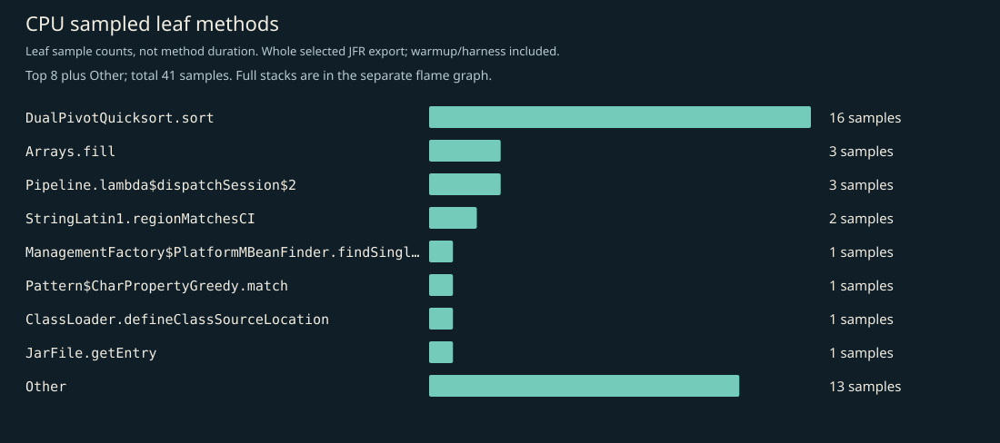
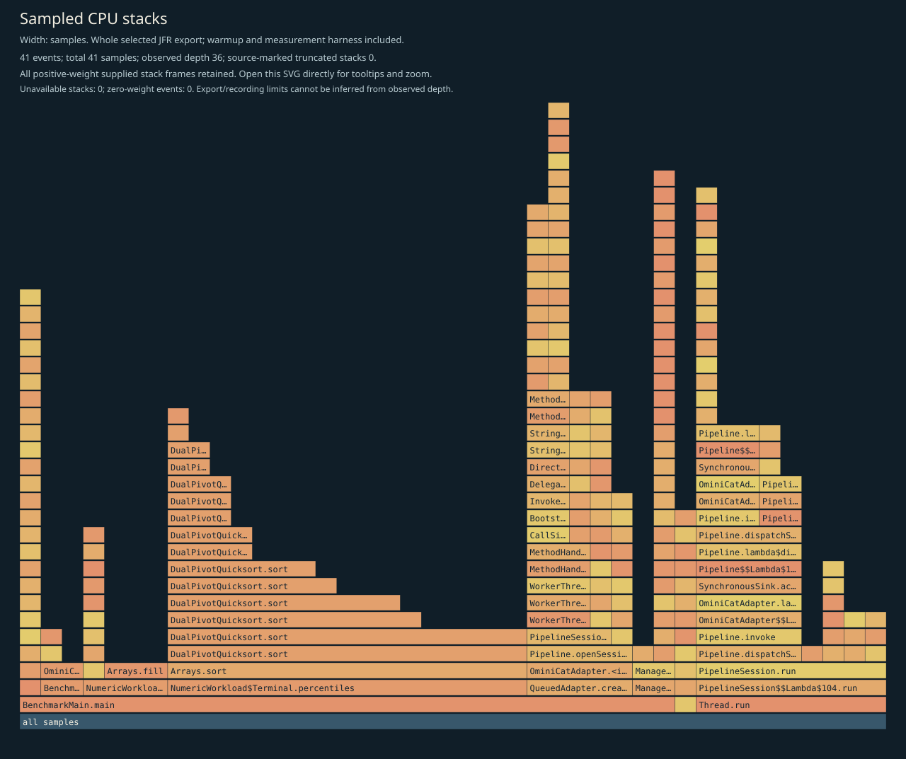
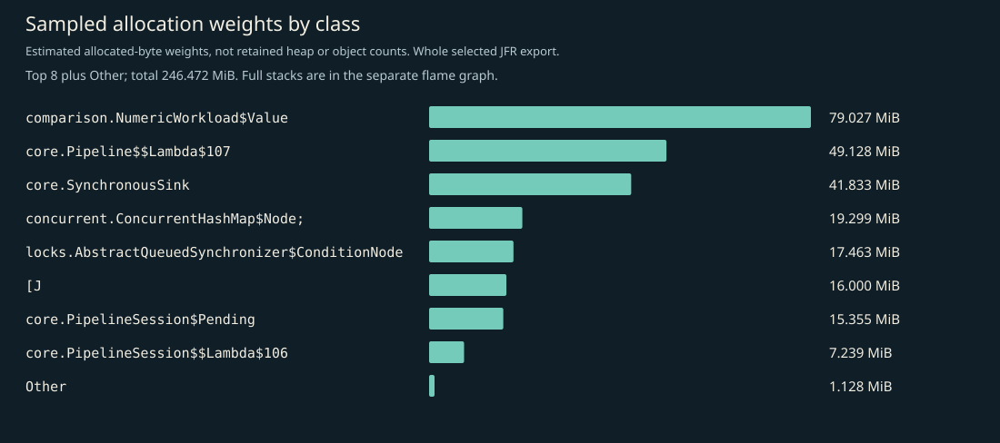
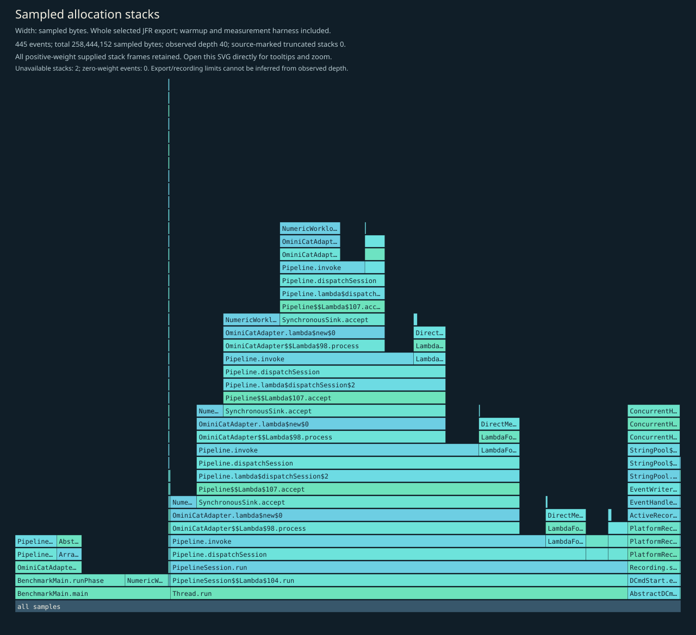
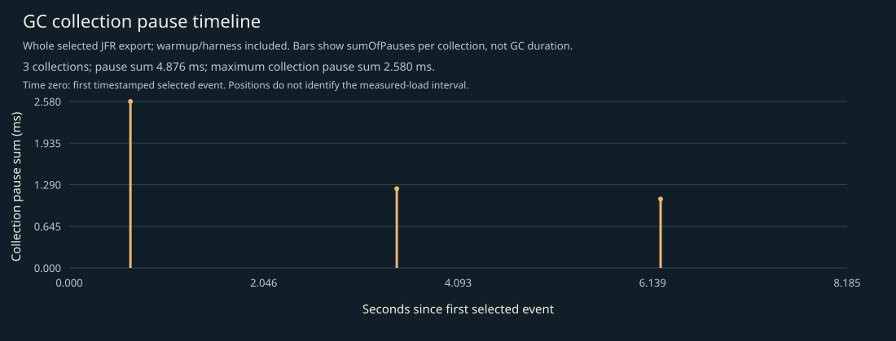

# CPU, allocation and GC profile

Whole selected recording: JVM/framework startup, setup, 3-second warmup, 5-second W=1 measurement, harness and teardown. No phase filtering. Separate profiled diagnostics; not headline timings, framework-only allocation, retained heap, or a shared cross-language bytes-per-operation axis.

## Complete supplied CPU stacks

Every positive-weight supplied stack frame is retained; zero-weight events have no area. Observed depth does not prove that the recording or export was unlimited. Source-marked truncation and unavailable stacks are shown on the figure. Open the SVG directly to inspect full method tooltips.

## CPU leaf samples

| Method | Samples |
|---|---:|
| `java.util.DualPivotQuicksort.sort` | 16 |
| `java.util.Arrays.fill` | 3 |
| `io.ominicat.core.Pipeline.lambda$dispatchSession$2` | 3 |
| `java.lang.StringLatin1.regionMatchesCI` | 2 |
| `java.lang.management.ManagementFactory$PlatformMBeanFinder.findSingleton` | 1 |
| `java.util.regex.Pattern$CharPropertyGreedy.match` | 1 |
| `java.lang.ClassLoader.defineClassSourceLocation` | 1 |
| `java.util.jar.JarFile.getEntry` | 1 |
| `java.lang.invoke.InvokerBytecodeGenerator.clinit` | 1 |
| `jdk.internal.org.objectweb.asm.Frame.execute` | 1 |
| `java.util.ImmutableCollections$SetN.iterator` | 1 |
| `io.ominicat.core.PipelineSession$$Lambda$106+0x00007fe69c00e648.1824005787.<init>` | 1 |

## Sampled allocation weights

Weights estimate sampled allocation distribution, not retained heap or exact object counts. The harness retains an exact latency array; its `long[]` allocation is intentionally visible. No per-operation allocation estimate is inferred from this recording.

| Class | Sampled weight (MiB) |
|---|---:|
| `io.ominicat.comparison.NumericWorkload$Value` | 79.03 |
| `io.ominicat.core.Pipeline$$Lambda$107+0x00007fe69c00e870.344576214` | 49.13 |
| `io.ominicat.core.SynchronousSink` | 41.83 |
| `[Ljava.util.concurrent.ConcurrentHashMap$Node;` | 19.30 |
| `java.util.concurrent.locks.AbstractQueuedSynchronizer$ConditionNode` | 17.46 |
| `[J` | 16.00 |
| `io.ominicat.core.PipelineSession$Pending` | 15.35 |
| `io.ominicat.core.PipelineSession$$Lambda$106+0x00007fe69c00e648.1824005787` | 7.24 |
| `java.lang.invoke.MethodType` | 0.38 |
| `[B` | 0.38 |
| `java.lang.String` | 0.37 |
| `java.util.concurrent.CopyOnWriteArrayList$COWIterator` | 0.00 |

## Complete supplied allocation stacks

## GC and contention

- Garbage collections recorded: 3.
- Recorded GC pause sum: 4.876 ms; longest collection pause sum: 2.580 ms.
- Monitor contention events: 0; virtual-thread pinning events: not available on this runtime.
- GC positions are relative to the first timestamped selected event, not the measured-load start. The figure includes warmup/harness events. Collection pause sums are not whole GC durations.
- Zero sampled events does not prove absence. Sampling, event thresholds and workload duration limit these observations.

Evidence: [selected events, gzip JSON](jfr-events.json.gz), [measurement report](report.md).
Raw JFR is generated locally and intentionally excluded from Git; do not record real credentials or conversation payloads for public profiling.

[GC pause timeline](gc-pauses.svg).
