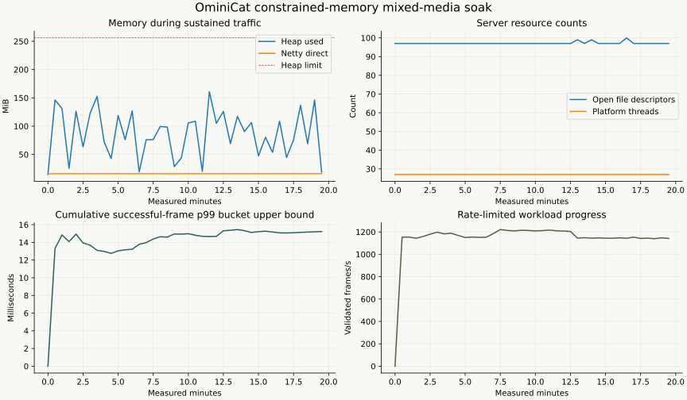

# Deep verification report

Recorded on **2026-10-31, Asia/Shanghai**. This report separates completed verification from work that has not yet produced a result. Inputs are generated test data; no production conversations are used.

**Completed:** 232 tests passed with zero failures, errors or skips, including 512-seed kernel stress tests, independent state/media oracles and real local TCP/HTTP/WebSocket fault fixtures. [Java21/25 and container CI](https://github.com/g5n-dev/ominicat/actions/runs/41175697513) passed. Two earlier native transport resource runs completed for 180 seconds and 60 seconds respectively, on their identified source variant.

**Completed — final-distribution sustained run:** 60 seconds of warmup followed by **1,200.174 measured seconds**, **1,405,303 validated frames**, **42,729 new connections**, **zero unexpected failures**, and complete session/worker/output drain. All eleven predeclared numeric checks passed.

**PENDING — live compatible service:** the test endpoint, credential environment-variable name and model configuration have not been supplied. No live-service request or successful live-provider result is recorded.

Hardware/toolchain details are recorded in the [environment manifest](environment.json).

## Evidence and provenance

| Artifact | Purpose |
| --- | --- |
| [Verification results](verification.json) | Per-module test and coverage counters |
| [Frozen source and artifact manifest](frozen-artifact.json) | Distribution SHA-256 and the production files used to build it |
| [Sustained-run summary](soak-summary.json) | Completed duration, counters, drain checks and retained-resource observations |
| [Sustained resource plot](soak-resources.svg) | Completed resource samples and latency/rate timeline |
| [Kernel measurement report](kernel/report.md) | Separate dispatch/allocation measurements and their reproduction conditions |
| [Dependency audit](dependency-audit.json) | Recorded versioned dependency queries and returned advisory matches |
| [Static analysis](static-analysis.json) | Final-source findings and retained review dispositions |

The artifact reserved for the final sustained run has SHA-256:

```text
081520dcc8c78baea46c013f78a3be0878bcba1c24789bce3b8c6c535710978f
```

Its production-source aggregate SHA-256 is `f960008e9dd2b7a9da3eb2d8b934851f191e8d1d63c2ca546e51972797bc014d`. The recorded hardening sources match revision `f66c2d5af76d9d19c997f41bcd0292aafb1434c7` file by file. The manifest also retains the pre-hardening base revision. Incremental repackaging changed ZIP entry order; all 3,906 entry contents and metadata remained identical. The measured JAR itself is retained unchanged under the stated SHA-256. Evidence from earlier source variants is labeled separately and cannot substitute for a completed run of this artifact.

## Complete test verification

The clean whole-repository verification completed with kernel stress repetition set to 512 seeds. [GitHub CI](https://github.com/g5n-dev/ominicat/actions/runs/41175697513) also passed on Java 21 and 25, including container lifecycle/authentication and a smoke run of the validation driver. Coverage describes the paths exercised in that run; it is not a probability of correctness.

| Module | Tests | Failures / errors / skips | Covered lines | Covered branches |
| --- | ---: | --- | ---: | ---: |
| Core | 80 | 0 / 0 / 0 | 617/655 — 94.20% | 322/400 — 80.50% |
| Conversation | 40 | 0 / 0 / 0 | 416/434 — 95.85% | 297/360 — 82.50% |
| Providers | 55 | 0 / 0 / 0 | 359/363 — 98.90% | 282/314 — 89.81% |
| Server | 57 | 0 / 0 / 0 | 463/498 — 92.97% | 296/370 — 80.00% |
| **Total** | **232** | **0 / 0 / 0** | | |

Builds used isolated source snapshots and their own output directories. They did not replace classes underneath a running validation process. Deliberately failing controls against the original implementation are retained as regression evidence and are not counted as successful verification.

### Kernel scheduling, ownership and lifetime

The 512-seed kernel run executed **1,572,864 selected randomized operations**, plus 1,024 terminal-resource scenarios and 512 fork/join cases. Independent models check bounded admission, FIFO behavior, accepted-frame accounting, interruption generations, terminal outcomes, ordered joins and resource ownership. Callback scenarios cover both raw and metadata-preserving envelope adapters.

Reachability regressions deliberately retain invalid callbacks and verify that terminated input/output, delegate and ID-supplier graphs can be collected. A separate check keeps an active callback reachable with virtual-thread tracking disabled. No reachability check was skipped in the recorded run. Random seeds reproduce operation selection, not an exact JVM thread schedule.

See [core adversarial verification](../../ominicat-core/DEEP_VERIFICATION.md) for seeds, failure controls and reproduction commands.

### Provider, media and conversation oracles

The local fault matrix includes 42 Unicode SSE fragmentation/line-ending combinations, all 65 premature byte cuts before the completion marker, malformed UTF-8/JSON, response limits, ten non-success HTTP statuses, redirects, slow headers, stalled text/audio bodies and a literal TCP reset after partial output. A deterministic fixture unblocks EOF while deadline cleanup is still running, checking that timeout cannot become a successful partial response.

Independent generated cases include:

- **352,000 transcript-gate operations** over 32,000 segments, with shuffled revisions, duplicate/stale input and conflicting final commits.
- **32,000 conversation turns**, with 3,200 interval/window comparisons against discrete-time occupancy bitsets and snapshot restoration.
- **1,440 PCM frames and 108 WAV requests** across three tracks. Exact bytes and format headers are checked against separate track buffers; timeline conversion uses an independent `BigInteger` oracle.
- **1,000 evidence locations**, checking the committed segment, role, time interval and matching excerpt.
- **250 completed HTTP requests** with long configured deadlines, checking immediate timeout-task retirement and bounded descriptor growth where the JVM exposes descriptor counts.

The 19 fault/oracle test methods were repeated three additional times without failure. These generated-case counts are distinct from JUnit test-method counts. See the [provider/conversation matrix](../../ominicat-providers/DEEP_VERIFICATION.md) for exact seeds and commands.

## Reproduced defects and corrections

| Area | Reproduced failure or verified gap | Correction and retained check |
| --- | --- | --- |
| Synchronous emissions | Captured sinks could emit after return, on a foreign thread or during a later invocation | Per-invocation thread/lifetime boundaries; invalid handles detach downstream references |
| Composition | A failed primary or finished branch could reuse its captured sink; parallel close could allow later joined delivery | Scoped child sinks, cancellation checks between deliveries and explicit ownership rules |
| Cleanup | One child's `Error` could skip other owned resources; duplicate stage identities could close a resource twice | Complete cleanup aggregation, fatal-error preservation, idempotent composite close and duplicate-identity rejection |
| Retired callbacks | Retained raw/envelope callback objects kept terminated session, payload or adapter graphs reachable | Weak session ownership and terminal detachment, checked with retained-callback reachability tests |
| WebSocket admission | Closing a socket released its session slot while a noncooperative worker was still alive | Retain admission until both socket closure and worker cleanup complete |
| Slow consumers | An unflushable close frame could strand admission; Pong writes bypassed output budgeting | Immediate cooperative cancellation, two-second forced socket close and shared data/control output budgeting |
| Raw sockets | HTTP and incomplete-handshake sockets were outside WebSocket admission | A separate finite connection cap before HTTP handler allocation |
| Server factory ownership | Startup/session factory or cleanup `Error` skipped already-created processors | Attempt all owned cleanup; preserve fatal startup errors and sanitize connection initialization failure |
| Loopback authority | A native connection with matching attacker-controlled Host and Origin was accepted without a token | Reject non-loopback authorities on unauthenticated loopback listeners; six native regressions include IPv6 |
| SSE decoding | Valid CR-only events failed; malformed UTF-8 was silently replaced | Support LF/CRLF/CR and an initial BOM; reject malformed UTF-8 |
| Response bounds and deadlines | Decoding and cancellation required explicit byte/timeout ownership boundaries | Count raw bytes before decoding; mark expiry before body close; remove canceled timeout tasks immediately |
| Restored state | Revision overflow partially advanced a flow; eviction counts could wrap negative | Check increments before mutation and preserve the prior snapshot on failure |

The original kernel regression control reported 13 failures and one error across 16 tests. The initial four native server controls reported three failures. The four provider/conversation failure controls also failed before their corrections. These observations establish specific reproduced defects, not an exhaustive inventory of every possible defect.

The authority test proves transport-level acceptance and its correction; it does **not** demonstrate a browser DNS-rebinding exploit. Token-configured deployments retain their authentication boundary. No test extracted provider credentials or another socket's conversation.

## Completed native transport resource runs

These earlier runs use the source hashes documented in the [server verification report](../../ominicat-server/DEEP_VERIFICATION.md). They precede the final loopback Host hardening and must remain distinct from the final-distribution run below.

| Workload or result | 180-second run | 60-second task-sampling run |
| --- | ---: | ---: |
| Actual measured duration | 180.441 s | 60.473 s |
| Concurrent native clients | 16 | 16 |
| Total connection-rate limit | 100/s | 100/s |
| Successful connection/exchange/disconnection cycles | 17,248 | 5,744 |
| Ping/Pong exchanges | 2,464 | 816 |
| Deliberate nonreading TCP consumers | 60 | 20 |
| Unexpected failures / admission rejections | 0 / 0 | 0 / 0 |
| Reported Netty leak warnings | 0 | 0 |

Both used PARANOID Netty leak detection and a 512 MiB maximum heap. Pooled direct reservation remained at 16 MiB. In the 180-second run, sampled descriptors ranged from 58 to 92 and platform threads from 31 to 35; final samples were 58 and 31 respectively. Connections, active sessions, admission slots, workers and pending output all drained to zero.

The separate task-sampling run observed 0–5 queued worker event-loop tasks and 0–15 scheduled tasks, both returning to zero after drain. Heap samples include temporary objects awaiting collection and must not be described as retained heap. An earlier unpaced client generator exhausted local ephemeral ports; that unsuccessful run is excluded from passing-soak and throughput claims.

## Completed final-distribution sustained run

| Requested condition | Configuration |
| --- | --- |
| Warmup | 60 seconds |
| Measured interval | 1,200 seconds |
| Steady clients | 64, approximately 20 frames/s each |
| Connection churn | Four additional workers, with a 100 ms pause between cycles |
| Server heap / direct-memory limit | 256 MiB / 128 MiB |
| Instrumentation | PARANOID Netty leak detection, JFR, resource/GC samples and source/artifact hashes |
| Payloads | Text, PCM audio, final transcripts, encoded images and causal envelopes |
| Actual measured duration / validated frames / new connections | **1,200.174 s / 1,405,303 / 42,729** |
| Failure/progress/drain outcome | **0 failures; every client progressed; owned resource gauges all zero after drain** |
| Steady exchange p50 / p95 / p99 | **7.382 / 10.498 / 15.260 ms**, histogram bucket upper bounds |

The driver checks serialized payloads and envelope causation/correlation, session/turn identities, timing preservation and event-ID derivation. Each client must make progress. Completion requires zero recorded failures and bounded polling until active sessions, retained admission, live workers and pending output bytes have drained. A metrics request itself is a transport connection and is not mistaken for a leaked WebSocket.

This is a paced, closed-loop correctness/resource workload, not a saturation benchmark. Churn exchange latency excludes handshake time. The completed [summary](soak-summary.json), [numeric samples](soak-samples.jsonl) and [resource plot](soak-resources.svg) apply to the stated artifact. Latency includes leak-detection/profiling overhead and response validation on a shared development host; it is not a production SLA.



The measured frames comprised 1,011,623 text frames, 210,900 audio frames, 140,600 transcripts, 28,120 images and 14,060 causal envelopes. Per-type and latency counts balance to the successful total. Churn exchanges had p99 **4.883 ms**, excluding handshake time. The maximum steady exchange was **135.484 ms**; the tail is retained rather than discarded.

| Retained/resource observation | After warmup | After drain |
| --- | ---: | ---: |
| Heap used after requested full GC | 13.566 MiB | 7.173 MiB |
| Netty direct reservation | 16 MiB | 16 MiB |
| Open file descriptors | 97 | 33 |
| Platform threads | 27 | 27 |
| Active/admitted sessions, live workers, pending output | Traffic active | All zero |

The [post-drain class histogram summary](resource-diagnostics.json) found zero selected PipelineSession, callback-handle, synchronous-sink, audio/image/envelope and WebSocket-handler instances. Factory singletons and server infrastructure remain expected. These are selected reachability/resource observations, not a proof of all possible leaks. No Netty leak warnings were observed. The driver also passed [negative controls](harness-controls.json): deliberately corrupted replies and a service returning no progress both failed as required.

The JFR recording covers **1,345 seconds** of whole-process execution, including startup, warmup, measured traffic, drain and diagnostics. See [event summary](soak-jfr-summary.txt), [sampled hot methods](soak-hot-methods.txt), [sampled allocation classes](soak-allocation-by-class.txt) and [GC pauses](soak-gc-pauses.txt). Class-histogram diagnostics request additional GC; those events remain in the recording. Raw JFR stays local. Native Memory Tracking reported **502.247 MiB committed** (7.065 MiB below its earlier diagnostic baseline), including the fixed 256 MiB heap, JVM threads/code/GC/metadata and profiling. This is neither RSS nor a 256 MiB total-process memory claim. The full native category breakdown is retained in the diagnostics JSON.

The separate [kernel report](kernel/report.md) measures 4-stage direct dispatch at 40.01 million operations/s and session round trips at 8.229 µs/op. The [historical comparison](kernel/comparison.md) openly records increased allocation with invocation guards and lower direct-dispatch throughput; shared-host runs do not isolate causality. Correctness checks are not represented as free.

## Dependency and static-analysis review

The recorded OSV batch query checked **13 versioned third-party coordinates** and returned **zero matching advisories** on 2026-10-31. This is an as-of database result for that recorded set, not proof that the software or its dependencies have no vulnerabilities. The [audit](dependency-audit.json) retains package versions and query provenance.

The completed final-source SpotBugs scan used maximum effort and a low reporting threshold. It reported **23 findings: zero high, five medium and eighteen low**, with no analysis errors or missing classes. The [recorded review](static-analysis.json) explains intentional registry synchronization, checked-exception SPI boundaries, ownership-aware cleanup and overflow validation. Warnings remain visible; they were not suppressed to manufacture a zero-warning result. The scanned entry contents are verified equal to the measured artifact. No analysis errors or missing classes were reported.

## PENDING — live compatible-service verification

No endpoint, usable test credential environment-variable name or model configuration is available. Consequently there is no external-service success result to report.

The opt-in probe is limited to one request per configured capability, with short generated inputs and bounded responses: an exact text marker, a solid-color image, a short local speech fixture and short speech synthesis. It records checks, lengths/hashes and numeric audio measurements rather than raw provider text, endpoint details or credentials. The speech output check verifies PCM size and non-silence; it does not establish intelligibility or acoustic quality. Successful local HTTP fixtures do not substitute for this pending live check.

## Reproduction and interpretation

Run the complete suite in an isolated checkout with Java 21+:

```sh
./mvnw -B -Pcoverage,sbom -Dominicat.stress.seeds=512 clean verify
```

The [validation drivers](../../validation/README.md) document the sustained and opt-in live commands. Module reports above contain the deterministic seeds, focused fault commands and original failure controls. The [kernel report](kernel/report.md) separately documents profiling workloads; kernel dispatch numbers must not be presented as network or model response latency.

This evidence does not prove exhaustive concurrency safety, freedom from all leaks or vulnerabilities, multi-day stability, model accuracy, production capacity or an SLA. Cancellation is cooperative and cannot revoke an external effect already entered. Payload size, session count and queue capacity must be considered together; bounded frame counts are not a universal machine-memory limit. Custom plugins own their behavior, deadlines and external side effects. Durable delivery, crash recovery, automatic speaker diarization and continuous provider-native ASR/TTS remain outside the included adapters' demonstrated capabilities.
