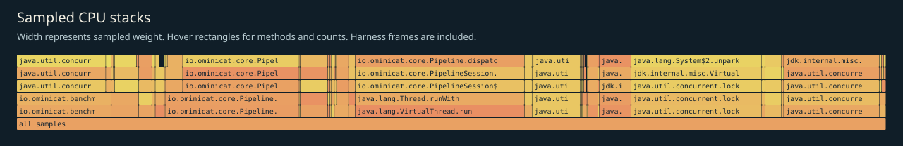
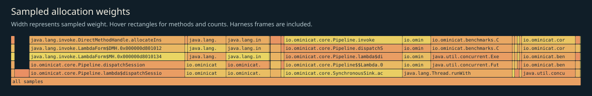

# CPU, allocation and GC profile

Generated from the selected JFR events for the bounded kernel load. Samples include the load harness, warmup and exact-percentile sorting; they are not a model or network profile. The host concurrently ran a rate-limited64steady+4churnclient correctness soak.

## CPU leaf samples

| Method | Samples |
|---|---:|
| `io.ominicat.core.Pipeline.dispatchSession` | 166 |
| `java.lang.System$2.unparkVirtualThread` | 122 |
| `io.ominicat.core.PipelineSession.valid` | 106 |
| `jdk.internal.misc.Unsafe.getAndBitwiseAndInt` | 87 |
| `java.util.concurrent.CountDownLatch$Sync.tryReleaseShared` | 81 |
| `java.util.DualPivotQuicksort.sort` | 58 |
| `java.lang.VirtualThread.parkNanos` | 29 |
| `java.util.concurrent.locks.ReentrantLock$Sync.lock` | 26 |
| `java.lang.Thread.interrupted` | 23 |
| `java.lang.VirtualThread.unpark` | 15 |
| `java.util.concurrent.Semaphore.release` | 14 |
| `io.ominicat.benchmarks.CoreLoad.lambda$runPhase$4` | 11 |

## Sampled allocation weights

Weights estimate sampled allocation distribution, not retained heap or exact object counts. The harness retains an exact latency array; its `long[]` allocation is intentionally visible. Use JMH `gc.alloc.rate.norm` for per-operation allocation estimates.

| Class | Sampled weight (MiB) |
|---|---:|
| `io.ominicat.core.Pipeline$$Lambda.0x000000d80100cac8` | 2,902.08 |
| `io.ominicat.core.SynchronousSink` | 2,139.99 |
| `io.ominicat.benchmarks.CoreLoad$Probe` | 1,192.09 |
| `io.ominicat.core.PipelineSession$Pending` | 783.80 |
| `io.ominicat.core.PipelineSession$$Lambda.0x000000d80100b958` | 575.02 |
| `[J` | 211.19 |
| `java.util.concurrent.locks.AbstractQueuedSynchronizer$ExclusiveNode` | 202.38 |
| `java.util.concurrent.ScheduledThreadPoolExecutor$ScheduledFutureTask` | 68.58 |
| `java.util.concurrent.locks.AbstractQueuedSynchronizer$SharedNode` | 53.34 |
| `java.util.concurrent.locks.AbstractQueuedSynchronizer$ConditionNode` | 40.30 |
| `java.lang.VirtualThread$$Lambda.0x000000d80103eaf0` | 38.57 |
| `java.util.concurrent.Executors$RunnableAdapter` | 33.88 |

## GC and contention

- Garbage collections recorded: 30.
- Recorded GC pause sum: 37.279 ms; longest collection pause sum: 4.496 ms.
- Monitor contention events: 0; virtual-thread pinning events: 0.
- Zero sampled events does not prove absence. Sampling, event thresholds and workload duration limit these observations.

Evidence: [selected events, gzip JSON](jfr-events.json.gz), [GC log](gc.txt), [measurement report](report.md).
Raw JFR is generated locally and intentionally excluded from Git; do not record real credentials or conversation payloads for public profiling.
