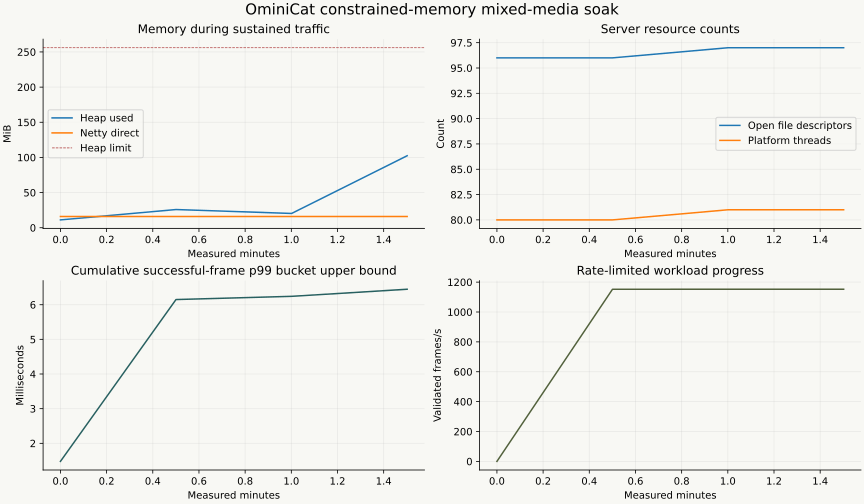

# Java 17 compatibility verification

This records the initial Java 17 compatibility artifact (preview.3). The subsequent [HTTP-body cancellation correction](http-cancellation/README.md) has separate source, test and distribution evidence.

Recorded on **2026-10-31, Asia/Shanghai**. Java 17 is the build/runtime baseline for every module; Java 21+ selects virtual workers automatically. Inputs are synthetic local fixtures. No external model service was called.

## Whole-project verification

A clean reactor build ran on **Homebrew OpenJDK 17.0.21.0.3**, macOS/aarch64, with 512 kernel stress seeds:

```sh
./mvnw -B -ntp -Pcoverage,sbom -Dominicat.stress.seeds=512 clean verify
```

**244 tests passed, zero failures, errors or skips.** The full regression suite was preserved; nine new kernel cases check backend selection, bounded execution, rejection, drain, interruption, discarded task ownership and `ExecutorCompletionService` wrappers. An additional real WebSocket test checks the worker backend and post-disconnect cleanup. [Counters](verification.json) · [Sanitized build output](verification.txt).

| Module | Tests | Failures / errors / skips | Line coverage | Branch coverage |
| --- | ---: | --- | ---: | ---: |
| `ominicat-core` | 89 | 0 / 0 / 0 | 92.34% | 79.67% |
| `ominicat-conversation` | 40 | 0 / 0 / 0 | 95.85% | 82.50% |
| `ominicat-providers` | 57 | 0 / 0 / 0 | 98.91% | 89.81% |
| `ominicat-server` | 58 | 0 / 0 / 0 | 93.04% | 80.37% |

Independent module runs also passed core **89/89** and server **58/58** on both Java 17 and 21. The [CI matrix](https://github.com/g5n-dev/ominicat/actions/workflows/ci.yml) runs the full suite and validation tools on Java **17, 21 and 25**. The container job checks that the default image actually reports Java 17. Protected `main` requires all five named checks; the PR checks provide the final merge gate.

## Runtime and bytecode scope

The final server JAR was built and run on Java 17. SHA-256:

```text
370e4e056d2336526ffe5f4975470671b195235eeb43623efed873bc2e32883e
```

The [artifact/source manifest](frozen-artifact.json) records every production source/resource and POM. Its source aggregate is `1d5f10c841306ca5871ada654e8ff72aae10604f20b893490e93a7237e2cb69b`. All **3,611 base classes** in the shaded JAR are Java 17-compatible: 91 at classfile major 61, 2,159 at 50 and 1,361 at 52. Versioned multi-release entries are outside this base-class scan. A single delivery-worker Javadoc line was corrected after measurement. The manifest retains both source hashes; rebuilding after that comment change produced identical contents for every JAR entry, so the measured artifact is retained unchanged. Actual Java 17 execution complements that structural check. The [exact same Java 17-built JAR also ran on Java 21](java21-artifact-smoke.json), without recompilation: 10.000 measured seconds, 1,056 validated mixed-media frames, 352 new connections, zero failures, virtual workers and complete owned-resource drain.

`WorkerThreads` uses named daemon platform threads on Java 17, and discovers a public virtual-thread factory on Java 21+. Reflection stays outside frame dispatch. Branch executors have explicit worker and queue bounds on both backends. Cancellation generations, synchronous-sink lifetimes, serial session ownership and reverse cleanup remain covered by the regression suite. The [compatibility guide](../../docs/java-compatibility.md) explains deployment/thread-budget implications.

## Exact-artifact mixed-media resource run

The JAR above completed **120.118 measured seconds**, following ten seconds of warmup, with 64 persistent clients at approximately 20 frames/s plus four paced churn workers. It used a 256 MiB heap, 128 MiB direct-memory limit, PARANOID Netty leak detection, JFR and Native Memory Tracking. JFR and diagnostics are local test overhead, not production defaults.

- **138,388 validated frames**, **4,395 new measured connections**, **zero unexpected failures**.
- Text, PCM audio, transcripts, encoded images and causal envelopes were checked against their serialized input. All clients progressed; all frame-type and latency counters balanced.
- All eleven [predeclared checks](soak-criteria.json) passed. Sessions, retained admission, pipeline workers and pending output drained to zero.
- Steady p50/p95/p99: **0.778 / 3.293 / 6.149 ms**, histogram bucket upper bounds; maximum 52.465 ms. Churn exchange p99 was 2.667 ms, excluding handshake time.

| Server resource | After warmup | After drain |
| --- | ---: | ---: |
| Heap used after requested full GC | 11.159 MiB | 7.718 MiB |
| Netty pooled direct reservation | 16 MiB | 16 MiB |
| Open descriptors | 96 | 33 |
| JDK platform-thread count | 80 | 17 |

Platform workers appear in Java 17's thread count; this differs from virtual-worker accounting on newer JDKs. A metrics request itself accounts for the remaining transport connection. The post-drain class histogram found zero selected session, callback/sink, audio/image/envelope and WebSocket-handler instances. No Netty leak warning was observed. These finite observations do not prove absence of every possible leak.

NMT reported **484.589 MiB committed** after drain, including the fixed heap, thread stacks, JVM internals and profiling. This is **not RSS** or a 256 MiB total-process memory claim. Its diff baseline was captured during measured traffic, not exactly at warmup end. The whole JFR recording also includes startup, warmup, drain, idle and diagnostic collections; its 153 GC events are not confined to the 120-second interval. The longest collection pause sum in that recording was 12.176 ms.

[Summary](soak-summary.json) · [Numeric samples](soak-samples.jsonl) · [Diagnostics](resource-diagnostics.json) · [JFR event counts](soak-jfr-summary.txt).



The timeline shows periodic samples during traffic; post-drain values are tabulated separately. This was a paced, closed-loop correctness/resource workload on a shared development host, concurrently used for profiling and other verification. It is not a saturation benchmark, production SLA or multi-day stability test.

## Additional affected-path checks

| Probe | Completed result | Provenance |
| --- | --- | --- |
| Held-open CR-only HTTP stream on Java 17 | 60.063 s; all 6,000 Unicode chunks exact, ordered and observed before the following write; DONE completes without producer EOF | [Result](sse-cr-streaming.json), [runtime/source/commands](sse-metadata.json) |
| Native TCP on Java 17 | 60.584 s; 5,753 cycles, 816 Ping/Pong exchanges, 20 nonreading consumers; zero failures/rejections and complete resource drain | [Result](native-soak-60s.json), [source variant](native-provenance.json) |

The native run used an earlier `WorkerThreads` direct-Future cancellation implementation; server production files and the worker factory matched the final implementation. Its [full source manifest](native-source-sha256.json) retains that difference. It is not relabeled as a run of the final JAR. The exact final artifact has the separate whole-project and mixed-media evidence above.

## Java 17 CPU, allocation and scheduling profiles

The [kernel report](kernel/report.md) records a real two-fork JMH run, GC allocation measurements and 25 million bounded load frames. Four-stage synchronous dispatch measured **40.536 million ops/s at 328 B/op**; one-outstanding-frame session round trips measured **7.104 microseconds/op**. The separate 16-session load completed 25 million measured frames with zero rejection, at 2.706 million frames/s and p99 1,436.041 microseconds.

These are distinct workloads, with different timing scopes. Shared-host execution does not establish a causal Java 17 versus Java 21 comparison. [CPU/allocation flame graphs and GC](kernel/profiles.md) retain the load harness and latency-array costs. Java 17 does not provide the virtual-thread pinning event; the report marks it unavailable.

## Reproduction and limits

Build on JDK 17 as above, then follow the [validation guide](../../validation/README.md). For the Java 17 resource regression, use 120 measured seconds, ten seconds of warmup and 64 clients, then analyze with:

```sh
python validation/summarize.py reports/local/java17/soak reports/local/java17/analysis validation/java17-soak-criteria.json
```

Use a separate environment with the pinned plotting requirements. Keep raw JFR, private configuration and machine-specific logs local. The [historical Java 21 baseline](../baseline/report.md) and [20-minute deep run](../deep/README.md) keep their original sources/artifacts; they do not describe this compatibility port. Live provider verification remains unrun because no test endpoint, credential environment-variable name or model configuration has been supplied.
