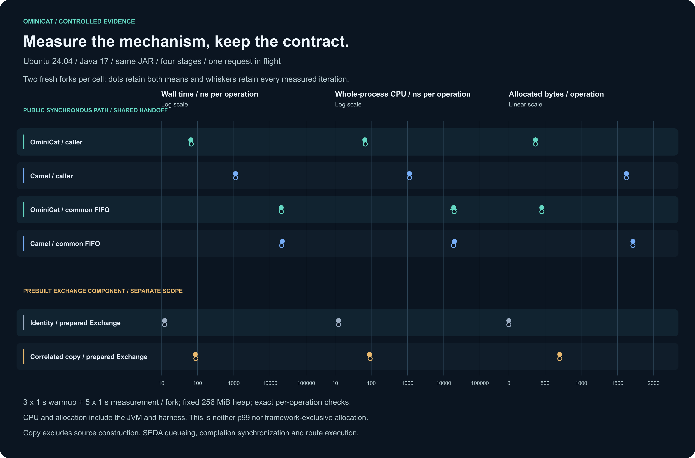

# Controlled Java mechanism evidence — 2026-11-02

These experiments measure three concrete mechanisms: synchronous public execution, the same external queue/worker/acknowledgment package around either framework, and correlated Exchange copying. They change no production runtime. The main results below come only from [run 41387743749](https://github.com/g5n-dev/ominicat/actions/runs/41387743749).

The workflow and complete 91-file evidence bundle passed validation, including all twelve measurement forks and five independent diagnostics. Publication checks cover the allowlist, privacy, source/artifact bindings and checksums; diagnostic timings remain separate from the main table.

[](costs.svg)

## Recorded environment and method

| Item | Recorded value |
| --- | --- |
| Host | Ubuntu 24.04.5 LTS; Linux 7.0.0-1017-azure; x86_64 |
| CPU allocation | AMD EPYC 7763 64-Core Processor; 4 logical processors and affinity count 4 exposed to this job |
| JVM | Eclipse Adoptium OpenJDK 17.0.21+9; fixed 256 MiB heap |
| Framework / harness | Camel 4.22.2; current OminiCat core; JMH 1.37 |
| Workload | 4 immutable numeric stages; 1 outstanding request; 1 benchmark thread |
| Sampling plan | 6 cells, forward then reverse order; 12 fresh JVM forks; 2 forks per cell |
| Each fork | 3 × 1 s warmup; 5 × 1 s measured iterations |
| Capture time | 2026-11-02T04:19:26.238399+00:00 |

The job uses a shared GitHub runner without exclusive CPU isolation. Each wall-time operation includes its input construction, four transformations, exact sequence/value/count/thread checks, synchronous backend return and, where selected, the complete external handoff and acknowledgment. Copy operations instead use the prepared source described below. Startup, setup validation, drain, shutdown and report generation are outside the benchmark method.

JMH reports AverageTime in `ns/op`. Allocation is `gc.alloc.rate.norm` in `B/op`, including framework, harness and participating JVM-thread work. Whole-process CPU is `process.cpu.ns/op`: the process CPU delta between profiler iteration hooks divided by JMH's `getAllOps()`. Its interval includes hook work, JIT, GC and other JVM threads; it is not stage self-time. No p99, RSS, model, media codec or network measurement is made.

The [manifest](evidence/measurements/manifest.json) records the exact host, JVM, settings, dependency hashes and complete source inventory. This capture used clean source revision `d6a9cdffef4fe4e00d30ff814e0bd1b92a59f189`, source fingerprint `e6df4f37d63b613e27db58d3524c1a8225dfea99b63d48eee97935f71926e6a4` and executable JAR SHA-256 `a3156be9d9908ad00aa9fb6d6c6b9e8dbf281c189de75e1e15503df3702a002c`. Every fresh fork checks its actual loaded JAR origin.

## Six measured cells

Each entry is the median of the two fork means; with two forks this is their midpoint. The [full summary](evidence/measurements/summary.md) retains both fork means and all ten measured-iteration ranges, and [summary.json](evidence/measurements/summary.json) retains every iteration. The figure shows the two means as separate dots and the observed iteration minimum–maximum as a line. These ranges are not confidence intervals. Derived differences use the unrounded means.

| Cell | Wall time ns/op | Whole-process CPU ns/op | Allocated B/op |
| --- | ---: | ---: | ---: |
| `ominicat-caller` | 66.339 | 67.457 | 368.000413 |
| `camel-caller` | 1,122.604 | 1,136.710 | 1,624.125335 |
| `ominicat-handoff` | 20,590.533 | 19,168.987 | 455.910356 |
| `camel-handoff` | 21,544.793 | 19,199.635 | 1,714.367391 |
| `identity` | 12.360 | 12.499 | 0.000825 |
| `correlated-copy` | 88.161 | 90.942 | 704.005886 |

The tiny nonzero identity allocation is retained rather than rounded to zero; a normalized whole-JVM observation does not prove an allocation-free framework operation.

## What the controls show

### Synchronous public paths

OminiCat's caller path measured 66.339 ns/op; Camel's caller path measured 1,122.604 ns/op, about 16.92 times as much time in this fixture. Both execute the four numeric stages with the shared oracle. OminiCat uses the real `Pipeline.process` API, including scoped synchronous sinks. Camel uses `ProducerTemplate.requestBody` through a real `direct:` InOut route with `synchronous=true`, `block=false` and `failIfNoConsumers=true`; Exchange/Message access, routing and normal error handling remain included. This is a public-path comparison, not feature parity or an isolated instruction cost.

Camel is a useful Java routing control because it offers both direct and queued in-process public paths on the same supported JVM. The pinned [4.22.2 LTS release](https://camel.apache.org/releases/release-4.22.2/) supports Java 17, 21 and 25; the [Direct component](https://camel.apache.org/components/4.22.x/direct-component.html) and [fixed-version DirectProducer](https://github.com/apache/camel/blob/camel-4.22.2/components/camel-direct/src/main/java/org/apache/camel/component/direct/DirectProducer.java) document the selected synchronous route. It is not presented as a voice-feature equivalent.

### Identical external handoff

Both handoff cells use the same capacity-one `ArrayBlockingQueue` ingress, one persistent platform worker and capacity-one acknowledgment queue. The worker publishes success only after the synchronous backend returns and its terminal result is validated. A correct early output followed by an exception is a failed invocation.

Subtracting each caller median from its own handoff median gives 20,524.193 ns/op for OminiCat and 20,422.188 ns/op for Camel. This describes the observed effect of the complete external queue/worker/acknowledgment package under these settings. It does not isolate queue locking, scheduler wakeup, object escape, caching or GC from one another.

The handoff medians are 20,590.533 and 21,544.793 ns/op. Their measured iteration ranges overlap: 18,894.141–22,305.599 and 20,737.539–22,482.092 ns/op. The external handoff dominates these short numeric operations, so the caller-path ratio does not carry over unchanged. These cells do not use `PipelineSession` or SEDA, and cannot establish their native queue cost, saturation throughput or production capacity.

### Prepared Exchange copying

The copy fixture uses a prebuilt InOut Exchange with fixed exchange/message IDs, one fixed header, one application property, prepared correlation metadata and an immutable numeric body. Source construction and source-ID initialization are outside timing. Identity and copy execute the same body/metadata read oracle; copying must produce a distinct Exchange while preserving the body reference and message identity.

`ExchangeHelper.createCorrelatedCopy(source, false, true)` measured 88.161 ns/op and 704.005886 B/op, versus the identity control's 12.360 ns/op and 0.000825 B/op. The observed wall-time difference is 75.801 ns/op for this prepared shape. The flags match [SedaProducer.prepareCopy](https://github.com/apache/camel/blob/camel-4.22.2/components/camel-seda/src/main/java/org/apache/camel/component/seda/SedaProducer.java); [ExchangeHelper](https://github.com/apache/camel/blob/camel-4.22.2/core/camel-support/src/main/java/org/apache/camel/support/ExchangeHelper.java) prepares correlation and independent Exchange state rather than deeply copying this immutable numeric payload.

This standalone operation excludes source construction, SEDA queueing, its completion latch, result-copy-back and route execution. Its timing cannot be added to the handoff or synchronous-path differences to explain a percentage of the [earlier native queued comparison](../../comparison/README.md). JIT, escaping objects, allocation, cache state and GC interact; that earlier workload also used different timing and lifecycle boundaries.

## Separate CPU, allocation and GC diagnostics

All five diagnostic cases completed. The configuration requests CPU execution sampling every 10 ms, records and exports up to 64 stack frames, and rejects a selected-event JSON export above 128 MiB rather than truncating it. The [diagnostic manifest](evidence/diagnostics/manifest.json) binds them to the same measured artifact and source.

Each case is a separate instrumented Java 17 JVM with `-f 0`, two 1-second warmup iterations and two 1-second measurement iterations. Its whole recording includes JVM/framework startup, setup, harness and teardown with no measurement-phase filtering. CPU samples span JVM threads, allocation widths are sampled allocated-byte weights, and GC pause sums cover that selected recording. These are not the twelve main measurement forks or additional headline timing samples. The identity control is intentionally not profiled.

| Diagnostic case | Scope and index | CPU flame graph | Allocation flame graph | CPU hotspots | Allocation hotspots | GC pauses |
| --- | --- | --- | --- | --- | --- | --- |
| `ominicat-caller` | [report](evidence/diagnostics/ominicat-caller/report.md) / [index](evidence/diagnostics/ominicat-caller/profiles.md) | [PNG](../../../docs/assets/previews/mechanism-ominicat-caller-cpu-flamegraph.png) / [SVG](evidence/diagnostics/ominicat-caller/cpu-flamegraph.svg) | [PNG](../../../docs/assets/previews/mechanism-ominicat-caller-allocation-flamegraph.png) / [SVG](evidence/diagnostics/ominicat-caller/allocation-flamegraph.svg) | [PNG](../../../docs/assets/previews/mechanism-ominicat-caller-cpu-hotspots.png) / [SVG](evidence/diagnostics/ominicat-caller/cpu-hotspots.svg) | [PNG](../../../docs/assets/previews/mechanism-ominicat-caller-allocation-hotspots.png) / [SVG](evidence/diagnostics/ominicat-caller/allocation-hotspots.svg) | [PNG](../../../docs/assets/previews/mechanism-ominicat-caller-gc-pauses.png) / [SVG](evidence/diagnostics/ominicat-caller/gc-pauses.svg) |
| `camel-caller` | [report](evidence/diagnostics/camel-caller/report.md) / [index](evidence/diagnostics/camel-caller/profiles.md) | [PNG](../../../docs/assets/previews/mechanism-camel-caller-cpu-flamegraph.png) / [SVG](evidence/diagnostics/camel-caller/cpu-flamegraph.svg) | [PNG](../../../docs/assets/previews/mechanism-camel-caller-allocation-flamegraph.png) / [SVG](evidence/diagnostics/camel-caller/allocation-flamegraph.svg) | [PNG](../../../docs/assets/previews/mechanism-camel-caller-cpu-hotspots.png) / [SVG](evidence/diagnostics/camel-caller/cpu-hotspots.svg) | [PNG](../../../docs/assets/previews/mechanism-camel-caller-allocation-hotspots.png) / [SVG](evidence/diagnostics/camel-caller/allocation-hotspots.svg) | [PNG](../../../docs/assets/previews/mechanism-camel-caller-gc-pauses.png) / [SVG](evidence/diagnostics/camel-caller/gc-pauses.svg) |
| `ominicat-handoff` | [report](evidence/diagnostics/ominicat-handoff/report.md) / [index](evidence/diagnostics/ominicat-handoff/profiles.md) | [PNG](../../../docs/assets/previews/mechanism-ominicat-handoff-cpu-flamegraph.png) / [SVG](evidence/diagnostics/ominicat-handoff/cpu-flamegraph.svg) | [PNG](../../../docs/assets/previews/mechanism-ominicat-handoff-allocation-flamegraph.png) / [SVG](evidence/diagnostics/ominicat-handoff/allocation-flamegraph.svg) | [PNG](../../../docs/assets/previews/mechanism-ominicat-handoff-cpu-hotspots.png) / [SVG](evidence/diagnostics/ominicat-handoff/cpu-hotspots.svg) | [PNG](../../../docs/assets/previews/mechanism-ominicat-handoff-allocation-hotspots.png) / [SVG](evidence/diagnostics/ominicat-handoff/allocation-hotspots.svg) | [PNG](../../../docs/assets/previews/mechanism-ominicat-handoff-gc-pauses.png) / [SVG](evidence/diagnostics/ominicat-handoff/gc-pauses.svg) |
| `camel-handoff` | [report](evidence/diagnostics/camel-handoff/report.md) / [index](evidence/diagnostics/camel-handoff/profiles.md) | [PNG](../../../docs/assets/previews/mechanism-camel-handoff-cpu-flamegraph.png) / [SVG](evidence/diagnostics/camel-handoff/cpu-flamegraph.svg) | [PNG](../../../docs/assets/previews/mechanism-camel-handoff-allocation-flamegraph.png) / [SVG](evidence/diagnostics/camel-handoff/allocation-flamegraph.svg) | [PNG](../../../docs/assets/previews/mechanism-camel-handoff-cpu-hotspots.png) / [SVG](evidence/diagnostics/camel-handoff/cpu-hotspots.svg) | [PNG](../../../docs/assets/previews/mechanism-camel-handoff-allocation-hotspots.png) / [SVG](evidence/diagnostics/camel-handoff/allocation-hotspots.svg) | [PNG](../../../docs/assets/previews/mechanism-camel-handoff-gc-pauses.png) / [SVG](evidence/diagnostics/camel-handoff/gc-pauses.svg) |
| `correlated-copy` | [report](evidence/diagnostics/correlated-copy/report.md) / [index](evidence/diagnostics/correlated-copy/profiles.md) | [PNG](../../../docs/assets/previews/mechanism-correlated-copy-cpu-flamegraph.png) / [SVG](evidence/diagnostics/correlated-copy/cpu-flamegraph.svg) | [PNG](../../../docs/assets/previews/mechanism-correlated-copy-allocation-flamegraph.png) / [SVG](evidence/diagnostics/correlated-copy/allocation-flamegraph.svg) | [PNG](../../../docs/assets/previews/mechanism-correlated-copy-cpu-hotspots.png) / [SVG](evidence/diagnostics/correlated-copy/cpu-hotspots.svg) | [PNG](../../../docs/assets/previews/mechanism-correlated-copy-allocation-hotspots.png) / [SVG](evidence/diagnostics/correlated-copy/allocation-hotspots.svg) | [PNG](../../../docs/assets/previews/mechanism-correlated-copy-gc-pauses.png) / [SVG](evidence/diagnostics/correlated-copy/gc-pauses.svg) |

| Diagnostic case | CPU execution samples | Allocation samples | GC collections | Pause sum ms | Maximum collection pause sum ms |
| --- | ---: | ---: | ---: | ---: | ---: |
| `ominicat-caller` | 287 | 1325 | 127 | 101.714887 | 4.957060 |
| `camel-caller` | 270 | 1380 | 33 | 56.626077 | 5.392455 |
| `ominicat-handoff` | 8 | 202 | 1 | 3.964694 | 3.964694 |
| `camel-handoff` | 15 | 670 | 3 | 11.811734 | 5.733589 |
| `correlated-copy` | 238 | 1353 | 178 | 141.635232 | 5.735054 |

CPU entries are sampled stack occurrences, not method durations. The two handoff recordings contain only 8 and 15 execution samples, including startup activity; they cannot support precise stage attribution. The caller recordings include `Pipeline.lambda$dispatch$1` and `CamelInternalProcessor.process`, while the copy recording includes `MessageSupport.copyFromWithNewBody`. These observations locate supplied stacks, without assigning percentages of the uninstrumented timing difference to them.

The diagnostics use the same configured warmup and measurement durations, but complete different operation counts; whole-recording startup and teardown also vary. CPU sample totals, allocation weights and GC counts are not normalized per operation, cannot be read as `B/op`, and do not rank the mechanisms. OminiCat caller’s 127 collections versus Camel caller’s 33 do not show worse per-operation allocation: use the separate main JMH allocation estimates, 368.000413 versus 1,624.125335 B/op, for that declared workload. Sparse handoff CPU samples must not be converted into percentages to decide a mechanism winner. The pause sums are sums of pauses per collection, not total collection duration or main-measurement-only pauses.

Raw JFR, private configurations, uncompressed event exports and unreviewed tool logs remain outside the published allowlist. Each case's report and context identify its instrumented scope; missing samples do not prove absence, and sampled allocation weights are not exact `B/op`.

## Attempts and retained evidence

The primary table uses only the latest run. Earlier completed measurements are retained separately, without mixing forks, hosts or executable hashes into the primary summary.

| Run | Outcome and retained evidence |
| --- | --- |
| [41385218510](https://github.com/g5n-dev/ominicat/actions/runs/41385218510) | Measurements completed, but diagnostic preflight incorrectly classified a private JFR-configuration log and failed before a measurement artifact was preserved. No numerical result from this run is used here. |
| [41386037966](https://github.com/g5n-dev/ominicat/actions/runs/41386037966) | Measurements preserved. Diagnostic export at 1 ms CPU sampling and 64 stack frames exceeded the 128 MiB selected-JSON bound. Its separate [summary](earlier-measurements/41386037966/summary.md), [raw summary](earlier-measurements/41386037966/summary.json) and [manifest](earlier-measurements/41386037966/manifest.json) remain available. |
| [41387434975](https://github.com/g5n-dev/ominicat/actions/runs/41387434975) | Measurements preserved. Diagnostics were cancelled when a renderer correction was pushed; this is not labelled a diagnostic failure. Its separate [summary](earlier-measurements/41387434975/summary.md), [raw summary](earlier-measurements/41387434975/summary.json) and [manifest](earlier-measurements/41387434975/manifest.json) remain available. |
| [41387743749](https://github.com/g5n-dev/ominicat/actions/runs/41387743749) | Main measurements and all five separate diagnostics completed successfully; the complete publication bundle passed validation. |

The earlier allocations include an AMD EPYC 7763 host and an AMD EPYC 9V74 host. Even matching CPU labels do not establish the same physical runner or exclusive CPU conditions. Compare each archive within its own recorded host/JVM/settings; these are not pooled replicates or a before/after runtime optimization.

## Source, checks and reproduction

The [protocol](../../../comparison/mechanism-protocol.md) defines the six cells and their limits. The [Java harness](../../../comparison/mechanisms/src/main/java/io/ominicat/mechanisms/PathHarness.java), [copy fixture](../../../comparison/mechanisms/src/main/java/io/ominicat/mechanisms/ExchangeCopyFixture.java), [collector](../../../comparison/mechanism_evidence.py) and [diagnostic collector](../../../comparison/mechanism_profiles.py) provide the implementation. The standalone module's 32 correctness tests passed on Java 17, 21 and 25 before measurement, covering output failures, thread ownership, post-output exceptions, cleanup, copying and CPU/origin validation; timing evidence remains Java 17 only.

The [measurement suite](evidence/measurements/suite.json), [source/dependency manifest](evidence/measurements/manifest.json), twelve original raw JMH JSON files and privacy-checked logs are preserved with [checksums](evidence/measurements/SHA256SUMS). No failed cell or best fork is silently omitted. Reproduction requires an explicitly selected Java 17 runtime and a fresh destination:

```sh
./mvnw -B -ntp -pl ominicat-core -am install -DskipTests
./mvnw -B -ntp -f comparison/mechanisms/pom.xml verify
python3 comparison/mechanism_evidence.py collect --root . --output reports/local/mechanism-capture/evidence/measurements
python3 comparison/mechanism_profiles.py collect --root . --output reports/local/mechanism-capture
python3 comparison/mechanism_evidence.py check reports/local/mechanism-capture/evidence/measurements
python3 comparison/mechanism_profiles.py check reports/local/mechanism-capture/evidence
```
