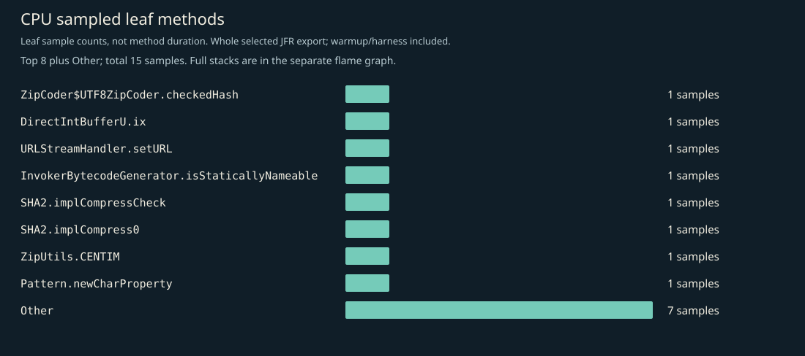
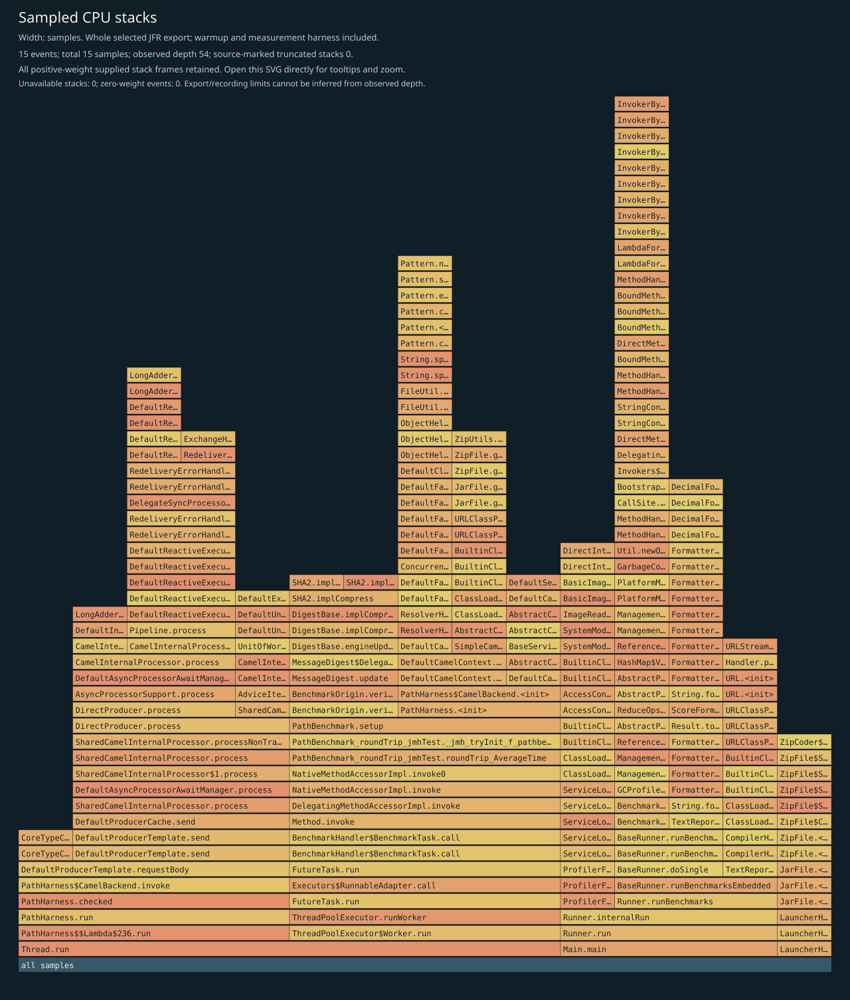
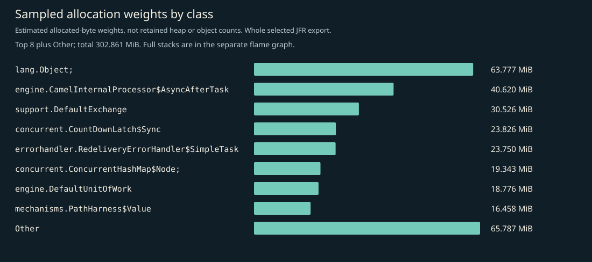
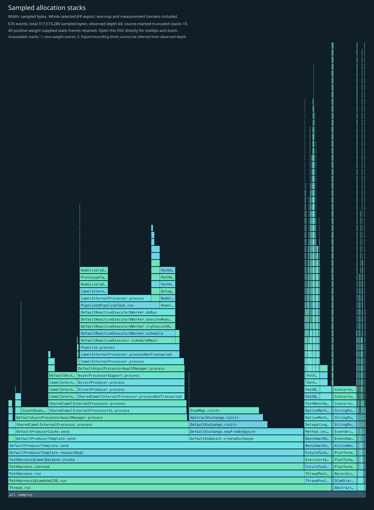
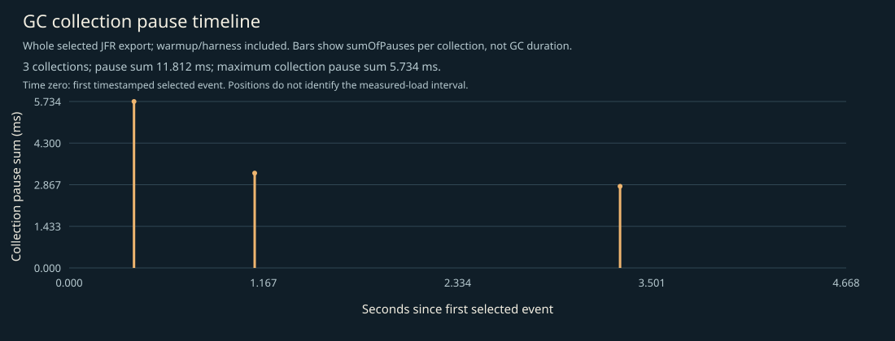

# CPU, allocation and GC profile

Separate instrumented Java 17 JMH diagnostic JVM: whole recording includes JVM/framework startup, setup, two 1-second warmup iterations, two 1-second measurement iterations, harness and teardown. No phase filtering. CPU execution sampling requests a 10ms period; allocation uses profile.jfc defaults. Recording and exported stacks retain up to 64 frames. These are not headline timings, framework-exclusive CPU, retained heap, exact object counts, p99 latency or RSS measurements.

## Complete supplied CPU stacks

Every positive-weight supplied stack frame is retained; zero-weight events have no area. Observed depth does not prove that the recording or export was unlimited. Source-marked truncation and unavailable stacks are shown on the figure. Open the SVG directly to inspect full method tooltips.

## CPU leaf samples

| Method | Samples |
|---|---:|
| `java.util.zip.ZipCoder$UTF8ZipCoder.checkedHash` | 1 |
| `java.nio.DirectIntBufferU.ix` | 1 |
| `java.net.URLStreamHandler.setURL` | 1 |
| `java.lang.invoke.InvokerBytecodeGenerator.isStaticallyNameable` | 1 |
| `sun.security.provider.SHA2.implCompressCheck` | 1 |
| `sun.security.provider.SHA2.implCompress0` | 1 |
| `java.util.zip.ZipUtils.CENTIM` | 1 |
| `java.util.regex.Pattern.newCharProperty` | 1 |
| `org.apache.camel.impl.engine.DefaultServiceBootstrapCloseable.close` | 1 |
| `org.apache.camel.support.ExchangeHelper.isErrorHandlerBridge` | 1 |
| `org.apache.camel.impl.converter.CoreTypeConverterRegistry.convertTo` | 1 |
| `org.apache.camel.support.DefaultExchange.setUnitOfWork` | 1 |

## Sampled allocation weights

Weights estimate sampled allocation distribution, not retained heap or exact object counts. This JMH mechanism experiment has no exact latency array. Use the separate uninstrumented JMH measurements for per-operation allocation; no such estimate is inferred from these samples.

| Class | Sampled weight (MiB) |
|---|---:|
| `[Ljava.lang.Object;` | 63.78 |
| `org.apache.camel.impl.engine.CamelInternalProcessor$AsyncAfterTask` | 40.62 |
| `org.apache.camel.support.DefaultExchange` | 30.53 |
| `java.util.concurrent.CountDownLatch$Sync` | 23.83 |
| `org.apache.camel.processor.errorhandler.RedeliveryErrorHandler$SimpleTask` | 23.75 |
| `[Ljava.util.concurrent.ConcurrentHashMap$Node;` | 19.34 |
| `org.apache.camel.impl.engine.DefaultUnitOfWork` | 18.78 |
| `io.ominicat.mechanisms.PathHarness$Value` | 16.46 |
| `[B` | 16.35 |
| `org.apache.camel.support.DefaultMessage` | 6.75 |
| `java.util.concurrent.locks.AbstractQueuedSynchronizer$ConditionNode` | 6.71 |
| `org.apache.camel.impl.engine.DefaultAsyncProcessorAwaitManager$$Lambda$240+0x00007f11481bc640.1658424032` | 6.20 |

## Complete supplied allocation stacks

## GC and contention

- Garbage collections recorded: 3.
- Recorded GC pause sum: 11.812 ms; longest collection pause sum: 5.734 ms.
- Monitor contention events: 0; virtual-thread pinning events: not available on this runtime.
- GC positions are relative to the first timestamped selected event, not the JMH measurement start. The figure includes warmup/harness events. Collection pause sums are not whole GC durations.
- Zero sampled events does not prove absence. Sampling, event thresholds and workload duration limit these observations.

Evidence: [selected events, gzip JSON](jfr-events.json.gz), [diagnostic report](report.md).
Raw JFR is generated locally and intentionally excluded from Git; do not record real credentials or conversation payloads for public profiling.
