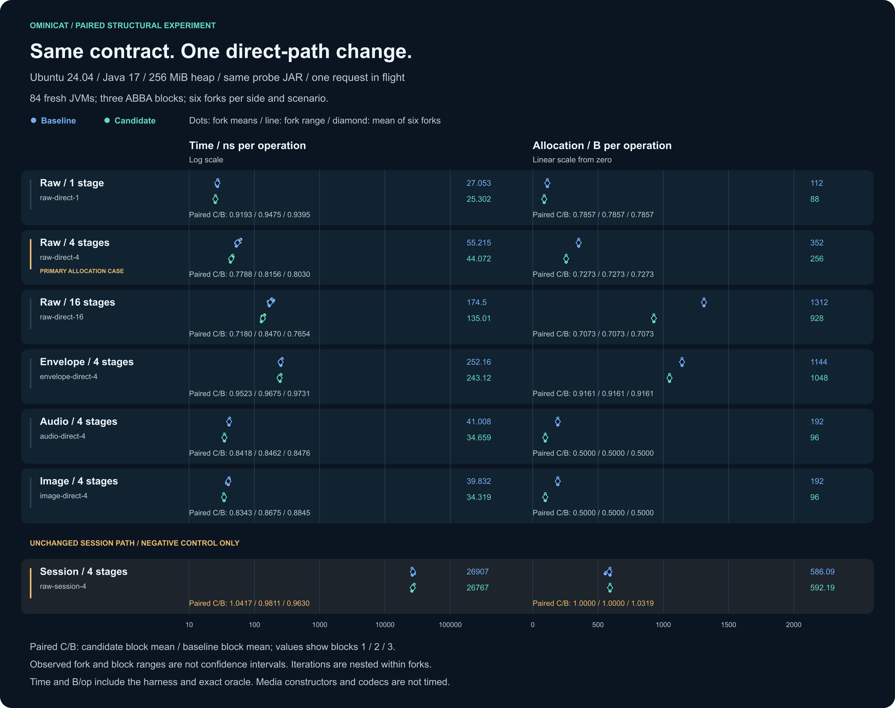
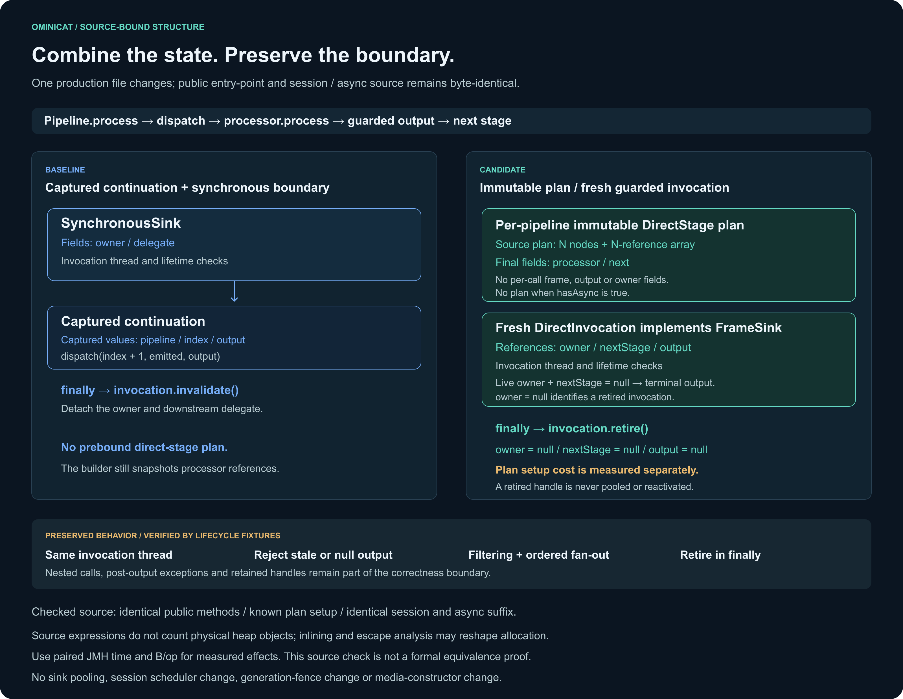

# Paired direct-state evidence — 2026-11-02

The third candidate met every preregistered observation target in [Ubuntu run 41401882524](https://github.com/g5n-dev/ominicat/actions/runs/41401882524). For `raw-direct-4`, the mean paired-block time ratio decreased by **20.09%** and allocation by **27.27%**; `envelope-direct-4` decreased by **3.57%** and **8.39%**. These are results for one controlled direct-path representation change, with the same probe and paired runtime JARs. They do not establish a whole-framework, model-latency or production-capacity improvement.

The complete 223-file main measurement/diagnostic archive and separate 21-file construction archive passed their checks. The first two candidates remain available with their failed and uncertain outcomes; no scenario or target was removed to obtain the final result.

[](costs.svg)

## Controlled source and behavior

[](structure.svg)

The [baseline source](sources/baseline-Pipeline.java) evaluates a continuation capturing the pipeline, current index and output, then wraps it in `SynchronousSink`. The final [candidate source](sources/candidate-Pipeline.java) prebinds an immutable per-pipeline `DirectStage` plan. Its final fields hold the processor and next stage; a parallel array retains the stage references. For a synchronous pipeline with N stages, this adds N plan nodes and an N-reference array in the source-level layout. Plans contain no per-call frame, output or owning-thread fields.

Each direct invocation still gets fresh, unpooled state: `owner`, `nextStage` and `output`. `finally` clears all three references. A live invocation with `nextStage == null` forwards to the terminal output; `owner == null` marks retirement. Thread/lifetime checks, null rejection, filtering, ordered multiple outputs, nested calls and exception propagation remain part of the contract. Pipelines containing `AsyncProcessor` do not build the N-stage plan, although the new pipeline field still exists. A non-async pipeline used only through a session also pays the plan construction cost.

| Evidence layer | What it establishes |
| --- | --- |
| Archived source | Only `Pipeline.java` differs among production core sources. The renderer checks the exact known constructor/field/direct-body shapes; public-method source regions and the entire session/async suffix remain byte-identical. This does not promise identical class files or compiled lambda numbering. |
| Behavior and lifecycle | The 9 added [lifecycle tests](../../../ominicat-core/src/test/java/io/ominicat/core/DirectInvocationLifecycleTest.java) pass against both the old baseline and candidate, including stale/wrong-thread sinks, filtering/fan-out, nested calls, post-output exceptions and detached retained handles. Repository verification passed 390 tests: core 120, conversation 75, providers 74, server 90 and benchmarks 31, with no failures/errors/skips. Java 17 coverage/SBOM and 512 stress seeds passed; Java 17/21/25 compatibility checks also passed. |
| Paired runtime measurement | The seven-scenario, 84-fork experiment compares two real core JARs through one shared probe. Every fork verifies loaded origins; every measured invocation uses exact result and ownership checks. |
| Independent diagnostics | Four separately instrumented JVMs provide CPU stacks, sampled allocation and GC context. Their weights are not additional timing samples or per-operation allocation estimates. |

This supports the effect of the combined representation change within the declared fixture. Source allocation expressions do not count physical heap objects: inlining, escape analysis, field layout and call shape can interact. Neither the JFR samples nor these differences isolate one JIT transformation or explain a percentage of the earlier Camel SEDA gap.

## Environment and timing

| Item | Recorded value |
| --- | --- |
| Host | Ubuntu 24.04.5 LTS; Linux 7.0.0-1017-azure; x86_64 |
| CPU allocation | INTEL(R) XEON(R) PLATINUM 8573C; 4 logical processors and affinity count 4 exposed to the job |
| JVM / harness | Eclipse Adoptium OpenJDK 17.0.21+9; JMH 1.37; fixed 256 MiB heap; one benchmark thread |
| Main plan | 7 scenarios; 3 ABBA blocks; 84 fresh single-fork JVMs; 6 forks per side/scenario |
| Each main fork | 3 × 1 s warmup; 5 × 1 s measurement; AverageTime `ns/op`; GC-profiler `B/op` |
| Case order | Baseline, candidate, candidate, baseline within each block/scenario; reverse scenario order in block 2 |
| Main capture time | 2026-11-02T06:45:49.143239+00:00 |

This is a shared hosted runner without exclusive CPU isolation. Numeric inputs and transformed immutable frames are constructed inside timing, along with the independent sequence/value/order/count/thread oracle and successful backend return. The envelope case uses real `EnvelopeProcessor` adapters; deterministic ID preparation, supplier calls and metadata/causation checks are timed. Setup, origin hashing, pipeline construction for the main cases, cleanup and reporting are outside the main benchmark method.

The media cases cycle 64 prebuilt immutable frames: 640-byte, 16 kHz mono PCM for audio and 64 KiB synthetic payloads labelled `image/png` for images. Exact frame identity and stage order are checked. Media construction, defensive snapshots, codecs and image validity are outside this timed scope. The session control includes real capacity-one `PipelineSession` ingress, a capacity-one reply queue, and waiting for the successful processed counter after the reply; a correct early frame followed by an exception cannot pass.

## Seven steady-state scenarios

Time and allocation columns are the arithmetic means of six fork means. Each paired C/B column gives the arithmetic mean of the three block ratios, followed by their observed minimum–maximum. A block ratio divides its two candidate fork means' average by its two baseline fork means' average. The percentage change is `100 × (1 − mean block ratio)`; it is **not** the ratio of the two globally averaged columns.

| Direct scenario | Baseline ns/op | Candidate ns/op | Paired time C/B mean [range] | Baseline B/op | Candidate B/op | Paired allocation C/B mean [range] |
| --- | ---: | ---: | --- | ---: | ---: | --- |
| `raw-direct-1` | 27.05332 | 25.30190 | 0.935440 [0.919298–0.947532] | 112.000161 | 88.000150 | 0.785714 [0.785714–0.785715] |
| `raw-direct-4` | 55.21457 | 44.07219 | 0.799119 [0.778756–0.815576] | 352.000328 | 256.000262 | 0.727273 [0.727273–0.727273] |
| `raw-direct-16` | 174.49622 | 135.01103 | 0.776780 [0.718003–0.846970] | 1312.001037 | 928.000803 | 0.707317 [0.707317–0.707317] |
| `envelope-direct-4` | 252.15870 | 243.11872 | 0.964313 [0.952305–0.973089] | 1144.001499 | 1048.001446 | 0.916084 [0.916084–0.916084] |
| `audio-direct-4` | 41.00787 | 34.65904 | 0.845194 [0.841766–0.847633] | 192.000244 | 96.000206 | 0.500000 [0.500000–0.500000] |
| `image-direct-4` | 39.83210 | 34.31896 | 0.862098 [0.834251–0.884550] | 192.000237 | 96.000204 | 0.500000 [0.500000–0.500000] |

The [summary](evidence/measurements/summary.md) and [full JSON](evidence/measurements/summary.json) retain all three ratios, six fork means and 30 measured iterations per side/scenario. The figure's dots and lines show fork means and the range of those six means, not iteration extrema. Forks and blocks are the replication units; iterations within a fork are not independent repetitions. Ranges are not confidence intervals, and rounded endpoints may coincide.

All six direct cases met the unchanged rules in every block: primary `raw-direct-4` allocation C/B ≤0.90, direct-case time C/B ≤1.05, and direct-case allocation C/B ≤1.01. The recorded outcome is `observed-targets-met`. This is a preregistered experimental decision, not a hosted-CI performance gate, statistical-significance claim or universal guarantee.

### Unchanged session control

| Control scenario | Baseline ns/op | Candidate ns/op | Paired time C/B mean [range] | Baseline B/op | Candidate B/op | Paired allocation C/B mean [range] |
| --- | ---: | ---: | --- | ---: | ---: | --- |
| `raw-session-4` | 26906.98109 | 26767.08696 | 0.995270 [0.963048–1.041690] | 586.089036 | 592.192980 | 1.010636 [0.999999–1.031893] |

The `raw-session-4` path is unchanged and its ranges are retained, including the allocation increase in one block. It is excluded from the direct-path targets. It neither corrects runner noise nor rescues a failed direct case; no session speedup is claimed.

## Per-pipeline setup tradeoff

The separate [construction summary](startup-evidence/summary.md), [JSON](startup-evidence/summary.json) and [bound manifest](startup-evidence/manifest.json) expose the added plan setup cost. `DirectPlanStartupProbe.invoke` creates a new real four-stage builder and pipeline per operation. The four distinct processor stubs, immutable input and terminal oracle are cached outside timing. `build-4` consumes every returned pipeline and exercises the setup and last-built graph outside timing. `first-direct-4` also executes and checks each first call inside timing, acknowledging it only after synchronous return.

One ABBA block per scenario gives 8 fresh JVMs and 2 forks per side/scenario, using the same 3 × 1 s warmup, 5 × 1 s measurements and 256 MiB heap. Entries below are the mean of two fork means [fork minimum–maximum]. These diagnostics have no acceptance threshold and cannot override the main result.

| Construction scenario | Baseline ns/op [range] | Candidate ns/op [range] | Baseline B/op [range] | Candidate B/op [range] |
| --- | --- | --- | --- | --- |
| `build-4` | 217.75599 [216.67130–218.84068] | 229.97745 [228.47388–231.48102] | 824.001306 [824.001299–824.001313] | 960.001374 [960.001365–960.001384] |
| `first-direct-4` | 250.63652 [248.04026–253.23279] | 259.01436 [258.06653–259.96219] | 1016.001489 [1016.001473–1016.001504] | 1048.001541 [1040.001547–1056.001536] |

Measured build allocation increased by approximately **136 B/op**; build plus first-call allocation increased by approximately **32 B/op**. The candidate first-call fork means differ, and their full allocation range is retained. These are normalized fixture observations, not an exact physical-object or retained-heap accounting.

These are new-pipeline costs in warmed JVMs, **not OS/JVM cold-start latency**. Do not subtract these timings from the steady-state probe, combine different oracles to derive an exact amortization point, or infer saturated pipeline/session capacity. The eager plan trades setup work for the measured direct-dispatch gains; session-only synchronous pipelines also incur that setup work. This is not a claim that all OminiCat execution modes become faster.

## Independent CPU, allocation and GC diagnostics

The [diagnostic manifest](evidence/diagnostics/manifest.json) and each case's source context bind all four recordings to the main manifest, baseline/candidate core hashes and shared probe hash. Each separate instrumented JVM uses `-f 0`, 2 × 1 s warmup and 2 × 1 s measurement. CPU sampling requests 10 ms, allocation sampling is throttled to 50 events/second, and recording/export retain up to 64 stack frames. Selected JSON above 128 MiB is rejected rather than truncated.

| Diagnostic case | Report / source binding | CPU flame graph | Allocation flame graph | CPU hotspots | Allocation hotspots | GC pauses |
| --- | --- | --- | --- | --- | --- | --- |
| `baseline-raw-direct-4` | [report](evidence/diagnostics/baseline-raw-direct-4/report.md) / [context](evidence/diagnostics/baseline-raw-direct-4/diagnostic-context.json) | [PNG](../../../docs/assets/previews/direct-state-final-baseline-raw-direct-4-cpu-flamegraph.png) / [SVG](evidence/diagnostics/baseline-raw-direct-4/cpu-flamegraph.svg) | [PNG](../../../docs/assets/previews/direct-state-final-baseline-raw-direct-4-allocation-flamegraph.png) / [SVG](evidence/diagnostics/baseline-raw-direct-4/allocation-flamegraph.svg) | [PNG](../../../docs/assets/previews/direct-state-final-baseline-raw-direct-4-cpu-hotspots.png) / [SVG](evidence/diagnostics/baseline-raw-direct-4/cpu-hotspots.svg) | [PNG](../../../docs/assets/previews/direct-state-final-baseline-raw-direct-4-allocation-hotspots.png) / [SVG](evidence/diagnostics/baseline-raw-direct-4/allocation-hotspots.svg) | [PNG](../../../docs/assets/previews/direct-state-final-baseline-raw-direct-4-gc-pauses.png) / [SVG](evidence/diagnostics/baseline-raw-direct-4/gc-pauses.svg) |
| `candidate-raw-direct-4` | [report](evidence/diagnostics/candidate-raw-direct-4/report.md) / [context](evidence/diagnostics/candidate-raw-direct-4/diagnostic-context.json) | [PNG](../../../docs/assets/previews/direct-state-final-candidate-raw-direct-4-cpu-flamegraph.png) / [SVG](evidence/diagnostics/candidate-raw-direct-4/cpu-flamegraph.svg) | [PNG](../../../docs/assets/previews/direct-state-final-candidate-raw-direct-4-allocation-flamegraph.png) / [SVG](evidence/diagnostics/candidate-raw-direct-4/allocation-flamegraph.svg) | [PNG](../../../docs/assets/previews/direct-state-final-candidate-raw-direct-4-cpu-hotspots.png) / [SVG](evidence/diagnostics/candidate-raw-direct-4/cpu-hotspots.svg) | [PNG](../../../docs/assets/previews/direct-state-final-candidate-raw-direct-4-allocation-hotspots.png) / [SVG](evidence/diagnostics/candidate-raw-direct-4/allocation-hotspots.svg) | [PNG](../../../docs/assets/previews/direct-state-final-candidate-raw-direct-4-gc-pauses.png) / [SVG](evidence/diagnostics/candidate-raw-direct-4/gc-pauses.svg) |
| `baseline-envelope-direct-4` | [report](evidence/diagnostics/baseline-envelope-direct-4/report.md) / [context](evidence/diagnostics/baseline-envelope-direct-4/diagnostic-context.json) | [PNG](../../../docs/assets/previews/direct-state-final-baseline-envelope-direct-4-cpu-flamegraph.png) / [SVG](evidence/diagnostics/baseline-envelope-direct-4/cpu-flamegraph.svg) | [PNG](../../../docs/assets/previews/direct-state-final-baseline-envelope-direct-4-allocation-flamegraph.png) / [SVG](evidence/diagnostics/baseline-envelope-direct-4/allocation-flamegraph.svg) | [PNG](../../../docs/assets/previews/direct-state-final-baseline-envelope-direct-4-cpu-hotspots.png) / [SVG](evidence/diagnostics/baseline-envelope-direct-4/cpu-hotspots.svg) | [PNG](../../../docs/assets/previews/direct-state-final-baseline-envelope-direct-4-allocation-hotspots.png) / [SVG](evidence/diagnostics/baseline-envelope-direct-4/allocation-hotspots.svg) | [PNG](../../../docs/assets/previews/direct-state-final-baseline-envelope-direct-4-gc-pauses.png) / [SVG](evidence/diagnostics/baseline-envelope-direct-4/gc-pauses.svg) |
| `candidate-envelope-direct-4` | [report](evidence/diagnostics/candidate-envelope-direct-4/report.md) / [context](evidence/diagnostics/candidate-envelope-direct-4/diagnostic-context.json) | [PNG](../../../docs/assets/previews/direct-state-final-candidate-envelope-direct-4-cpu-flamegraph.png) / [SVG](evidence/diagnostics/candidate-envelope-direct-4/cpu-flamegraph.svg) | [PNG](../../../docs/assets/previews/direct-state-final-candidate-envelope-direct-4-allocation-flamegraph.png) / [SVG](evidence/diagnostics/candidate-envelope-direct-4/allocation-flamegraph.svg) | [PNG](../../../docs/assets/previews/direct-state-final-candidate-envelope-direct-4-cpu-hotspots.png) / [SVG](evidence/diagnostics/candidate-envelope-direct-4/cpu-hotspots.svg) | [PNG](../../../docs/assets/previews/direct-state-final-candidate-envelope-direct-4-allocation-hotspots.png) / [SVG](evidence/diagnostics/candidate-envelope-direct-4/allocation-hotspots.svg) | [PNG](../../../docs/assets/previews/direct-state-final-candidate-envelope-direct-4-gc-pauses.png) / [SVG](evidence/diagnostics/candidate-envelope-direct-4/gc-pauses.svg) |

| Diagnostic case | CPU execution samples | Allocation samples | GC collections | Pause sum ms | Maximum collection pause sum ms |
| --- | ---: | ---: | ---: | ---: | ---: |
| `baseline-raw-direct-4` | 342 | 225 | 154 | 97.775630 | 5.463274 |
| `candidate-raw-direct-4` | 344 | 215 | 141 | 91.618603 | 5.688608 |
| `baseline-envelope-direct-4` | 351 | 215 | 101 | 71.239833 | 3.652610 |
| `candidate-envelope-direct-4` | 355 | 211 | 99 | 71.156076 | 4.107739 |

The whole recording includes JVM startup, setup, warmup, timed loops, harness and teardown with no measurement-phase filtering. Configured durations match, but operation counts differ; faster loops may do more work. CPU/allocation sample totals, allocation weights and GC counts cannot rank per-operation efficiency or replace the formal JMH `B/op`. CPU samples locate supplied stacks, not method durations. Pause sums add pauses within each collection, not the entire collection duration or only the main measured window.

The baseline raw recording contains continuation-lambda and `SynchronousSink` allocation samples; the candidate raw recording contains `DirectInvocation` samples. Envelope recordings also contain `FrameEnvelope`, ID strings and the envelope adapter's own guarded sink. These are consistent with the source structure and retained surrounding work, without proving that every source allocation materializes or assigning a causal percentage to a sampled method. Raw JFR, private settings, uncompressed event exports and unreviewed logs are not published.

## Earlier attempts remain part of the evidence

The two earlier complete experiments remain separate. Their envelope regressions were not hidden, and the original targets were retained. Absolute times from different hosted jobs are not used to rank the prototypes or pooled with the final run; matching CPU model names also do not prove the same physical runner.

| Candidate | Recorded outcome | Retained evidence |
| --- | --- | --- |
| `143deb4` / inline state | `targets-not-met`; envelope time C/B mean 1.057092, block range 1.037070–1.070106. The mean increase exceeded 5%, with two blocks above 1.05. | [Summary](earlier-attempts/143deb4/evidence/measurements/summary.md), [manifest](earlier-attempts/143deb4/evidence/measurements/manifest.json), [costs PNG](../../../docs/assets/previews/direct-state-143deb4-costs.png) / [SVG](earlier-attempts/143deb4/costs.svg), [structure PNG](../../../docs/assets/previews/direct-state-143deb4-structure.png) / [SVG](earlier-attempts/143deb4/structure.svg) |
| `4e594fc` / private helpers | `uncertain`; envelope time C/B mean 1.035401, block range 1.005529–1.053953. The point estimate met the limit but one block exceeded 1.05. | [Summary](earlier-attempts/4e594fc/evidence/measurements/summary.md), [manifest](earlier-attempts/4e594fc/evidence/measurements/manifest.json), [costs PNG](../../../docs/assets/previews/direct-state-4e594fc-costs.png) / [SVG](earlier-attempts/4e594fc/costs.svg), [structure PNG](../../../docs/assets/previews/direct-state-4e594fc-structure.png) / [SVG](earlier-attempts/4e594fc/structure.svg) |
| `f5454f4` / prebound plan | `observed-targets-met`; every direct criterion met in all 3 blocks. | This report's [main summary](evidence/measurements/summary.json), [construction evidence](startup-evidence/summary.json) and [diagnostics](evidence/diagnostics/manifest.json) |

The first attempt recorded an INTEL(R) XEON(R) PLATINUM 8573C host; the second recorded an AMD EPYC 7763 64-Core Processor. Each archive keeps its own source/artifact fingerprints, raw forks, settings and diagnostics. This sequence explains the prototype decisions, not a cross-host speedup or an independent confirmation of the final effect.

## Provenance and reproduction

| Binding | Source revision | Source inventory SHA-256 | Artifact SHA-256 |
| --- | --- | --- | --- |
| `baseline` | `c2def9dcbdf3857d8bbfed8f9b27182993c764f3` | `0a53528ab1131529222f50ebbf085549e024b38e382ec808c61dd3b531234d9b` | `c662ff8d90a828c4dbc45f72b3fb3353f36596d7f36532621a8e07aa55a9df97` |
| `candidate` | `f5454f40d60166b3d6edfecb0ba384c814fe9b9f` | `b575d3ec580760f9edd554bcade8c213cba5f89f3b7dbe8efb6f130cca579ffe` | `92c4ae8b34ae3b308ad6fbb0efc02ace89076141d12bfc75b26e101a5cf36c9f` |
| `probe` | `f5454f40d60166b3d6edfecb0ba384c814fe9b9f` | `bc9f4c49ca6e7811f9da8363e2974949613c63be224efe0a7cbd5bac2c853dfa` | `cf3d64bc6d3cb2698c6599004f468b2fe016349f942935504500483d4293c381` |

The original main [manifest](evidence/measurements/manifest.json) SHA-256 is `20f4660045480aa46038ee830cc7cb70e24750e3ea32c50776b84162f13d91c2`. The [measurement suite](evidence/measurements/suite.json) preserves all 84 raw fork results and privacy-checked logs with [checksums](evidence/measurements/SHA256SUMS). Construction [checksums](startup-evidence/SHA256SUMS), the diagnostic [hash index](evidence/evidence-index.json) and original Pipeline source bytes are retained separately. The figures bind their generator, main manifest, summary and archived source hashes; later publication text does not change the measured Java artifacts.

The [protocol](../../../comparison/direct-state-protocol.md), [main probe](../../../ominicat-benchmarks/src/main/java/io/ominicat/benchmarks/DirectStateProbe.java), [construction probe](../../../ominicat-benchmarks/src/main/java/io/ominicat/benchmarks/DirectPlanStartupProbe.java), [collector](../../../comparison/direct_state_evidence.py), [construction collector](../../../comparison/direct_plan_startup.py) and [diagnostic collector](../../../comparison/direct_state_profiles.py) define reproduction. Fresh collection requires clean baseline/candidate checkouts, the same explicitly selected Java 17 runtime, one shared probe JAR and a new destination. Archived fingerprints, rather than the current checkout, identify this capture.

```sh
python3 comparison/direct_state_evidence.py check reports/performance-audit/direct-state-2026-11-02/evidence/measurements
python3 comparison/direct_plan_startup.py check reports/performance-audit/direct-state-2026-11-02/startup-evidence --measurements reports/performance-audit/direct-state-2026-11-02/evidence/measurements
python3 comparison/direct_state_profiles.py check reports/performance-audit/direct-state-2026-11-02/evidence
python3 comparison/render_direct_state.py reports/performance-audit/direct-state-2026-11-02 --check
```
