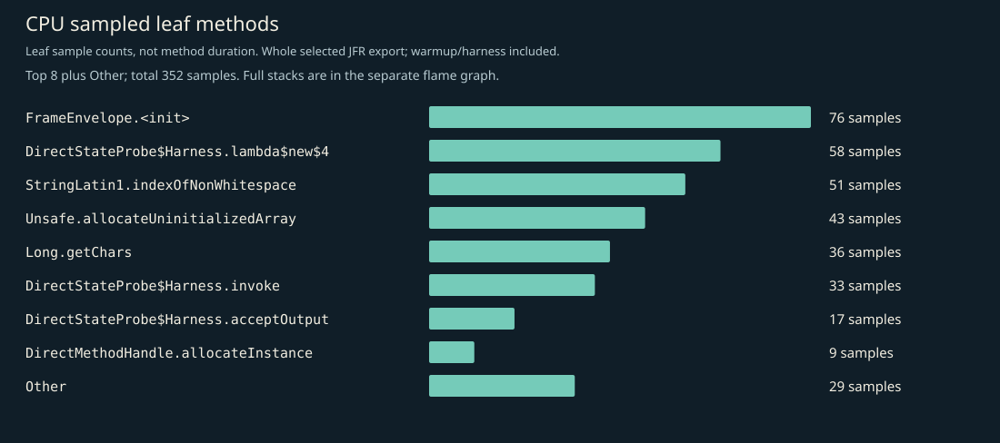
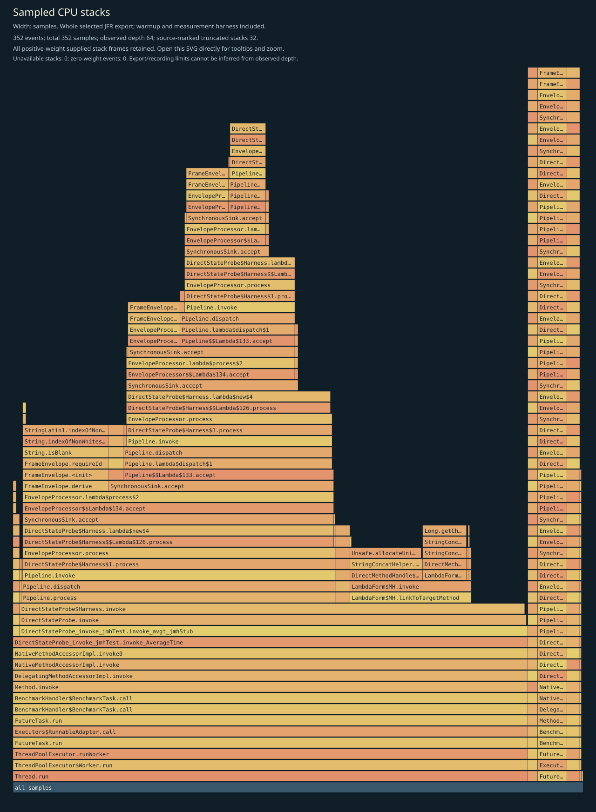
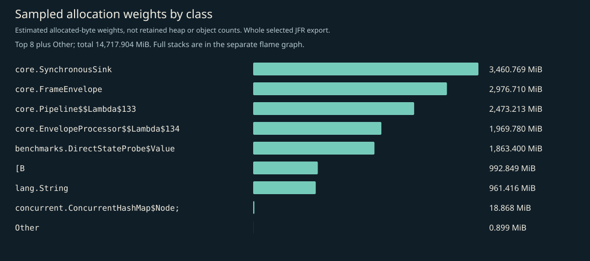
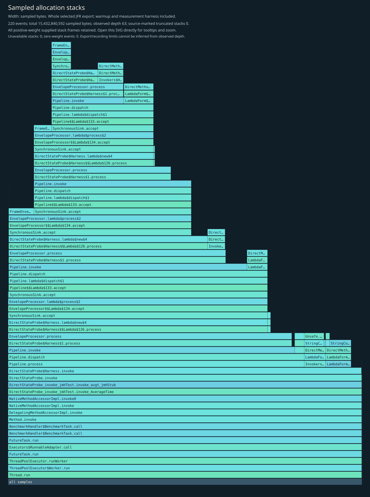
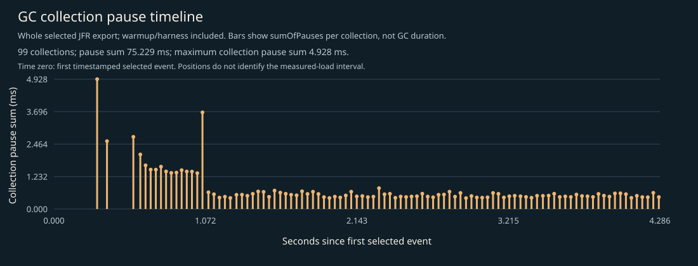

# CPU, allocation and GC profile

Independent instrumented Java 17 JMH diagnostic JVM, including startup, setup, two 1-second warmups, two 1-second measurements, harness and teardown. No phase filtering. CPU sampling requests 10ms; allocation sampling is throttled to 50 events/second; recording and export retain up to 64 frames. This is not main timing evidence, per-operation allocation, retained heap, method duration, p99 latency, RSS or production capacity.

## Complete supplied CPU stacks

Every positive-weight supplied stack frame is retained; zero-weight events have no area. Observed depth does not prove that the recording or export was unlimited. Source-marked truncation and unavailable stacks are shown on the figure. Open the SVG directly to inspect full method tooltips.

## CPU leaf samples

| Method | Samples |
|---|---:|
| `io.ominicat.core.FrameEnvelope.<init>` | 76 |
| `io.ominicat.benchmarks.DirectStateProbe$Harness.lambda$new$4` | 58 |
| `java.lang.StringLatin1.indexOfNonWhitespace` | 51 |
| `jdk.internal.misc.Unsafe.allocateUninitializedArray` | 43 |
| `java.lang.Long.getChars` | 36 |
| `io.ominicat.benchmarks.DirectStateProbe$Harness.invoke` | 33 |
| `io.ominicat.benchmarks.DirectStateProbe$Harness.acceptOutput` | 17 |
| `java.lang.invoke.DirectMethodHandle.allocateInstance` | 9 |
| `java.lang.Record.<init>` | 9 |
| `sun.security.provider.SHA2.implCompress0` | 2 |
| `java.lang.invoke.VarHandleByteArrayAsInts$ArrayHandle.get` | 2 |
| `io.ominicat.core.FrameEnvelope.derive` | 2 |

## Sampled allocation weights

Weights estimate sampled allocation distribution, not retained heap or exact object counts. Different fixed-duration loops can perform different operation counts. This probe has no exact latency array. Use formal paired JMH B/op for per-operation allocation.

| Class | Sampled weight (MiB) |
|---|---:|
| `io.ominicat.core.SynchronousSink` | 3,460.77 |
| `io.ominicat.core.FrameEnvelope` | 2,976.71 |
| `io.ominicat.core.Pipeline$$Lambda$133+0x00007fc334096030.284879437` | 2,473.21 |
| `io.ominicat.core.EnvelopeProcessor$$Lambda$134+0x00007fc334096258.1201448536` | 1,969.78 |
| `io.ominicat.benchmarks.DirectStateProbe$Value` | 1,863.40 |
| `[B` | 992.85 |
| `java.lang.String` | 961.42 |
| `[Ljava.util.concurrent.ConcurrentHashMap$Node;` | 18.87 |
| `java.util.ArrayList$Itr` | 0.37 |
| `java.util.zip.ZipFile$InflaterCleanupAction` | 0.23 |
| `java.util.HashMap` | 0.19 |
| `java.util.ArrayList` | 0.07 |

## Complete supplied allocation stacks

## GC and contention

- Garbage collections recorded: 99.
- Recorded GC pause sum: 75.229 ms; longest collection pause sum: 4.928 ms.
- Monitor contention events: 0; virtual-thread pinning events: not available on this runtime.
- GC positions are relative to the first timestamped selected event, not the JMH measurement start. The figure includes warmup/harness events. Collection pause sums are not whole GC durations.
- Zero sampled events does not prove absence. Sampling, event thresholds and workload duration limit these observations.

Evidence: [selected events, gzip JSON](jfr-events.json.gz), [diagnostic report](report.md).
Raw JFR is generated locally and intentionally excluded from Git; do not record real credentials or conversation payloads for public profiling.
