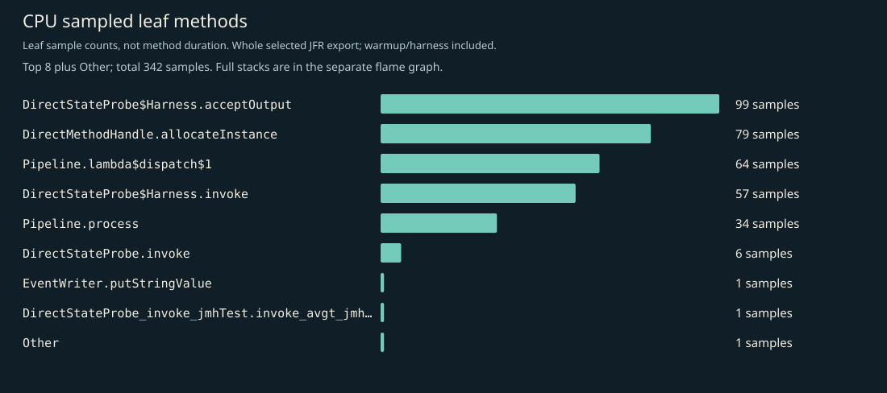
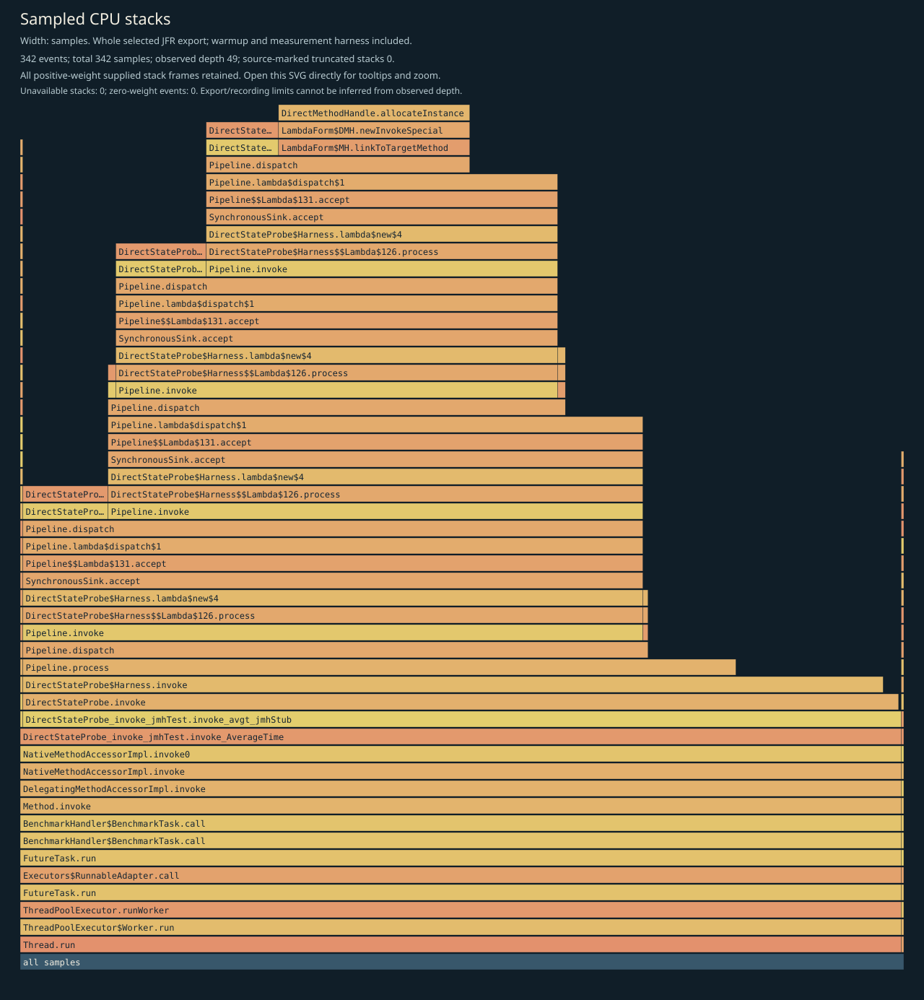
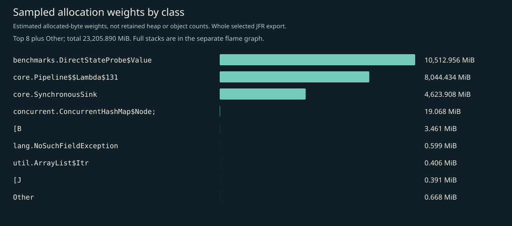
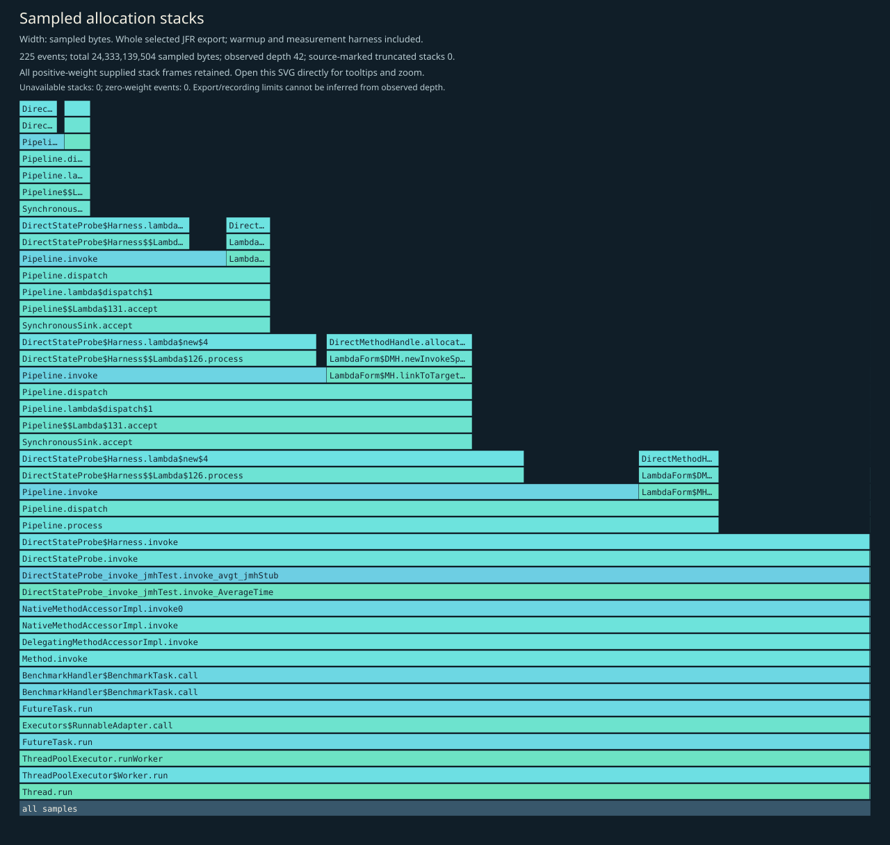
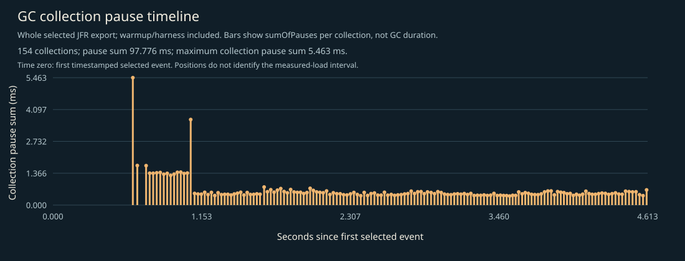

# CPU, allocation and GC profile

Independent instrumented Java 17 JMH diagnostic JVM, including startup, setup, two 1-second warmups, two 1-second measurements, harness and teardown. No phase filtering. CPU sampling requests 10ms; allocation sampling is throttled to 50 events/second; recording and export retain up to 64 frames. This is not main timing evidence, per-operation allocation, retained heap, method duration, p99 latency, RSS or production capacity.

## Complete supplied CPU stacks

Every positive-weight supplied stack frame is retained; zero-weight events have no area. Observed depth does not prove that the recording or export was unlimited. Source-marked truncation and unavailable stacks are shown on the figure. Open the SVG directly to inspect full method tooltips.

## CPU leaf samples

| Method | Samples |
|---|---:|
| `io.ominicat.benchmarks.DirectStateProbe$Harness.acceptOutput` | 99 |
| `java.lang.invoke.DirectMethodHandle.allocateInstance` | 79 |
| `io.ominicat.core.Pipeline.lambda$dispatch$1` | 64 |
| `io.ominicat.benchmarks.DirectStateProbe$Harness.invoke` | 57 |
| `io.ominicat.core.Pipeline.process` | 34 |
| `io.ominicat.benchmarks.DirectStateProbe.invoke` | 6 |
| `jdk.jfr.internal.EventWriter.putStringValue` | 1 |
| `io.ominicat.benchmarks.jmh_generated.DirectStateProbe_invoke_jmhTest.invoke_avgt_jmhStub` | 1 |
| `java.lang.invoke.LambdaForm$MH+0x00007fab10090400.130668770.invoke` | 1 |

## Sampled allocation weights

Weights estimate sampled allocation distribution, not retained heap or exact object counts. Different fixed-duration loops can perform different operation counts. This probe has no exact latency array. Use formal paired JMH B/op for per-operation allocation.

| Class | Sampled weight (MiB) |
|---|---:|
| `io.ominicat.benchmarks.DirectStateProbe$Value` | 10,512.96 |
| `io.ominicat.core.Pipeline$$Lambda$131+0x00007fab10095978.1805199446` | 8,044.43 |
| `io.ominicat.core.SynchronousSink` | 4,623.91 |
| `[Ljava.util.concurrent.ConcurrentHashMap$Node;` | 19.07 |
| `[B` | 3.46 |
| `java.lang.NoSuchFieldException` | 0.60 |
| `java.util.ArrayList$Itr` | 0.41 |
| `[J` | 0.39 |
| `java.security.Provider$UString` | 0.17 |
| `java.lang.StringBuilder` | 0.17 |
| `java.util.jar.JarFile$JarFileEntry` | 0.17 |
| `jdk.internal.ref.CleanerImpl$PhantomCleanableRef` | 0.09 |

## Complete supplied allocation stacks

## GC and contention

- Garbage collections recorded: 154.
- Recorded GC pause sum: 97.776 ms; longest collection pause sum: 5.463 ms.
- Monitor contention events: 0; virtual-thread pinning events: not available on this runtime.
- GC positions are relative to the first timestamped selected event, not the JMH measurement start. The figure includes warmup/harness events. Collection pause sums are not whole GC durations.
- Zero sampled events does not prove absence. Sampling, event thresholds and workload duration limit these observations.

Evidence: [selected events, gzip JSON](jfr-events.json.gz), [diagnostic report](report.md).
Raw JFR is generated locally and intentionally excluded from Git; do not record real credentials or conversation payloads for public profiling.
