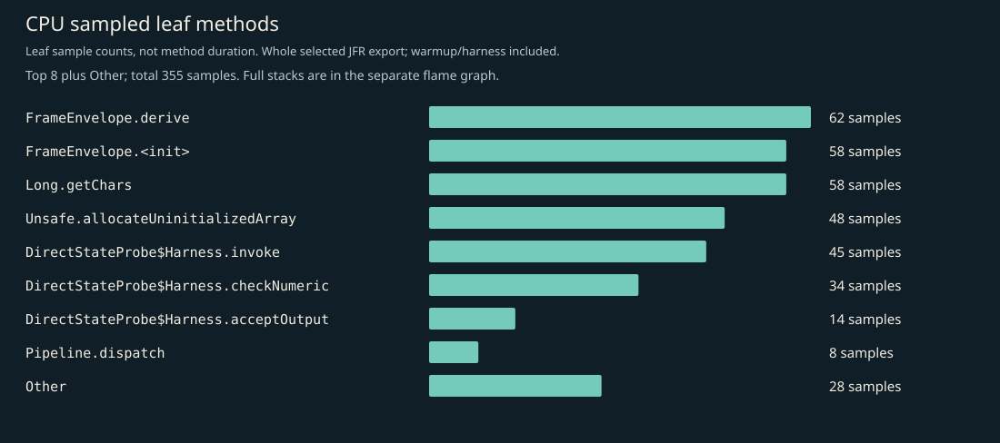
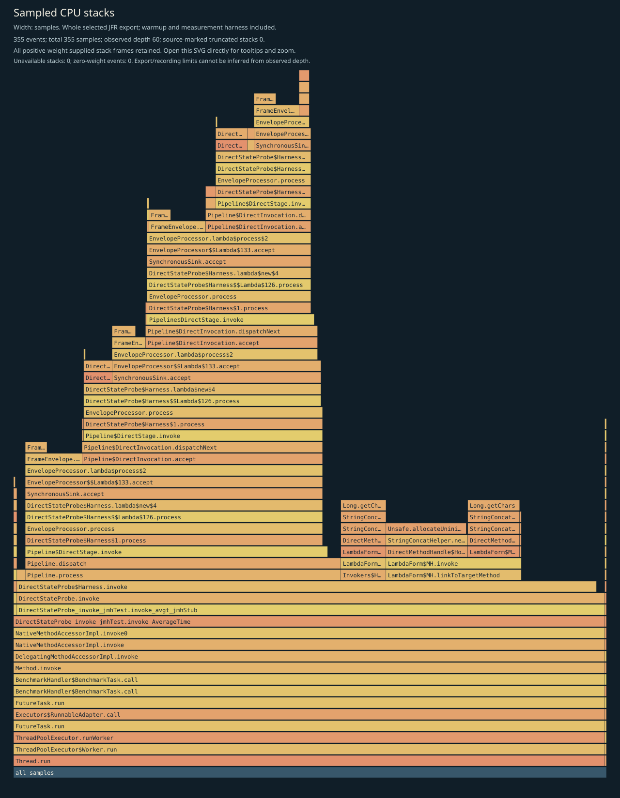
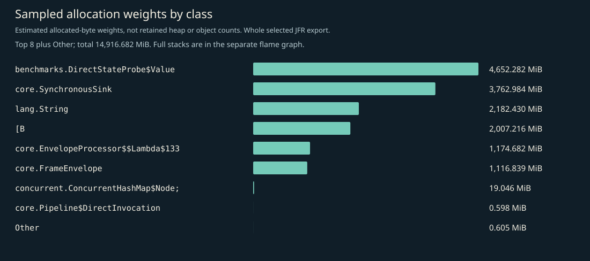
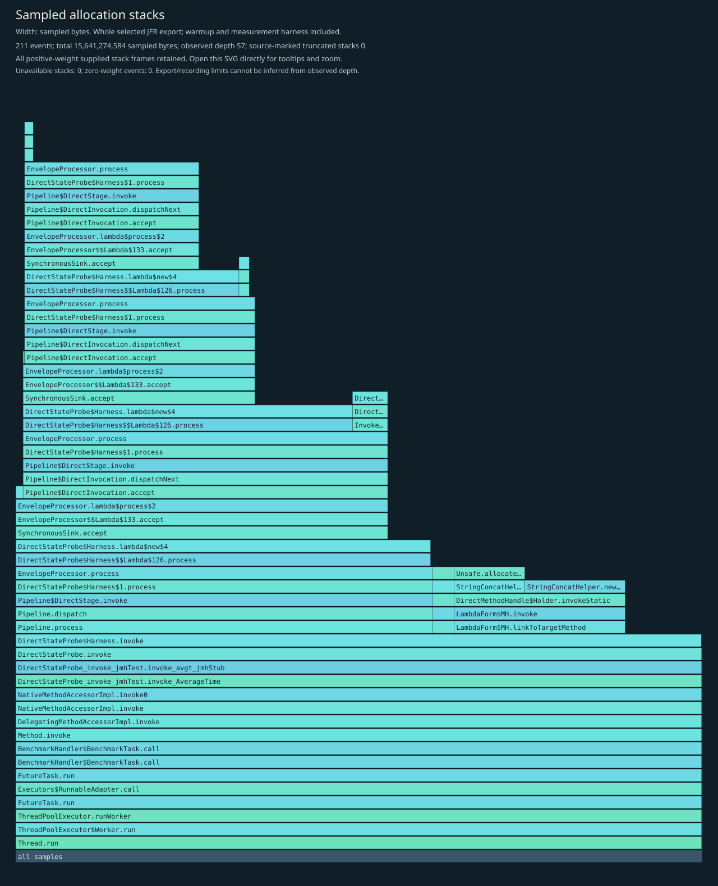
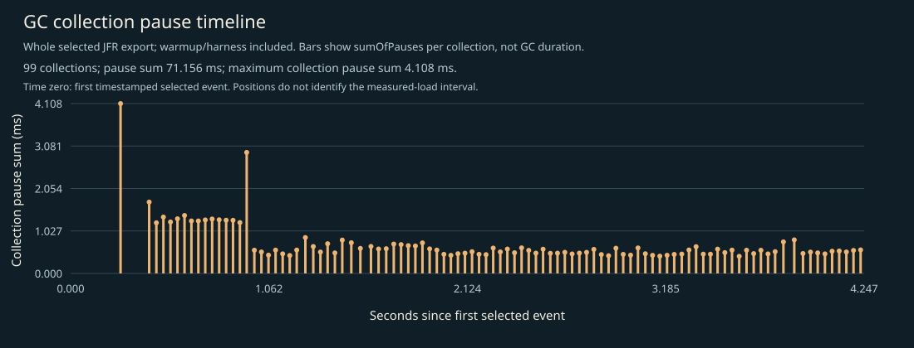

# CPU, allocation and GC profile

Independent instrumented Java 17 JMH diagnostic JVM, including startup, setup, two 1-second warmups, two 1-second measurements, harness and teardown. No phase filtering. CPU sampling requests 10ms; allocation sampling is throttled to 50 events/second; recording and export retain up to 64 frames. This is not main timing evidence, per-operation allocation, retained heap, method duration, p99 latency, RSS or production capacity.

## Complete supplied CPU stacks

Every positive-weight supplied stack frame is retained; zero-weight events have no area. Observed depth does not prove that the recording or export was unlimited. Source-marked truncation and unavailable stacks are shown on the figure. Open the SVG directly to inspect full method tooltips.

## CPU leaf samples

| Method | Samples |
|---|---:|
| `io.ominicat.core.FrameEnvelope.derive` | 62 |
| `io.ominicat.core.FrameEnvelope.<init>` | 58 |
| `java.lang.Long.getChars` | 58 |
| `jdk.internal.misc.Unsafe.allocateUninitializedArray` | 48 |
| `io.ominicat.benchmarks.DirectStateProbe$Harness.invoke` | 45 |
| `io.ominicat.benchmarks.DirectStateProbe$Harness.checkNumeric` | 34 |
| `io.ominicat.benchmarks.DirectStateProbe$Harness.acceptOutput` | 14 |
| `io.ominicat.core.Pipeline.dispatch` | 8 |
| `io.ominicat.core.Pipeline$DirectStage.invoke` | 5 |
| `io.ominicat.benchmarks.DirectStateProbe.invoke` | 5 |
| `java.lang.Record.<init>` | 4 |
| `io.ominicat.core.EnvelopeProcessor$$Lambda$133+0x00007fe240096698.2045829892.accept` | 3 |

## Sampled allocation weights

Weights estimate sampled allocation distribution, not retained heap or exact object counts. Different fixed-duration loops can perform different operation counts. This probe has no exact latency array. Use formal paired JMH B/op for per-operation allocation.

| Class | Sampled weight (MiB) |
|---|---:|
| `io.ominicat.benchmarks.DirectStateProbe$Value` | 4,652.28 |
| `io.ominicat.core.SynchronousSink` | 3,762.98 |
| `java.lang.String` | 2,182.43 |
| `[B` | 2,007.22 |
| `io.ominicat.core.EnvelopeProcessor$$Lambda$133+0x00007fe240096698.2045829892` | 1,174.68 |
| `io.ominicat.core.FrameEnvelope` | 1,116.84 |
| `[Ljava.util.concurrent.ConcurrentHashMap$Node;` | 19.05 |
| `io.ominicat.core.Pipeline$DirectInvocation` | 0.60 |
| `[C` | 0.41 |
| `jdk.internal.org.objectweb.asm.MethodWriter` | 0.20 |
| `java.util.concurrent.CopyOnWriteArrayList$COWIterator` | 0.00 |

## Complete supplied allocation stacks

## GC and contention

- Garbage collections recorded: 99.
- Recorded GC pause sum: 71.156 ms; longest collection pause sum: 4.108 ms.
- Monitor contention events: 0; virtual-thread pinning events: not available on this runtime.
- GC positions are relative to the first timestamped selected event, not the JMH measurement start. The figure includes warmup/harness events. Collection pause sums are not whole GC durations.
- Zero sampled events does not prove absence. Sampling, event thresholds and workload duration limit these observations.

Evidence: [selected events, gzip JSON](jfr-events.json.gz), [diagnostic report](report.md).
Raw JFR is generated locally and intentionally excluded from Git; do not record real credentials or conversation payloads for public profiling.
