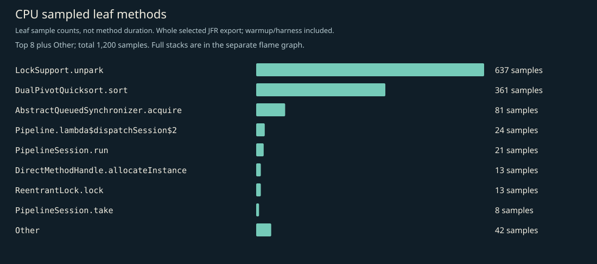
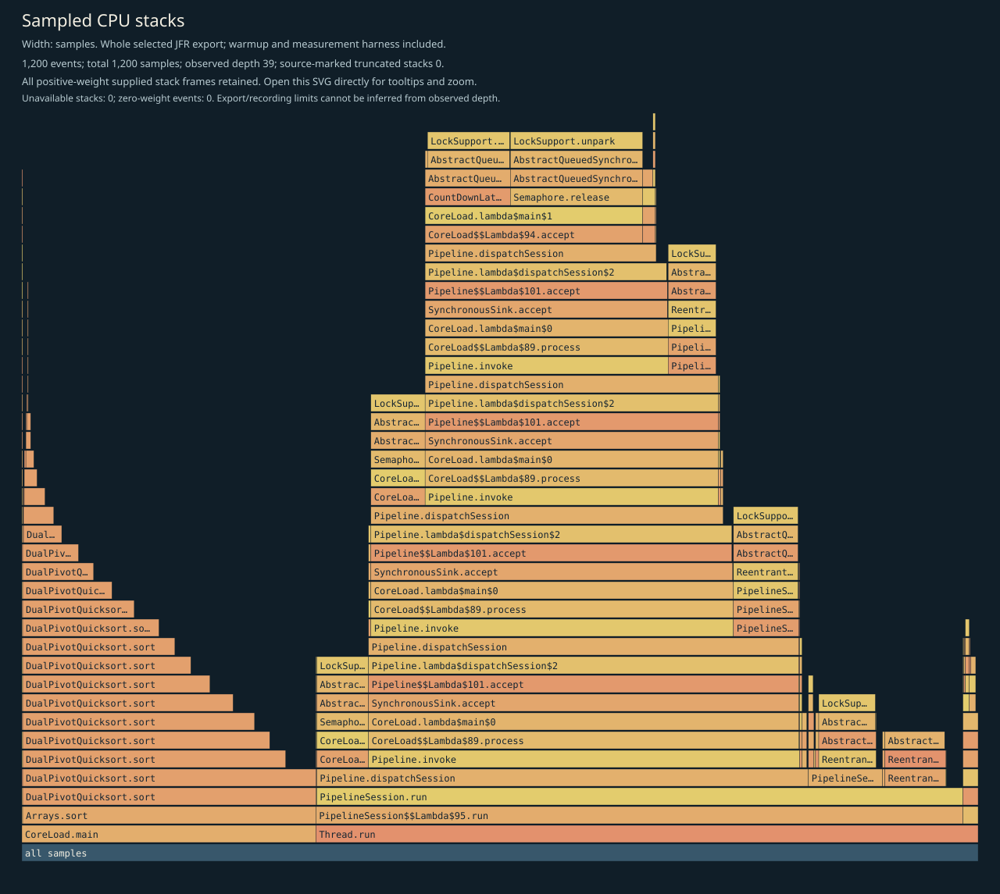
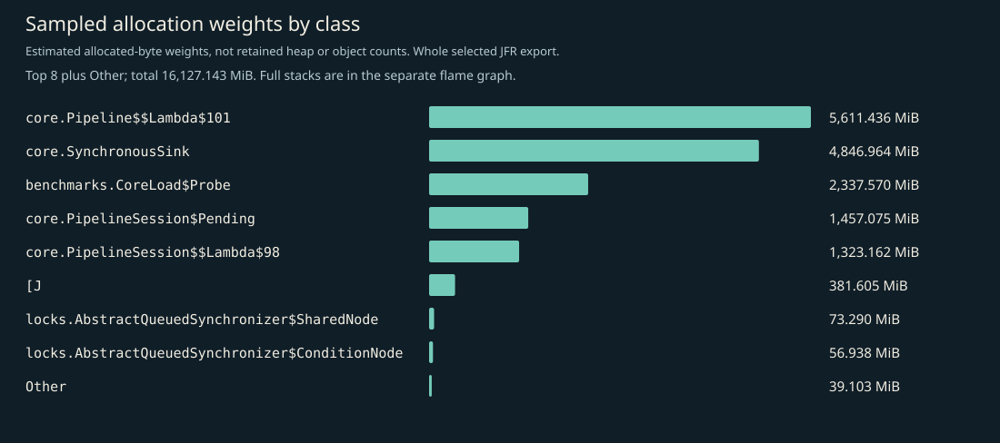
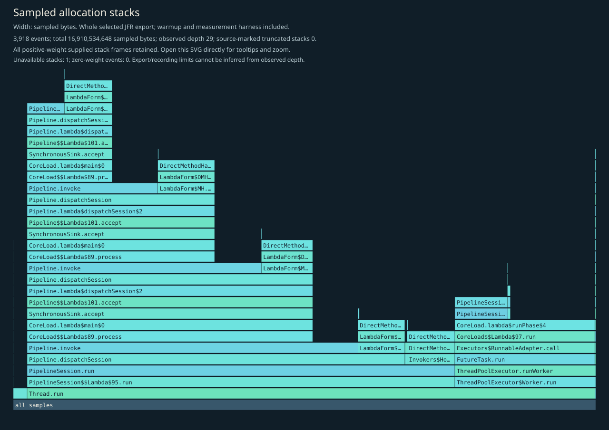
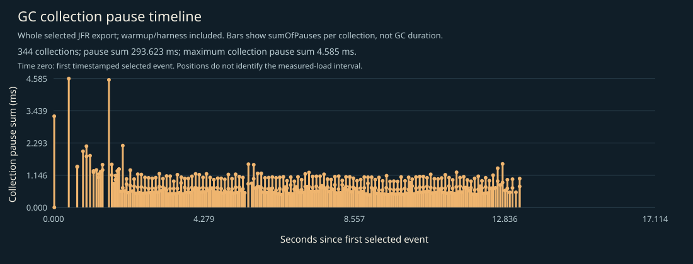

# CPU, allocation and GC profile

Generated from the selected JFR events for the bounded kernel load. Samples include the load harness and warmup; they are not a model or network profile.

## Complete supplied CPU stacks

Every positive-weight supplied stack frame is retained; zero-weight events have no area. Observed depth does not prove that the recording or export was unlimited. Source-marked truncation and unavailable stacks are shown on the figure. Open the SVG directly to inspect full method tooltips.

## CPU leaf samples

| Method | Samples |
|---|---:|
| `java.util.concurrent.locks.LockSupport.unpark` | 637 |
| `java.util.DualPivotQuicksort.sort` | 361 |
| `java.util.concurrent.locks.AbstractQueuedSynchronizer.acquire` | 81 |
| `io.ominicat.core.Pipeline.lambda$dispatchSession$2` | 24 |
| `io.ominicat.core.PipelineSession.run` | 21 |
| `java.lang.invoke.DirectMethodHandle.allocateInstance` | 13 |
| `java.util.concurrent.locks.ReentrantLock.lock` | 13 |
| `io.ominicat.core.PipelineSession.take` | 8 |
| `java.util.DualPivotQuicksort.mixedInsertionSort` | 7 |
| `io.ominicat.core.Pipeline.dispatchSession` | 5 |
| `java.lang.Thread.interrupted` | 4 |
| `io.ominicat.benchmarks.CoreLoad.lambda$runPhase$4` | 3 |

## Sampled allocation weights

Weights estimate sampled allocation distribution, not retained heap or exact object counts. The harness retains an exact latency array; its `long[]` allocation is intentionally visible. Use JMH `gc.alloc.rate.norm` for per-operation allocation estimates.

| Class | Sampled weight (MiB) |
|---|---:|
| `io.ominicat.core.Pipeline$$Lambda$101+0x00007b312c014000.320929598` | 5,611.44 |
| `io.ominicat.core.SynchronousSink` | 4,846.96 |
| `io.ominicat.benchmarks.CoreLoad$Probe` | 2,337.57 |
| `io.ominicat.core.PipelineSession$Pending` | 1,457.07 |
| `io.ominicat.core.PipelineSession$$Lambda$98+0x00007b312c00fa10.342683394` | 1,323.16 |
| `[J` | 381.61 |
| `java.util.concurrent.locks.AbstractQueuedSynchronizer$SharedNode` | 73.29 |
| `java.util.concurrent.locks.AbstractQueuedSynchronizer$ConditionNode` | 56.94 |
| `[C` | 19.12 |
| `java.util.concurrent.locks.AbstractQueuedSynchronizer$ExclusiveNode` | 8.10 |
| `java.lang.InterruptedException` | 6.20 |
| `java.util.LinkedHashMap$LinkedKeySet` | 4.75 |

## Complete supplied allocation stacks

## GC and contention

- Garbage collections recorded: 344.
- Recorded GC pause sum: 293.623 ms; longest collection pause sum: 4.585 ms.
- Monitor contention events: 0; virtual-thread pinning events: not available on this runtime.
- GC positions are relative to the first timestamped selected event, not the measured-load start. The figure includes warmup/harness events. Collection pause sums are not whole GC durations.
- Zero sampled events does not prove absence. Sampling, event thresholds and workload duration limit these observations.

Evidence: [selected events, gzip JSON](jfr-events.json.gz), [measurement report](report.md).
Raw JFR is generated locally and intentionally excluded from Git; do not record real credentials or conversation payloads for public profiling.

[GC log](gc.log).
